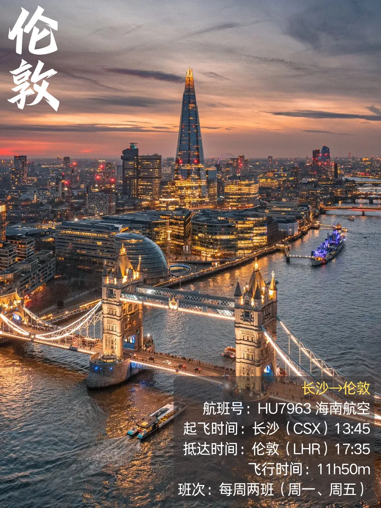

Mezinárodní letiště Čchang-ša Chuang-chua (kód letiště **CSX**) leží ve městě Chuang-chua v okrese Čchang-ša a je významnou mezinárodní branou do střední Číny; v provozu jsou dva terminály (T1 a T2). Z města je letiště spojeno **maglevem v Čchang-ša**, který navazuje na Jižní nádraží vysokorychlostních vlaků Čchang-ša, a jezdí sem také **linka metra 6**.

Na které mezinárodní a regionální destinace se tedy z Čchang-ša dostanete **bez přestupu**? Tento seznam vychází z jízdních řádů, které původní materiál zveřejnil pro **zimní sezónu 2025–26 (únor–březen 2026)**: **15 tras** pokrývajících jihovýchodní Asii, severovýchodní Asii, Evropu a Afriku. **Trasy a frekvence se každou sezónu mění**, proto si před rezervací u aerolinie ověřte aktuální jízdní řád — jak na to, najdete na konci.

## 1. Trasy na první pohled

Podle země a regionu:

| Země / region | Destinace | Aerolinie | Frekvence |
| --- | --- | --- | --- |
| Myanmar | Rangún (RGN) | Myanmar Airways International | Dvakrát týdně (úterý, sobota) |
| Thajsko | Bangkok (DMK) | Thai AirAsia, Thai Lion Air | Dvakrát denně |
| Thajsko | Bangkok (BKK) | XiamenAir | Denně do 28. února 2026 |
| Thajsko | Phuket (HKT) | Thai Lion Air | Třikrát týdně do 2. března 2026 |
| Spojené království | Londýn (LHR) | Hainan Airlines | Dvakrát týdně (pondělí, pátek) |
| Jižní Korea | Soul (ICN) | China Southern, Korean Air, Asiana | Dvakrát denně |
| Hongkong (Čína) | Hongkong (HKG) | Cathay Pacific | Denně do 28. března 2026 |
| Malajsie | Kuala Lumpur (KUL) | China Southern, AirAsia X, XiamenAir, Batik Air | 2–4krát denně |
| Singapur | Singapur (SIN) | China Southern, China Eastern, Scoot | Dvakrát denně |
| Kambodža | Phnom Penh (KTI) | Cambodia Airways, Sky Angkor Airways | Pětkrát týdně |
| Indonésie | Jakarta (CGK) | Citilink | Středy, 11. února – 4. března 2026 |
| Vietnam | Ho Či Minovo Město (SGN) | China Southern | Třikrát týdně do 28. února 2026 (út, čt, so) |
| Vietnam | Hanoj (HAN) | China Southern | Pětkrát týdně |
| Laos | Vientiane (VTE) | Lao Airlines | Třikrát týdně do 28. března 2026 |
| Keňa | Nairobi (NBO) | China Southern | 2–3krát týdně |

## 2. Trasa po trase

### Myanmar: Rangún (RGN)

Myanmar Airways International létá trasu Čchang-ša–Rangún jako **8M721**: odlet z Čchang-ša ve 22:35, přistání v 00:45 následujícího dne, 3 hodiny 40 minut ve vzduchu, **dvakrát týdně (v úterý a v sobotu)**. Je to noční přelet, díky kterému můžete hned druhý den ráno vyrazit k pagodě Šwedagon.

### Thajsko: Bangkok (DMK a BKK) a Phuket (HKT)

Thajsko má z Čchang-ša nejhustší spojení ze všech destinací, rozdělené mezi tři letiště:

- **Bangkok Don Mueang (DMK)**: Thai AirAsia a Thai Lion Air, lety **FD481 a SL935**, odlet z Čchang-ša ve 12:55 a přílet v 15:20, případně odlet ve 14:35 a přílet v 17:05, 3 hodiny 30 minut, **dvakrát denně**;
- **Bangkok Suvarnabhumi (BKK)**: XiamenAir, let **MF8643**, odlet z Čchang-ša v 08:30 a přílet v 11:05, 3 hodiny 35 minut, **denně do 28. února 2026** — ranní odlet, který vás do Bangkoku dostane v poledne;
- **Phuket (HKT)**: Thai Lion Air, let **SL969**, odlet z Čchang-ša v 17:20 a přílet ve 20:35, 4 hodiny 15 minut, **třikrát týdně do 2. března 2026**, přímo na ostrovy.

### Spojené království: Londýn (LHR)

Hainan Airlines létá trasu Čchang-ša–Londýn Heathrow jako **HU7963**: odlet z Čchang-ša ve 13:45 a přistání na Heathrow v 17:35 místního času, 11 hodin 50 minut, **dvakrát týdně (v pondělí a v pátek)**. Je to jediná přímá trasa z Čchang-ša do Evropy — ta, kterou byste měli znát, pokud ve Velké Británii studujete nebo pracujete.

### Jižní Korea: Soul (ICN)

China Southern, Korean Air a Asiana létají trasu Čchang-ša–Soul Inčchon, lety **CZ3065 / KE146 / KE820 / OZ322**: odlet z Čchang-ša ve 12:55 a přílet v 17:00, přibližně 4 hodiny, **dvakrát denně**. S třemi dopravci na trase je prostor porovnat ceny a měnit termíny.

### Hongkong (Čína): Hongkong (HKG)

Cathay Pacific létá trasu Čchang-ša–Hongkong jako **CX943 a CX927**: odlet z Čchang-ša ve 21:15 a přílet ve 22:55, 1 hodina 40 minut, **denně do 28. března 2026**. Pozdní přílet pěkně navazuje na dálkové odlety Cathay následujícího rána.

### Malajsie: Kuala Lumpur (KUL)

China Southern, AirAsia X, XiamenAir a Batik Air létají trasu Čchang-ša–Kuala Lumpur, lety **CZ5049, D7353, MF8015 a OD643**: odlet z Čchang-ša v 11:50 a přílet v 16:20, 4 hodiny 30 minut, **2–4krát denně**. S takovým množstvím spojů nebývá změna termínu na poslední chvíli problém.

### Singapur: Singapur (SIN)

China Southern, China Eastern a Scoot létají trasu Čchang-ša–Singapur, lety **CZ5021, MU2045 a TR125**: odlet z Čchang-ša v 00:05 a přílet ve 04:40, 4 hodiny 35 minut, **dvakrát denně**. Jde o noční odlety, po kterých přistanete včas na celý první den.

### Kambodža: Phnom Penh (KTI)

Cambodia Airways a Sky Angkor Airways létají trasu Čchang-ša–Phnom Penh, lety **KR942 a ZA638**: odlet z Čchang-ša ve 12:15 a přílet ve 14:30, 3 hodiny 15 minut, **pětkrát týdně**. Odpolední odlet i odpolední přílet — nejcivilizovanější čas v tomto seznamu.

### Indonésie: Jakarta (CGK)

Citilink létá trasu Čchang-ša–Jakarta jako **QG8837**: odlet z Čchang-ša v 01:30 a přílet v 06:20, 5 hodin 50 minut, **každou středu od 11. února do 4. března 2026**.

### Vietnam: Ho Či Minovo Město (SGN) a Hanoj (HAN)

- **Ho Či Minovo Město**: China Southern, let **CZ6061**, odlet z Čchang-ša ve 23:20 a přílet v 01:55 následujícího dne, 3 hodiny 35 minut, **třikrát týdně do 28. února 2026 (úterý, čtvrtek, sobota)**;
- **Hanoj**: China Southern, let **CZ8359**, odlet z Čchang-ša v 18:00 a přílet v 19:20, 2 hodiny 20 minut, **pětkrát týdně** — nejkratší let v seznamu, odlet před večeří a přílet po ní.

### Laos: Vientiane (VTE)

Lao Airlines létá trasu Čchang-ša–Vientiane jako **QV856**: odlet z Čchang-ša v 18:10 a přílet v 19:25, 2 hodiny 15 minut, **třikrát týdně do 28. března 2026**.

### Keňa: Nairobi (NBO)

China Southern létá trasu Čchang-ša–Nairobi jako **CZ6043**: odlet z Čchang-ša v 00:50 a přílet v 06:50, 11 hodin ve vzduchu, **2–3krát týdně**. Je to jediná přímá trasa z Čchang-ša do Afriky a nejdelší let v tomto seznamu.

## 3. Jízdní řády se mění: jak si je před letem ověřit

Výše uvedené frekvence a časy pocházejí z jízdního řádu původního materiálu pro **zimní sezónu 2025–26 (únor–březen 2026)** a u několika z nich je výslovně uvedeno datum „do“. **Aerolinie upravují trasy a časy každou sezónu (na konci března a na konci října)** a trasa může změnit dopravce i letiště — pamatujte, že Bangkok má dvě letiště, **BKK (Suvarnabhumi)** a **DMK (Don Mueang)**, vzdálená asi 30 km.

Před cestou:

1. Hledejte na **webu nebo v aplikaci samotné aerolinie** konkrétní datum, místo abyste se spoléhali na shrnutí typu „tolik letů týdně“;
2. Zkontrolujte číslo letu, terminál a časy na **rezervačním portálu**;
3. Den před odletem si znovu ověřte **stav letu** — zpoždění, změny terminálu i výměna letadla ovlivňují, kde se odbavíte;
4. Čtěte pozorně kód letiště: BKK a DMK nejsou při přestupech ani při vyzvednutí zaměnitelné.

Zdroj obrázků: plakáty tras z původního materiálu. Jízdní řády jsou zimní informace onoho materiálu; rozhodující jsou aktuální oznámení aerolinií a letišť pro daný den.

## Související odkazy

- **Na tomto webu (letiště)**: [Bangkok Suvarnabhumi (BKK)](/airport/BKK), [Soul Inčchon (ICN)](/airport/ICN), [Hongkong (HKG)](/airport/HKG), [Kuala Lumpur (KUL)](/airport/KUL), [Londýn Heathrow (LHR)](/airport/LHR), [Singapur Changi (SIN)](/airport/SIN), [Ho Či Minovo Město Tan Son Nhat (SGN)](/airport/SGN), [Jakarta (CGK)](/airport/CGK)
- **Na tomto webu (země)**: [Čína (CN)](/country/CN), [Thajsko (TH)](/country/TH), [Jižní Korea (KR)](/country/KR), [Singapur (SG)](/country/SG), [Spojené království (GB)](/country/GB), [Malajsie (MY)](/country/MY), [Vietnam (VN)](/country/VN), [Indonésie (ID)](/country/ID), [Myanmar (MM)](/country/MM), [Keňa (KE)](/country/KE)
- **Wikipedia**: [Mezinárodní letiště Čchang-ša Chuang-chua](https://en.wikipedia.org/wiki/Changsha_Huanghua_International_Airport)
- **Baidu Baike**: [Mezinárodní letiště Čchang-ša Chuang-chua](https://baike.baidu.com/item/%E9%95%BF%E6%B2%99%E9%BB%84%E8%8A%B1%E5%9B%BD%E9%99%85%E6%9C%BA%E5%9C%BA)
