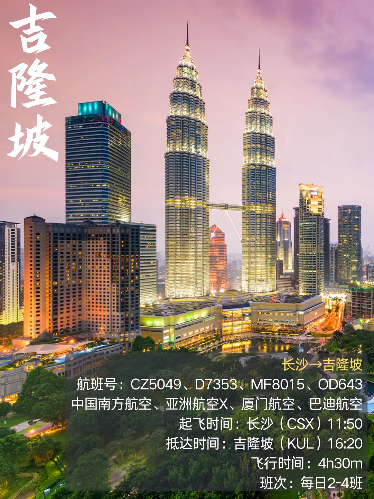

Bandara Internasional Changsha Huanghua (kode bandara **CSX**) terletak di kota Huanghua, Kabupaten Changsha, dan merupakan gerbang internasional utama bagi Tiongkok tengah, dengan dua terminal yang beroperasi (T1 dan T2). Dari kota, **maglev Changsha** terhubung ke stasiun kereta cepat Changsha Selatan dan **Metro jalur 6** melayani bandara.

Jadi destinasi internasional dan regional mana yang dapat Anda capai **tanpa transit** dari Changsha? Daftar ini disusun dari jadwal yang diterbitkan materi asli untuk **musim dingin 2025–26 (Februari–Maret 2026)**: **15 rute** yang mencakup Asia Tenggara, Asia Timur Laut, Eropa, dan Afrika. **Rute dan frekuensi berubah setiap musim**, jadi konfirmasikan jadwal terkini dengan maskapai sebelum Anda memesan — caranya ada di bagian akhir.

## 1. Rute sekilas

Menurut negara dan kawasan:

| Negara / kawasan | Destinasi | Maskapai | Frekuensi |
| --- | --- | --- | --- |
| Myanmar | Yangon (RGN) | Myanmar Airways International | Dua kali seminggu (Selasa, Sabtu) |
| Thailand | Bangkok (DMK) | Thai AirAsia, Thai Lion Air | Dua kali sehari |
| Thailand | Bangkok (BKK) | XiamenAir | Harian hingga 28 Feb 2026 |
| Thailand | Phuket (HKT) | Thai Lion Air | Tiga kali seminggu hingga 2 Mar 2026 |
| Inggris | London (LHR) | Hainan Airlines | Dua kali seminggu (Senin, Jumat) |
| Korea Selatan | Seoul (ICN) | China Southern, Korean Air, Asiana | Dua kali sehari |
| Hong Kong, Tiongkok | Hong Kong (HKG) | Cathay Pacific | Harian hingga 28 Mar 2026 |
| Malaysia | Kuala Lumpur (KUL) | China Southern, AirAsia X, XiamenAir, Batik Air | 2–4 kali sehari |
| Singapura | Singapura (SIN) | China Southern, China Eastern, Scoot | Dua kali sehari |
| Kamboja | Phnom Penh (KTI) | Cambodia Airways, Sky Angkor Airways | Lima kali seminggu |
| Indonesia | Jakarta (CGK) | Citilink | Rabu, 11 Feb – 4 Mar 2026 |
| Vietnam | Kota Ho Chi Minh (SGN) | China Southern | Tiga kali seminggu hingga 28 Feb 2026 (Sel, Kam, Sab) |
| Vietnam | Hanoi (HAN) | China Southern | Lima kali seminggu |
| Laos | Vientiane (VTE) | Lao Airlines | Tiga kali seminggu hingga 28 Mar 2026 |
| Kenya | Nairobi (NBO) | China Southern | 2–3 kali seminggu |

## 2. Rute demi rute

### Myanmar: Yangon (RGN)

Myanmar Airways International menerbangkan rute Changsha–Yangon sebagai **8M721**: berangkat dari Changsha pukul 22.35 dan mendarat pukul 00.45 keesokan harinya, 3 jam 40 menit di udara, **dua kali seminggu (Selasa dan Sabtu)**. Ini penerbangan semalam, yang membuat Anda siap mengunjungi Pagoda Shwedagon pagi-pagi keesokan harinya.

### Thailand: Bangkok (DMK dan BKK) dan Phuket (HKT)

Thailand memiliki layanan terpadat dibandingkan destinasi mana pun dari Changsha, terbagi di tiga bandara:

- **Bangkok Don Mueang (DMK)**: Thai AirAsia dan Thai Lion Air, penerbangan **FD481 dan SL935**, berangkat dari Changsha pukul 12.55 dan tiba 15.20, atau berangkat 14.35 dan tiba 17.05, 3 jam 30 menit, **dua kali sehari**;
- **Bangkok Suvarnabhumi (BKK)**: XiamenAir, penerbangan **MF8643**, berangkat dari Changsha pukul 08.30 dan tiba 11.05, 3 jam 35 menit, **harian hingga 28 Februari 2026** — keberangkatan pagi yang menempatkan Anda di Bangkok pada tengah hari;
- **Phuket (HKT)**: Thai Lion Air, penerbangan **SL969**, berangkat dari Changsha 17.20 dan tiba 20.35, 4 jam 15 menit, **tiga kali seminggu hingga 2 Maret 2026**, langsung ke kepulauan.

### Inggris: London (LHR)

Hainan Airlines menerbangkan rute Changsha–London Heathrow sebagai **HU7963**: berangkat dari Changsha 13.45 dan mendarat di Heathrow pukul 17.35 waktu setempat, 11 jam 50 menit, **dua kali seminggu (Senin dan Jumat)**. Ini satu-satunya rute langsung Changsha ke Eropa — rute yang perlu Anda ketahui jika Anda belajar atau bekerja di Inggris.

### Korea Selatan: Seoul (ICN)

China Southern, Korean Air, dan Asiana sama-sama menerbangkan rute Changsha–Seoul Incheon, penerbangan **CZ3065 / KE146 / KE820 / OZ322**: berangkat dari Changsha 12.55 dan tiba 17.00, sekitar 4 jam, **dua kali sehari**. Dengan tiga maskapai di rute ini, ada ruang untuk membandingkan tarif dan mengubah tanggal.

### Hong Kong, Tiongkok: Hong Kong (HKG)

Cathay Pacific menerbangkan rute Changsha–Hong Kong sebagai **CX943 dan CX927**: berangkat dari Changsha 21.15 dan tiba 22.55, 1 jam 40 menit, **harian hingga 28 Maret 2026**. Kedatangan larut malam itu selaras dengan keberangkatan jarak jauh Cathay pagi berikutnya.

### Malaysia: Kuala Lumpur (KUL)

China Southern, AirAsia X, XiamenAir, dan Batik Air menerbangkan rute Changsha–Kuala Lumpur, penerbangan **CZ5049, D7353, MF8015, dan OD643**: berangkat dari Changsha 11.50 dan tiba 16.20, 4 jam 30 menit, **2–4 kali sehari**. Dengan layanan sebanyak itu, mengubah tanggal pada waktu singkat jarang menjadi masalah.

### Singapura: Singapura (SIN)

China Southern, China Eastern, dan Scoot menerbangkan rute Changsha–Singapura, penerbangan **CZ5021, MU2045, dan TR125**: berangkat dari Changsha 00.05 dan tiba 04.40, 4 jam 35 menit, **dua kali sehari**. Ini keberangkatan tengah malam, yang membuat Anda mendarat tepat waktu untuk menjalani hari pertama secara penuh.

### Kamboja: Phnom Penh (KTI)

Cambodia Airways dan Sky Angkor Airways menerbangkan rute Changsha–Phnom Penh, penerbangan **KR942 dan ZA638**: berangkat dari Changsha 12.15 dan tiba 14.30, 3 jam 15 menit, **lima kali seminggu**. Keberangkatan sore dengan kedatangan sore — waktu paling nyaman dalam daftar ini.

### Indonesia: Jakarta (CGK)

Citilink menerbangkan rute Changsha–Jakarta sebagai **QG8837**: berangkat dari Changsha 01.30 dan tiba 06.20, 5 jam 50 menit, **mingguan pada hari Rabu antara 11 Februari dan 4 Maret 2026**.

### Vietnam: Kota Ho Chi Minh (SGN) dan Hanoi (HAN)

- **Kota Ho Chi Minh**: China Southern, penerbangan **CZ6061**, berangkat dari Changsha 23.20 dan tiba 01.55 keesokan harinya, 3 jam 35 menit, **tiga kali seminggu hingga 28 Februari 2026 (Selasa, Kamis, Sabtu)**;
- **Hanoi**: China Southern, penerbangan **CZ8359**, berangkat dari Changsha 18.00 dan tiba 19.20, 2 jam 20 menit, **lima kali seminggu** — penerbangan terpendek dalam daftar ini, berangkat sebelum makan malam dan tiba setelahnya.

### Laos: Vientiane (VTE)

Lao Airlines menerbangkan rute Changsha–Vientiane sebagai **QV856**: berangkat dari Changsha 18.10 dan tiba 19.25, 2 jam 15 menit, **tiga kali seminggu hingga 28 Maret 2026**.

### Kenya: Nairobi (NBO)

China Southern menerbangkan rute Changsha–Nairobi sebagai **CZ6043**: berangkat dari Changsha 00.50 dan tiba 06.50, 11 jam di udara, **2–3 kali seminggu**. Ini satu-satunya rute langsung Changsha ke Afrika, dan penerbangan terpanjang dalam daftar ini.

## 3. Jadwal berubah: cara memeriksa sebelum terbang

Frekuensi dan waktu di atas berasal dari jadwal **musim dingin 2025–26 (Februari–Maret 2026)** dalam materi asli, dan beberapa di antaranya mencantumkan tanggal “hingga” yang eksplisit. **Maskapai merevisi rute dan waktu setiap musim (pada akhir Maret dan akhir Oktober)**, dan sebuah rute dapat berganti maskapai atau bandara — perhatikan bahwa Bangkok memiliki dua bandara, **BKK (Suvarnabhumi)** dan **DMK (Don Mueang)**, yang berjarak sekitar 30 km.

Sebelum Anda bepergian:

1. Cari di **situs web atau aplikasi maskapai sendiri** untuk tanggal pasti Anda, bukan mengandalkan ringkasan “sekian penerbangan per minggu”;
2. Periksa silang nomor penerbangan, terminal, dan waktu di **situs pemesanan**;
3. Periksa ulang **status penerbangan** sehari sebelumnya — penundaan, perubahan terminal, dan penggantian pesawat semuanya memengaruhi tempat Anda check-in;
4. Baca kode bandara dengan cermat: BKK dan DMK tidak dapat dipertukarkan untuk koneksi atau penjemputan.

Sumber gambar: poster rute dari materi asli. Jadwal adalah informasi musim dingin materi tersebut; pengumuman maskapai dan bandara pada hari itu adalah yang definitif.

## Tautan terkait

- **Di situs ini (bandara)**: [Bangkok Suvarnabhumi (BKK)](/airport/BKK), [Seoul Incheon (ICN)](/airport/ICN), [Hong Kong (HKG)](/airport/HKG), [Kuala Lumpur (KUL)](/airport/KUL), [London Heathrow (LHR)](/airport/LHR), [Singapura Changi (SIN)](/airport/SIN), [Kota Ho Chi Minh Tan Son Nhat (SGN)](/airport/SGN), [Jakarta (CGK)](/airport/CGK)
- **Di situs ini (negara)**: [Tiongkok (CN)](/country/CN), [Thailand (TH)](/country/TH), [Korea Selatan (KR)](/country/KR), [Singapura (SG)](/country/SG), [Inggris (GB)](/country/GB), [Malaysia (MY)](/country/MY), [Vietnam (VN)](/country/VN), [Indonesia (ID)](/country/ID), [Myanmar (MM)](/country/MM), [Kenya (KE)](/country/KE)
- **Wikipedia**: [Bandara Internasional Changsha Huanghua](https://en.wikipedia.org/wiki/Changsha_Huanghua_International_Airport)
- **Baidu Baike**: [Bandara Internasional Changsha Huanghua](https://baike.baidu.com/item/%E9%95%BF%E6%B2%99%E9%BB%84%E8%8A%B1%E5%9B%BD%E9%99%85%E6%9C%BA%E5%9C%BA)
