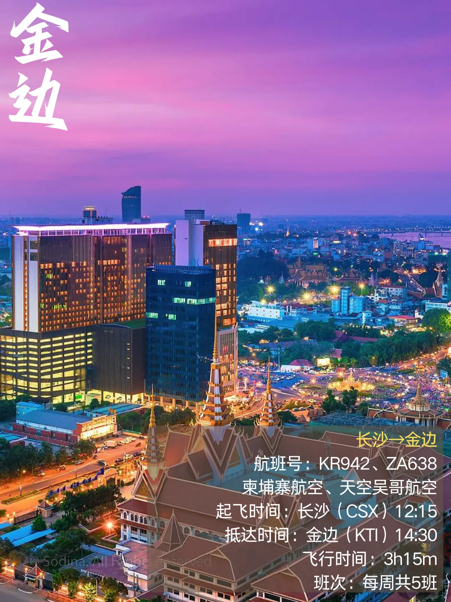

長沙黄花国際空港（空港コード**CSX**）は長沙県黄花鎮にあり、中国中部の主要な国際玄関口です。ターミナルはT1とT2の2つが稼働しています。市街地からは**長沙磁浮（マグレブ）**が長沙南高速鉄道駅に接続し、**地下鉄6号線**も空港まで乗り入れています。

では、長沙から**乗り継ぎなし**で行ける国際・地域路線には何があるのでしょうか。このリストは、元資料が**2025〜26年冬ダイヤ（2026年2〜3月）**向けに公開したスケジュールをもとにまとめたもので、東南アジア、北東アジア、ヨーロッパ、アフリカにまたがる**15路線**です。**路線と運航頻度はシーズンごとに変わる**ため、予約前に航空会社で最新の時刻表を確認してください。確認の方法は最後に説明します。

## 1. 路線一覧

国・地域別に見ると次のとおりです。

| 国・地域 | 目的地 | 航空会社 | 運航頻度 |
| --- | --- | --- | --- |
| ミャンマー | ヤンゴン (RGN) | ミャンマー・エアウェイズ・インターナショナル | 週2便（火曜、土曜） |
| タイ | バンコク (DMK) | タイ・エアアジア、タイ・ライオン・エア | 1日2便 |
| タイ | バンコク (BKK) | 廈門航空 | 2026年2月28日まで毎日 |
| タイ | プーケット (HKT) | タイ・ライオン・エア | 2026年3月2日まで週3便 |
| 英国 | ロンドン (LHR) | 海南航空 | 週2便（月曜、金曜） |
| 韓国 | ソウル (ICN) | 中国南方航空、大韓航空、アシアナ航空 | 1日2便 |
| 中国・香港 | 香港 (HKG) | キャセイパシフィック航空 | 2026年3月28日まで毎日 |
| マレーシア | クアラルンプール (KUL) | 中国南方航空、エアアジアX、廈門航空、バティック・エア | 1日2〜4便 |
| シンガポール | シンガポール (SIN) | 中国南方航空、中国東方航空、スクート | 1日2便 |
| カンボジア | プノンペン (KTI) | カンボジア航空、スカイアンコール航空 | 週5便 |
| インドネシア | ジャカルタ (CGK) | シティリンク | 2026年2月11日〜3月4日の水曜 |
| ベトナム | ホーチミン市 (SGN) | 中国南方航空 | 2026年2月28日まで週3便（火・木・土） |
| ベトナム | ハノイ (HAN) | 中国南方航空 | 週5便 |
| ラオス | ビエンチャン (VTE) | ラオ航空 | 2026年3月28日まで週3便 |
| ケニア | ナイロビ (NBO) | 中国南方航空 | 週2〜3便 |

## 2. 路線ごとの詳細

### ミャンマー：ヤンゴン (RGN)

ミャンマー・エアウェイズ・インターナショナルが長沙〜ヤンゴンを**8M721**便で運航します。長沙22時35分発、翌日0時45分着で、飛行時間は3時間40分、**週2便（火曜と土曜）**です。夜行のフライトなので、翌朝一番にシュエダゴン・パゴダへ向かえます。

### タイ：バンコク (DMKとBKK)、プーケット (HKT)

タイは長沙からの目的地の中で最も便数が多く、3つの空港に分かれています。

- **バンコク・ドンムアン (DMK)**：タイ・エアアジアとタイ・ライオン・エア、便名**FD481とSL935**。長沙12時55分発15時20分着、または14時35分発17時05分着で、3時間30分、**1日2便**です。
- **バンコク・スワンナプーム (BKK)**：廈門航空、便名**MF8643**。長沙8時30分発11時05分着、3時間35分、**2026年2月28日まで毎日**。朝出発して正午にバンコクに着く便です。
- **プーケット (HKT)**：タイ・ライオン・エア、便名**SL969**。長沙17時20分発20時35分着、4時間15分、**2026年3月2日まで週3便**で、そのまま島へ向かえます。

### 英国：ロンドン (LHR)

海南航空が長沙〜ロンドン・ヒースローを**HU7963**便で運航します。長沙13時45分発、ヒースロー17時35分着（現地時間）、11時間50分、**週2便（月曜と金曜）**です。長沙からヨーロッパへの唯一の直行路線で、英国に留学や赴任をしている人には欠かせない路線です。

### 韓国：ソウル (ICN)

中国南方航空、大韓航空、アシアナ航空が長沙〜ソウル・仁川を運航し、便名は**CZ3065 / KE146 / KE820 / OZ322**です。長沙12時55分発17時着、約4時間、**1日2便**。3社が乗り入れているので、運賃を比較したり日程を変更したりする余地があります。

### 中国・香港：香港 (HKG)

キャセイパシフィック航空が長沙〜香港を**CX943とCX927**便で運航します。長沙21時15分発22時55分着、1時間40分、**2026年3月28日まで毎日**です。遅めの到着は、翌朝のキャセイの長距離便とうまくつながります。

### マレーシア：クアラルンプール (KUL)

中国南方航空、エアアジアX、廈門航空、バティック・エアが長沙〜クアラルンプールを運航し、便名は**CZ5049、D7353、MF8015、OD643**です。長沙11時50分発16時20分着、4時間30分、**1日2〜4便**。これだけ便数があれば、直前の日程変更もほとんど困りません。

### シンガポール：シンガポール (SIN)

中国南方航空、中国東方航空、スクートが長沙〜シンガポールを運航し、便名は**CZ5021、MU2045、TR125**です。長沙0時05分発4時40分着、4時間35分、**1日2便**。深夜出発なので、到着後すぐに丸1日を過ごせます。

### カンボジア：プノンペン (KTI)

カンボジア航空とスカイアンコール航空が長沙〜プノンペンを運航し、便名は**KR942とZA638**です。長沙12時15分発14時30分着、3時間15分、**週5便**。午後に出て午後に着く、このリストで最も過ごしやすい時間帯の便です。

### インドネシア：ジャカルタ (CGK)

シティリンクが長沙〜ジャカルタを**QG8837**便で運航します。長沙1時30分発6時20分着、5時間50分、**2026年2月11日から3月4日までの水曜に週1便**です。

### ベトナム：ホーチミン市 (SGN)とハノイ (HAN)

- **ホーチミン市**：中国南方航空、便名**CZ6061**。長沙23時20分発、翌日1時55分着、3時間35分、**2026年2月28日まで週3便（火曜、木曜、土曜）**です。
- **ハノイ**：中国南方航空、便名**CZ8359**。長沙18時発19時20分着、2時間20分、**週5便**。このリストで最短のフライトで、夕食前に出て夕食後に着きます。

### ラオス：ビエンチャン (VTE)

ラオ航空が長沙〜ビエンチャンを**QV856**便で運航します。長沙18時10分発19時25分着、2時間15分、**2026年3月28日まで週3便**です。

### ケニア：ナイロビ (NBO)

中国南方航空が長沙〜ナイロビを**CZ6043**便で運航します。長沙0時50分発6時50分着、飛行時間11時間、**週2〜3便**です。長沙からアフリカへの唯一の直行路線で、このリストで最長のフライトです。

## 3. スケジュールは変わる：搭乗前の確認方法

上記の運航頻度と時刻は、元資料の**2025〜26年冬ダイヤ（2026年2〜3月）**のスケジュールによるもので、いくつかには「〜まで」という明示的な期限があります。**航空会社はシーズンごと（3月末と10月末）に路線と時刻を改定**し、路線によっては航空会社や空港も変わります。バンコクには**BKK（スワンナプーム）**と**DMK（ドンムアン）**という約30 km離れた2つの空港があることに注意してください。

旅行前に確認すること。

1. 「週に何便」という要約に頼らず、**航空会社の公式サイトやアプリ**で自分の搭乗日を検索する。
2. **予約サイト**で便名、ターミナル、時刻を照合する。
3. 前日に**運航状況**を再確認する。遅延、ターミナル変更、機材変更は、チェックインの場所に影響します。
4. 空港コードをよく読む。BKKとDMKは、乗り継ぎや送迎では同じものとして扱えません。

画像出典：元資料の路線ポスター。スケジュールは同資料の冬ダイヤ情報です。当日の航空会社と空港の発表が最終的な判断材料です。

## 関連リンク

- **このサイト内（空港）**：[バンコク・スワンナプーム (BKK)](/airport/BKK)、[ソウル・仁川 (ICN)](/airport/ICN)、[香港 (HKG)](/airport/HKG)、[クアラルンプール (KUL)](/airport/KUL)、[ロンドン・ヒースロー (LHR)](/airport/LHR)、[シンガポール・チャンギ (SIN)](/airport/SIN)、[ホーチミン市・タンソンニャット (SGN)](/airport/SGN)、[ジャカルタ (CGK)](/airport/CGK)
- **このサイト内（国・地域）**：[中国 (CN)](/country/CN)、[タイ (TH)](/country/TH)、[韓国 (KR)](/country/KR)、[シンガポール (SG)](/country/SG)、[英国 (GB)](/country/GB)、[マレーシア (MY)](/country/MY)、[ベトナム (VN)](/country/VN)、[インドネシア (ID)](/country/ID)、[ミャンマー (MM)](/country/MM)、[ケニア (KE)](/country/KE)
- **Wikipedia**：[長沙黄花国際空港](https://en.wikipedia.org/wiki/Changsha_Huanghua_International_Airport)
- **百度百科**：[長沙黄花国際空港](https://baike.baidu.com/item/%E9%95%BF%E6%B2%99%E9%BB%84%E8%8A%B1%E5%9B%BD%E9%99%85%E6%9C%BA%E5%9C%BA)
