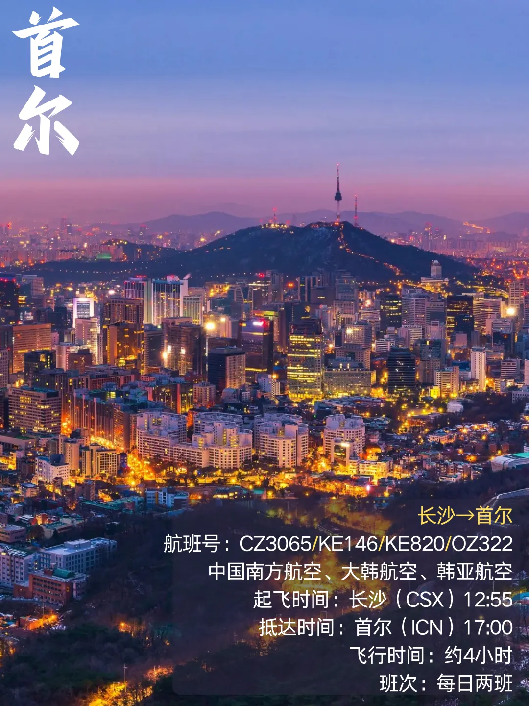

Międzynarodowe lotnisko Changsha Huanghua (kod lotniska **CSX**) leży w miejscowości Huanghua w powiecie Changsha i jest ważną bramą międzynarodową dla środkowych Chin, z dwoma czynnymi terminalami (T1 i T2). Z miasta do lotniska docieramy **koleją maglev w Changsha**, która łączy lotnisko ze stacją kolei dużych prędkości Changsha Południowa, oraz **linią metra nr 6**.

Do jakich więc miejsc międzynarodowych i regionalnych można dolecieć **bezpośrednio** z Changsha? Poniższa lista powstała na podstawie rozkładów opublikowanych w materiale źródłowym dla **sezonu zimowego 2025–26 (luty–marzec 2026)**: **15 tras** obejmujących Azję Południowo-Wschodnią, Azję Północno-Wschodnią, Europę i Afrykę. **Trasy i częstotliwość zmieniają się z każdym sezonem**, dlatego przed rezerwacją potwierdź aktualny rozkład u przewoźnika — jak to zrobić, opisujemy na końcu.

## 1. Trasy w skrócie

Według kraju i regionu:

| Kraj / region | Cel | Przewoźnicy | Częstotliwość |
| --- | --- | --- | --- |
| Mjanma | Rangun (RGN) | Myanmar Airways International | Dwa razy w tygodniu (wtorek, sobota) |
| Tajlandia | Bangkok (DMK) | Thai AirAsia, Thai Lion Air | Dwa razy dziennie |
| Tajlandia | Bangkok (BKK) | XiamenAir | Codziennie do 28 lutego 2026 |
| Tajlandia | Phuket (HKT) | Thai Lion Air | Trzy razy w tygodniu do 2 marca 2026 |
| Wielka Brytania | Londyn (LHR) | Hainan Airlines | Dwa razy w tygodniu (poniedziałek, piątek) |
| Korea Południowa | Seul (ICN) | China Southern, Korean Air, Asiana | Dwa razy dziennie |
| Hongkong, Chiny | Hongkong (HKG) | Cathay Pacific | Codziennie do 28 marca 2026 |
| Malezja | Kuala Lumpur (KUL) | China Southern, AirAsia X, XiamenAir, Batik Air | 2–4 razy dziennie |
| Singapur | Singapur (SIN) | China Southern, China Eastern, Scoot | Dwa razy dziennie |
| Kambodża | Phnom Penh (KTI) | Cambodia Airways, Sky Angkor Airways | Pięć razy w tygodniu |
| Indonezja | Dżakarta (CGK) | Citilink | Środy, 11 lutego – 4 marca 2026 |
| Wietnam | Miasto Ho Chi Minh (SGN) | China Southern | Trzy razy w tygodniu do 28 lutego 2026 (wt., czw., sob.) |
| Wietnam | Hanoi (HAN) | China Southern | Pięć razy w tygodniu |
| Laos | Wientian (VTE) | Lao Airlines | Trzy razy w tygodniu do 28 marca 2026 |
| Kenia | Nairobi (NBO) | China Southern | 2–3 razy w tygodniu |

## 2. Trasa po trasie

### Mjanma: Rangun (RGN)

Myanmar Airways International obsługuje trasę Changsha–Rangun jako **8M721**: odlot z Changsha o 22:35 i lądowanie o 00:45 następnego dnia, 3 godziny 40 minut w powietrzu, **dwa razy w tygodniu (wtorek i sobota)**. To przelot przez noc, dzięki któremu od razu następnego ranka możesz ruszyć do pagody Shwedagon.

### Tajlandia: Bangkok (DMK i BKK) oraz Phuket (HKT)

Tajlandia ma najgęstszą siatkę połączeń spośród wszystkich kierunków z Changsha, rozdzieloną między trzy lotniska:

- **Bangkok Don Mueang (DMK)**: Thai AirAsia i Thai Lion Air, loty **FD481 i SL935**, odlot z Changsha o 12:55 i przylot o 15:20 albo odlot o 14:35 i przylot o 17:05, 3 godziny 30 minut, **dwa razy dziennie**;
- **Bangkok Suvarnabhumi (BKK)**: XiamenAir, lot **MF8643**, odlot z Changsha o 08:30 i przylot o 11:05, 3 godziny 35 minut, **codziennie do 28 lutego 2026** — poranny wylot, który stawia cię w Bangkoku w samo południe;
- **Phuket (HKT)**: Thai Lion Air, lot **SL969**, odlot z Changsha o 17:20 i przylot o 20:35, 4 godziny 15 minut, **trzy razy w tygodniu do 2 marca 2026**, prosto na wyspy.

### Wielka Brytania: Londyn (LHR)

Hainan Airlines lata na trasie Changsha–Londyn Heathrow jako **HU7963**: odlot z Changsha o 13:45 i lądowanie na Heathrow o 17:35 czasu lokalnego, 11 godzin 50 minut, **dwa razy w tygodniu (poniedziałek i piątek)**. To jedyne bezpośrednie połączenie Changsha z Europą — warto o nim wiedzieć, jeśli studiujesz lub pracujesz w Wielkiej Brytanii.

### Korea Południowa: Seul (ICN)

China Southern, Korean Air i Asiana latają na trasie Changsha–Seul Incheon, loty **CZ3065 / KE146 / KE820 / OZ322**: odlot z Changsha o 12:55 i przylot o 17:00, około 4 godzin, **dwa razy dziennie**. Trzech przewoźników na tej trasie daje pole do porównania cen i zmiany terminów.

### Hongkong, Chiny: Hongkong (HKG)

Cathay Pacific lata na trasie Changsha–Hongkong jako **CX943 i CX927**: odlot z Changsha o 21:15 i przylot o 22:55, 1 godzina 40 minut, **codziennie do 28 marca 2026**. Późny przylot dobrze się zgra z dalekodystansowymi odlotami Cathay następnego ranka.

### Malezja: Kuala Lumpur (KUL)

China Southern, AirAsia X, XiamenAir i Batik Air latają na trasie Changsha–Kuala Lumpur, loty **CZ5049, D7353, MF8015 i OD643**: odlot z Changsha o 11:50 i przylot o 16:20, 4 godziny 30 minut, **2–4 razy dziennie**. Przy takiej częstotliwości zmiana terminu w ostatniej chwili rzadko stanowi problem.

### Singapur: Singapur (SIN)

China Southern, China Eastern i Scoot latają na trasie Changsha–Singapur, loty **CZ5021, MU2045 i TR125**: odlot z Changsha o 00:05 i przylot o 04:40, 4 godziny 35 minut, **dwa razy dziennie**. To nocne wyloty, po których wysiadasz na pełny pierwszy dzień.

### Kambodża: Phnom Penh (KTI)

Cambodia Airways i Sky Angkor Airways latają na trasie Changsha–Phnom Penh, loty **KR942 i ZA638**: odlot z Changsha o 12:15 i przylot o 14:30, 3 godziny 15 minut, **pięć razy w tygodniu**. Popołudniowy wylot i popołudniowy przylot — najbardziej cywilizowane godziny na tej liście.

### Indonezja: Dżakarta (CGK)

Citilink lata na trasie Changsha–Dżakarta jako **QG8837**: odlot z Changsha o 01:30 i przylot o 06:20, 5 godzin 50 minut, **w każdą środę od 11 lutego do 4 marca 2026**.

### Wietnam: Miasto Ho Chi Minh (SGN) i Hanoi (HAN)

- **Miasto Ho Chi Minh**: China Southern, lot **CZ6061**, odlot z Changsha o 23:20 i przylot o 01:55 następnego dnia, 3 godziny 35 minut, **trzy razy w tygodniu do 28 lutego 2026 (wtorek, czwartek, sobota)**;
- **Hanoi**: China Southern, lot **CZ8359**, odlot z Changsha o 18:00 i przylot o 19:20, 2 godziny 20 minut, **pięć razy w tygodniu** — najkrótszy lot na tej liście, wylot przed kolacją i przylot po niej.

### Laos: Wientian (VTE)

Lao Airlines lata na trasie Changsha–Wientian jako **QV856**: odlot z Changsha o 18:10 i przylot o 19:25, 2 godziny 15 minut, **trzy razy w tygodniu do 28 marca 2026**.

### Kenia: Nairobi (NBO)

China Southern lata na trasie Changsha–Nairobi jako **CZ6043**: odlot z Changsha o 00:50 i przylot o 06:50, 11 godzin w powietrzu, **2–3 razy w tygodniu**. To jedyne bezpośrednie połączenie Changsha z Afryką i najdłuższy lot na tej liście.

## 3. Rozkłady się zmieniają: jak sprawdzić przed lotem

Podane wyżej częstotliwości i godziny pochodzą z rozkładu **sezonu zimowego 2025–26 (luty–marzec 2026)** z materiału źródłowego, a przy kilku z nich widnieje wyraźna data „do”. **Przewoźnicy korygują trasy i godziny co sezon (pod koniec marca i pod koniec października)**, a trasa może zmienić przewoźnika lub lotnisko — pamiętaj, że Bangkok ma dwa lotniska, **BKK (Suvarnabhumi)** i **DMK (Don Mueang)**, oddalone od siebie o około 30 km.

Przed podróżą:

1. Sprawdź na **stronie internetowej lub w aplikacji przewoźnika** dokładnie swoją datę, zamiast opierać się na podsumowaniu „tyle lotów w tygodniu”;
2. Zweryfikuj numer lotu, terminal i godziny na **portalu rezerwacyjnym**;
3. Dzień wcześniej ponownie sprawdź **status lotu** — opóźnienia, zmiany terminali i podmiany samolotów wpływają na to, gdzie się odprawiasz;
4. Uważnie czytaj kod lotniska: BKK i DMK nie są wymienne przy przesiadkach ani odbiorze z lotniska.

Źródło zdjęć: plakaty tras z materiału źródłowego. Rozkłady pochodzą z informacji tego materiału dla sezonu zimowego; wiążące są ogłoszenia przewoźników i lotnisk na dany dzień.

## Powiązane linki

- **Na tej stronie (lotniska)**: [Bangkok Suvarnabhumi (BKK)](/airport/BKK), [Seul Incheon (ICN)](/airport/ICN), [Hongkong (HKG)](/airport/HKG), [Kuala Lumpur (KUL)](/airport/KUL), [Londyn Heathrow (LHR)](/airport/LHR), [Singapur Changi (SIN)](/airport/SIN), [Miasto Ho Chi Minh Tan Son Nhat (SGN)](/airport/SGN), [Dżakarta (CGK)](/airport/CGK)
- **Na tej stronie (kraje)**: [Chiny (CN)](/country/CN), [Tajlandia (TH)](/country/TH), [Korea Południowa (KR)](/country/KR), [Singapur (SG)](/country/SG), [Wielka Brytania (GB)](/country/GB), [Malezja (MY)](/country/MY), [Wietnam (VN)](/country/VN), [Indonezja (ID)](/country/ID), [Mjanma (MM)](/country/MM), [Kenia (KE)](/country/KE)
- **Wikipedia**: [Port lotniczy Changsha Huanghua](https://en.wikipedia.org/wiki/Changsha_Huanghua_International_Airport)
- **Baidu Baike**: [Port lotniczy Changsha Huanghua](https://baike.baidu.com/item/%E9%95%BF%E6%B2%99%E9%BB%84%E8%8A%B1%E5%9B%BD%E9%99%85%E6%9C%BA%E5%9C%BA)
