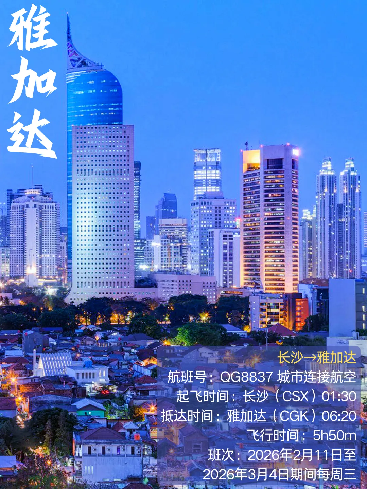

O Aeroporto Internacional de Changsha Huanghua (código **CSX**) fica na cidade de Huanghua, condado de Changsha, e é um importante portal internacional do centro da China, com dois terminais em operação (T1 e T2). A partir da cidade, o **maglev de Changsha** conecta à estação ferroviária de alta velocidade de Changsha Sul, e a **linha 6 do metrô** vai até o aeroporto.

Então quais destinos internacionais e regionais você pode alcançar **sem escala** a partir de Changsha? Esta lista foi compilada a partir das programações que o material original publicou para a **temporada de inverno 2025–26 (fevereiro–março de 2026)**: **15 rotas** que cobrem Sudeste Asiático, Nordeste Asiático, Europa e África. **As rotas e frequências mudam a cada temporada**, então confirme o horário atual com a companhia antes de comprar — como fazer isso está no final.

## 1. As rotas em resumo

Por país e região:

| País / região | Destino | Companhias | Frequência |
| --- | --- | --- | --- |
| Mianmar | Yangon (RGN) | Myanmar Airways International | Duas vezes por semana (terça e sábado) |
| Tailândia | Bangkok (DMK) | Thai AirAsia, Thai Lion Air | Duas vezes ao dia |
| Tailândia | Bangkok (BKK) | XiamenAir | Diário até 28 de fev. de 2026 |
| Tailândia | Phuket (HKT) | Thai Lion Air | Três vezes por semana até 2 de mar. de 2026 |
| Reino Unido | Londres (LHR) | Hainan Airlines | Duas vezes por semana (segunda e sexta) |
| Coreia do Sul | Seul (ICN) | China Southern, Korean Air, Asiana | Duas vezes ao dia |
| Hong Kong, China | Hong Kong (HKG) | Cathay Pacific | Diário até 28 de mar. de 2026 |
| Malásia | Kuala Lumpur (KUL) | China Southern, AirAsia X, XiamenAir, Batik Air | 2–4 por dia |
| Singapura | Singapura (SIN) | China Southern, China Eastern, Scoot | Duas vezes ao dia |
| Camboja | Phnom Penh (KTI) | Cambodia Airways, Sky Angkor Airways | Cinco vezes por semana |
| Indonésia | Jacarta (CGK) | Citilink | Quartas-feiras, 11 de fev. – 4 de mar. de 2026 |
| Vietnã | Cidade de Ho Chi Minh (SGN) | China Southern | Três vezes por semana até 28 de fev. de 2026 (ter., qui., sáb.) |
| Vietnã | Hanói (HAN) | China Southern | Cinco vezes por semana |
| Laos | Vienciana (VTE) | Lao Airlines | Três vezes por semana até 28 de mar. de 2026 |
| Quênia | Nairóbi (NBO) | China Southern | 2–3 por semana |

## 2. Rota por rota

### Mianmar: Yangon (RGN)

A Myanmar Airways International opera Changsha–Yangon como **8M721**: sai de Changsha às 22:35 e pousa às 00:45 do dia seguinte, 3 horas e 40 minutos de voo, **duas vezes por semana (terça e sábado)**. É um trecho noturno, que já deixa você pronto para o Pagode Shwedagon logo na manhã seguinte.

### Tailândia: Bangkok (DMK e BKK) e Phuket (HKT)

A Tailândia tem o serviço mais denso entre os destinos a partir de Changsha, dividido em três aeroportos:

- **Bangkok Don Mueang (DMK)**: Thai AirAsia e Thai Lion Air, voos **FD481 e SL935**, saindo de Changsha às 12:55 e chegando às 15:20, ou saindo às 14:35 e chegando às 17:05, 3 horas e 30 minutos, **duas vezes ao dia**;
- **Bangkok Suvarnabhumi (BKK)**: XiamenAir, voo **MF8643**, saindo de Changsha às 08:30 e chegando às 11:05, 3 horas e 35 minutos, **diário até 28 de fevereiro de 2026** — uma partida pela manhã que coloca você em Bangkok ao meio-dia;
- **Phuket (HKT)**: Thai Lion Air, voo **SL969**, saindo de Changsha às 17:20 e chegando às 20:35, 4 horas e 15 minutos, **três vezes por semana até 2 de março de 2026**, direto para as ilhas.

### Reino Unido: Londres (LHR)

A Hainan Airlines voa de Changsha para Londres Heathrow como **HU7963**: sai de Changsha às 13:45 e pousa em Heathrow às 17:35 no horário local, 11 horas e 50 minutos, **duas vezes por semana (segunda e sexta)**. É a única rota direta de Changsha para a Europa — a que você precisa conhecer se estuda ou trabalha no Reino Unido.

### Coreia do Sul: Seul (ICN)

China Southern, Korean Air e Asiana voam de Changsha para Seul Incheon, voos **CZ3065 / KE146 / KE820 / OZ322**: saindo de Changsha às 12:55 e chegando às 17:00, cerca de 4 horas, **duas vezes ao dia**. Com três companhias na rota, há espaço para comparar tarifas e mudar datas.

### Hong Kong, China: Hong Kong (HKG)

A Cathay Pacific voa de Changsha para Hong Kong como **CX943 e CX927**: saindo de Changsha às 21:15 e chegando às 22:55, 1 hora e 40 minutos, **diário até 28 de março de 2026**. A chegada tardia encaixa perfeitamente nas partidas de longo curso da Cathay na manhã seguinte.

### Malásia: Kuala Lumpur (KUL)

China Southern, AirAsia X, XiamenAir e Batik Air voam de Changsha para Kuala Lumpur, voos **CZ5049, D7353, MF8015 e OD643**: saindo de Changsha às 11:50 e chegando às 16:20, 4 horas e 30 minutos, **2–4 vezes ao dia**. Com tanto serviço assim, mudar de data em cima da hora raramente é problema.

### Singapura: Singapura (SIN)

China Southern, China Eastern e Scoot voam de Changsha para Singapura, voos **CZ5021, MU2045 e TR125**: saindo de Changsha às 00:05 e chegando às 04:40, 4 horas e 35 minutos, **duas vezes ao dia**. São partidas de madrugada, que fazem você chegar a tempo de um primeiro dia inteiro.

### Camboja: Phnom Penh (KTI)

Cambodia Airways e Sky Angkor Airways voam de Changsha para Phnom Penh, voos **KR942 e ZA638**: saindo de Changsha às 12:15 e chegando às 14:30, 3 horas e 15 minutos, **cinco vezes por semana**. Uma partida à tarde com chegada à tarde — o horário mais civilizado desta lista.

### Indonésia: Jacarta (CGK)

A Citilink voa de Changsha para Jacarta como **QG8837**: saindo de Changsha às 01:30 e chegando às 06:20, 5 horas e 50 minutos, **às quartas-feiras, entre 11 de fevereiro e 4 de março de 2026**.

### Vietnã: Cidade de Ho Chi Minh (SGN) e Hanói (HAN)

- **Cidade de Ho Chi Minh**: China Southern, voo **CZ6061**, saindo de Changsha às 23:20 e chegando às 01:55 do dia seguinte, 3 horas e 35 minutos, **três vezes por semana até 28 de fevereiro de 2026 (terça, quinta e sábado)**;
- **Hanói**: China Southern, voo **CZ8359**, saindo de Changsha às 18:00 e chegando às 19:20, 2 horas e 20 minutos, **cinco vezes por semana** — o voo mais curto desta lista, saindo antes do jantar e chegando depois dele.

### Laos: Vienciana (VTE)

A Lao Airlines voa de Changsha para Vienciana como **QV856**: saindo de Changsha às 18:10 e chegando às 19:25, 2 horas e 15 minutos, **três vezes por semana até 28 de março de 2026**.

### Quênia: Nairóbi (NBO)

A China Southern voa de Changsha para Nairóbi como **CZ6043**: saindo de Changsha às 00:50 e chegando às 06:50, 11 horas de voo, **2–3 vezes por semana**. É a única rota direta de Changsha para a África e o voo mais longo desta lista.

## 3. Os horários mudam: como confirmar antes de voar

As frequências e os horários acima vêm da programação da **temporada de inverno 2025–26 (fevereiro–março de 2026)** do material original, e vários deles trazem uma data limite explícita de “até”. **As companhias revisam rotas e horários a cada temporada (no fim de março e no fim de outubro)**, e uma rota pode mudar de companhia ou de aeroporto — observe que Bangkok tem dois aeroportos, **BKK (Suvarnabhumi)** e **DMK (Don Mueang)**, a cerca de 30 km de distância um do outro.

Antes de viajar:

1. Pesquise no **site ou aplicativo da própria companhia** a sua data exata, em vez de confiar em um resumo do tipo “tantos voos por semana”;
2. Confira o número do voo, o terminal e os horários em um **site de reservas**;
3. Verifique o **status do voo** novamente na véspera — atrasos, mudanças de terminal e trocas de aeronave afetam onde você faz o check-in;
4. Leia o código do aeroporto com atenção: BKK e DMK não são intercambiáveis para conexões nem para buscar alguém.

Fonte das imagens: os cartazes das rotas do material original. As programações são as informações de temporada de inverno desse material; os anúncios das próprias companhias e aeroportos para o dia são definitivos.

## Links relacionados

- **Neste site (aeroportos)**: [Bangkok Suvarnabhumi (BKK)](/airport/BKK), [Seul Incheon (ICN)](/airport/ICN), [Hong Kong (HKG)](/airport/HKG), [Kuala Lumpur (KUL)](/airport/KUL), [Londres Heathrow (LHR)](/airport/LHR), [Singapura Changi (SIN)](/airport/SIN), [Cidade de Ho Chi Minh Tan Son Nhat (SGN)](/airport/SGN), [Jacarta (CGK)](/airport/CGK)
- **Neste site (países)**: [China (CN)](/country/CN), [Tailândia (TH)](/country/TH), [Coreia do Sul (KR)](/country/KR), [Singapura (SG)](/country/SG), [Reino Unido (GB)](/country/GB), [Malásia (MY)](/country/MY), [Vietnã (VN)](/country/VN), [Indonésia (ID)](/country/ID), [Mianmar (MM)](/country/MM), [Quênia (KE)](/country/KE)
- **Wikipédia**: [Aeroporto Internacional de Changsha Huanghua](https://en.wikipedia.org/wiki/Changsha_Huanghua_International_Airport)
- **Baidu Baike**: [Aeroporto Internacional de Changsha Huanghua](https://baike.baidu.com/item/%E9%95%BF%E6%B2%99%E9%BB%84%E8%8A%B1%E5%9B%BD%E9%99%85%E6%9C%BA%E5%9C%BA)
