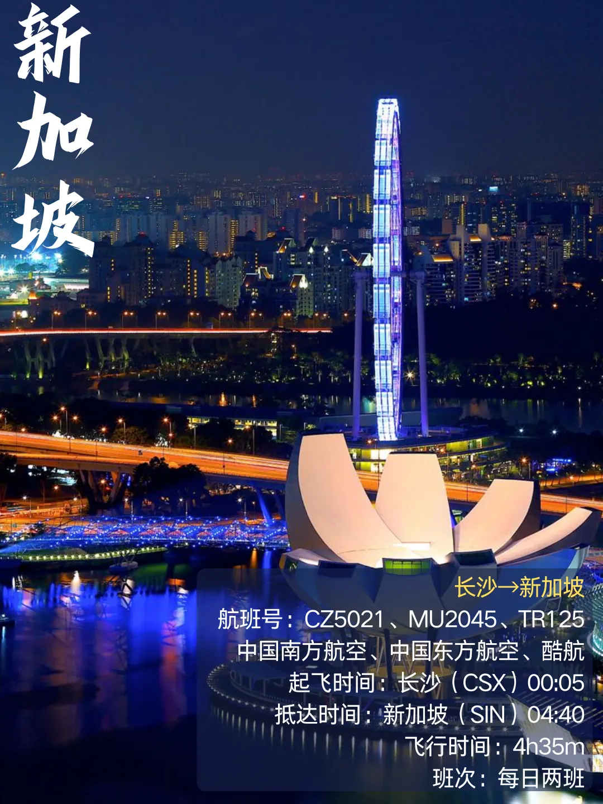
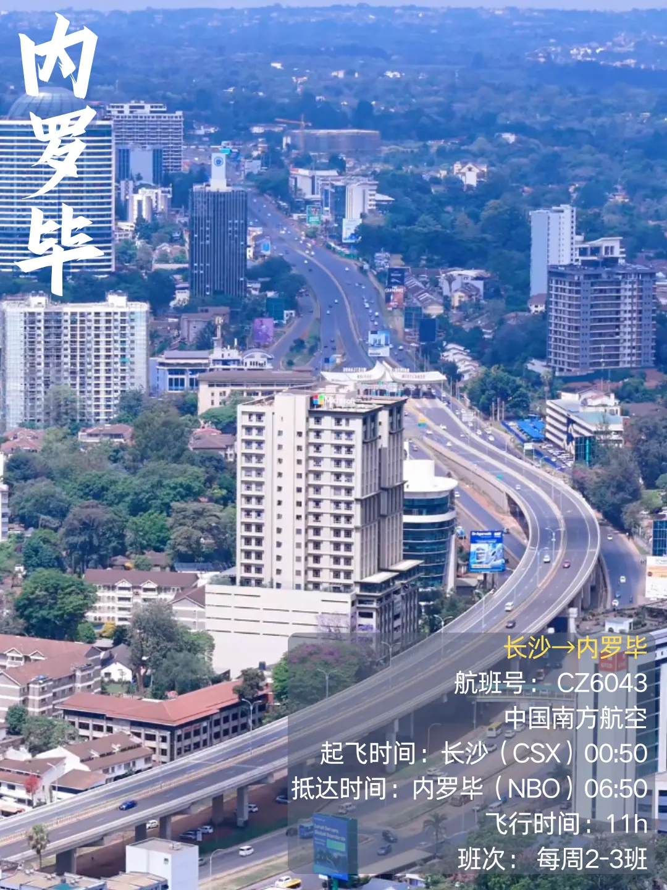

Aeroportul Internațional Changsha Huanghua (cod **CSX**) se află în orașul Huanghua, județul Changsha, și este o poartă internațională importantă pentru centrul Chinei, cu două terminale în funcțiune (T1 și T2). Din oraș, **maglev-ul Changsha** face legătura cu gara de mare viteză Changsha South, iar **linia 6 de metrou** ajunge la aeroport.

Așadar, ce destinații internaționale și regionale puteți ajunge **fără escală** din Changsha? Această listă este alcătuită pe baza orarelor publicate în materialul original pentru **sezonul de iarnă 2025–26 (februarie–martie 2026)**: **15 rute** care acoperă Asia de Sud-Est, Asia de Nord-Est, Europa și Africa. **Rutele și frecvențele se schimbă de la un sezon la altul**, așa că confirmați orarul actual cu compania aeriană înainte de rezervare — cum să faceți acest lucru găsiți la final.

## 1. Rutele dintr-o privire

Pe țară și regiune:

| Țară / regiune | Destinație | Companii aeriene | Frecvență |
| --- | --- | --- | --- |
| Myanmar | Yangon (RGN) | Myanmar Airways International | De două ori pe săptămână (marți, sâmbătă) |
| Thailanda | Bangkok (DMK) | Thai AirAsia, Thai Lion Air | De două ori pe zi |
| Thailanda | Bangkok (BKK) | XiamenAir | Zilnic până la 28 feb. 2026 |
| Thailanda | Phuket (HKT) | Thai Lion Air | De trei ori pe săptămână până la 2 mar. 2026 |
| Regatul Unit | Londra (LHR) | Hainan Airlines | De două ori pe săptămână (luni, vineri) |
| Coreea de Sud | Seul (ICN) | China Southern, Korean Air, Asiana | De două ori pe zi |
| Hong Kong, China | Hong Kong (HKG) | Cathay Pacific | Zilnic până la 28 mar. 2026 |
| Malaysia | Kuala Lumpur (KUL) | China Southern, AirAsia X, XiamenAir, Batik Air | De 2–4 ori pe zi |
| Singapore | Singapore (SIN) | China Southern, China Eastern, Scoot | De două ori pe zi |
| Cambodgia | Phnom Penh (KTI) | Cambodia Airways, Sky Angkor Airways | De cinci ori pe săptămână |
| Indonezia | Jakarta (CGK) | Citilink | Miercuri, 11 feb. – 4 mar. 2026 |
| Vietnam | Ho Chi Minh City (SGN) | China Southern | De trei ori pe săptămână până la 28 feb. 2026 (mar., joi, sâm.) |
| Vietnam | Hanoi (HAN) | China Southern | De cinci ori pe săptămână |
| Laos | Vientiane (VTE) | Lao Airlines | De trei ori pe săptămână până la 28 mar. 2026 |
| Kenya | Nairobi (NBO) | China Southern | De 2–3 ori pe săptămână |

## 2. Rută cu rută

### Myanmar: Yangon (RGN)

Myanmar Airways International zboară Changsha–Yangon ca **8M721**: plecare din Changsha la 22:35 și aterizare la 00:45 a doua zi, 3 ore și 40 de minute în aer, **de două ori pe săptămână (marți și sâmbătă)**. Este un zbor peste noapte, care vă lasă liber pentru Pagoda Shwedagon chiar în prima dimineață.

### Thailanda: Bangkok (DMK și BKK) și Phuket (HKT)

Thailanda are cea mai densă ofertă dintre toate destinațiile din Changsha, împărțită între trei aeroporturi:

- **Bangkok Don Mueang (DMK)**: Thai AirAsia și Thai Lion Air, zborurile **FD481 și SL935**, plecare din Changsha la 12:55 și sosire la 15:20, sau plecare la 14:35 și sosire la 17:05, 3 ore și 30 de minute, **de două ori pe zi**;
- **Bangkok Suvarnabhumi (BKK)**: XiamenAir, zborul **MF8643**, plecare din Changsha la 08:30 și sosire la 11:05, 3 ore și 35 de minute, **zilnic până la 28 februarie 2026** — o plecare de dimineață care vă pune în Bangkok la amiază;
- **Phuket (HKT)**: Thai Lion Air, zborul **SL969**, plecare din Changsha la 17:20 și sosire la 20:35, 4 ore și 15 minute, **de trei ori pe săptămână până la 2 martie 2026**, direct spre insule.

### Regatul Unit: Londra (LHR)

Hainan Airlines zboară Changsha–Londra Heathrow ca **HU7963**: plecare din Changsha la 13:45 și aterizare la Heathrow la 17:35 ora locală, 11 ore și 50 de minute, **de două ori pe săptămână (luni și vineri)**. Este singura rută directă a Changsha către Europa — cea pe care trebuie să o știți dacă studiați sau lucrați în Regatul Unit.

### Coreea de Sud: Seul (ICN)

China Southern, Korean Air și Asiana zboară toate Changsha–Seul Incheon, zborurile **CZ3065 / KE146 / KE820 / OZ322**: plecare din Changsha la 12:55 și sosire la 17:00, aproximativ 4 ore, **de două ori pe zi**. Cu trei companii pe rută, aveți loc să comparați tarifele și să schimbați datele.

### Hong Kong, China: Hong Kong (HKG)

Cathay Pacific zboară Changsha–Hong Kong ca **CX943 și CX927**: plecare din Changsha la 21:15 și sosire la 22:55, 1 oră și 40 de minute, **zilnic până la 28 martie 2026**. Sosirea târzie se potrivește perfect cu plecările pe distanțe lungi ale Cathay din dimineața următoare.

### Malaysia: Kuala Lumpur (KUL)

China Southern, AirAsia X, XiamenAir și Batik Air zboară Changsha–Kuala Lumpur, zborurile **CZ5049, D7353, MF8015 și OD643**: plecare din Changsha la 11:50 și sosire la 16:20, 4 ore și 30 de minute, **de 2–4 ori pe zi**. Cu o asemenea ofertă, schimbarea datelor în ultimul moment este rareori o problemă.

### Singapore: Singapore (SIN)

China Southern, China Eastern și Scoot zboară Changsha–Singapore, zborurile **CZ5021, MU2045 și TR125**: plecare din Changsha la 00:05 și sosire la 04:40, 4 ore și 35 de minute, **de două ori pe zi**. Sunt plecări de noapte, care vă lasă să ajungeți la timp pentru o primă zi întreagă.

### Cambodgia: Phnom Penh (KTI)

Cambodia Airways și Sky Angkor Airways zboară Changsha–Phnom Penh, zborurile **KR942 și ZA638**: plecare din Changsha la 12:15 și sosire la 14:30, 3 ore și 15 minute, **de cinci ori pe săptămână**. O plecare de după-amiază cu o sosire de după-amiază — cel mai civilizat orar din listă.

### Indonezia: Jakarta (CGK)

Citilink zboară Changsha–Jakarta ca **QG8837**: plecare din Changsha la 01:30 și sosire la 06:20, 5 ore și 50 de minute, **săptămânal, miercurea, între 11 februarie și 4 martie 2026**.

### Vietnam: Ho Chi Minh City (SGN) și Hanoi (HAN)

- **Ho Chi Minh City**: China Southern, zborul **CZ6061**, plecare din Changsha la 23:20 și sosire la 01:55 a doua zi, 3 ore și 35 de minute, **de trei ori pe săptămână până la 28 februarie 2026 (marți, joi, sâmbătă)**;
- **Hanoi**: China Southern, zborul **CZ8359**, plecare din Changsha la 18:00 și sosire la 19:20, 2 ore și 20 de minute, **de cinci ori pe săptămână** — cel mai scurt zbor din listă, plecare înainte de cină și sosire după ea.

### Laos: Vientiane (VTE)

Lao Airlines zboară Changsha–Vientiane ca **QV856**: plecare din Changsha la 18:10 și sosire la 19:25, 2 ore și 15 minute, **de trei ori pe săptămână până la 28 martie 2026**.

### Kenya: Nairobi (NBO)

China Southern zboară Changsha–Nairobi ca **CZ6043**: plecare din Changsha la 00:50 și sosire la 06:50, 11 ore în aer, **de 2–3 ori pe săptămână**. Este singura rută directă a Changsha către Africa și cel mai lung zbor din listă.

## 3. Orarele se schimbă: cum să verificați înainte de zbor

Frecvențele și orele de mai sus provin din orarul **sezonului de iarnă 2025–26 (februarie–martie 2026)** din materialul original, iar câteva dintre ele au o dată-limită explicită „până la”. **Companiile aeriene revizuiesc rutele și orarele în fiecare sezon (la sfârșitul lui martie și la sfârșitul lui octombrie)**, iar o rută poate schimba compania sau aeroportul — rețineți că Bangkok are două aeroporturi, **BKK (Suvarnabhumi)** și **DMK (Don Mueang)**, la aproximativ 30 km distanță.

Înainte de a călători:

1. Căutați pe **site-ul sau în aplicația companiei aeriene** pentru data dvs. exactă, în loc să vă bazați pe un rezumat de tipul „atâtea zboruri pe săptămână”;
2. Verificați încrucișat numărul zborului, terminalul și orele pe un **site de rezervări**;
3. Reverificați **starea zborului** cu o zi înainte — întârzierile, schimbările de terminal și înlocuirile de aeronavă afectează locul unde vă înregistrați pentru zbor;
4. Citiți cu atenție codul aeroportului: BKK și DMK nu sunt interschimbabile pentru corespondențe sau preluări.

Sursa imaginilor: afișele rutelor din materialul original. Orarele reprezintă informațiile pentru sezonul de iarnă din acel material; anunțurile companiilor aeriene și ale aeroporturilor pentru ziua respectivă sunt decisive.

## Linkuri utile

- **Pe acest site (aeroporturi)**: [Bangkok Suvarnabhumi (BKK)](/airport/BKK), [Seul Incheon (ICN)](/airport/ICN), [Hong Kong (HKG)](/airport/HKG), [Kuala Lumpur (KUL)](/airport/KUL), [Londra Heathrow (LHR)](/airport/LHR), [Singapore Changi (SIN)](/airport/SIN), [Ho Chi Minh City Tan Son Nhat (SGN)](/airport/SGN), [Jakarta (CGK)](/airport/CGK)
- **Pe acest site (țări)**: [China (CN)](/country/CN), [Thailanda (TH)](/country/TH), [Coreea de Sud (KR)](/country/KR), [Singapore (SG)](/country/SG), [Regatul Unit (GB)](/country/GB), [Malaysia (MY)](/country/MY), [Vietnam (VN)](/country/VN), [Indonezia (ID)](/country/ID), [Myanmar (MM)](/country/MM), [Kenya (KE)](/country/KE)
- **Wikipedia**: [Changsha Huanghua International Airport](https://en.wikipedia.org/wiki/Changsha_Huanghua_International_Airport)
- **Baidu Baike**: [Changsha Huanghua International Airport](https://baike.baidu.com/item/%E9%95%BF%E6%B2%99%E9%BB%84%E8%8A%B1%E5%9B%BD%E9%99%85%E6%9C%BA%E5%9C%BA)
