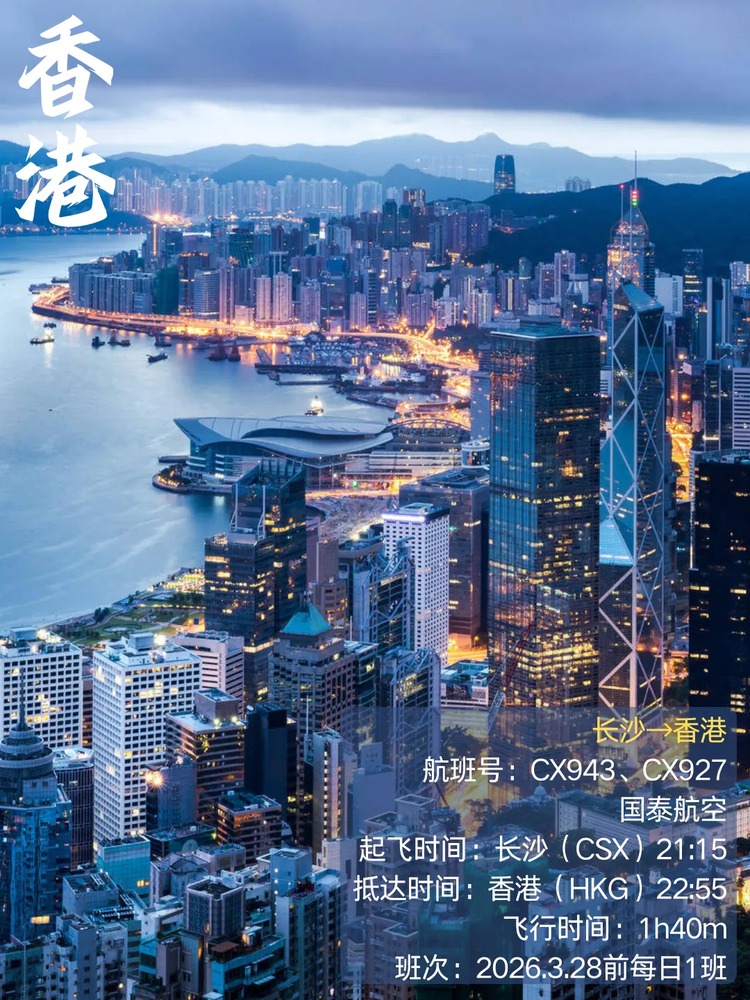
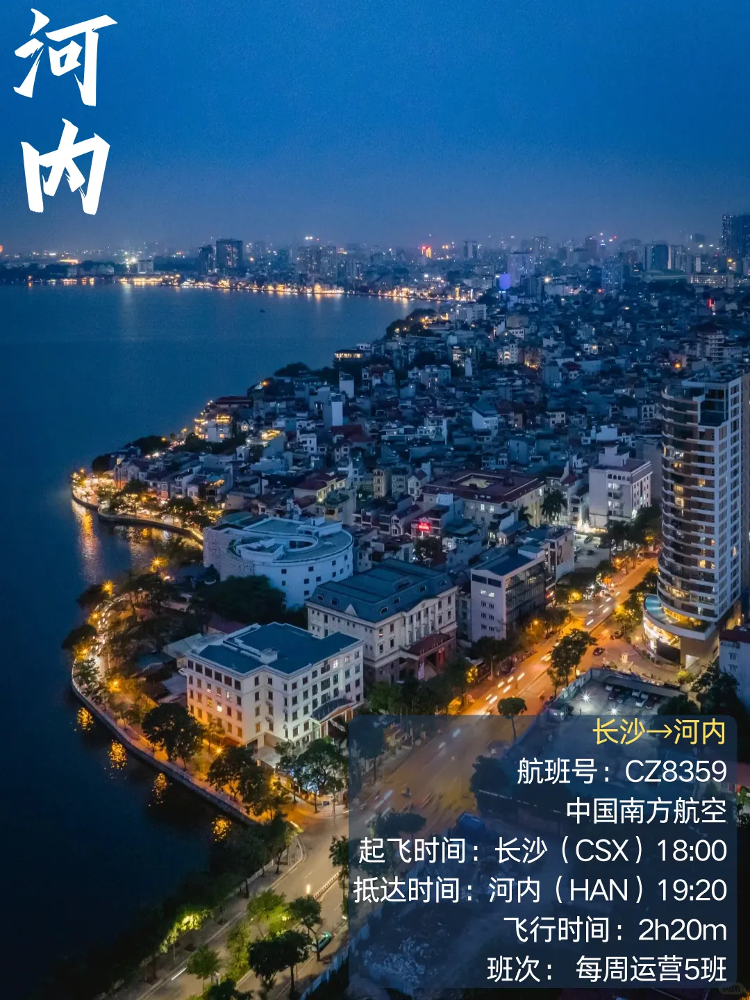

Changsha Huanghua internationella flygplats (flygplatskod **CSX**) ligger i Huanghua köping i Changsha län och är en viktig internationell port för centrala Kina, med två terminaler i drift (T1 och T2). Från staden förbinder **Changsha maglev** till höghastighetsjärnvägsstationen Changsha South, och **tunnelbanelinje 6** går till flygplatsen.

Så vilka internationella och regionala destinationer kan du nå **direkt** från Changsha? Listan är sammanställd utifrån de tidtabeller som originalmaterialet publicerade för **vintersäsongen 2025–26 (februari–mars 2026)**: **15 rutter** som omfattar Sydostasien, Nordostasien, Europa och Afrika. **Rutter och frekvenser ändras varje säsong**, så bekräfta den aktuella tidtabellen med flygbolaget innan du bokar – hur du gör det står i slutet.

## 1. Rutterna i korthet

Efter land och region:

| Land/region | Destination | Flygbolag | Frekvens |
| --- | --- | --- | --- |
| Myanmar | Yangon (RGN) | Myanmar Airways International | Två gånger i veckan (tisdag, lördag) |
| Thailand | Bangkok (DMK) | Thai AirAsia, Thai Lion Air | Två gånger dagligen |
| Thailand | Bangkok (BKK) | XiamenAir | Dagligen till och med 28 feb 2026 |
| Thailand | Phuket (HKT) | Thai Lion Air | Tre gånger i veckan till och med 2 mars 2026 |
| Storbritannien | London (LHR) | Hainan Airlines | Två gånger i veckan (måndag, fredag) |
| Sydkorea | Seoul (ICN) | China Southern, Korean Air, Asiana | Två gånger dagligen |
| Hongkong, Kina | Hongkong (HKG) | Cathay Pacific | Dagligen till och med 28 mars 2026 |
| Malaysia | Kuala Lumpur (KUL) | China Southern, AirAsia X, XiamenAir, Batik Air | 2–4 gånger dagligen |
| Singapore | Singapore (SIN) | China Southern, China Eastern, Scoot | Två gånger dagligen |
| Kambodja | Phnom Penh (KTI) | Cambodia Airways, Sky Angkor Airways | Fem gånger i veckan |
| Indonesien | Jakarta (CGK) | Citilink | Onsdagar 11 feb–4 mars 2026 |
| Vietnam | Ho Chi Minh-staden (SGN) | China Southern | Tre gånger i veckan till och med 28 feb 2026 (tis, tors, lör) |
| Vietnam | Hanoi (HAN) | China Southern | Fem gånger i veckan |
| Laos | Vientiane (VTE) | Lao Airlines | Tre gånger i veckan till och med 28 mars 2026 |
| Kenya | Nairobi (NBO) | China Southern | 2–3 gånger i veckan |

## 2. Rutt för rutt

### Myanmar: Yangon (RGN)

Myanmar Airways International flyger Changsha–Yangon som **8M721**: avgår från Changsha 22.35 och landar 00.45 dagen därpå, 3 timmar och 40 minuter i luften, **två gånger i veckan (tisdag och lördag)**. Det är en nattlig etapp som gör att du är redo för Shwedagon-pagoden tidigt nästa morgon.

### Thailand: Bangkok (DMK och BKK) och Phuket (HKT)

Thailand har den tätaste trafiken av alla destinationer från Changsha, fördelad på tre flygplatser:

- **Bangkok Don Mueang (DMK)**: Thai AirAsia och Thai Lion Air, flygen **FD481 och SL935**, avgår från Changsha 12.55 och anländer 15.20, eller avgår 14.35 och anländer 17.05, 3 timmar och 30 minuter, **två gånger dagligen**;
- **Bangkok Suvarnabhumi (BKK)**: XiamenAir, flyget **MF8643**, avgår från Changsha 08.30 och anländer 11.05, 3 timmar och 35 minuter, **dagligen till och med 28 februari 2026** – en morgonavgång som sätter dig i Bangkok vid middagstid;
- **Phuket (HKT)**: Thai Lion Air, flyget **SL969**, avgår från Changsha 17.20 och anländer 20.35, 4 timmar och 15 minuter, **tre gånger i veckan till och med 2 mars 2026**, direkt till öarna.

### Storbritannien: London (LHR)

Hainan Airlines flyger Changsha–London Heathrow som **HU7963**: avgår från Changsha 13.45 och landar på Heathrow 17.35 lokal tid, 11 timmar och 50 minuter, **två gånger i veckan (måndag och fredag)**. Det är Changshas enda direktlinje till Europa – den du bör känna till om du studerar eller arbetar i Storbritannien.

### Sydkorea: Seoul (ICN)

China Southern, Korean Air och Asiana flyger alla Changsha–Seoul Incheon, flygen **CZ3065 / KE146 / KE820 / OZ322**: avgår från Changsha 12.55 och anländer 17.00, cirka 4 timmar, **två gånger dagligen**. Med tre flygbolag på sträckan finns det utrymme att jämföra priser och ändra datum.

### Hongkong, Kina: Hongkong (HKG)

Cathay Pacific flyger Changsha–Hongkong som **CX943 och CX927**: avgår från Changsha 21.15 och anländer 22.55, 1 timme och 40 minuter, **dagligen till och med 28 mars 2026**. Den sena ankomsten passar utmärkt med Cathays långdistansavgångar nästa morgon.

### Malaysia: Kuala Lumpur (KUL)

China Southern, AirAsia X, XiamenAir och Batik Air flyger Changsha–Kuala Lumpur, flygen **CZ5049, D7353, MF8015 och OD643**: avgår från Changsha 11.50 och anländer 16.20, 4 timmar och 30 minuter, **2–4 gånger dagligen**. Med så tät trafik är det sällan ett problem att ändra datum med kort varsel.

### Singapore: Singapore (SIN)

China Southern, China Eastern och Scoot flyger Changsha–Singapore, flygen **CZ5021, MU2045 och TR125**: avgår från Changsha 00.05 och anländer 04.40, 4 timmar och 35 minuter, **två gånger dagligen**. Det är nattavgångar som gör att du landar i tid till en hel första dag.

### Kambodja: Phnom Penh (KTI)

Cambodia Airways och Sky Angkor Airways flyger Changsha–Phnom Penh, flygen **KR942 och ZA638**: avgår från Changsha 12.15 och anländer 14.30, 3 timmar och 15 minuter, **fem gånger i veckan**. En eftermiddagsavgång med eftermiddagsankomst – den mest civiliserade tidtabellen i listan.

### Indonesien: Jakarta (CGK)

Citilink flyger Changsha–Jakarta som **QG8837**: avgår från Changsha 01.30 och anländer 06.20, 5 timmar och 50 minuter, **varje onsdag mellan 11 februari och 4 mars 2026**.

### Vietnam: Ho Chi Minh-staden (SGN) och Hanoi (HAN)

- **Ho Chi Minh-staden**: China Southern, flyget **CZ6061**, avgår från Changsha 23.20 och anländer 01.55 dagen därpå, 3 timmar och 35 minuter, **tre gånger i veckan till och med 28 februari 2026 (tisdag, torsdag, lördag)**;
- **Hanoi**: China Southern, flyget **CZ8359**, avgår från Changsha 18.00 och anländer 19.20, 2 timmar och 20 minuter, **fem gånger i veckan** – den kortaste flygningen i listan, ut före middagen och framme efter den.

### Laos: Vientiane (VTE)

Lao Airlines flyger Changsha–Vientiane som **QV856**: avgår från Changsha 18.10 och anländer 19.25, 2 timmar och 15 minuter, **tre gånger i veckan till och med 28 mars 2026**.

### Kenya: Nairobi (NBO)

China Southern flyger Changsha–Nairobi som **CZ6043**: avgår från Changsha 00.50 och anländer 06.50, 11 timmar i luften, **2–3 gånger i veckan**. Det är Changshas enda direktlinje till Afrika och den längsta flygningen i listan.

## 3. Tidtabeller ändras: så kontrollerar du före avresa

Frekvenserna och tiderna ovan kommer från originalmaterialets tidtabell för **vintersäsongen 2025–26 (februari–mars 2026)**, och flera av dem har ett uttryckligt "till och med"-datum. **Flygbolagen reviderar rutter och tidtabeller varje säsong (i slutet av mars och i slutet av oktober)**, och en rutt kan byta flygbolag eller flygplats – observera att Bangkok har två flygplatser, **BKK (Suvarnabhumi)** och **DMK (Don Mueang)**, cirka 30 km från varandra.

Före avresa:

1. Sök på **flygbolagets egen webbplats eller app** efter ditt exakta datum i stället för att förlita dig på en sammanfattning av typen "så många flyg i veckan";
2. Kontrollera flygnummer, terminal och tider mot en **bokningssajt**;
3. Kontrollera **flygstatus** igen dagen före – förseningar, terminalbyten och byte av flygplan påverkar var du checkar in;
4. Läs flygplatskoden noggrant: BKK och DMK är inte utbytbara för anslutningar eller upphämtning.

Bildkälla: ruttaffischerna från originalmaterialet. Tidtabellerna är materialets vintersäsongsinformation; flygbolagens och flygplatsernas egna meddelanden för dagen är avgörande.

## Relaterade länkar

- **På den här webbplatsen (flygplatser)**: [Bangkok Suvarnabhumi (BKK)](/airport/BKK), [Seoul Incheon (ICN)](/airport/ICN), [Hongkong (HKG)](/airport/HKG), [Kuala Lumpur (KUL)](/airport/KUL), [London Heathrow (LHR)](/airport/LHR), [Singapore Changi (SIN)](/airport/SIN), [Ho Chi Minh-staden Tan Son Nhat (SGN)](/airport/SGN), [Jakarta (CGK)](/airport/CGK)
- **På den här webbplatsen (länder)**: [Kina (CN)](/country/CN), [Thailand (TH)](/country/TH), [Sydkorea (KR)](/country/KR), [Singapore (SG)](/country/SG), [Storbritannien (GB)](/country/GB), [Malaysia (MY)](/country/MY), [Vietnam (VN)](/country/VN), [Indonesien (ID)](/country/ID), [Myanmar (MM)](/country/MM), [Kenya (KE)](/country/KE)
- **Wikipedia**: [Changsha Huanghua internationella flygplats](https://en.wikipedia.org/wiki/Changsha_Huanghua_International_Airport)
- **Baidu Baike**: [Changsha Huanghua internationella flygplats](https://baike.baidu.com/item/%E9%95%BF%E6%B2%99%E9%BB%84%E8%8A%B1%E5%9B%BD%E9%99%85%E6%9C%BA%E5%9C%BA)
