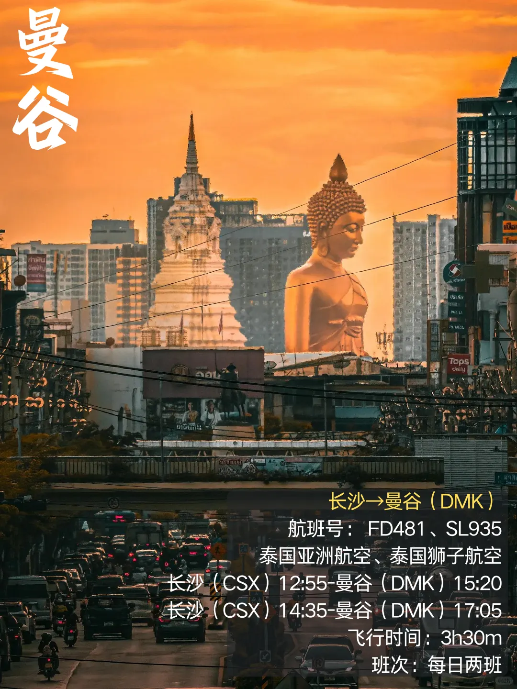

ท่าอากาศยานนานาชาติหวงหัวฉางซา (รหัสสนามบิน **CSX**) ตั้งอยู่ในเมืองหวงหัว อำเภอฉางซา และเป็นประตูระหว่างประเทศสำคัญของจีนตอนกลาง มีอาคารผู้โดยสารเปิดให้บริการสองหลัง (T1 และ T2) จากตัวเมือง รถไฟ **Maglev ฉางซา** เชื่อมต่อกับสถานีรถไฟความเร็วสูงฉางซาใต้ และรถไฟใต้ดิน**สาย 6** วิ่งไปยังสนามบิน

แล้วมีจุดหมายระหว่างประเทศและภูมิภาคใดบ้างที่เดินทางได้แบบ**บินตรง**จากฉางซา? รายการนี้รวบรวมจากตารางบินที่ต้นฉบับเผยแพร่สำหรับ**ฤดูหนาว 2025–26 (กุมภาพันธ์–มีนาคม 2026)**: **15 เส้นทาง** ครอบคลุมเอเชียตะวันออกเฉียงใต้ เอเชียตะวันออกเฉียงเหนือ ยุโรป และแอฟริกา **เส้นทางและความถี่เปลี่ยนแปลงทุกฤดูกาล** จึงควรตรวจสอบตารางบินปัจจุบันกับสายการบินก่อนจอง — วิธีตรวจสอบอยู่ในตอนท้าย

## 1. เส้นทางโดยสรุป

ตามประเทศและภูมิภาค:

| ประเทศ / ภูมิภาค | จุดหมาย | สายการบิน | ความถี่ |
| --- | --- | --- | --- |
| เมียนมา | ย่างกุ้ง (RGN) | Myanmar Airways International | สัปดาห์ละสองเที่ยว (อังคาร, เสาร์) |
| ไทย | กรุงเทพฯ (DMK) | Thai AirAsia, Thai Lion Air | วันละสองเที่ยว |
| ไทย | กรุงเทพฯ (BKK) | XiamenAir | ทุกวันจนถึง 28 ก.พ. 2026 |
| ไทย | ภูเก็ต (HKT) | Thai Lion Air | สัปดาห์ละสามเที่ยวจนถึง 2 มี.ค. 2026 |
| สหราชอาณาจักร | ลอนดอน (LHR) | Hainan Airlines | สัปดาห์ละสองเที่ยว (จันทร์, ศุกร์) |
| เกาหลีใต้ | โซล (ICN) | China Southern, Korean Air, Asiana | วันละสองเที่ยว |
| ฮ่องกง จีน | ฮ่องกง (HKG) | Cathay Pacific | ทุกวันจนถึง 28 มี.ค. 2026 |
| มาเลเซีย | กัวลาลัมเปอร์ (KUL) | China Southern, AirAsia X, XiamenAir, Batik Air | 2–4 เที่ยวต่อวัน |
| สิงคโปร์ | สิงคโปร์ (SIN) | China Southern, China Eastern, Scoot | วันละสองเที่ยว |
| กัมพูชา | พนมเปญ (KTI) | Cambodia Airways, Sky Angkor Airways | สัปดาห์ละห้าเที่ยว |
| อินโดนีเซีย | จาการ์ตา (CGK) | Citilink | วันพุธ 11 ก.พ. – 4 มี.ค. 2026 |
| เวียดนาม | โฮจิมินห์ซิตี้ (SGN) | China Southern | สัปดาห์ละสามเที่ยวจนถึง 28 ก.พ. 2026 (อังคาร, พฤหัสบดี, เสาร์) |
| เวียดนาม | ฮานอย (HAN) | China Southern | สัปดาห์ละห้าเที่ยว |
| ลาว | เวียงจันทน์ (VTE) | Lao Airlines | สัปดาห์ละสามเที่ยวจนถึง 28 มี.ค. 2026 |
| เคนยา | ไนโรบี (NBO) | China Southern | 2–3 เที่ยวต่อสัปดาห์ |

## 2. ทีละเส้นทาง

### เมียนมา: ย่างกุ้ง (RGN)

Myanmar Airways International บินฉางซา–ย่างกุ้งด้วยเที่ยวบิน **8M721**: ออกจากฉางซาเวลา 22:35 และลงจอดเวลา 00:45 ของวันถัดไป ใช้เวลาบนอากาศ 3 ชั่วโมง 40 นาที **สัปดาห์ละสองเที่ยว (อังคารและเสาร์)** เป็นเที่ยวบินข้ามคืนที่ทำให้คุณพร้อมไปเจดีย์ชเวดากองตั้งแต่เช้าวันรุ่งขึ้น

### ไทย: กรุงเทพฯ (DMK และ BKK) และภูเก็ต (HKT)

ไทยมีเที่ยวบินหนาแน่นที่สุดในบรรดาจุดหมายทั้งหมดจากฉางซา แบ่งออกเป็นสามสนามบิน:

- **กรุงเทพฯ ดอนเมือง (DMK)**: Thai AirAsia และ Thai Lion Air เที่ยวบิน **FD481 และ SL935** ออกจากฉางซาเวลา 12:55 และถึง 15:20 หรือออกเวลา 14:35 และถึง 17:05 ใช้เวลา 3 ชั่วโมง 30 นาที **วันละสองเที่ยว**;
- **กรุงเทพฯ สุวรรณภูมิ (BKK)**: XiamenAir เที่ยวบิน **MF8643** ออกจากฉางซาเวลา 08:30 และถึง 11:05 ใช้เวลา 3 ชั่วโมง 35 นาที **ทุกวันจนถึง 28 กุมภาพันธ์ 2026** — เที่ยวบินเช้าที่พาคุณถึงกรุงเทพฯ ช่วงเที่ยง;
- **ภูเก็ต (HKT)**: Thai Lion Air เที่ยวบิน **SL969** ออกจากฉางซา 17:20 และถึง 20:35 ใช้เวลา 4 ชั่วโมง 15 นาที **สัปดาห์ละสามเที่ยวจนถึง 2 มีนาคม 2026** ตรงสู่หมู่เกาะ

### สหราชอาณาจักร: ลอนดอน (LHR)

Hainan Airlines บินฉางซา–ลอนดอนฮีทโธรว์ด้วยเที่ยวบิน **HU7963**: ออกจากฉางซา 13:45 และลงจอดที่ฮีทโธรว์เวลา 17:35 ตามเวลาท้องถิ่น ใช้เวลา 11 ชั่วโมง 50 นาที **สัปดาห์ละสองเที่ยว (จันทร์และศุกร์)** เป็นเส้นทางตรงเส้นเดียวของฉางซาไปยังยุโรป — เส้นทางที่ควรรู้หากคุณเรียนหรือทำงานในสหราชอาณาจักร

### เกาหลีใต้: โซล (ICN)

China Southern, Korean Air และ Asiana ต่างบินฉางซา–โซลอินชอน เที่ยวบิน **CZ3065 / KE146 / KE820 / OZ322**: ออกจากฉางซา 12:55 และถึง 17:00 ใช้เวลาประมาณ 4 ชั่วโมง **วันละสองเที่ยว** เมื่อมีสามสายการบินบนเส้นทางนี้ จึงมีช่องให้เปรียบเทียบราคาและเปลี่ยนวันเดินทางได้

### ฮ่องกง จีน: ฮ่องกง (HKG)

Cathay Pacific บินฉางซา–ฮ่องกงด้วยเที่ยวบิน **CX943 และ CX927**: ออกจากฉางซา 21:15 และถึง 22:55 ใช้เวลา 1 ชั่วโมง 40 นาที **ทุกวันจนถึง 28 มีนาคม 2026** การถึงล่าช้านี้เชื่อมต่อได้พอดีกับเที่ยวบินระยะไกลของ Cathay ในเช้าวันถัดไป

### มาเลเซีย: กัวลาลัมเปอร์ (KUL)

China Southern, AirAsia X, XiamenAir และ Batik Air บินฉางซา–กัวลาลัมเปอร์ เที่ยวบิน **CZ5049, D7353, MF8015 และ OD643**: ออกจากฉางซา 11:50 และถึง 16:20 ใช้เวลา 4 ชั่วโมง 30 นาที **2–4 เที่ยวต่อวัน** ด้วยบริการที่มากขนาดนี้ การเปลี่ยนวันเดินทางในระยะสั้นจึงแทบไม่เป็นปัญหา

### สิงคโปร์: สิงคโปร์ (SIN)

China Southern, China Eastern และ Scoot บินฉางซา–สิงคโปร์ เที่ยวบิน **CZ5021, MU2045 และ TR125**: ออกจากฉางซา 00:05 และถึง 04:40 ใช้เวลา 4 ชั่วโมง 35 นาที **วันละสองเที่ยว** เป็นเที่ยวบินออกกลางดึกซึ่งพาคุณไปถึงทันเริ่มวันแรกได้เต็มที่

### กัมพูชา: พนมเปญ (KTI)

Cambodia Airways และ Sky Angkor Airways บินฉางซา–พนมเปญ เที่ยวบิน **KR942 และ ZA638**: ออกจากฉางซา 12:15 และถึง 14:30 ใช้เวลา 3 ชั่วโมง 15 นาที **สัปดาห์ละห้าเที่ยว** เที่ยวบินบ่ายที่ถึงช่วงบ่าย — เวลาที่สบายที่สุดในรายการนี้

### อินโดนีเซีย: จาการ์ตา (CGK)

Citilink บินฉางซา–จาการ์ตาด้วยเที่ยวบิน **QG8837**: ออกจากฉางซา 01:30 และถึง 06:20 ใช้เวลา 5 ชั่วโมง 50 นาที **ทุกวันพุธระหว่างวันที่ 11 กุมภาพันธ์ถึง 4 มีนาคม 2026**

### เวียดนาม: โฮจิมินห์ซิตี้ (SGN) และฮานอย (HAN)

- **โฮจิมินห์ซิตี้**: China Southern เที่ยวบิน **CZ6061** ออกจากฉางซา 23:20 และถึง 01:55 ของวันถัดไป ใช้เวลา 3 ชั่วโมง 35 นาที **สัปดาห์ละสามเที่ยวจนถึง 28 กุมภาพันธ์ 2026 (อังคาร, พฤหัสบดี, เสาร์)**;
- **ฮานอย**: China Southern เที่ยวบิน **CZ8359** ออกจากฉางซา 18:00 และถึง 19:20 ใช้เวลา 2 ชั่วโมง 20 นาที **สัปดาห์ละห้าเที่ยว** — เที่ยวบินที่สั้นที่สุดในรายการนี้ ออกก่อนอาหารเย็นและถึงหลังอาหารเย็น

### ลาว: เวียงจันทน์ (VTE)

Lao Airlines บินฉางซา–เวียงจันทน์ด้วยเที่ยวบิน **QV856**: ออกจากฉางซา 18:10 และถึง 19:25 ใช้เวลา 2 ชั่วโมง 15 นาที **สัปดาห์ละสามเที่ยวจนถึง 28 มีนาคม 2026**

### เคนยา: ไนโรบี (NBO)

China Southern บินฉางซา–ไนโรบีด้วยเที่ยวบิน **CZ6043**: ออกจากฉางซา 00:50 และถึง 06:50 ใช้เวลาบนอากาศ 11 ชั่วโมง **2–3 เที่ยวต่อสัปดาห์** เป็นเส้นทางตรงเส้นเดียวของฉางซาไปยังแอฟริกา และเป็นเที่ยวบินที่ยาวที่สุดในรายการนี้

## 3. ตารางบินเปลี่ยนได้: วิธีตรวจสอบก่อนเดินทาง

ความถี่และเวลาข้างต้นมาจากตารางบิน**ฤดูหนาว 2025–26 (กุมภาพันธ์–มีนาคม 2026)** ของต้นฉบับ และหลายรายการระบุวันที่ "จนถึง" ไว้ชัดเจน **สายการบินปรับเส้นทางและเวลาในทุกฤดูกาล (ปลายเดือนมีนาคมและปลายเดือนตุลาคม)** และเส้นทางหนึ่งอาจเปลี่ยนสายการบินหรือสนามบินได้ — โปรดทราบว่ากรุงเทพฯ มีสองสนามบิน คือ **BKK (สุวรรณภูมิ)** และ **DMK (ดอนเมือง)** ซึ่งห่างกันประมาณ 30 กม.

ก่อนเดินทาง:

1. ค้นหาใน**เว็บไซต์หรือแอปของสายการบินเอง**สำหรับวันที่คุณต้องการเดินทางจริง แทนที่จะพึ่งบทสรุปแบบ "สัปดาห์ละกี่เที่ยว";
2. ตรวจสอบหมายเลขเที่ยวบิน อาคารผู้โดยสาร และเวลาซ้ำบน**เว็บไซต์จองตั๋ว**;
3. ตรวจสอบ**สถานะเที่ยวบิน**อีกครั้งในวันก่อนเดินทาง — ความล่าช้า การเปลี่ยนอาคาร และการเปลี่ยนเครื่องบินล้วนส่งผลต่อจุดที่คุณเช็คอิน;
4. อ่านรหัสสนามบินให้ถี่ถ้วน: BKK และ DMK ใช้แทนกันไม่ได้สำหรับการต่อเครื่องหรือการรับผู้โดยสาร

ที่มาของภาพ: โปสเตอร์เส้นทางจากต้นฉบับ ตารางบินเป็นข้อมูลฤดูหนาวของต้นฉบับนั้น ส่วนประกาศของสายการบินและสนามบินเองในแต่ละวันถือเป็นข้อมูลที่ชี้ขาด

## ลิงก์ที่เกี่ยวข้อง

- **ในเว็บไซต์นี้ (สนามบิน)**: [กรุงเทพฯ สุวรรณภูมิ (BKK)](/airport/BKK), [โซลอินชอน (ICN)](/airport/ICN), [ฮ่องกง (HKG)](/airport/HKG), [กัวลาลัมเปอร์ (KUL)](/airport/KUL), [ลอนดอนฮีทโธรว์ (LHR)](/airport/LHR), [สิงคโปร์ชางงี (SIN)](/airport/SIN), [โฮจิมินห์ซิตี้ เตินเซินเญิต (SGN)](/airport/SGN), [จาการ์ตา (CGK)](/airport/CGK)
- **ในเว็บไซต์นี้ (ประเทศ)**: [จีน (CN)](/country/CN), [ไทย (TH)](/country/TH), [เกาหลีใต้ (KR)](/country/KR), [สิงคโปร์ (SG)](/country/SG), [สหราชอาณาจักร (GB)](/country/GB), [มาเลเซีย (MY)](/country/MY), [เวียดนาม (VN)](/country/VN), [อินโดนีเซีย (ID)](/country/ID), [เมียนมา (MM)](/country/MM), [เคนยา (KE)](/country/KE)
- **Wikipedia**: [ท่าอากาศยานนานาชาติหวงหัวฉางซา](https://en.wikipedia.org/wiki/Changsha_Huanghua_International_Airport)
- **Baidu Baike**: [ท่าอากาศยานนานาชาติหวงหัวฉางซา](https://baike.baidu.com/item/%E9%95%BF%E6%B2%99%E9%BB%84%E8%8A%B1%E5%9B%BD%E9%99%85%E6%9C%BA%E5%9C%BA)
