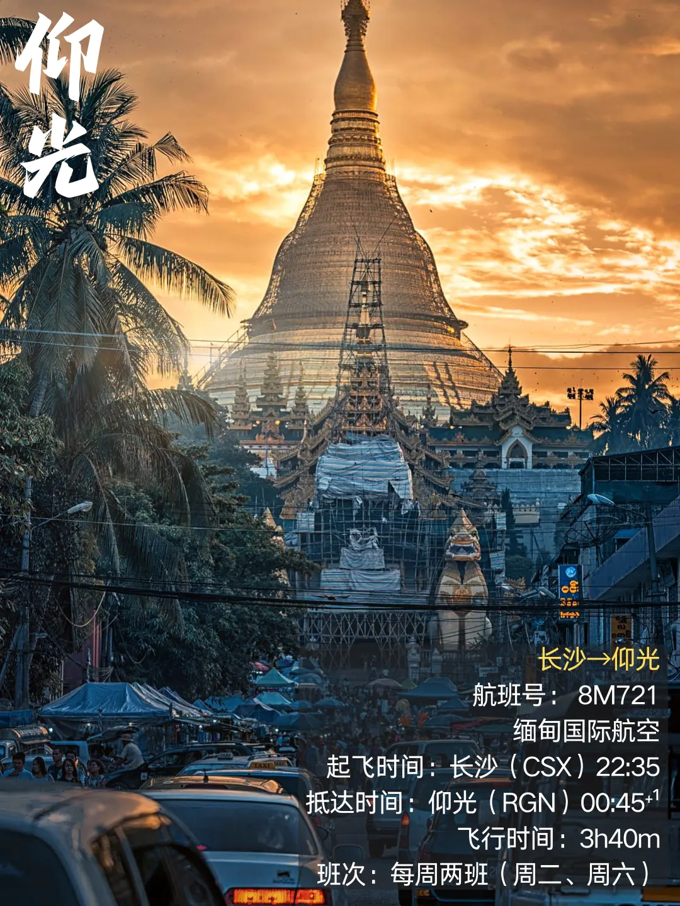

Changsha Huanghua Uluslararası Havalimanı (havalimanı kodu **CSX**), Changsha'ya bağlı Huanghua kasabasında yer alıyor ve hizmetteki iki terminaliyle (T1 ve T2) orta Çin'in önemli uluslararası kapılarından biri. Şehirden **Changsha maglev** hattı Changsha Güney yüksek hızlı demiryolu istasyonuna bağlanıyor ve **metro 6. hattı** havalimanına gidiyor.

Peki Changsha'dan **aktarmasız** hangi uluslararası ve bölgesel varış noktalarına ulaşabilirsiniz? Bu liste, orijinal materyalin **2025–26 kış sezonu (Şubat–Mart 2026)** için yayımladığı tarifelerden derlendi: Güneydoğu Asya, Kuzeydoğu Asya, Avrupa ve Afrika'yı kapsayan **15 güzergâh**. **Güzergâhlar ve sıklıklar her sezon değişir**, bu yüzden rezervasyon yapmadan önce güncel tarifeyi havayoluyla teyit edin — bunun nasıl yapılacağı yazının sonunda.

## 1. Güzergâhlara genel bakış

Ülke ve bölgeye göre:

| Ülke / bölge | Varış noktası | Havayolları | Sıklık |
| --- | --- | --- | --- |
| Myanmar | Yangon (RGN) | Myanmar Airways International | Haftada iki kez (Salı, Cumartesi) |
| Tayland | Bangkok (DMK) | Thai AirAsia, Thai Lion Air | Günde iki kez |
| Tayland | Bangkok (BKK) | XiamenAir | 28 Şubat 2026'ya kadar her gün |
| Tayland | Phuket (HKT) | Thai Lion Air | 2 Mart 2026'ya kadar haftada üç kez |
| Birleşik Krallık | Londra (LHR) | Hainan Airlines | Haftada iki kez (Pazartesi, Cuma) |
| Güney Kore | Seul (ICN) | China Southern, Korean Air, Asiana | Günde iki kez |
| Hong Kong, Çin | Hong Kong (HKG) | Cathay Pacific | 28 Mart 2026'ya kadar her gün |
| Malezya | Kuala Lumpur (KUL) | China Southern, AirAsia X, XiamenAir, Batik Air | Günde 2–4 kez |
| Singapur | Singapur (SIN) | China Southern, China Eastern, Scoot | Günde iki kez |
| Kamboçya | Phnom Penh (KTI) | Cambodia Airways, Sky Angkor Airways | Haftada beş kez |
| Endonezya | Cakarta (CGK) | Citilink | Çarşamba günleri, 11 Şubat – 4 Mart 2026 |
| Vietnam | Ho Chi Minh City (SGN) | China Southern | 28 Şubat 2026'ya kadar haftada üç kez (Salı, Perşembe, Cumartesi) |
| Vietnam | Hanoi (HAN) | China Southern | Haftada beş kez |
| Laos | Vientiane (VTE) | Lao Airlines | 28 Mart 2026'ya kadar haftada üç kez |
| Kenya | Nairobi (NBO) | China Southern | Haftada 2–3 kez |

## 2. Güzergâh güzergâh

### Myanmar: Yangon (RGN)

Myanmar Airways International, Changsha–Yangon hattını **8M721** sefer sayısıyla uçuyor: Changsha'dan 22:35'te kalkıp ertesi gün 00:45'te iniyor; havada 3 saat 40 dakika, **haftada iki kez (Salı ve Cumartesi)**. Gece uçuşu, ertesi sabah ilk iş Shwedagon Pagodası'na gitmeniz için sizi hazırlıyor.

### Tayland: Bangkok (DMK ve BKK) ve Phuket (HKT)

Tayland, Changsha'dan en yoğun hizmete sahip varış noktası ve üç havalimanına dağılıyor:

- **Bangkok Don Mueang (DMK)**: Thai AirAsia ve Thai Lion Air, **FD481 ve SL935** seferleri; Changsha'dan 12:55'te kalkıp 15:20'de varıyor ya da 14:35'te kalkıp 17:05'te varıyor; 3 saat 30 dakika, **günde iki kez**;
- **Bangkok Suvarnabhumi (BKK)**: XiamenAir, **MF8643** seferi; Changsha'dan 08:30'da kalkıp 11:05'te varıyor; 3 saat 35 dakika, **28 Şubat 2026'ya kadar her gün** — sizi öğlen Bangkok'ta bırakan bir sabah kalkışı;
- **Phuket (HKT)**: Thai Lion Air, **SL969** seferi; Changsha'dan 17:20'de kalkıp 20:35'te varıyor; 4 saat 15 dakika, **2 Mart 2026'ya kadar haftada üç kez**, doğrudan adalara.

### Birleşik Krallık: Londra (LHR)

Hainan Airlines, Changsha–Londra Heathrow hattını **HU7963** sefer sayısıyla uçuyor: Changsha'dan 13:45'te kalkıp Heathrow'a yerel saatle 17:35'te iniyor; 11 saat 50 dakika, **haftada iki kez (Pazartesi ve Cuma)**. Changsha'nın Avrupa'ya tek doğrudan güzergâhı — Birleşik Krallık'ta okuyorsanız veya çalışıyorsanız bilmeniz gereken hat.

### Güney Kore: Seul (ICN)

China Southern, Korean Air ve Asiana, Changsha–Seul Incheon hattını **CZ3065 / KE146 / KE820 / OZ322** seferleriyle uçuyor: Changsha'dan 12:55'te kalkıp 17:00'de varıyor; yaklaşık 4 saat, **günde iki kez**. Hatta üç taşıyıcı olması, ücretleri karşılaştırma ve tarih değiştirme imkânı bırakıyor.

### Hong Kong, Çin: Hong Kong (HKG)

Cathay Pacific, Changsha–Hong Kong hattını **CX943 ve CX927** seferleriyle uçuyor: Changsha'dan 21:15'te kalkıp 22:55'te varıyor; 1 saat 40 dakika, **28 Mart 2026'ya kadar her gün**. Geç varış, Cathay'in ertesi sabahki uzun mesafe kalkışlarıyla düzgünce örtüşüyor.

### Malezya: Kuala Lumpur (KUL)

China Southern, AirAsia X, XiamenAir ve Batik Air, Changsha–Kuala Lumpur hattını **CZ5049, D7353, MF8015 ve OD643** seferleriyle uçuyor: Changsha'dan 11:50'de kalkıp 16:20'de varıyor; 4 saat 30 dakika, **günde 2–4 kez**. Bu kadar yoğun hizmetle son anda tarih değiştirmek nadiren sorun oluyor.

### Singapur: Singapur (SIN)

China Southern, China Eastern ve Scoot, Changsha–Singapur hattını **CZ5021, MU2045 ve TR125** seferleriyle uçuyor: Changsha'dan 00:05'te kalkıp 04:40'ta varıyor; 4 saat 35 dakika, **günde iki kez**. Bunlar gece uçuşları; dolu dolu bir ilk güne zamanında varıyorsunuz.

### Kamboçya: Phnom Penh (KTI)

Cambodia Airways ve Sky Angkor Airways, Changsha–Phnom Penh hattını **KR942 ve ZA638** seferleriyle uçuyor: Changsha'dan 12:15'te kalkıp 14:30'da varıyor; 3 saat 15 dakika, **haftada beş kez**. Öğleden sonra kalkış, öğleden sonra varış — bu listedeki en makul zamanlama.

### Endonezya: Cakarta (CGK)

Citilink, Changsha–Cakarta hattını **QG8837** sefer sayısıyla uçuyor: Changsha'dan 01:30'da kalkıp 06:20'de varıyor; 5 saat 50 dakika, **11 Şubat ile 4 Mart 2026 arasında Çarşamba günleri haftalık**.

### Vietnam: Ho Chi Minh City (SGN) ve Hanoi (HAN)

- **Ho Chi Minh City**: China Southern, **CZ6061** seferi; Changsha'dan 23:20'de kalkıp ertesi gün 01:55'te varıyor; 3 saat 35 dakika, **28 Şubat 2026'ya kadar haftada üç kez (Salı, Perşembe, Cumartesi)**;
- **Hanoi**: China Southern, **CZ8359** seferi; Changsha'dan 18:00'de kalkıp 19:20'de varıyor; 2 saat 20 dakika, **haftada beş kez** — bu listedeki en kısa uçuş; akşam yemeğinden önce çıkıp yemekten sonra iniyorsunuz.

### Laos: Vientiane (VTE)

Lao Airlines, Changsha–Vientiane hattını **QV856** sefer sayısıyla uçuyor: Changsha'dan 18:10'da kalkıp 19:25'te varıyor; 2 saat 15 dakika, **28 Mart 2026'ya kadar haftada üç kez**.

### Kenya: Nairobi (NBO)

China Southern, Changsha–Nairobi hattını **CZ6043** sefer sayısıyla uçuyor: Changsha'dan 00:50'de kalkıp 06:50'de varıyor; havada 11 saat, **haftada 2–3 kez**. Changsha'nın Afrika'ya tek doğrudan güzergâhı ve bu listedeki en uzun uçuş.

## 3. Tarifeler değişir: uçmadan önce nasıl kontrol edilir

Yukarıdaki sıklıklar ve saatler, orijinal materyalin **2025–26 kış sezonu (Şubat–Mart 2026)** tarifesinden geliyor ve birçoğunda açık bir “şu tarihe kadar” ibaresi var. **Havayolları güzergâhları ve saatleri her sezon (mart sonunda ve ekim sonunda) gözden geçirir** ve bir güzergâh havayolu ya da havalimanı değiştirebilir — Bangkok'un yaklaşık 30 km arayla iki havalimanı olduğunu unutmayın: **BKK (Suvarnabhumi)** ve **DMK (Don Mueang)**.

Seyahat etmeden önce:

1. “Haftada şu kadar uçuş” özetine güvenmek yerine tam tarihiniz için **havayolunun kendi web sitesinde veya uygulamasında** arama yapın;
2. Uçuş numarasını, terminali ve saatleri bir **rezervasyon sitesinde** çapraz kontrol edin;
3. **Uçuş durumunu** bir gün önce yeniden kontrol edin — gecikmeler, terminal değişiklikleri ve uçak değişimleri check-in yapacağınız yeri etkiler;
4. Havalimanı kodunu dikkatle okuyun: BKK ile DMK aktarmalar veya karşılama için birbirinin yerine geçmez.

Görsel kaynağı: orijinal materyaldeki güzergâh afişleri. Tarifeler o materyalin kış sezonu bilgileridir; havayollarının ve havalimanlarının o güne ait kendi duyuruları kesindir.

## İlgili bağlantılar

- **Bu sitede (havalimanları)**: [Bangkok Suvarnabhumi (BKK)](/airport/BKK), [Seul Incheon (ICN)](/airport/ICN), [Hong Kong (HKG)](/airport/HKG), [Kuala Lumpur (KUL)](/airport/KUL), [Londra Heathrow (LHR)](/airport/LHR), [Singapur Changi (SIN)](/airport/SIN), [Ho Chi Minh City Tan Son Nhat (SGN)](/airport/SGN), [Cakarta (CGK)](/airport/CGK)
- **Bu sitede (ülkeler)**: [Çin (CN)](/country/CN), [Tayland (TH)](/country/TH), [Güney Kore (KR)](/country/KR), [Singapur (SG)](/country/SG), [Birleşik Krallık (GB)](/country/GB), [Malezya (MY)](/country/MY), [Vietnam (VN)](/country/VN), [Endonezya (ID)](/country/ID), [Myanmar (MM)](/country/MM), [Kenya (KE)](/country/KE)
- **Wikipedia**: [Changsha Huanghua International Airport](https://en.wikipedia.org/wiki/Changsha_Huanghua_International_Airport)
- **Baidu Baike**: [Changsha Huanghua International Airport](https://baike.baidu.com/item/%E9%95%BF%E6%B2%99%E9%BB%84%E8%8A%B1%E5%9B%BD%E9%99%85%E6%9C%BA%E5%9C%BA)
