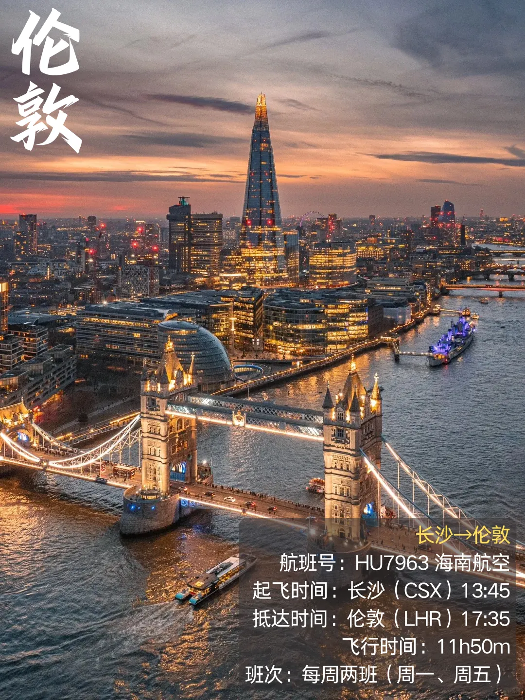
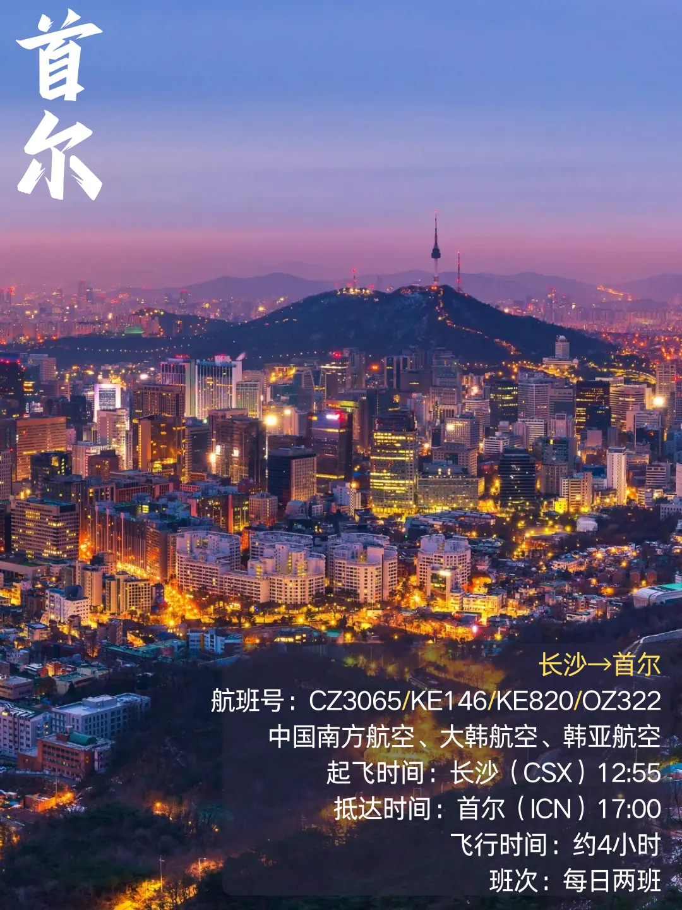
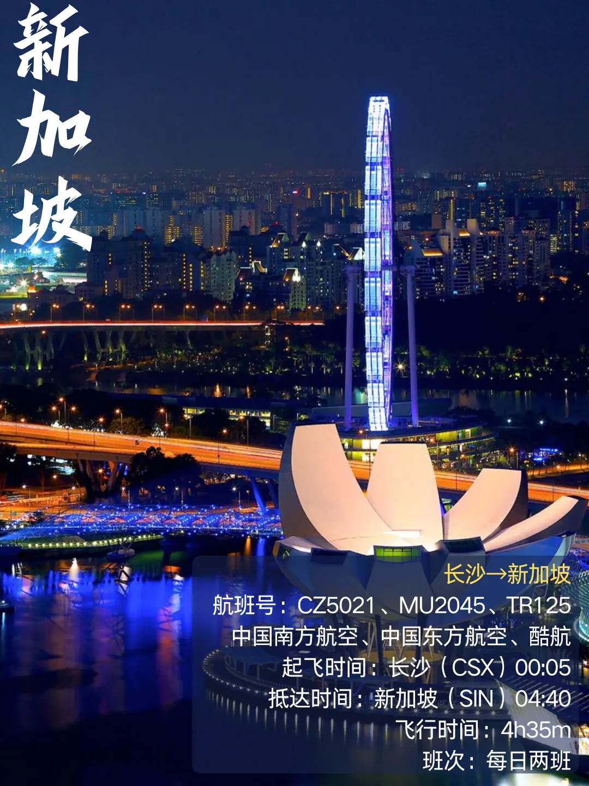
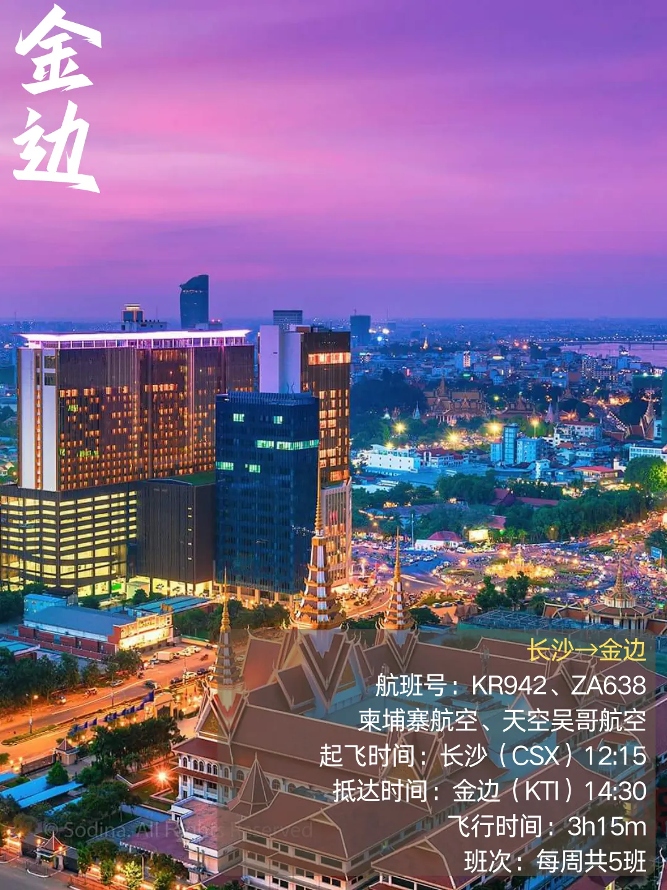
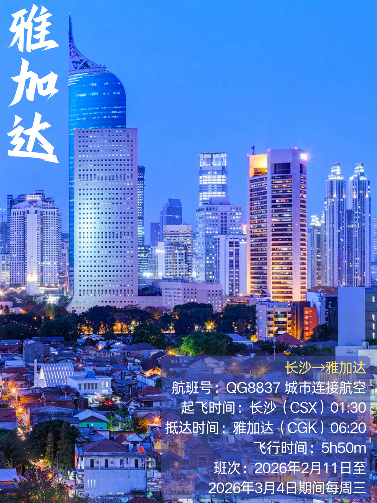
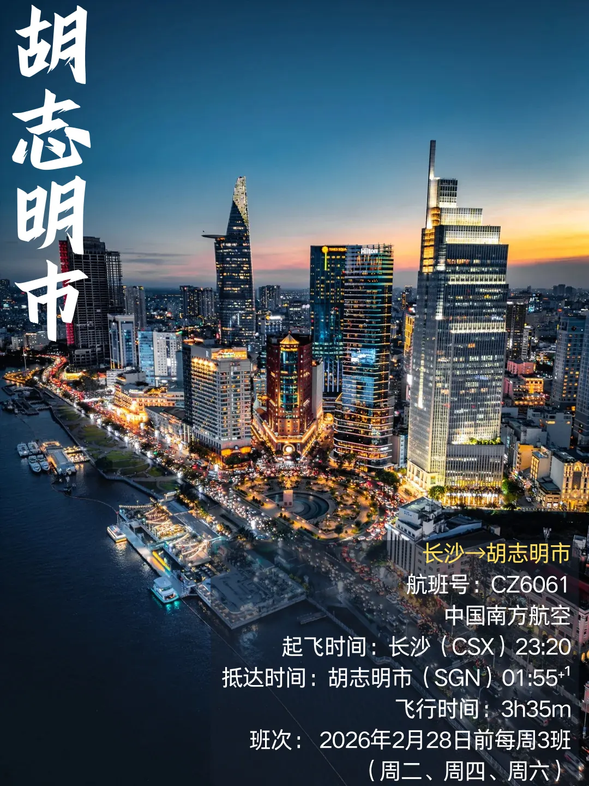
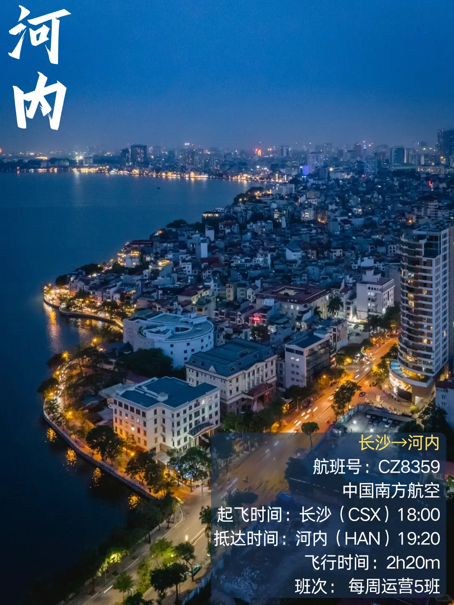
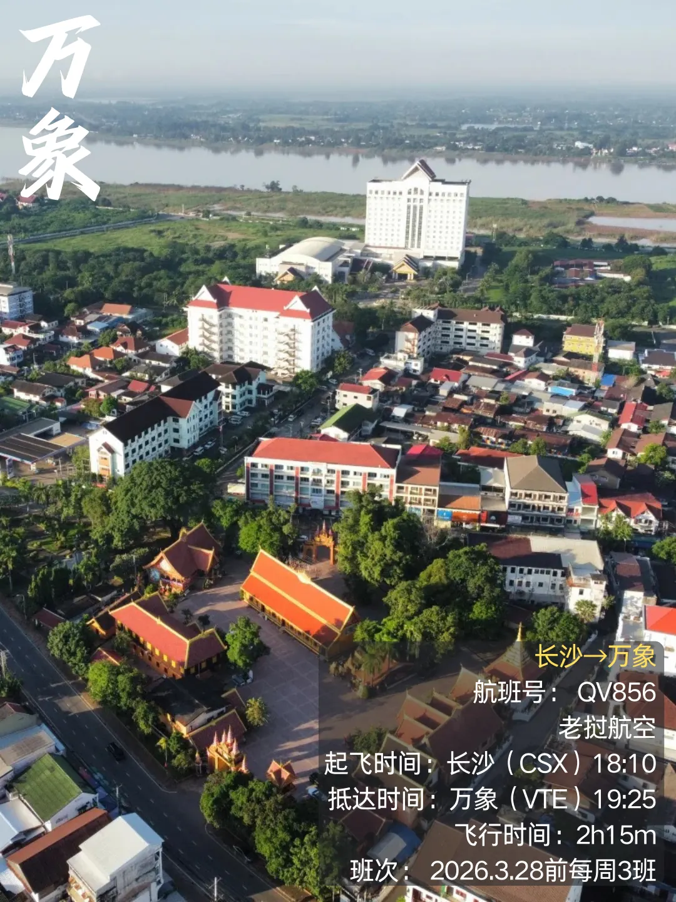
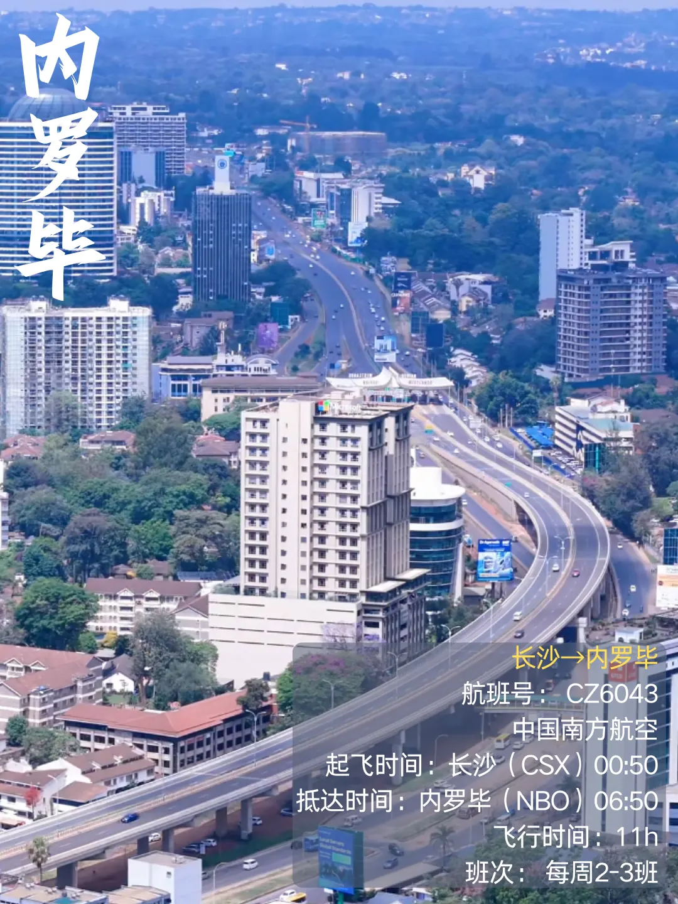

長沙黃花國際機場（機場代碼 **CSX**）位於長沙市長沙縣黃花鎮，是中部地區重要的國際航空口岸，現有 T1、T2 兩座航廈。從市區去機場，**長沙磁浮快線**連接高鐵長沙南站，**地鐵 6 號線**也可直達機場，落地或出發都比較方便。

那麼，從長沙出發能**直飛**哪些國際和地區目的地？這份清單根據原資料公佈的 **2026 年冬春航季**（2–3 月）班期整理，共 **15 條航線**，覆蓋東南亞、東北亞、歐洲與非洲。**航線與班次會隨航季調整**，出發前請以航司公佈的最新時刻為準（文末附核對方法）。

## 一、航線總覽

先看總表，按國家／地區分組：

| 國家／地區 | 目的地 | 航司 | 班次 |
| --- | --- | --- | --- |
| 緬甸 | 仰光（RGN） | 緬甸國際航空 | 每週兩班（週二、週六） |
| 泰國 | 曼谷（DMK） | 泰國亞洲航空、泰國獅子航空 | 每日兩班 |
| 泰國 | 曼谷（BKK） | 廈門航空 | 截至 2026.2.28 每日一班 |
| 泰國 | 普吉島（HKT） | 泰國獅子航空 | 截至 2026.3.2 每週三班 |
| 英國 | 倫敦（LHR） | 海南航空 | 每週兩班（週一、週五） |
| 韓國 | 首爾（ICN） | 中國南方航空、大韓航空、韓亞航空 | 每日兩班 |
| 中國香港 | 香港（HKG） | 國泰航空 | 截至 2026.3.28 每日一班 |
| 馬來西亞 | 吉隆坡（KUL） | 中國南方航空、亞洲航空 X、廈門航空、巴迪航空 | 每日 2–4 班 |
| 新加坡 | 新加坡（SIN） | 中國南方航空、中國東方航空、酷航 | 每日兩班 |
| 柬埔寨 | 金邊（KTI） | 柬埔寨航空、天空吳哥航空 | 每週共 5 班 |
| 印度尼西亞 | 雅加達（CGK） | 城市連接航空 | 2026.2.11–3.4 期間每週三 |
| 越南 | 胡志明市（SGN） | 中國南方航空 | 截至 2026.2.28 每週三班（週二、週四、週六） |
| 越南 | 河內（HAN） | 中國南方航空 | 每週五班 |
| 寮國 | 永珍（VTE） | 寮國航空 | 截至 2026.3.28 每週三班 |
| 肯亞 | 奈洛比（NBO） | 中國南方航空 | 每週 2–3 班 |

## 二、逐條航線

### 緬甸：仰光（RGN）

緬甸國際航空（Myanmar Airways International）執飛長沙—仰光，航班號 **8M721**：長沙 22:35 起飛、次日 00:45 抵達仰光，飛行 3 小時 40 分，**每週兩班（週二、週六）**。夜航落地，適合把仰光大金塔安排成第二天一早的第一站。

### 泰國：曼谷（DMK、BKK）與普吉島（HKT）

泰國是長沙直飛班次最密的目的地，三個機場各有分工：

- **曼谷廊曼（DMK）**：泰國亞洲航空與泰國獅子航空執飛，航班號 **FD481、SL935**，長沙 12:55 起飛 15:20 抵達／14:35 起飛 17:05 抵達，飛行 3 小時 30 分，**每日兩班**；
- **曼谷素萬那普（BKK）**：廈門航空執飛，航班號 **MF8643**，長沙 08:30 起飛、11:05 抵達，飛行 3 小時 35 分，**截至 2026 年 2 月 28 日每日一班**——上午出發，中午就能到曼谷；
- **普吉島（HKT）**：泰國獅子航空執飛，航班號 **SL969**，長沙 17:20 起飛、20:35 抵達，飛行 4 小時 15 分，**截至 2026 年 3 月 2 日每週三班**，適合直接落地海島。

### 英國：倫敦（LHR）

海南航空執飛長沙—倫敦希斯洛，航班號 **HU7963**：長沙 13:45 起飛、倫敦時間 17:35 抵達，飛行 11 小時 50 分，**每週兩班（週一、週五）**。這是長沙目前唯一一條直飛歐洲的航線，去英國留學、出差都靠它。

### 韓國：首爾（ICN）

中國南方航空、大韓航空與韓亞航空三家共同執飛長沙—首爾仁川，航班號 **CZ3065／KE146／KE820／OZ322**：長沙 12:55 起飛、17:00 抵達，飛行約 4 小時，**每日兩班**。三家航司同天運營，改簽和比價的空間都比較大。

### 中國香港：香港（HKG）

國泰航空執飛長沙—香港，航班號 **CX943、CX927**：長沙 21:15 起飛、22:55 抵達，飛行 1 小時 40 分，**截至 2026 年 3 月 28 日每日一班**。晚班機到港，第二天轉乘國泰的國際長航線很順。

### 馬來西亞：吉隆坡（KUL）

中國南方航空、亞洲航空 X、廈門航空與巴迪航空（Batik Air）共同執飛長沙—吉隆坡，航班號 **CZ5049、D7353、MF8015、OD643**：長沙 11:50 起飛、16:20 抵達，飛行 4 小時 30 分，**每日 2–4 班**。班次密集，臨時改期也不難。

### 新加坡：新加坡（SIN）

中國南方航空、中國東方航空與酷航共同執飛長沙—新加坡，航班號 **CZ5021、MU2045、TR125**：長沙 00:05 起飛、04:40 抵達，飛行 4 小時 35 分，**每日兩班**。紅眼航班為主，落地正好接上午的行程。

### 柬埔寨：金邊（KTI）

柬埔寨航空與天空吳哥航空執飛長沙—金邊，航班號 **KR942、ZA638**：長沙 12:15 起飛、14:30 抵達，飛行 3 小時 15 分，**每週共 5 班**。下午出發、下午到，是這批航線裡節奏最舒服的一條。

### 印度尼西亞：雅加達（CGK）

城市連接航空（Citilink）執飛長沙—雅加達，航班號 **QG8837**：長沙 01:30 起飛、06:20 抵達，飛行 5 小時 50 分，**2026 年 2 月 11 日至 3 月 4 日期間每週三**運營。

### 越南：胡志明市（SGN）與河內（HAN）

- **胡志明市**：中國南方航空執飛，航班號 **CZ6061**，長沙 23:20 起飛、次日 01:55 抵達，飛行 3 小時 35 分，**截至 2026 年 2 月 28 日每週三班（週二、週四、週六）**；
- **河內**：中國南方航空執飛，航班號 **CZ8359**，長沙 18:00 起飛、19:20 抵達，飛行 2 小時 20 分，**每週五班**——是這批航線裡飛行時間最短的一條，晚飯前出發、晚飯後到。

### 寮國：永珍（VTE）

寮國航空執飛長沙—永珍，航班號 **QV856**：長沙 18:10 起飛、19:25 抵達，飛行 2 小時 15 分，**截至 2026 年 3 月 28 日每週三班**。

### 肯亞：奈洛比（NBO）

中國南方航空執飛長沙—奈洛比，航班號 **CZ6043**：長沙 00:50 起飛、06:50 抵達，飛行 11 小時，**每週 2–3 班**。這是長沙唯一一條直飛非洲的航線，也是這批航線裡飛行時間最長的一條。

## 三、班期會變：出發前怎麼核對

上表的班次與時刻來自原資料公佈的 **2026 年冬春航季**（2–3 月）班期，其中有幾條本身就標註了「截至某日」。**航司每個航季（每年 3 月底與 10 月底）都會調整航線與時刻**，同一條航線也可能換航司、換機場（例如曼谷的 BKK 與 DMK 是兩個不同機場，別走錯）。

出發前建議按這個順序核對：

1. 在**航司官網或 App** 輸入具體日期查當天航班，不要只看「每週幾班」這類概述；
2. 用**訂票平臺**交叉驗證：同一天的航班號、航廈與起降時間；
3. 出發前一天再確認一次**航班動態**（延誤、改航廈、換機型都會影響值機櫃臺）；
4. 看清落地機場代碼：曼谷有 **BKK（素萬那普）** 與 **DMK（廊曼）** 兩個機場，兩者相距約 30 公里，轉機或接機都不要弄混。

圖片來源：原資料航線海報。文中班期為原資料整理的冬春航季資訊，實際以航空公司與機場當日公佈為準。

## 相關連結

- **本站頁面（機場）**：[曼谷素萬那普（BKK）](/tw/airport/BKK)、[首爾仁川（ICN）](/tw/airport/ICN)、[香港（HKG）](/tw/airport/HKG)、[吉隆坡（KUL）](/tw/airport/KUL)、[倫敦希斯洛（LHR）](/tw/airport/LHR)、[新加坡樟宜（SIN）](/tw/airport/SIN)、[胡志明市新山一（SGN）](/tw/airport/SGN)、[雅加達（CGK）](/tw/airport/CGK)
- **本站頁面（國家／地區）**：[中國（CN）](/tw/country/CN)、[泰國（TH）](/tw/country/TH)、[韓國（KR）](/tw/country/KR)、[新加坡（SG）](/tw/country/SG)、[英國（GB）](/tw/country/GB)、[馬來西亞（MY）](/tw/country/MY)、[越南（VN）](/tw/country/VN)、[印度尼西亞（ID）](/tw/country/ID)、[緬甸（MM）](/tw/country/MM)、[肯亞（KE）](/tw/country/KE)
- **維基百科**：[長沙黃花國際機場](https://zh.wikipedia.org/wiki/%E9%95%BF%E6%B2%99%E9%BB%84%E8%8A%B1%E5%9B%BD%E9%99%85%E6%9C%BA%E5%9C%BA)

