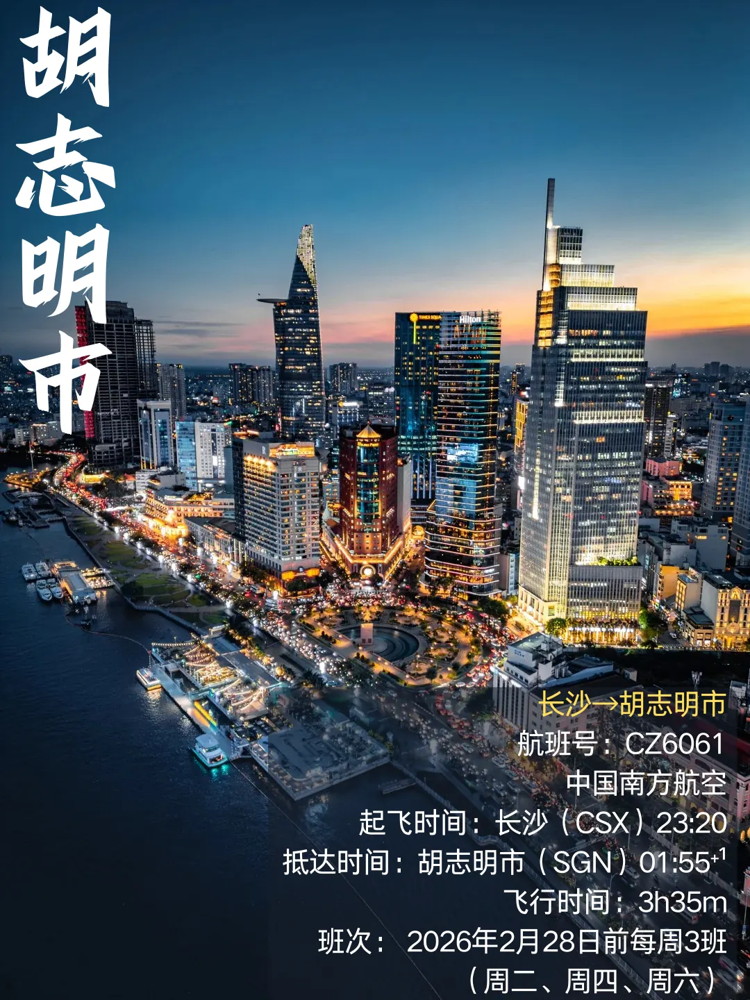
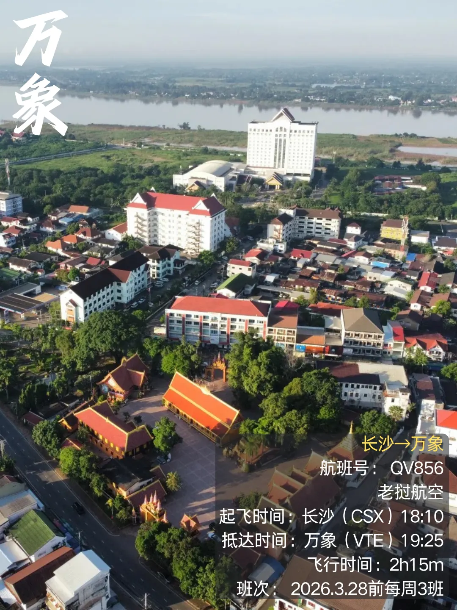

Sân bay quốc tế Hoàng Hoa Trường Sa (mã sân bay **CSX**) nằm ở thị trấn Hoàng Hoa, huyện Trường Sa, và là một cửa ngõ quốc tế lớn của miền trung Trung Quốc, với hai nhà ga đang hoạt động (T1 và T2). Từ thành phố, **tàu đệm từ Trường Sa** kết nối đến ga đường sắt cao tốc Trường Sa Nam và **tuyến metro số 6** chạy đến sân bay.

Vậy những điểm đến quốc tế và khu vực nào bạn có thể đến **bay thẳng** từ Trường Sa? Danh sách này được tổng hợp từ lịch bay mà tài liệu gốc công bố cho **mùa đông 2025–26 (tháng 2–3 năm 2026)**: **15 tuyến** bao gồm Đông Nam Á, Đông Bắc Á, châu Âu và châu Phi. **Các tuyến và tần suất thay đổi theo từng mùa**, vì vậy hãy xác nhận lịch trình hiện hành với hãng hàng không trước khi đặt vé — cách thực hiện được trình bày ở cuối bài.

## 1. Tổng quan các tuyến

Theo quốc gia và khu vực:

| Quốc gia / khu vực | Điểm đến | Hãng hàng không | Tần suất |
| --- | --- | --- | --- |
| Myanmar | Yangon (RGN) | Myanmar Airways International | Hai lần mỗi tuần (thứ Ba, thứ Bảy) |
| Thái Lan | Bangkok (DMK) | Thai AirAsia, Thai Lion Air | Hai lần mỗi ngày |
| Thái Lan | Bangkok (BKK) | XiamenAir | Hằng ngày đến 28 tháng 2 năm 2026 |
| Thái Lan | Phuket (HKT) | Thai Lion Air | Ba lần mỗi tuần đến 2 tháng 3 năm 2026 |
| Vương quốc Anh | London (LHR) | Hainan Airlines | Hai lần mỗi tuần (thứ Hai, thứ Sáu) |
| Hàn Quốc | Seoul (ICN) | China Southern, Korean Air, Asiana | Hai lần mỗi ngày |
| Hồng Kông, Trung Quốc | Hồng Kông (HKG) | Cathay Pacific | Hằng ngày đến 28 tháng 3 năm 2026 |
| Malaysia | Kuala Lumpur (KUL) | China Southern, AirAsia X, XiamenAir, Batik Air | 2–4 chuyến mỗi ngày |
| Singapore | Singapore (SIN) | China Southern, China Eastern, Scoot | Hai lần mỗi ngày |
| Campuchia | Phnom Penh (KTI) | Cambodia Airways, Sky Angkor Airways | Năm lần mỗi tuần |
| Indonesia | Jakarta (CGK) | Citilink | Thứ Tư, 11 tháng 2 – 4 tháng 3 năm 2026 |
| Việt Nam | Thành phố Hồ Chí Minh (SGN) | China Southern | Ba lần mỗi tuần đến 28 tháng 2 năm 2026 (thứ Ba, thứ Năm, thứ Bảy) |
| Việt Nam | Hà Nội (HAN) | China Southern | Năm lần mỗi tuần |
| Lào | Viêng Chăn (VTE) | Lao Airlines | Ba lần mỗi tuần đến 28 tháng 3 năm 2026 |
| Kenya | Nairobi (NBO) | China Southern | 2–3 lần mỗi tuần |

## 2. Chi tiết từng tuyến

### Myanmar: Yangon (RGN)

Myanmar Airways International khai thác tuyến Trường Sa – Yangon với số hiệu **8M721**: rời Trường Sa lúc 22:35 và hạ cánh lúc 00:45 ngày hôm sau, thời gian bay 3 giờ 40 phút, **hai lần mỗi tuần (thứ Ba và thứ Bảy)**. Đây là chuyến bay qua đêm, giúp bạn sẵn sàng đến chùa Shwedagon ngay từ sáng hôm sau.

### Thái Lan: Bangkok (DMK và BKK) và Phuket (HKT)

Thái Lan có mạng lưới dịch vụ dày đặc nhất trong các điểm đến từ Trường Sa, trải trên ba sân bay:

- **Bangkok Don Mueang (DMK)**: Thai AirAsia và Thai Lion Air, các chuyến **FD481 và SL935**, rời Trường Sa lúc 12:55 và đến 15:20, hoặc rời lúc 14:35 và đến 17:05, thời gian bay 3 giờ 30 phút, **hai lần mỗi ngày**;
- **Bangkok Suvarnabhumi (BKK)**: XiamenAir, chuyến **MF8643**, rời Trường Sa lúc 08:30 và đến 11:05, thời gian bay 3 giờ 35 phút, **hằng ngày đến 28 tháng 2 năm 2026** — một chuyến khởi hành buổi sáng đưa bạn đến Bangkok vào giữa trưa;
- **Phuket (HKT)**: Thai Lion Air, chuyến **SL969**, rời Trường Sa lúc 17:20 và đến 20:35, thời gian bay 4 giờ 15 phút, **ba lần mỗi tuần đến 2 tháng 3 năm 2026**, bay thẳng đến các hòn đảo.

### Vương quốc Anh: London (LHR)

Hainan Airlines khai thác tuyến Trường Sa – London Heathrow với số hiệu **HU7963**: rời Trường Sa lúc 13:45 và hạ cánh tại Heathrow lúc 17:35 giờ địa phương, thời gian bay 11 giờ 50 phút, **hai lần mỗi tuần (thứ Hai và thứ Sáu)**. Đây là tuyến bay thẳng duy nhất từ Trường Sa đến châu Âu — điều cần biết nếu bạn đang học tập hoặc làm việc tại Vương quốc Anh.

### Hàn Quốc: Seoul (ICN)

China Southern, Korean Air và Asiana đều khai thác tuyến Trường Sa – Seoul Incheon, các chuyến **CZ3065 / KE146 / KE820 / OZ322**: rời Trường Sa lúc 12:55 và đến 17:00, khoảng 4 giờ, **hai lần mỗi ngày**. Với ba hãng hàng không cùng khai thác tuyến này, bạn có dư địa để so sánh giá vé và thay đổi ngày đi.

### Hồng Kông, Trung Quốc: Hồng Kông (HKG)

Cathay Pacific khai thác tuyến Trường Sa – Hồng Kông với các chuyến **CX943 và CX927**: rời Trường Sa lúc 21:15 và đến 22:55, thời gian bay 1 giờ 40 phút, **hằng ngày đến 28 tháng 3 năm 2026**. Giờ đến muộn rất thuận tiện để nối với các chuyến bay đường dài của Cathay vào sáng hôm sau.

### Malaysia: Kuala Lumpur (KUL)

China Southern, AirAsia X, XiamenAir và Batik Air khai thác tuyến Trường Sa – Kuala Lumpur, các chuyến **CZ5049, D7353, MF8015 và OD643**: rời Trường Sa lúc 11:50 và đến 16:20, thời gian bay 4 giờ 30 phút, **2–4 chuyến mỗi ngày**. Với tần suất đó, việc đổi ngày sát giờ khởi hành hiếm khi là vấn đề.

### Singapore: Singapore (SIN)

China Southern, China Eastern và Scoot khai thác tuyến Trường Sa – Singapore, các chuyến **CZ5021, MU2045 và TR125**: rời Trường Sa lúc 00:05 và đến 04:40, thời gian bay 4 giờ 35 phút, **hai lần mỗi ngày**. Đây là các chuyến khởi hành đêm muộn, giúp bạn đến nơi kịp cho một ngày đầu tiên trọn vẹn.

### Campuchia: Phnom Penh (KTI)

Cambodia Airways và Sky Angkor Airways khai thác tuyến Trường Sa – Phnom Penh, các chuyến **KR942 và ZA638**: rời Trường Sa lúc 12:15 và đến 14:30, thời gian bay 3 giờ 15 phút, **năm lần mỗi tuần**. Một chuyến khởi hành buổi chiều và đến nơi vào buổi chiều — khung giờ thuận tiện nhất trong danh sách này.

### Indonesia: Jakarta (CGK)

Citilink khai thác tuyến Trường Sa – Jakarta với số hiệu **QG8837**: rời Trường Sa lúc 01:30 và đến 06:20, thời gian bay 5 giờ 50 phút, **mỗi tuần vào thứ Tư từ 11 tháng 2 đến 4 tháng 3 năm 2026**.

### Việt Nam: Thành phố Hồ Chí Minh (SGN) và Hà Nội (HAN)

- **Thành phố Hồ Chí Minh**: China Southern, chuyến **CZ6061**, rời Trường Sa lúc 23:20 và đến 01:55 ngày hôm sau, thời gian bay 3 giờ 35 phút, **ba lần mỗi tuần đến 28 tháng 2 năm 2026 (thứ Ba, thứ Năm, thứ Bảy)**;
- **Hà Nội**: China Southern, chuyến **CZ8359**, rời Trường Sa lúc 18:00 và đến 19:20, thời gian bay 2 giờ 20 phút, **năm lần mỗi tuần** — chuyến bay ngắn nhất trong danh sách này, khởi hành trước bữa tối và đến nơi sau bữa tối.

### Lào: Viêng Chăn (VTE)

Lao Airlines khai thác tuyến Trường Sa – Viêng Chăn với số hiệu **QV856**: rời Trường Sa lúc 18:10 và đến 19:25, thời gian bay 2 giờ 15 phút, **ba lần mỗi tuần đến 28 tháng 3 năm 2026**.

### Kenya: Nairobi (NBO)

China Southern khai thác tuyến Trường Sa – Nairobi với số hiệu **CZ6043**: rời Trường Sa lúc 00:50 và đến 06:50, thời gian bay 11 giờ, **2–3 lần mỗi tuần**. Đây là tuyến bay thẳng duy nhất từ Trường Sa đến châu Phi và là chuyến bay dài nhất trong danh sách này.

## 3. Lịch trình thay đổi: cách kiểm tra trước khi bay

Tần suất và giờ bay trên đây lấy từ lịch **mùa đông 2025–26 (tháng 2–3 năm 2026)** của tài liệu gốc, và một số chuyến có ngày kết thúc cụ thể. **Các hãng hàng không điều chỉnh tuyến và giờ bay mỗi mùa (vào cuối tháng 3 và cuối tháng 10)**, và một tuyến có thể thay đổi hãng hàng không hoặc sân bay — lưu ý Bangkok có hai sân bay, **BKK (Suvarnabhumi)** và **DMK (Don Mueang)**, cách nhau khoảng 30 km.

Trước khi đi:

1. Tìm trên **trang web hoặc ứng dụng của chính hãng hàng không** theo đúng ngày bạn muốn đi thay vì dựa vào bản tóm tắt “bao nhiêu chuyến mỗi tuần”;
2. Đối chiếu số hiệu chuyến bay, nhà ga và giờ bay trên một **trang đặt vé**;
3. Kiểm tra lại **tình trạng chuyến bay** một ngày trước — chậm chuyến, đổi nhà ga và thay đổi máy bay đều ảnh hưởng đến nơi bạn làm thủ tục;
4. Đọc kỹ mã sân bay: BKK và DMK không thể thay thế cho nhau khi nối chuyến hoặc đón khách.

Nguồn ảnh: các áp phích tuyến của tài liệu gốc. Lịch trình là thông tin mùa đông của tài liệu đó; thông báo của hãng hàng không và sân bay trong ngày là nguồn xác định cuối cùng.

## Liên kết liên quan

- **Trên trang này (sân bay)**: [Bangkok Suvarnabhumi (BKK)](/airport/BKK), [Seoul Incheon (ICN)](/airport/ICN), [Hồng Kông (HKG)](/airport/HKG), [Kuala Lumpur (KUL)](/airport/KUL), [London Heathrow (LHR)](/airport/LHR), [Singapore Changi (SIN)](/airport/SIN), [Thành phố Hồ Chí Minh Tân Sơn Nhất (SGN)](/airport/SGN), [Jakarta (CGK)](/airport/CGK)
- **Trên trang này (quốc gia)**: [Trung Quốc (CN)](/country/CN), [Thái Lan (TH)](/country/TH), [Hàn Quốc (KR)](/country/KR), [Singapore (SG)](/country/SG), [Vương quốc Anh (GB)](/country/GB), [Malaysia (MY)](/country/MY), [Việt Nam (VN)](/country/VN), [Indonesia (ID)](/country/ID), [Myanmar (MM)](/country/MM), [Kenya (KE)](/country/KE)
- **Wikipedia**: [Sân bay quốc tế Hoàng Hoa Trường Sa](https://en.wikipedia.org/wiki/Changsha_Huanghua_International_Airport)
- **Baidu Baike**: [Sân bay quốc tế Hoàng Hoa Trường Sa](https://baike.baidu.com/item/%E9%95%BF%E6%B2%99%E9%BB%84%E8%8A%B1%E5%9B%BD%E9%99%85%E6%9C%BA%E5%9C%BA)
