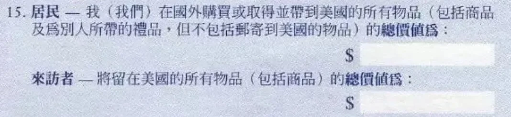

শিকাগোতে স্বাগতম। দীর্ঘ ফ্লাইটের পর ও'হেয়ার থেকে আপনার থাকার জায়গায় কীভাবে যাবেন, তা এখানে।

## ও'হেয়ারের টার্মিনালগুলো কীভাবে একসঙ্গে যুক্ত

মার্কিন যুক্তরাষ্ট্রের চতুর্থ ব্যস্ততম বিমানবন্দর হাব, শিকাগো ও'হেয়ার আন্তর্জাতিক (ORD)-এ **চারটি টার্মিনাল: 1, 2, 3 ও 5** (T1, T2, T3, T5)।

- **T1, T2 ও T3** সংযুক্ত, তাই এগুলোর মধ্যে হেঁটে যাওয়া যায়।
- **T5** আন্তর্জাতিক ফ্লাইট সামলায় — এর মধ্যে চীন থেকে আসা ও চীনে যাওয়া বেশিরভাগ ফ্লাইটও পড়ে — এবং **এয়ারপোর্ট ট্রানজিট সিস্টেম (ATS)** দিয়ে বাকিগুলোর সঙ্গে যুক্ত।

টার্মিনালগুলোর মধ্যে ATS **বিনামূল্যে**।

## শিকাগোতে আগমন

### বিমানে কাস্টমস ঘোষণাপত্র পূরণ করুন

ফ্লাইটের সময় ক্রুরা **কাস্টমস ঘোষণাপত্র** বিলি করেন (চীনা ভাষার সংস্করণও পাওয়া যায়)। **অবতরণের আগেই** এটি পূরণ করলে আগমন অনেক সহজ হয়।

পূরণ করার সময় কয়েকটি বিষয় খেয়াল রাখুন; নইলে অতিরিক্ত জিজ্ঞাসাবাদের জন্য পাঠানো হতে পারে:

1. পরিবারের সঙ্গে ভ্রমণ করলে এবং একই ঠিকানায় থাকলে একটি ফর্ম ভাগ করে ব্যবহার করতে পারেন।
2. **প্রবেশের উদ্দেশ্য সত্যি করে** লিখুন — পর্যটন, ব্যবসা, পড়াশোনা বা অন্য কিছু।
3. নিয়ে আসবেন না:
   - ফল, সবজি, গাছ, বীজ, খাবার বা পোকামাকড়;
   - মাংস, পশু, অথবা পশু ও বন্যপ্রাণীর পণ্য;
   - রোগজীবাণুর কালচার, কোষের কালচার বা শামুক;
   - মাটি, অথবা খামার, র্যাঞ্চ বা ফিডলটে ছিল এমন কোনো কিছু।
4. **US$10,000-এর বেশি নগদ** বহন করবেন না।

### ইমিগ্রেশনে যাওয়া

বিমান ও'হেয়ারে পৌঁছে ক্রুরা নামার অনুমতি দিলে একটু হাঁটুন, কেবিনে কিছু ফেলে এসেছেন কি না দেখে নিন — এবং ভিড় অনুসরণ করে **ইমিগ্রেশন এলাকায়** যান। শৌচাগারে থামার কারণে দলছুট হয়ে গেলে চিন্তা করবেন না: শুধু "Immigration" সাইন অনুসরণ করুন।

ইমিগ্রেশনে **"Visa" লাইনে** যান ("US Citizen" লাইনে নয়) এবং আপনার পালার জন্য অপেক্ষা করুন। আওয়াজ নিচু রাখুন এবং অফিসারদের ফোন দিয়ে ভিডিও করবেন না।

**পাসপোর্ট**, **ফর্ম I-20**, আপনার **আন্তর্জাতিক ভ্রমণ স্বাস্থ্য সনদ** ("ছোট লাল বই"), আপনার **আন্তর্জাতিক টিকাদান সনদ** ("ছোট হলুদ বই"), এবং থাকলে আপনার **ভর্তির চিঠি** বা **পড়াশোনার পরিকল্পনা** প্রস্তুত রাখুন।

অফিসার জিজ্ঞাসা করলে কেন আসছেন, আপনার স্কুল ও প্রোগ্রাম সম্পর্কে **সত্যি উত্তর দিন**। এরপর তারা আপনার ছবি ও আঙুলের ছাপ নেবেন, আর তাতেই প্রবেশ প্রক্রিয়া শেষ হবে।

### লাগেজ ও কাস্টমস

লাগেজ ট্যাগের তথ্য অনুসরণ করে সঠিক কনভেয়ার বেল্টে যান এবং **আপনার ব্যাগের জন্য অপেক্ষা করুন**, স্ক্রিনের সঙ্গে মিলিয়ে দেখুন — **বিমানবন্দরের স্ক্রিনই চূড়ান্ত**।

ঘোষণা করার মতো কিছু না থাকলে সাধারণত সোজা বেরিয়ে যেতে পারবেন। তল্লাশির জন্য আলাদা করে ডাকা হলে শান্ত থাকুন, অফিসারদের সঙ্গে সহযোগিতা করুন এবং **কিছু গোপন করবেন না**।

T5-এর আগমন হলের নানা আকারের রেস্তোরাঁ আছে, তাই বেরোনোর পর আরাম করতে পারেন, পানীয় বা হালকা খাবার কিনতে পারেন, এবং পরিবারকে অবতরণের খবর দিতে বিমানবন্দরের বিনামূল্যের ওয়াই-ফাইতে যুক্ত হতে পারেন।

## বিমানবন্দর ছাড়া

স্কুল বা অন্য কোনো প্রতিষ্ঠানের সঙ্গে পিকআপের ব্যবস্থা থাকলে বিমানবন্দরের সাইন অনুসরণ করে নির্ধারিত গেটে যান।

বিভিন্ন এলাকায় যাওয়া যাত্রীরা প্রতিটি পরিবহন বিকল্পের সাইনও অনুসরণ করতে পারেন: শ্যাম্পেইন, পারডু বা অঞ্চলের অন্য জায়গায় যাওয়া লোকেরা সাধারণত চার্টার বাস নেন, আর শিকাগো শহরে যাওয়া লোকেরা সাধারণত রাইড-হেইলিং বা CTA নেন।

## শহরে পৌঁছানো

### বিকল্প 1: CTA ব্লু লাইন

CTA-তে ও'হেয়ার থেকে আসা-যাওয়া করতে হলে **ব্লু লাইন** নিতে হবে। প্রথমে **ATS শাটল** নিয়ে **টার্মিনাল 2**-এ যান এবং সেখানে বদলান — টার্মিনালগুলোর মধ্যে ATS **বিনামূল্যে**।

ব্লু লাইন **সপ্তাহে সাত দিন, দিনে 24 ঘণ্টা** চলে। ও'হেয়ার স্টেশন থেকে প্রতিটি ট্রেন ফরেস্ট পার্কের পথে ডাউনটাউন হয়ে যায়, আর ডাউনটাউনে যেতে সাধারণত **40–45 মিনিট** লাগে।

**T2**-এ পৌঁছালে **নীল মেট্রো আইকন** অনুসরণ করে ব্লু লাইন প্ল্যাটফর্মে যান। ঢোকার আগে মেশিন থেকে টিকিট কিনতে হবে: **ও'হেয়ার ও ডাউনটাউনের মধ্যে ভাড়া $5** (সাধারণ ভাড়া $2.50)। কিছু মেশিন খুচরা ফেরত দেয় না, তাই কয়েন প্রস্তুত রাখুন, অথবা Visa বা Mastercard ক্রেডিট বা ডেবিট কার্ড দিয়ে দিন।

বেরোনোর সময় ট্যাপ আউট করতে হবে না, তবে **এক টিকিটে দুই ঘণ্টার মধ্যে অন্য CTA ট্রেন বা বাসে সর্বোচ্চ দুটি বিনামূল্যের পরিবর্তন** পাওয়া যায়, তাই টিকিটটি ধরে রাখুন।

**SAIC**, **DePaul (Loop)**, **Columbia College Chicago** বা **UIC**-তে যাচ্ছেন হলে ট্রেন বদলাতে হবে না — যথাক্রমে Monroe, Jackson, LaSalle বা UIC-Halsted-এ নামুন।

**DePaul (Lincoln Park)**, **Northwestern (Kellogg)**, **শিকাগো বিশ্ববিদ্যালয়** বা **IIT**-এর জন্য অন্য মেট্রো বা বাস রুটে বদলাতে হবে।

### বিকল্প 2: রাইড-হেইলিং

সবচেয়ে সহজ, দ্রুত ও আরামদায়ক বিকল্প চাইলে গাড়ি নিন এবং লাগেজ টানাটানির ঝামেলা এড়ান। একমাত্র অসুবিধা হলো এটি **ব্যয়বহুল** এবং **ব্যস্ত সময়ে যানজটে আটকে যেতে পারে**।

Uber ও Lyft হলো মার্কিন যুক্তরাষ্ট্রে সবাই ব্যবহার করা দুটি অ্যাপ। ওড়ার আগে আন্তর্জাতিক সংস্করণ ডাউনলোড করুন এবং আগেভাগে **দ্বৈত মুদ্রার ক্রেডিট কার্ড লিংক** করুন। অবতরণের পর ইন্টারনেট সংযোগ পেলে (বিমানবন্দরের ওয়াই-ফাই চলবে) গাড়ি ডাকতে পারবেন।

**T5**-এ অবতরণ করলে প্রথমে **ATS** নিয়ে **টার্মিনাল 2**-এ যান, তারপর **Rideshare / Ride App** সাইন অনুসরণ করে **প্রস্থান স্তরে** পিকআপ পয়েন্টে যান।

Uber ও Lyft দুটোই শুধু এখানেই যাত্রী তোলে। আপনার চালক পিকআপ পয়েন্টে পৌঁছালে মিটার শুরু হয়, আর সামান্য গ্রেস পিরিয়ড (প্রায় পাঁচ মিনিট) পরে অতিরিক্ত চার্জ লাগে — তাই **T2 পিকআপ পয়েন্টে পৌঁছে গাড়ি ডাকাই** ভালো।

নিবন্ধন করে পেমেন্ট পদ্ধতি যোগ করার পর অ্যাপে শুরুর স্থান ও গন্তব্য লিখে গাড়ির ধরন বেছে নিন। অ্যাপ নিকটতম চালকের সঙ্গে মিলিয়ে দিলে তার বিবরণ ও রেটিং দেখাবে — **রেটিং কম হলে নিরাপত্তার জন্য অন্য চালক অনুরোধ করুন**।

একই যাত্রার ভাড়া দুই অ্যাপে সামান্য আলাদা, তবে পরিষেবা মূলত একই (বেশিরভাগ চালক দুটোতেই কাজ করেন), তাই নিশ্চিত করার আগে তুলনা করা ভালো।

> গাড়িতে ওঠার আগে চালক ও গাড়ির বিবরণ — নাম, মডেল ও নম্বর প্লেট — দেখে নিন। যাত্রার সময় সজাগ থাকুন এবং অ্যাপে দেখুন রুট ঠিক আছে কি না।

### বিকল্প 3: পেস বাস

**(বিশেষত নর্থওয়েস্টার্নের শিক্ষার্থীদের জন্য)**

পেস শিকাগোর শহরতলিতে বাস চালায়, আর তার পালস ডেম্পস্টার লাইন **ও'হেয়ার থেকে ইভানস্টন** পর্যন্ত চলে, যেখানে নর্থওয়েস্টার্ন বিশ্ববিদ্যালয়, প্রায় **50 মিনিটে**, প্রতি **15–20 মিনিটে** (সপ্তাহান্তে ও ভিড়ের সময়ের বাইরে প্রতি 20–30 মিনিটে)।

ও'হেয়ার থেকে ইভানস্টনে যেতে **ATS নিয়ে MMF (মাল্টি-মোডাল ফ্যাসিলিটি)**-তে যান এবং পালস বাসের জন্য **বে 9** খুঁজুন। বাসে Ventra কার্ড ট্যাপ করতে পারেন বা নগদ দিতে পারেন: ভাড়া **$2** (নগদে $2.25)।

## শেষ একটি পরামর্শ

যেভাবেই ভ্রমণ করুন, আশপাশ সম্পর্কে সচেতন থাকুন, এবং ওঠা বা নামার আগে কোনো লাগেজ ফেলে আসেননি কি না দেখে নিন।

## সম্পর্কিত লিংক

- **এই সাইটে**: [শিকাগো ও'হেয়ার ORD](/airport/ORD), [মার্কিন যুক্তরাষ্ট্র (US)](/country/US)
- **উইকিপিডিয়া**: [শিকাগো ও'হেয়ার ORD](https://en.wikipedia.org/wiki/O'Hare_International_Airport)
- **বাইদু বাইকে**: [শিকাগো ও'হেয়ার ORD](https://baike.baidu.com/item/%E5%A5%A5%E9%BB%91%E5%B0%94%E5%9B%BD%E9%99%85%E6%9C%BA%E5%9C%BA)
