Willkommen in Chicago. Nach einem langen Flug erfahren Sie hier, wie Sie von O'Hare zu Ihrer Unterkunft kommen.

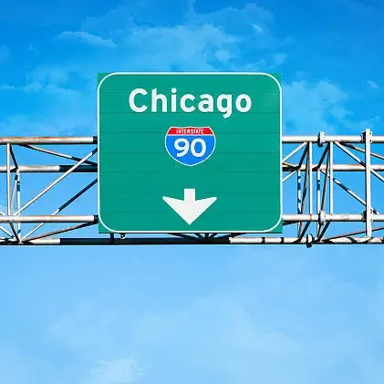

## Wie die Terminals von O'Hare zusammenpassen

Als viertgrößtes Flughafendrehkreuz der Vereinigten Staaten hat der Chicago O'Hare International (ORD) **vier Terminals: 1, 2, 3 und 5** (T1, T2, T3, T5).

- **T1, T2 und T3** sind verbunden, Sie können also zwischen ihnen laufen.
- **T5** fertigt internationale Flüge ab – darunter die meisten Flüge von und nach China – und ist über das **Airport Transit System (ATS)** mit den anderen verbunden.

Das ATS ist zwischen den Terminals **kostenlos**.

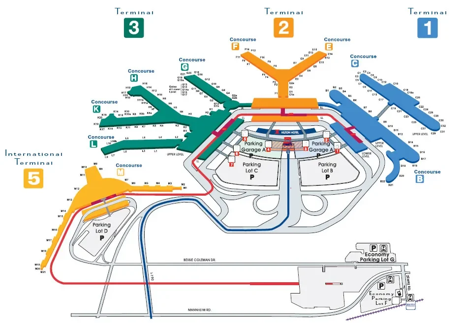

## Ankunft in Chicago

### Füllen Sie das Zollanmeldungsformular im Flugzeug aus

Während des Flugs teilt die Crew das **Zollanmeldungsformular** aus (eine chinesische Version ist erhältlich). Wenn Sie es **vor der Landung** ausfüllen, wird die Ankunft deutlich reibungsloser.

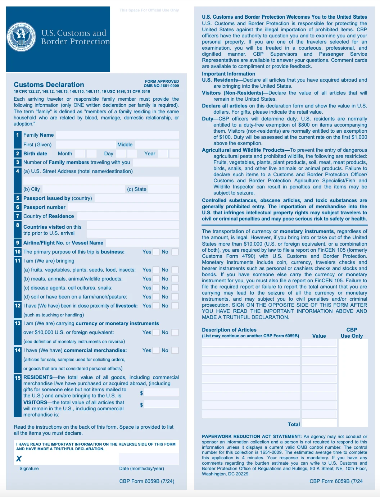

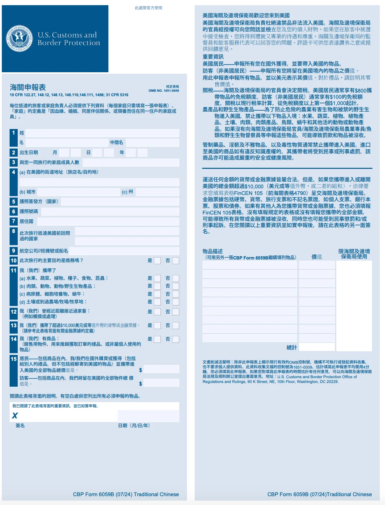

Ein paar Dinge, auf die Sie beim Ausfüllen achten sollten, sonst werden Sie möglicherweise zu weiteren Befragungen geschickt:

1. Wenn Sie mit Ihrer Familie reisen und an derselben Adresse wohnen, können Sie ein Formular gemeinsam nutzen.
2. Geben Sie Ihren **Einreisezweck wahrheitsgemäß** an – Tourismus, Geschäft, Studium oder etwas anderes.
3. Führen Sie nicht ein:
   - Obst, Gemüse, Pflanzen, Samen, Lebensmittel oder Insekten;
   - Fleisch, Tiere oder tierische und Wildtierprodukte;
   - Krankheitskulturen, Zellkulturen oder Schnecken;
   - Erde oder Gegenstände, die auf einer Farm, Ranch oder einem Mastbetrieb waren.
4. Führen Sie **nicht mehr als US$10,000 Bargeld** mit.

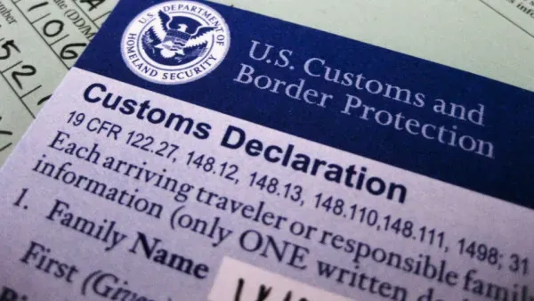

### Zur Einwanderungskontrolle gehen

Sobald das Flugzeug in O'Hare steht und die Crew durchsagt, dass Sie aussteigen können, vertreten Sie sich die Beine, prüfen Sie, dass Sie nichts in der Kabine vergessen haben – und folgen Sie der Menge **zum Einreisebereich**. Wenn Sie den Anschluss verlieren, weil Sie an der Toilette angehalten haben, kein Problem: Folgen Sie einfach den Schildern „Immigration“.

Bei der Einreisekontrolle stellen Sie sich in die **„Visa“-Schlange** (nicht in die „US Citizen“-Schlange) und warten Sie, bis Sie dran sind. Sprechen Sie leise und filmen Sie die Beamten nicht mit dem Handy.

Halten Sie Ihren **Reisepass**, das **Formular I-20**, Ihren **internationalen Reisegesundheitsausweis** (das „kleine rote Buch“), Ihren **internationalen Impfausweis** (das „kleine gelbe Buch“) und, falls vorhanden, Ihr **Zulassungsschreiben** oder Ihren **Studienplan** bereit.

Wenn der Beamte fragt, warum Sie einreisen, **antworten Sie wahrheitsgemäß** über Ihre Hochschule und Ihr Programm. Anschließend werden Sie fotografiert und es werden Fingerabdrücke genommen, womit der Einreisevorgang abgeschlossen ist.

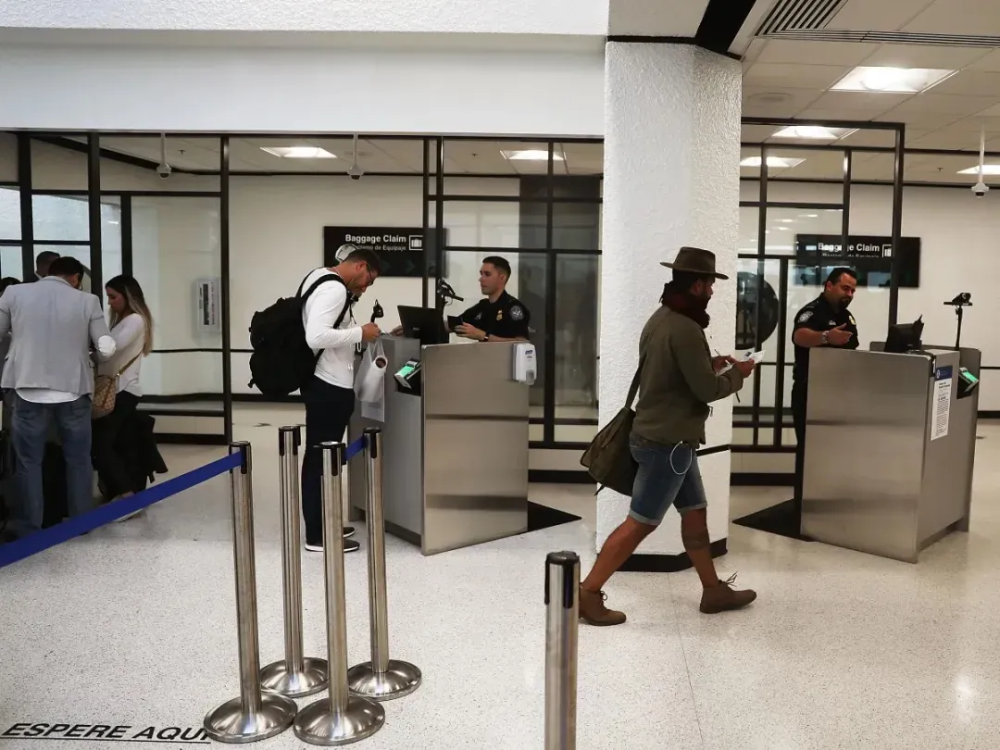

### Gepäck und Zoll

Folgen Sie den Angaben auf Ihrem Gepäckanhänger zum richtigen Gepäckband und **warten Sie auf Ihre Koffer**, und vergleichen Sie sie mit den Anzeigen – **die Anzeigen des Flughafens sind maßgeblich**.

Wenn Sie nichts zu verzollen haben, können Sie in der Regel direkt hinausgehen. Wenn Sie zur Kontrolle herausgewunken werden, bleiben Sie ruhig, arbeiten Sie mit den Beamten zusammen und **behalten Sie nichts zurück**.

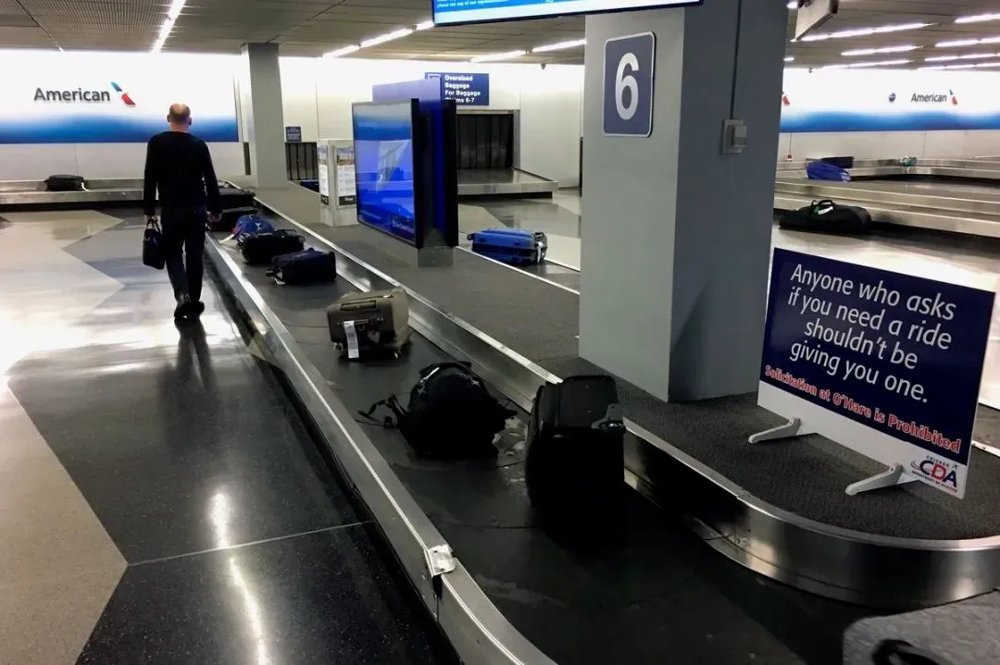

Die Ankunftshalle von T5 hat Restaurants jeder Größe; sobald Sie durch sind, können Sie sich also entspannen, ein Getränk oder einen Snack kaufen und sich mit dem kostenlosen WLAN des Flughafens verbinden, um Ihrer Familie mitzuteilen, dass Sie gelandet sind.

## Den Flughafen verlassen

Wenn Sie eine Abholung durch Ihre Hochschule oder eine andere Organisation arrangiert haben, folgen Sie den Flughafenschildern zum vereinbarten Tor.

Reisende in verschiedene Gebiete können auch den Schildern für die jeweilige Transportmöglichkeit folgen: Wer nach Champaign, Purdue oder an andere Orte der Region will, nimmt meist einen Charterbus, wer in die Stadt Chicago selbst will, meist Ride-Hailing oder die CTA.

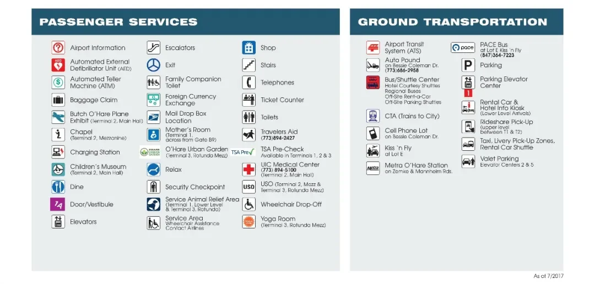

## In die Stadt kommen

### Option 1: die CTA Blue Line

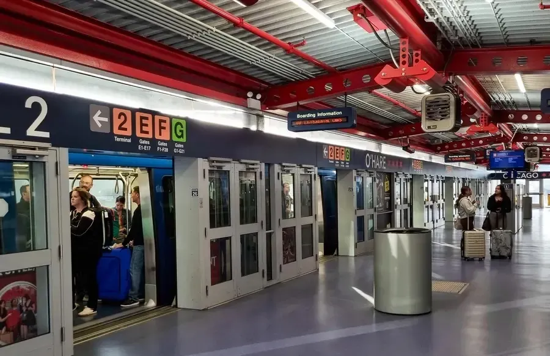

Mit der CTA von und nach O'Hare zu fahren bedeutet, die **Blue Line** zu nehmen. Zuerst nehmen Sie den **ATS-Shuttle** zum **Terminal 2** und steigen dort um – das ATS ist zwischen den Terminals **kostenlos**.

Die Blue Line fährt **24 Stunden am Tag, sieben Tage die Woche**. Jeder Zug von der Station O'Hare fährt durch die Innenstadt weiter nach Forest Park, und die Fahrt in die Innenstadt dauert in der Regel **40–45 Minuten**.

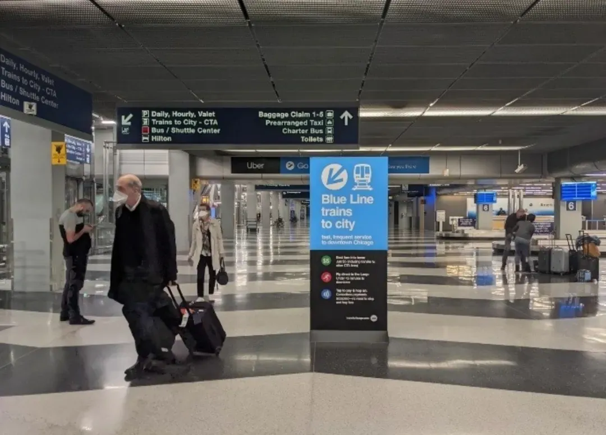

Wenn Sie am **T2** sind, folgen Sie dem **blauen U-Bahn-Symbol**, um zum Bahnsteig der Blue Line zu gelangen. Sie müssen vor dem Einsteigen ein Ticket am Automaten kaufen: Der **Fahrpreis zwischen O'Hare und der Innenstadt beträgt $5** (der reguläre Fahrpreis liegt bei $2.50). Manche Automaten geben kein Wechselgeld, halten Sie also Münzen bereit oder zahlen Sie mit einer Visa- oder Mastercard-Kredit- oder Debitkarte.

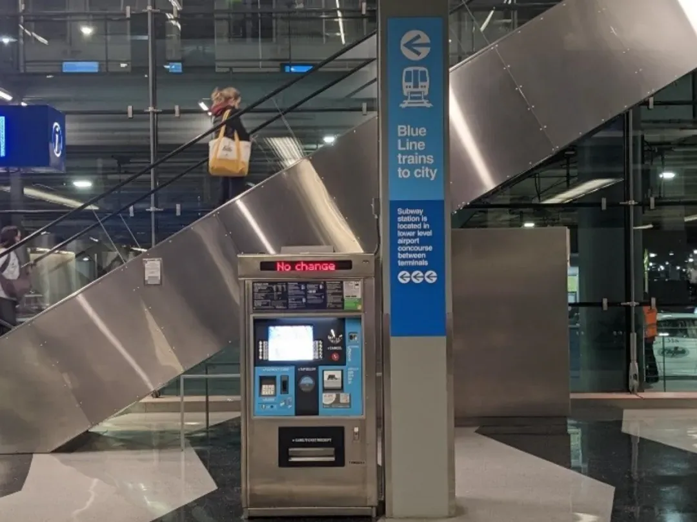

Beim Aussteigen müssen Sie nicht auschecken, aber **ein Ticket erlaubt Ihnen bis zu zwei kostenlose Umstiege zu einer anderen CTA-Bahn oder einem Bus innerhalb von zwei Stunden**, bewahren Sie es also auf.

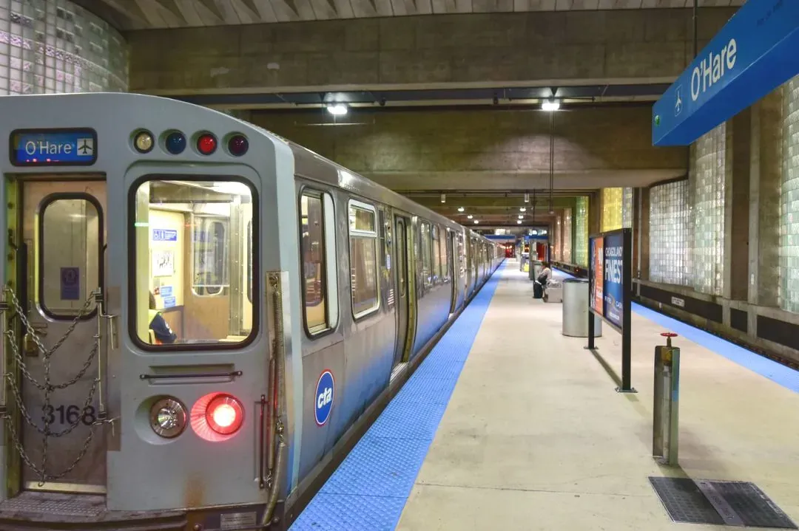

Wenn Sie zur **SAIC**, zur **DePaul (Loop)**, zum **Columbia College Chicago** oder zur **UIC** wollen, müssen Sie nicht umsteigen – steigen Sie je nach Ziel an Monroe, Jackson, LaSalle oder UIC-Halsted aus.

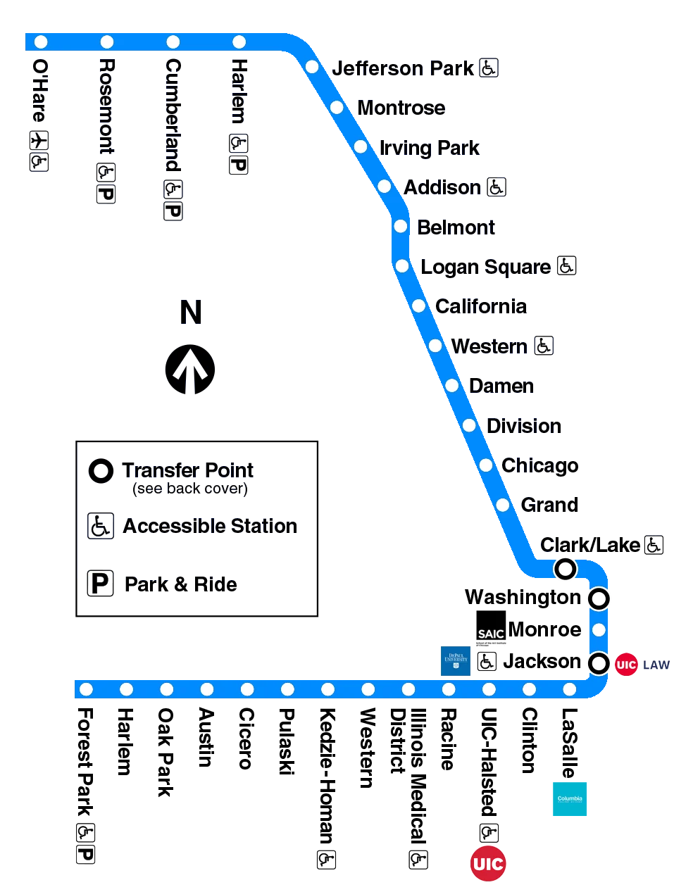

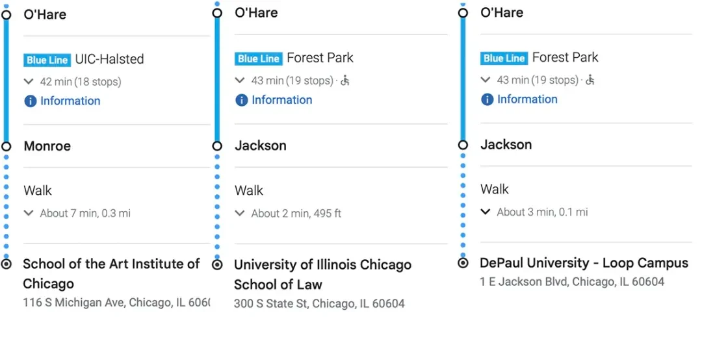

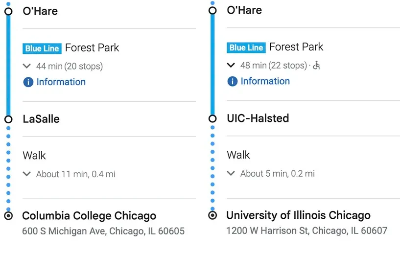

Für **DePaul (Lincoln Park)**, **Northwestern (Kellogg)**, die **University of Chicago** oder das **IIT** müssen Sie auf eine andere U-Bahn- oder Buslinie umsteigen.

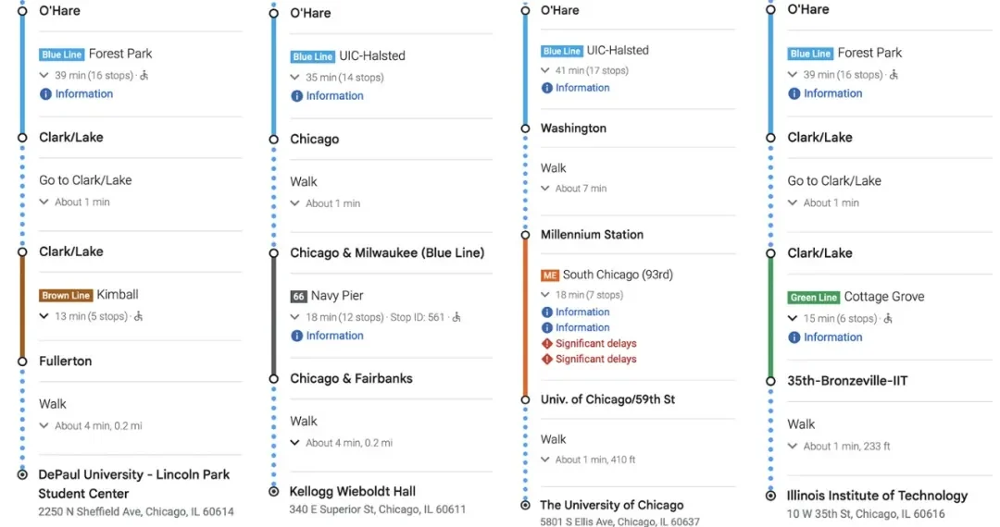

### Option 2: Ride-Hailing

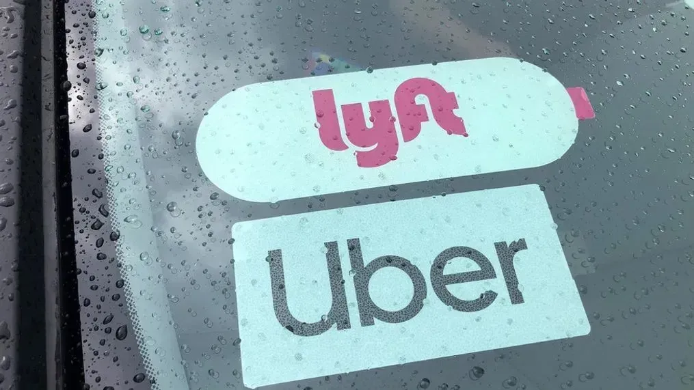

Wenn Sie die einfachste, schnellste und bequemste Option wollen, nehmen Sie ein Auto und ersparen sich das Herumschleppen des Gepäcks. Die einzigen Nachteile sind, dass es **teuer** ist und **zu Stoßzeiten im Stau stecken kann**.

Uber und Lyft sind die beiden Apps, die in den Vereinigten Staaten jeder nutzt. Laden Sie die internationale Version vor dem Abflug herunter und **verknüpfen Sie vorab eine Kreditkarte mit Doppelwährung**. Sobald Sie gelandet sind und eine Verbindung haben (das WLAN des Flughafens genügt), können Sie ein Auto rufen.

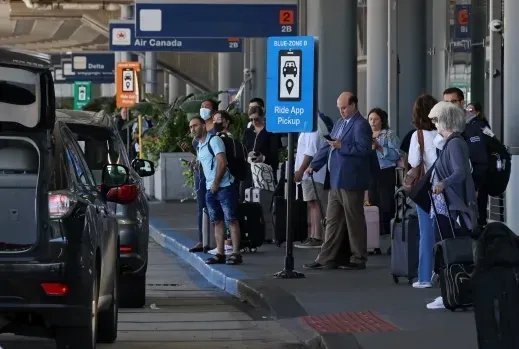

Wenn Sie am **T5** landen, nehmen Sie zuerst das **ATS** zum **Terminal 2** und folgen dann den Schildern **Rideshare / Ride App** zum Abholpunkt auf der **Abflugebene**.

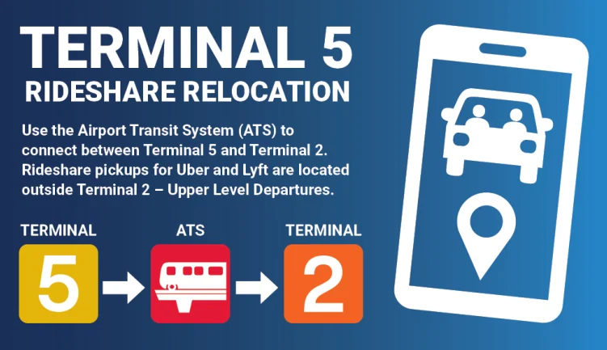

Sowohl Uber als auch Lyft holen nur hier ab. Die Uhr läuft, sobald Ihr Fahrer den Abholpunkt erreicht, und nach einer kurzen Kulanzzeit (etwa fünf Minuten) wird ein Aufschlag berechnet – am besten **bestellen Sie das Auto, sobald Sie am Abholpunkt T2 sind**.

Nachdem Sie sich registriert und eine Zahlungsmethode hinterlegt haben, geben Sie Startpunkt und Ziel in der App ein und wählen den Fahrzeugtyp. Sobald Sie dem nächsten Fahrer zugeordnet wurden, zeigt die App dessen Daten und Bewertung – **ist die Bewertung niedrig, fordern Sie sicherheitshalber einen anderen Fahrer an**.

Dieselbe Fahrt wird in den beiden Apps leicht unterschiedlich bepreist, der Service ist aber im Wesentlichen gleich (die meisten Fahrer arbeiten für beide), ein Vergleich vor der Bestätigung lohnt sich also.

> Prüfen Sie vor dem Einsteigen die Daten des Fahrers und des Fahrzeugs – Name, Modell und Kennzeichen. Bleiben Sie während der Fahrt aufmerksam und kontrollieren Sie in der App, ob die Route stimmt.

### Option 3: der Pace-Bus

**(Besonders für Studierende der Northwestern)**

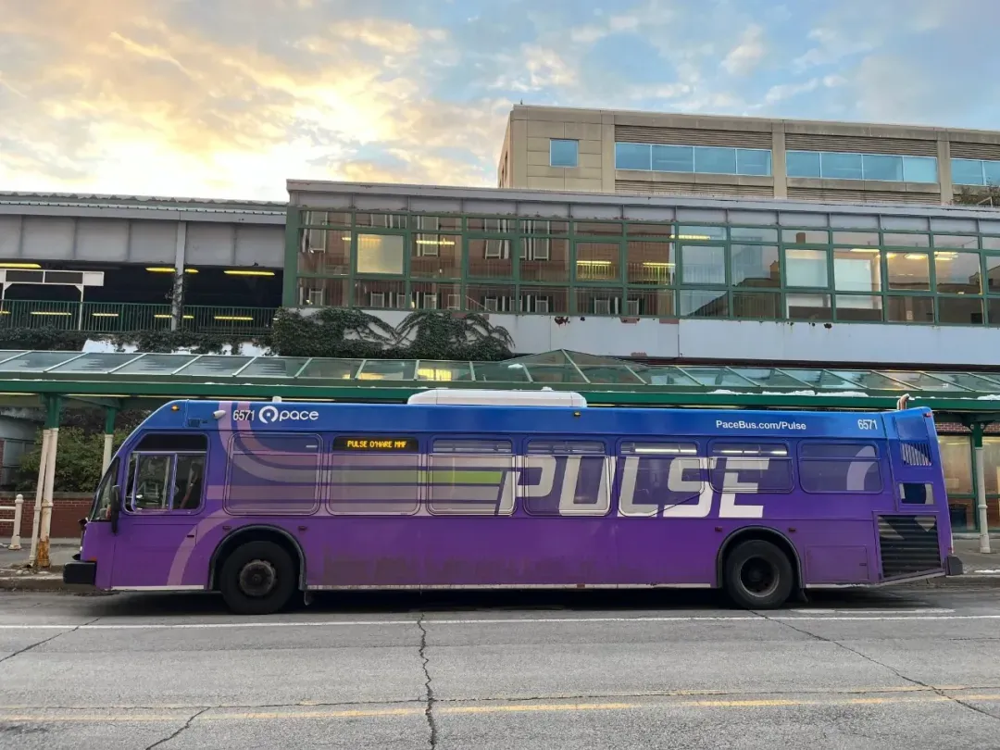

Pace betreibt die Busse in den Vororten Chicagos, und seine Linie Pulse Dempster fährt **von O'Hare nach Evanston**, wo die Northwestern University liegt, in etwa **50 Minuten**, alle **15–20 Minuten** (am Wochenende und außerhalb der Hauptverkehrszeiten alle 20–30 Minuten).

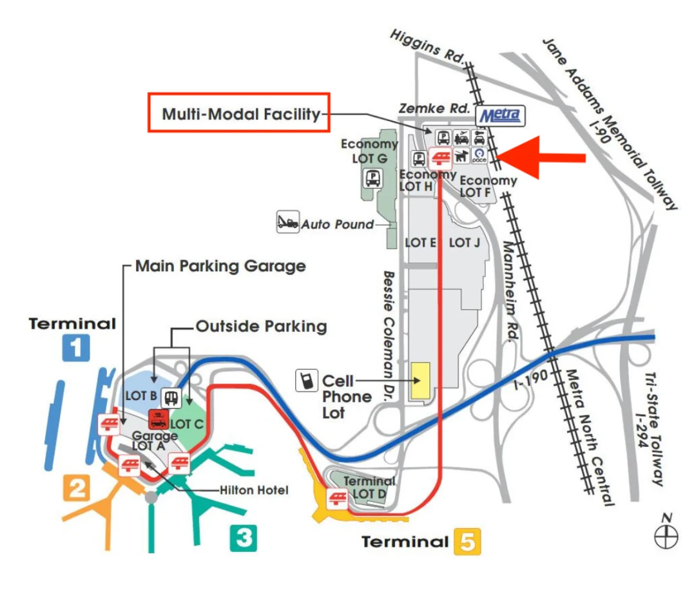

Um von O'Hare nach Evanston zu kommen, **nehmen Sie das ATS zur MMF (Multi-Modal Facility)** und suchen dort **Bucht 9** für den Pulse-Bus. Sie können an Bord eine Ventra-Karte kontaktlos nutzen oder bar zahlen: Der Fahrpreis beträgt **$2** ($2.25 in bar).

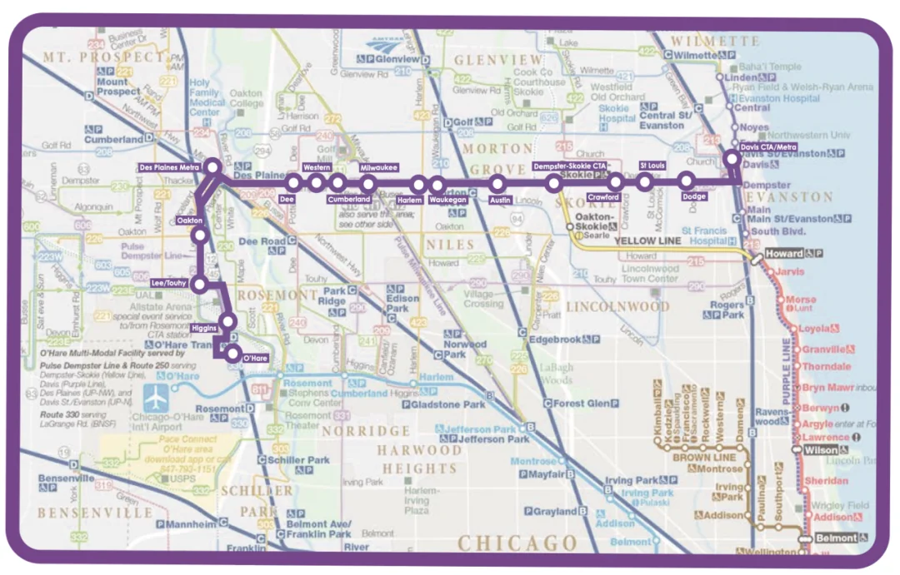

## Ein letzter Tipp

Wie Sie auch reisen, bleiben Sie aufmerksam gegenüber Ihrer Umgebung, und prüfen Sie, dass Sie kein Gepäck zurückgelassen haben, bevor Sie ein- oder aussteigen.

## Weiterführende Links

- **Auf dieser Website**: [Chicago O'Hare ORD](/airport/ORD), [Vereinigte Staaten (US)](/country/US)
- **Wikipedia**: [Chicago O'Hare ORD](https://en.wikipedia.org/wiki/O'Hare_International_Airport)
- **Baidu Baike**: [Chicago O'Hare ORD](https://baike.baidu.com/item/%E5%A5%A5%E9%BB%91%E5%B0%94%E5%9B%BD%E9%99%85%E6%9C%BA%E5%9C%BA)
