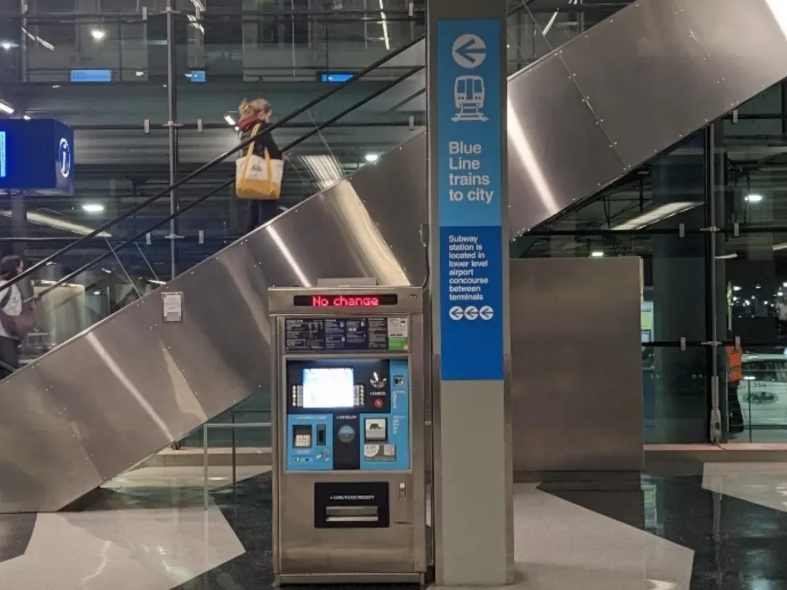

Te damos la bienvenida a Chicago. Después de un vuelo largo, así se llega de O'Hare a donde te alojas.

## Cómo encajan las terminales de O'Hare

El cuarto centro aeroportuario más transitado de Estados Unidos, el Aeropuerto Internacional O'Hare de Chicago (ORD), tiene **cuatro terminales: 1, 2, 3 y 5** (T1, T2, T3, T5).

- **T1, T2 y T3** están conectadas, así que puedes caminar entre ellas.
- **T5** gestiona los vuelos internacionales —incluida la mayoría de los vuelos desde y hacia China— y está unida a las demás por el **Airport Transit System (ATS)**.

El ATS es **gratuito** entre terminales.

## Llegada a Chicago

### Rellena el formulario de declaración de aduanas en el avión

Durante el vuelo, la tripulación reparte el **formulario de declaración de aduanas** (hay versión en chino). Rellenarlo **antes de aterrizar** hace que la llegada sea mucho más fluida.

A la hora de rellenarlo hay algunos detalles que conviene vigilar, o pueden enviarte a un interrogatorio adicional:

1. Si viajas con tu familia y te alojas en la misma dirección, puedes compartir un formulario.
2. Indica tu **motivo de entrada con sinceridad**: turismo, negocios, estudios o cualquier otro.
3. No traigas:
   - fruta, verdura, plantas, semillas, alimentos o insectos;
   - carne, animales ni productos de origen animal o de fauna salvaje;
   - cultivos de enfermedades, cultivos celulares o caracoles;
   - tierra ni nada que haya estado en una granja, un rancho o un cebadero.
4. No lleves **más de 10.000 dólares en efectivo**.

### Pasar a inmigración

Cuando el avión esté en O'Hare y la tripulación anuncie que puedes bajar, estírate, comprueba que no has dejado nada en la cabina y sigue a la multitud **hacia la zona de inmigración**. Si pierdes al grupo porque te has parado en el baño, no te preocupes: sigue los carteles de “Immigration”.

En inmigración, ponte en la cola de **“Visa”** (no en la de “US Citizen”) y espera tu turno. Habla en voz baja y no uses el móvil para grabar a los agentes.

Ten a mano tu **pasaporte**, tu **formulario I-20**, tu **certificado internacional de salud para viajes** (el “libro rojo”), tu **certificado internacional de vacunación** (el “libro amarillo”) y tu **carta de admisión** o **plan de estudios** si lo tienes.

Cuando el agente te pregunte por el motivo de la visita, **responde con sinceridad** sobre tu escuela y tu programa. Después te hará una foto y te tomará las huellas dactilares, con lo que concluye el proceso de entrada.

### Equipaje y aduanas

Sigue la información de la etiqueta del equipaje hasta la cinta correcta y **espera tus maletas**, comprobándolas con las pantallas: **las pantallas del aeropuerto son la referencia**.

Si no tienes nada que declarar, normalmente puedes salir directo. Si te apartan para una inspección, mantén la calma, colabora con los agentes y **no ocultes nada**.

La sala de llegadas de T5 tiene restaurantes de todos los tamaños, así que una vez que hayas pasado puedes relajarte, comprar una bebida o algo de comer y conectarte al wifi gratuito del aeropuerto para avisar a tu familia de que has aterrizado.

## Salir del aeropuerto

Si has acordado que te recoja tu escuela u otra organización, sigue los carteles del aeropuerto hasta la puerta acordada.

Los viajeros que se dirigen a distintas zonas también pueden seguir los carteles de cada opción de transporte: quienes van a Champaign, Purdue u otros lugares de la región suelen tomar un autobús fletado, mientras que quienes van a Chicago suelen usar aplicaciones de transporte o la CTA.

## Llegar a la ciudad

### Opción 1: la línea azul de la CTA

Para llegar a O'Hare y salir de allí en la CTA hay que tomar la **línea azul**. Primero tomas el **transbordador ATS** hasta la **Terminal 2** y cambias allí: el ATS es **gratuito** entre terminales.

La línea azul funciona **24 horas al día, siete días a la semana**. Todos los trenes desde la estación de O'Hare pasan por el centro en dirección a Forest Park, y el trayecto al centro suele durar **40–45 minutos**.

Una vez en **T2**, sigue el **icono azul del metro** para llegar al andén de la línea azul. Antes de entrar tienes que comprar un billete en la máquina: **la tarifa entre O'Hare y el centro es de 5 $** (la tarifa normal es de 2,50 $). Algunas máquinas no devuelven cambio, así que lleva monedas o paga con una tarjeta de crédito o débito Visa o Mastercard.

No hace falta validar la salida, pero **un billete te da hasta dos transbordos gratuitos a otro tren o autobús de la CTA en un plazo de dos horas**, así que guárdalo.

Si te diriges a **SAIC**, **DePaul (Loop)**, **Columbia College Chicago** o **UIC**, no necesitas cambiar de tren: bájate en Monroe, Jackson, LaSalle o UIC-Halsted según corresponda.

Para **DePaul (Lincoln Park)**, **Northwestern (Kellogg)**, la **Universidad de Chicago** o **IIT**, tendrás que cambiar a otra línea de metro o de autobús.

### Opción 2: aplicaciones de transporte

Si quieres la opción más fácil, rápida y cómoda, toma un coche y ahórrate arrastrar el equipaje. Los únicos inconvenientes son que es **caro** y que **puede quedarse atascado en el tráfico a las horas punta**.

Uber y Lyft son las dos aplicaciones que todo el mundo usa en Estados Unidos. Descarga la versión internacional antes de volar y **vincula una tarjeta de crédito de doble moneda** con antelación. Cuando aterrices y tengas conexión (el wifi del aeropuerto sirve), podrás pedir un coche.

Si aterrizas en **T5**, primero toma el **ATS** hasta la **Terminal 2** y luego sigue los carteles de **Rideshare / Ride App** hasta el punto de recogida en la **planta de salidas**.

Tanto Uber como Lyft recogen solo aquí. El taxímetro empieza a contar cuando tu conductor llega al punto de recogida, y tras un breve periodo de gracia (unos cinco minutos) te cobran un extra, así que lo mejor es **pedir el coche cuando ya estés en el punto de recogida de T2**.

Después de registrarte y añadir un método de pago, introduce el punto de partida y el destino en la aplicación y elige el tipo de vehículo. Cuando te asigne al conductor más cercano, mostrará sus datos y su valoración: **si la valoración es baja, pide otro conductor** para ir sobre seguro.

El mismo trayecto tiene un precio ligeramente distinto en cada aplicación, pero el servicio es esencialmente el mismo (la mayoría de los conductores trabajan para ambas), así que merece la pena comparar antes de confirmar.

> Antes de subir, comprueba los datos del conductor y del vehículo: nombre, modelo y matrícula. Mantente alerta durante el trayecto y comprueba en la aplicación que la ruta es la correcta.

### Opción 3: el autobús Pace

**(Para estudiantes de Northwestern en particular)**

Pace opera los autobuses de los suburbios de Chicago, y su línea Pulse Dempster va **de O'Hare a Evanston**, donde está la Universidad Northwestern, en unos **50 minutos**, cada **15–20 minutos** (cada 20–30 minutos los fines de semana y fuera de las horas punta).

Para ir de O'Hare a Evanston, **toma el ATS hasta el MMF (Multi-Modal Facility)** y busca la **dársena 9** para el autobús Pulse. Puedes pasar una tarjeta Ventra a bordo o pagar en efectivo: la tarifa es de **2 $** (2,25 $ en efectivo).

## Un último consejo

Sea cual sea el medio que uses, mantente atento a tu entorno y comprueba que no has dejado equipaje antes de subir o bajar.

## Enlaces relacionados

- **En este sitio**: [Chicago O'Hare ORD](/airport/ORD), [Estados Unidos (US)](/country/US)
- **Wikipedia**: [Chicago O'Hare ORD](https://en.wikipedia.org/wiki/O'Hare_International_Airport)
- **Baidu Baike**: [Chicago O'Hare ORD](https://baike.baidu.com/item/%E5%A5%A5%E9%BB%91%E5%B0%94%E5%9B%BD%E9%99%85%E6%9C%BA%E5%9C%BA)
