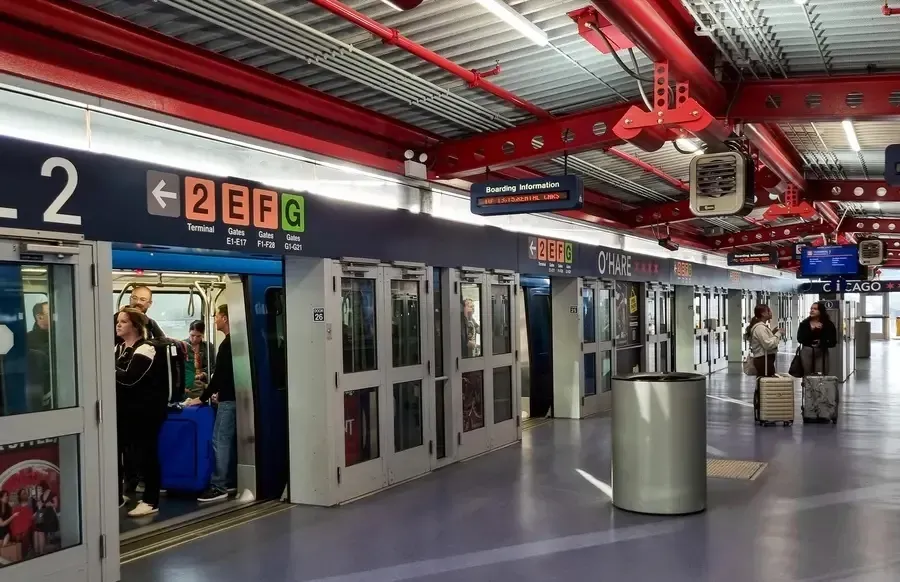

Selamat datang di Chicago. Setelah penerbangan panjang, berikut cara pergi dari O'Hare ke tempat Anda menginap.

## Bagaimana terminal O'Hare terhubung

Sebagai hub bandara tersibuk keempat di Amerika Serikat, Bandara Internasional Chicago O'Hare (ORD) memiliki **empat terminal: 1, 2, 3, dan 5** (T1, T2, T3, T5).

- **T1, T2, dan T3** saling terhubung, sehingga Anda dapat berjalan di antaranya.
- **T5** melayani penerbangan internasional — termasuk sebagian besar penerbangan ke dan dari Tiongkok — dan terhubung ke terminal lain melalui **Airport Transit System (ATS)**.

ATS **gratis** antarterminal.

## Tiba di Chicago

### Isi formulir deklarasi bea cukai di pesawat

Selama penerbangan, kru membagikan **formulir deklarasi bea cukai** (tersedia versi bahasa Mandarin). Mengisinya **sebelum Anda mendarat** membuat kedatangan jauh lebih lancar.

Beberapa hal yang perlu diperhatikan saat mengisinya, agar Anda tidak dikirim untuk pemeriksaan tambahan:

1. Jika Anda bepergian bersama keluarga dan menginap di alamat yang sama, Anda dapat menggunakan satu formulir bersama.
2. Nyatakan **tujuan masuk Anda dengan jujur** — wisata, bisnis, belajar, atau lainnya.
3. Jangan membawa masuk:
   - buah, sayuran, tanaman, benih, makanan, atau serangga;
   - daging, hewan, atau produk hewan dan satwa liar;
   - kultur penyakit, kultur sel, atau siput;
   - tanah, atau apa pun yang pernah berada di peternakan, ranch, atau feedlot.
4. Jangan membawa **uang tunai lebih dari US$10.000**.

### Menuju imigrasi

Setelah pesawat tiba di O'Hare dan kru mengumumkan Anda boleh turun, regangkan kaki, pastikan tidak ada yang tertinggal di kabin — dan ikuti kerumunan **menuju area imigrasi**. Jika Anda kehilangan rombongan karena berhenti di toilet, jangan khawatir: cukup ikuti papan “Imigrasi”.

Di imigrasi, bergabunglah dengan **antrean “Visa”** (bukan antrean “Warga Negara AS”) dan tunggu giliran. Jaga volume suara Anda, dan jangan menggunakan ponsel untuk merekam petugas.

Siapkan **paspor**, **Formulir I-20**, **sertifikat kesehatan perjalanan internasional** (“buku merah kecil”), **sertifikat vaksinasi internasional** (“buku kuning kecil”), serta **surat penerimaan** atau **rencana studi** jika ada.

Ketika petugas menanyakan tujuan kunjungan Anda, **jawab dengan jujur** tentang sekolah dan program Anda. Petugas kemudian akan memotret Anda dan mengambil sidik jari, yang menyelesaikan proses masuk.

### Bagasi dan bea cukai

Ikuti informasi label bagasi menuju ban berjalan yang benar dan **tunggu bagasi Anda**, sambil mencocokkannya dengan layar — **layar bandara adalah acuan yang sah**.

Jika tidak ada yang perlu dideklarasikan, biasanya Anda dapat langsung keluar. Jika Anda ditarik ke samping untuk pemeriksaan, tetap tenang, bekerja sama dengan petugas, dan **jangan menyembunyikan apa pun**.

Aula kedatangan T5 memiliki restoran berbagai ukuran, jadi setelah melewati semuanya Anda dapat bersantai, membeli minuman atau camilan, dan terhubung ke Wi-Fi gratis bandara untuk memberi tahu keluarga bahwa Anda telah mendarat.

## Meninggalkan bandara

Jika Anda telah mengatur penjemputan dengan sekolah atau organisasi lain, ikuti papan bandara menuju gerbang yang disepakati.

Pelancong yang menuju berbagai daerah juga dapat mengikuti papan untuk setiap pilihan transportasi: mereka yang pergi ke Champaign, Purdue, atau tempat lain di kawasan biasanya naik bus carter, sedangkan yang menuju Chicago sendiri umumnya menggunakan ride-hailing atau CTA.

## Masuk ke kota

### Pilihan 1: CTA Blue Line

Menggunakan CTA untuk pergi ke dan dari O'Hare berarti naik **Blue Line**. Anda terlebih dahulu naik **shuttle ATS** ke **Terminal 2** dan berganti di sana — ATS **gratis** antarterminal.

Blue Line beroperasi **24 jam sehari, tujuh hari seminggu**. Setiap kereta dari stasiun O'Hare melewati pusat kota dalam perjalanan ke Forest Park, dan perjalanan ke pusat kota biasanya memakan waktu **40–45 menit**.

Setelah Anda berada di **T2**, ikuti **ikon metro biru** untuk mencapai peron Blue Line. Anda perlu membeli tiket dari mesin sebelum masuk: **tarif antara O'Hare dan pusat kota adalah $5** (tarif biasa $2,50). Beberapa mesin tidak memberikan kembalian, jadi siapkan koin, atau bayar dengan kartu kredit atau debit Visa atau Mastercard.

Anda tidak perlu mengetuk kartu saat keluar, tetapi **satu tiket memberi Anda hingga dua transit gratis ke kereta atau bus CTA lain dalam waktu dua jam**, jadi simpan tiketnya.

Jika Anda menuju **SAIC**, **DePaul (Loop)**, **Columbia College Chicago**, atau **UIC**, Anda tidak perlu berganti kereta — turun di Monroe, Jackson, LaSalle, atau UIC-Halsted sesuai kebutuhan.

Untuk **DePaul (Lincoln Park)**, **Northwestern (Kellogg)**, **University of Chicago**, atau **IIT**, Anda perlu transit ke jalur metro atau bus lain.

### Pilihan 2: ride-hailing

Jika Anda menginginkan pilihan termudah, tercepat, dan paling nyaman, naik mobil dan hindari menyeret bagasi ke sana kemari. Satu-satunya kekurangannya adalah **mahal** dan **bisa terjebak macet pada jam sibuk**.

Uber dan Lyft adalah dua aplikasi yang digunakan semua orang di Amerika Serikat. Unduh versi internasionalnya sebelum terbang dan **tautkan kartu kredit dua mata uang** terlebih dahulu. Setelah mendarat dan memiliki koneksi (Wi-Fi bandara cukup), Anda dapat memesan mobil.

Jika Anda mendarat di **T5**, naik **ATS** terlebih dahulu ke **Terminal 2**, lalu ikuti papan **Rideshare / Ride App** menuju titik penjemputan di **lantai keberangkatan**.

Uber dan Lyft sama-sama hanya menjemput di sini. Argo mulai berjalan saat pengemudi Anda mencapai titik penjemputan, dan setelah masa tenggang singkat (sekitar lima menit) Anda dikenai biaya tambahan — jadi sebaiknya **pesan mobil setelah Anda berada di titik penjemputan T2**.

Setelah mendaftar dan menambahkan metode pembayaran, masukkan titik awal dan tujuan Anda di aplikasi lalu pilih jenis kendaraan. Setelah aplikasi mencocokkan Anda dengan pengemudi terdekat, detail dan rating mereka akan ditampilkan — **jika ratingnya rendah, minta pengemudi lain** demi keamanan.

Tarif untuk perjalanan yang sama sedikit berbeda antara kedua aplikasi, tetapi layanannya pada dasarnya sama (sebagian besar pengemudi bekerja untuk keduanya), jadi ada baiknya membandingkan sebelum mengonfirmasi.

> Sebelum masuk, periksa detail pengemudi dan kendaraan — nama, model, dan nomor pelat. Tetap waspada selama perjalanan dan periksa di aplikasi bahwa rutenya benar.

### Pilihan 3: bus Pace

**(Khususnya untuk mahasiswa Northwestern)**

Pace mengoperasikan bus di pinggiran Chicago, dan jalur Pulse Dempster-nya berjalan **dari O'Hare ke Evanston**, tempat Northwestern University berada, dalam waktu sekitar **50 menit**, setiap **15–20 menit** (setiap 20–30 menit pada akhir pekan dan di luar jam sibuk).

Untuk pergi dari O'Hare ke Evanston, **naik ATS ke MMF (Multi-Modal Facility)** dan cari **Bay 9** untuk bus Pulse. Anda dapat mengetuk kartu Ventra di dalam bus atau membayar tunai: tarifnya **$2** ($2,25 jika tunai).

## Satu tips terakhir

Dengan cara apa pun Anda bepergian, tetap waspada terhadap lingkungan sekitar, dan periksa bahwa Anda tidak meninggalkan bagasi sebelum naik atau turun.

## Tautan terkait

- **Di situs ini**: [Chicago O'Hare ORD](/airport/ORD), [Amerika Serikat (US)](/country/US)
- **Wikipedia**: [Chicago O'Hare ORD](https://en.wikipedia.org/wiki/O'Hare_International_Airport)
- **Baidu Baike**: [Chicago O'Hare ORD](https://baike.baidu.com/item/%E5%A5%A5%E9%BB%91%E5%B0%94%E5%9B%BD%E9%99%85%E6%9C%BA%E5%9C%BA)
