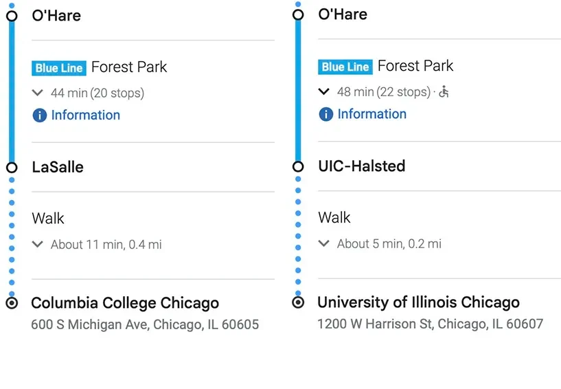
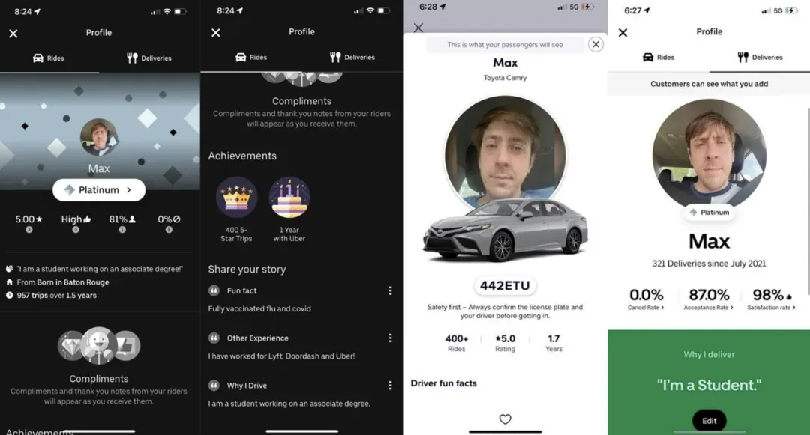
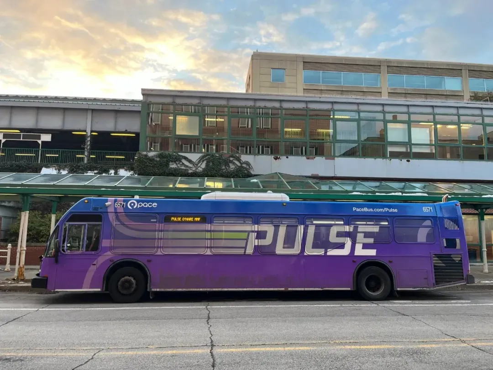

Welkom in Chicago. Na een lange vlucht: zo kom je van O'Hare naar je verblijfplaats.

## Hoe de terminals van O'Hare op elkaar aansluiten

Chicago O'Hare International (ORD) is de op drie na drukste luchthavenhub van de Verenigde Staten en heeft **vier terminals: 1, 2, 3 en 5** (T1, T2, T3, T5).

- **T1, T2 en T3** zijn met elkaar verbonden, dus je kunt ertussen lopen.
- **T5** verwerkt internationale vluchten — waaronder de meeste vluchten van en naar China — en is via het **Airport Transit System (ATS)** met de andere terminals verbonden.

De ATS is **gratis** tussen de terminals.

## Aankomst in Chicago

### Vul het douaneformulier in het vliegtuig in

Tijdens de vlucht deelt de bemanning het **douaneformulier** uit (er is een Chinese versie beschikbaar). Als je het **vóór de landing** invult, verloopt de aankomst veel soepeler.

Een paar dingen om op te letten bij het invullen, anders word je misschien voor extra ondervraging doorgestuurd:

1. Als je met familie reist en op hetzelfde adres verblijft, kun je samen één formulier gebruiken.
2. Geef je **doel van binnenkomst naar waarheid** op — toerisme, zaken, studie of iets anders.
3. Neem niet mee:
   - fruit, groenten, planten, zaden, voedsel of insecten;
   - vlees, dieren, of dierlijke producten en producten van wilde dieren;
   - ziekteculturen, celculturen of slakken;
   - aarde, of alles wat op een boerderij, ranch of veemesterij is geweest.
4. Neem **niet meer dan US$ 10.000 in contanten** mee.

### Door naar de immigratie

Zodra het vliegtuig op O'Hare staat en de bemanning omroept dat je mag uitstappen, strek je je benen, controleer je of je niets in de cabine hebt achtergelaten — en volg je de menigte **naar de immigratiehal**. Als je de groep kwijtraakt omdat je bij het toilet stopte, geen zorgen: volg gewoon de borden "Immigration".

Bij de immigratie sluit je aan in de **"Visa"-rij** (niet de rij **"US Citizen"**) en wacht je op je beurt. Praat zacht en gebruik je telefoon niet om de officieren te filmen.

Houd je **paspoort**, **formulier I-20**, je **internationale reisgezondheidsverklaring** (het "rode boekje"), het **internationale vaccinatiecertificaat** (het "gele boekje") en je **toelatingsbrief** of **studieplan** bij de hand, als je die hebt.

Wanneer de officier vraagt waarom je op bezoek bent, **antwoord je naar waarheid** over je school en studieprogramma. Daarna wordt je gefotografeerd en worden je vingerafdrukken genomen, waarmee de inreisprocedure is afgerond.

### Bagage en douane

Volg de informatie op je bagagelabel naar de juiste bagageband en **wacht op je koffers**; controleer ze aan de hand van de schermen — **de schermen op de luchthaven zijn bepalend**.

Als je niets hebt aan te geven, kun je meestal direct doorlopen. Word je apart genomen voor een controle, blijf dan kalm, werk mee met de officieren en **verzwijg niets**.

De aankomsthal van T5 heeft restaurants in alle soorten en maten, dus zodra je erdoor bent kun je ontspannen, iets te drinken of een hapje kopen en verbinding maken met de gratis wifi van de luchthaven om je familie te laten weten dat je geland bent.

## De luchthaven verlaten

Als je met je school of een andere organisatie een ophaalservice hebt geregeld, volg dan de borden van de luchthaven naar de afgesproken plek.

Reizigers naar verschillende gebieden kunnen ook de borden voor elke vervoersoptie volgen: wie naar Champaign, Purdue of andere plaatsen in de regio gaat, neemt meestal een charterbus, terwijl wie naar Chicago zelf gaat doorgaans ride-hailing of de CTA neemt.

## Naar de stad

### Optie 1: de CTA Blue Line

Met de CTA van en naar O'Hare reizen betekent de **Blue Line** nemen. Je neemt eerst de **ATS-shuttle** naar **Terminal 2** en stapt daar over — de ATS is **gratis** tussen de terminals.

De Blue Line rijdt **24 uur per dag, zeven dagen per week**. Elke trein vanaf station O'Hare komt door het centrum op weg naar Forest Park, en de rit naar het centrum duurt meestal **40–45 minuten**.

Zodra je bij **T2** bent, volg je het **blauwe metro-icoon** naar het perron van de Blue Line. Je moet voor het instappen een kaartje kopen bij de automaat: het **tarief tussen O'Hare en het centrum is $ 5** (het normale tarief is $ 2,50). Sommige automaten geven geen wisselgeld, dus houd munten klaar, of betaal met een Visa- of Mastercard-creditcard of -betaalkaart.

Bij het uitstappen hoef je niet uit te checken, maar **één kaartje geeft je binnen twee uur recht op maximaal twee gratis overstappen naar een andere CTA-trein of -bus**, dus houd het bij je.

Als je naar **SAIC**, **DePaul (Loop)**, **Columbia College Chicago** of **UIC** gaat, hoef je niet over te stappen — stap uit bij Monroe, Jackson, LaSalle of UIC-Halsted, al naargelang je bestemming.

Voor **DePaul (Lincoln Park)**, **Northwestern (Kellogg)**, de **University of Chicago** of **IIT** moet je overstappen op een andere metro- of buslijn.

### Optie 2: ride-hailing

Als je de makkelijkste, snelste en comfortabelste optie wilt, neem dan een auto en sleep je bagage niet mee. De enige nadelen zijn dat het **duur** is en **op drukke momenten vast kan lopen in het verkeer**.

Uber en Lyft zijn de twee apps die iedereen in de Verenigde Staten gebruikt. Download de internationale versie voordat je vliegt en **koppel vooraf een creditcard met dubbele valuta**. Zodra je geland bent en verbinding hebt (de wifi van de luchthaven is genoeg), kun je een auto bestellen.

Als je op **T5** landt, neem je eerst de **ATS** naar **Terminal 2** en volg je daarna de borden **Rideshare / Ride App** naar het ophaalpunt op het **vertrekniveau**.

Zowel Uber als Lyft haalt hier alleen passagiers op. De meter loopt vanaf het moment dat je chauffeur het ophaalpunt bereikt, en na een korte respijtperiode (ongeveer vijf minuten) betaal je extra — dus bestel de auto pas als je bij het ophaalpunt van T2 staat.

Nadat je je hebt geregistreerd en een betaalmethode hebt toegevoegd, voer je in de app je startpunt en bestemming in en kies je het voertuigtype. Zodra de app je aan de dichtstbijzijnde chauffeur koppelt, zie je diens gegevens en beoordeling — **is de beoordeling laag, vraag dan voor de zekerheid een andere chauffeur aan**.

Dezelfde rit wordt in de twee apps net iets anders geprijsd, maar de service is in wezen hetzelfde (de meeste chauffeurs werken voor beide), dus het loont om te vergelijken voordat je bevestigt.

> Controleer voordat je instapt de gegevens van de chauffeur en het voertuig — naam, model en kenteken. Blijf tijdens de rit alert en controleer in de app of de route klopt.

### Optie 3: de Pace-bus

**(Vooral voor studenten van Northwestern)**

Pace verzorgt de bussen in de buitenwijken van Chicago, en de Pulse Dempster-lijn rijdt **van O'Hare naar Evanston**, waar Northwestern University ligt, in ongeveer **50 minuten**, elke **15–20 minuten** (elke 20–30 minuten in het weekend en buiten de piekuren).

Om van O'Hare naar Evanston te gaan, **neem je de ATS naar de MMF (Multi-Modal Facility)** en zoek je **perron 9** voor de Pulse-bus. Je kunt aan boord een Ventra-kaart scannen of contant betalen: het tarief is **$ 2** ($ 2,25 contant).

## Nog één tip

Hoe je ook reist, blijf je bewust van je omgeving en controleer voordat je instapt of uitstapt of je geen bagage hebt achtergelaten.

## Gerelateerde links

- **Op deze site**: [Chicago O'Hare ORD](/airport/ORD), [Verenigde Staten (US)](/country/US)
- **Wikipedia**: [Chicago O'Hare ORD](https://en.wikipedia.org/wiki/O'Hare_International_Airport)
- **Baidu Baike**: [Chicago O'Hare ORD](https://baike.baidu.com/item/%E5%A5%A5%E9%BB%91%E5%B0%94%E5%9B%BD%E9%99%85%E6%9C%BA%E5%9C%BA)
