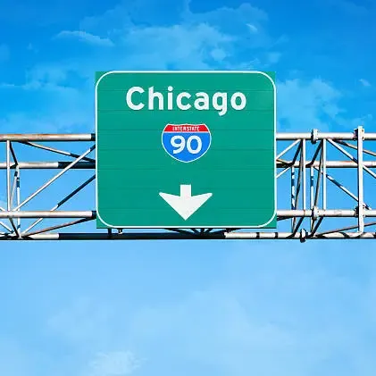

Witamy w Chicago. Po długim locie oto jak dostać się z O'Hare do miejsca, w którym się zatrzymujesz.

## Jak łączą się terminale O'Hare

Czwarty najruchliwszy węzeł lotniczy w Stanach Zjednoczonych, Chicago O'Hare International (ORD), ma **cztery terminale: 1, 2, 3 i 5** (T1, T2, T3, T5).

- **T1, T2 i T3** są połączone, więc można przechodzić między nimi pieszo.
- **T5** obsługuje loty międzynarodowe — w tym większość lotów do i z Chin — i jest połączony z pozostałymi przez **Airport Transit System (ATS)**.

ATS jest **bezpłatny** między terminalami.

## Przylot do Chicago

### Wypełnij formularz deklaracji celnej w samolocie

Podczas lotu załoga rozdaje **formularz deklaracji celnej** (dostępna jest wersja chińska). Wypełnienie go **przed lądowaniem** znacznie usprawnia przylot.

Na co uważać przy wypełnianiu, żeby nie zostać skierowanym na dodatkowe pytania:

1. Jeśli podróżujesz z rodziną i zatrzymujecie się pod tym samym adresem, możecie wypełnić jeden formularz.
2. Podaj **cel wjazdu zgodnie z prawdą** — turystyka, biznes, nauka czy cokolwiek innego.
3. Nie wwoź:
   - owoców, warzyw, roślin, nasion, żywności ani owadów;
   - mięsa, zwierząt oraz produktów zwierzęcych i pochodzących z dzikiej fauny;
   - kultur chorobotwórczych, kultur komórkowych ani ślimaków;
   - gleby ani niczego, co było na farmie, ranczu lub w tuczarni.
4. Nie przewoź **ponad 10 000 USD w gotówce**.

### Przejście przez kontrolę imigracyjną

Gdy samolot jest już na O'Hare, a załoga ogłosi, że można wysiadać, przeciągnij się, sprawdź, czy nic nie zostało w kabinie — i podążaj za tłumem **do strefy kontroli imigracyjnej**. Jeśli zgubisz grupę, bo zatrzymałeś się przy toalecie, nie martw się: po prostu idź za znakami „Immigration”.

Na kontroli ustaw się w kolejce **„Visa”** (nie „US Citizen”) i poczekaj na swoją kolej. Mów ściszonym głosem i nie filmuj funkcjonariuszy telefonem.

Miej przygotowane **paszport**, **formularz I-20**, **międzynarodowe świadectwo zdrowia** („czerwona książeczka”), **międzynarodowe zaświadczenie o szczepieniach** („żółta książeczka”) oraz **list przyjęcia** lub **plan studiów**, jeśli go masz.

Gdy funkcjonariusz zapyta o cel wizyty, **odpowiedz zgodnie z prawdą** o swojej szkole i programie. Następnie zrobi ci zdjęcie i pobierze odciski palców, co kończy procedurę wjazdu.

### Bagaż i odprawa celna

Kieruj się informacjami z metki bagażowej do właściwego przenośnika i **poczekaj na swoje bagaże**, sprawdzając je na ekranach — **to, co pokazują ekrany lotniskowe, jest wiążące**.

Jeśli nie masz nic do zgłoszenia, zwykle możesz przejść od razu. Jeśli zostaniesz poproszony na kontrolę, zachowaj spokój, współpracuj z funkcjonariuszami i **niczego nie zatajaj**.

W hali przylotów T5 jest mnóstwo restauracji różnej wielkości, więc po przejściu kontroli możesz odetchnąć, kupić coś do picia lub przekąskę i połączyć się z bezpłatnym Wi-Fi lotniska, by dać rodzinie znać, że wylądowałeś.

## Wyjście z lotniska

Jeśli masz umówiony odbiór ze szkoły lub innej organizacji, idź za znakami lotniska do ustalonej bramy.

Podróżni jadący w różne strony mogą też kierować się znakami dla poszczególnych środków transportu: ci, którzy jadą do Champaign, Purdue lub innych miejsc w regionie, zwykle biorą autokar czarterowy, a ci, którzy jadą do samego Chicago, zazwyczaj korzystają z aplikacji przewozowych lub CTA.

## Jak dostać się do miasta

### Opcja 1: linia CTA Blue Line

Dojazd do i z O'Hare koleją CTA oznacza **linię Blue Line**. Najpierw jedziesz **kolejką ATS** do **terminala 2** i tam się przesiadasz — ATS jest **bezpłatny** między terminalami.

Blue Line kursuje **24 godziny na dobę, siedem dni w tygodniu**. Każdy pociąg ze stacji O'Hare przejeżdża przez centrum w drodze do Forest Park, a podróż do centrum zajmuje zwykle **40–45 minut**.

Gdy jesteś na **T2**, idź za **niebieską ikoną metra**, aby dotrzeć do peronu Blue Line. Bilet trzeba kupić w automacie przed wejściem: **przejazd między O'Hare a centrum kosztuje 5 USD** (zwykła stawka to 2,50 USD). Niektóre automaty nie wydają reszty, więc miej przygotowane monety lub zapłać kartą kredytową bądź debetową Visa lub Mastercard.

Przy wyjściu nie musisz przykładać biletu, ale **jeden bilet daje do dwóch bezpłatnych przesiadek na inny pociąg lub autobus CTA w ciągu dwóch godzin**, więc go nie wyrzucaj.

Jeśli jedziesz do **SAIC**, **DePaul (Loop)**, **Columbia College Chicago** lub **UIC**, nie musisz się przesiadać — wysiądź odpowiednio na Monroe, Jackson, LaSalle lub UIC-Halsted.

Aby dostać się do **DePaul (Lincoln Park)**, **Northwestern (Kellogg)**, **University of Chicago** lub **IIT**, trzeba przesiąść się na inną linię metra lub autobus.

### Opcja 2: przejazdy przez aplikacje

Jeśli chcesz najłatwiejszej, najszybszej i najwygodniejszej opcji, weź samochód i oszczędź sobie taszczenia bagażu. Jedyne minusy: jest **drogo** i **w godzinach szczytu można utknąć w korku**.

Uber i Lyft to dwie aplikacje, których używają wszyscy w Stanach Zjednoczonych. Pobierz wersję międzynarodową przed lotem i **wcześniej podłącz kartę kredytową obsługującą dwie waluty**. Po wylądowaniu, gdy masz połączenie z internetem (wystarczy Wi-Fi lotniska), możesz zamówić auto.

Jeśli lądujesz na **T5**, najpierw jedź **ATS** do **terminala 2**, a potem idź za znakami **Rideshare / Ride App** do punktu odbioru na **poziomie odlotów**.

Zarówno Uber, jak i Lyft odbierają pasażerów tylko tutaj. Opłata startuje, gdy kierowca dotrze do punktu odbioru, a po krótkim okresie karencji (około pięciu minut) naliczana jest dopłata — dlatego najlepiej **zamów auto, gdy już jesteś na punkcie odbioru przy T2**.

Po rejestracji i dodaniu metody płatności wpisz w aplikacji punkt startowy i cel, a następnie wybierz typ pojazdu. Gdy aplikacja dobierze najbliższego kierowcę, pokaże jego dane i ocenę — **jeśli ocena jest niska, dla bezpieczeństwa poproś o innego kierowcę**.

Ta sama trasa kosztuje nieco inaczej w obu aplikacjach, ale usługa jest w zasadzie taka sama (większość kierowców pracuje dla obu), więc warto porównać przed potwierdzeniem.

> Przed wsiadaniem sprawdź dane kierowcy i pojazdu — imię, model i numer rejestracyjny. Zachowaj czujność podczas jazdy i sprawdzaj w aplikacji, czy trasa się zgadza.

### Opcja 3: autobus Pace

**(Zwłaszcza dla studentów Northwestern)**

Pace obsługuje autobusy na przedmieściach Chicago, a jego linia Pulse Dempster jeździ **z O'Hare do Evanston**, gdzie mieści się Northwestern University, w około **50 minut**, co **15–20 minut** (co 20–30 minut w weekendy i poza godzinami szczytu).

Aby dostać się z O'Hare do Evanston, **jedź ATS do MMF (Multi-Modal Facility)** i znajdź **stanowisko 9** autobusu Pulse. Możesz przyłożyć kartę Ventra w pojeździe albo zapłacić gotówką: bilet kosztuje **2 USD** (2,25 USD w gotówce).

## Ostatnia wskazówka

Bez względu na sposób podróży zachowaj czujność i sprawdź, czy nie zostawiłeś bagażu, zanim wsiądziesz lub wysiądziesz.

## Powiązane linki

- **Na tej stronie**: [Chicago O'Hare ORD](/airport/ORD), [Stany Zjednoczone (US)](/country/US)
- **Wikipedia**: [Chicago O'Hare ORD](https://en.wikipedia.org/wiki/O'Hare_International_Airport)
- **Baidu Baike**: [Chicago O'Hare ORD](https://baike.baidu.com/item/%E5%A5%A5%E9%BB%91%E5%B0%94%E5%9B%BD%E9%99%85%E6%9C%BA%E5%9C%BA)
