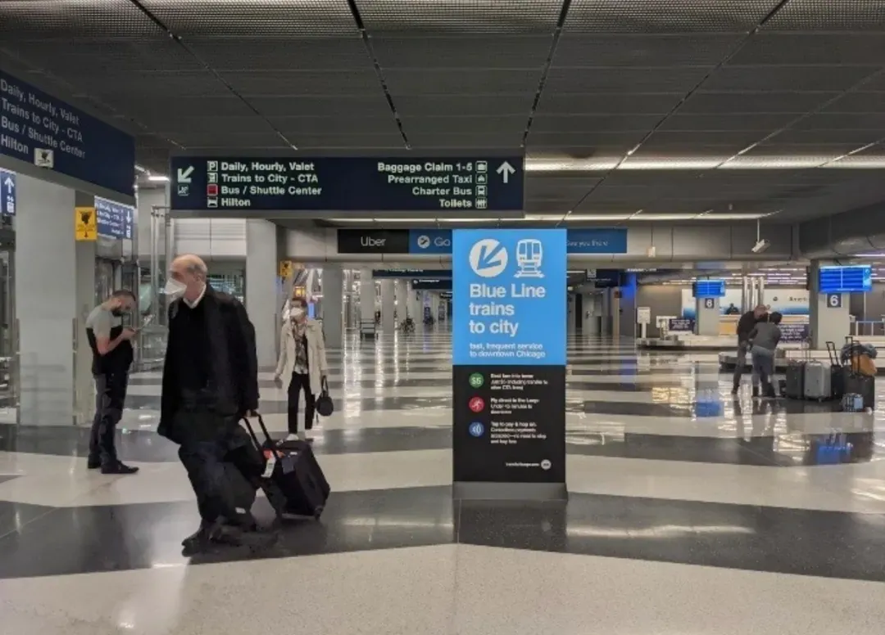
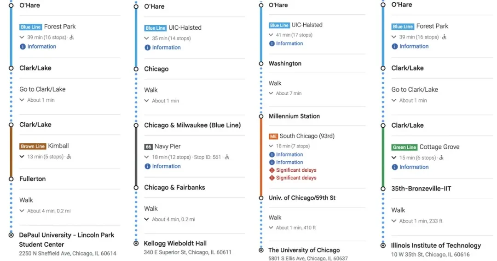
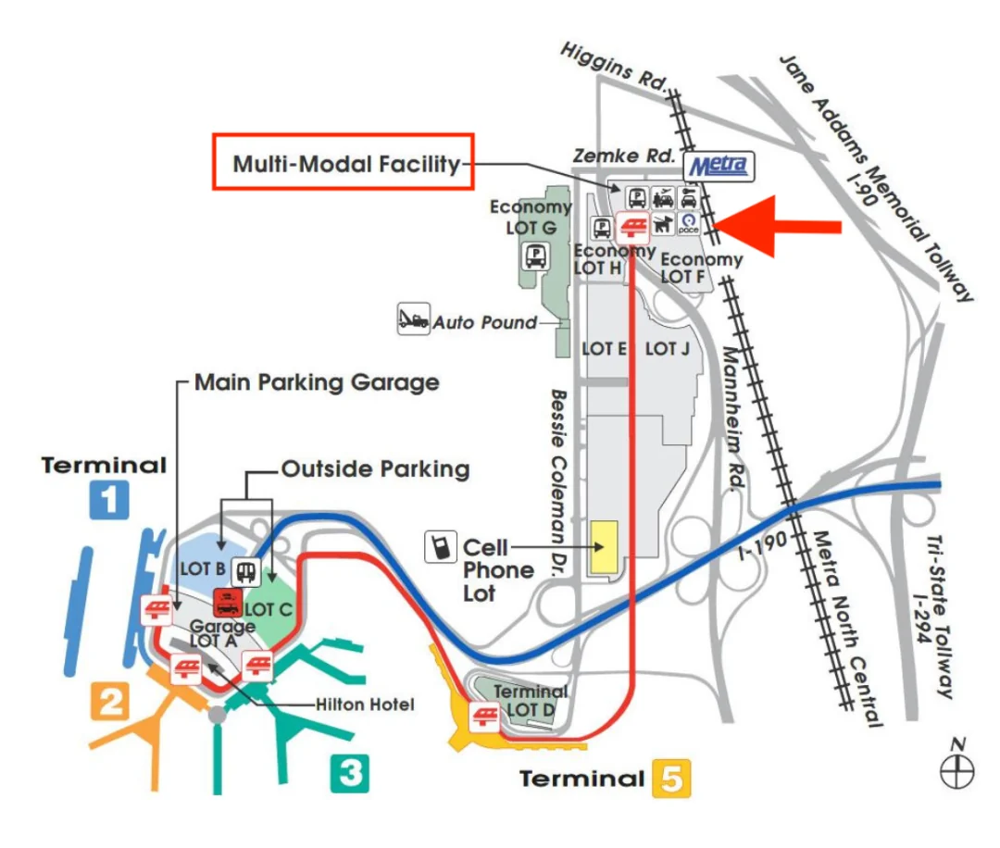

Bem-vindo a Chicago. Depois de um voo longo, veja como ir de O'Hare até onde você vai ficar.

## Como os terminais de O'Hare se conectam

Quarto hub aeroportuário mais movimentado dos Estados Unidos, o Aeroporto Internacional O'Hare (ORD) tem **quatro terminais: 1, 2, 3 e 5** (T1, T2, T3, T5).

- **T1, T2 e T3** são interligados, então você pode caminhar entre eles.
- **O T5** atende voos internacionais — incluindo a maioria dos voos de e para a China — e se liga aos outros pelo **Airport Transit System (ATS)**.

O ATS é **gratuito** entre os terminais.

## Chegando a Chicago

### Preencha o formulário de declaração aduaneira no avião

Durante o voo, a tripulação distribui o **formulário de declaração aduaneira** (há uma versão em chinês disponível). Preenchê-lo **antes de pousar** torna a chegada muito mais tranquila.

Alguns pontos de atenção ao preencher, ou você pode ser encaminhado para perguntas extras:

1. Se você viaja com a família e todos ficam no mesmo endereço, podem usar um único formulário.
2. Declare o **motivo da entrada com sinceridade** — turismo, negócios, estudo ou qualquer outro.
3. Não traga:
   - frutas, verduras, plantas, sementes, alimentos ou insetos;
   - carne, animais ou produtos de origem animal e de fauna silvestre;
   - culturas de doenças, culturas celulares ou caracóis;
   - terra ou qualquer coisa que tenha estado em uma fazenda, rancho ou confinamento.
4. Não carregue **mais de US$ 10.000 em dinheiro**.

### Passando pela imigração

Quando o avião estiver em O'Hare e a tripulação anunciar que você pode desembarcar, estique as pernas, verifique se não deixou nada na cabine — e siga a multidão **até a área de imigração**. Se perder o grupo porque parou no banheiro, não se preocupe: basta seguir as placas “Immigration”.

Na imigração, entre na **fila “Visa”** (não na fila “US Citizen”) e aguarde a sua vez. Fale baixo e não use o celular para filmar os agentes.

Tenha à mão o **passaporte**, o **Formulário I-20**, o **certificado internacional de saúde para viagem** (o “livrinho vermelho”), o **certificado internacional de vacinação** (o “livrinho amarelo”) e a **carta de admissão** ou o **plano de estudos**, se você tiver.

Quando o agente perguntar por que você está visitando o país, **responda com sinceridade** sobre a sua escola e o seu programa. Em seguida, ele vai tirar sua foto e colher suas digitais, o que conclui o processo de entrada.

### Bagagem e alfândega

Siga as informações da etiqueta da bagagem até a esteira correta e **espere as suas malas**, conferindo-as nas telas — **as telas do aeroporto são a referência oficial**.

Se você não tem nada a declarar, normalmente pode sair direto. Se for chamado para uma inspeção, mantenha a calma, colabore com os agentes e **não omita nada**.

O saguão de chegadas do T5 tem restaurantes de todos os tamanhos, então, depois de passar, você pode relaxar, comprar uma bebida ou um lanche e conectar ao Wi-Fi gratuito do aeroporto para avisar a família que chegou.

## Saindo do aeroporto

Se você combinou um traslado com a sua escola ou outra organização, siga as placas do aeroporto até o portão combinado.

Viajantes com destino a áreas diferentes também podem seguir as placas de cada opção de transporte: quem vai para Champaign, Purdue ou outros lugares da região costuma pegar um ônibus fretado, enquanto quem vai para a própria Chicago geralmente usa aplicativos de transporte ou a CTA.

## Indo para a cidade

### Opção 1: a Linha Azul da CTA

Ir e voltar de O'Hare com a CTA significa usar a **Linha Azul**. Primeiro você pega o **shuttle ATS** até o **Terminal 2** e faz a baldeação ali — o ATS é **gratuito** entre os terminais.

A Linha Azul funciona **24 horas por dia, sete dias por semana**. Todos os trens que saem da estação O'Hare passam pelo centro no caminho para Forest Park, e o trajeto até o centro costuma levar **40–45 minutos**.

Quando estiver no **T2**, siga o **ícone azul do metrô** para chegar à plataforma da Linha Azul. É preciso comprar a passagem na máquina antes de entrar: a **tarifa entre O'Hare e o centro é de US$ 5** (a tarifa normal é de US$ 2,50). Algumas máquinas não dão troco, então tenha moedas à mão, ou pague com cartão de crédito ou débito Visa ou Mastercard.

Não é preciso passar o cartão na saída, mas **uma passagem dá direito a até duas baldeações gratuitas para outro trem ou ônibus da CTA em duas horas**, então guarde-a.

Se você vai para a **SAIC**, a **DePaul (Loop)**, a **Columbia College Chicago** ou a **UIC**, não precisa trocar de trem — desça em Monroe, Jackson, LaSalle ou UIC-Halsted, conforme o caso.

Para **DePaul (Lincoln Park)**, **Northwestern (Kellogg)**, a **University of Chicago** ou o **IIT**, você vai precisar fazer baldeação para outra linha de metrô ou de ônibus.

### Opção 2: aplicativos de transporte

Se você quer a opção mais fácil, rápida e confortável, pegue um carro e evite arrastar a bagagem. As únicas desvantagens são que é **caro** e **pode ficar preso no trânsito nos horários de pico**.

Uber e Lyft são os dois aplicativos que todo mundo usa nos Estados Unidos. Baixe a versão internacional antes de voar e **vincule um cartão de crédito de dupla moeda** com antecedência. Quando pousar e tiver conexão (o Wi-Fi do aeroporto resolve), você pode chamar um carro.

Se você pousar no **T5**, primeiro pegue o **ATS** até o **Terminal 2** e depois siga as placas **Rideshare / Ride App** até o ponto de embarque no **piso de embarque (departures)**.

Tanto a Uber quanto a Lyft embarcam somente aqui. O taxímetro começa a contar quando o motorista chega ao ponto de embarque, e após um curto período de carência (cerca de cinco minutos) você paga um adicional — por isso é melhor **pedir o carro quando já estiver no ponto de embarque do T2**.

Depois de se cadastrar e adicionar uma forma de pagamento, informe o ponto de partida e o destino no aplicativo e escolha o tipo de veículo. Quando o aplicativo encontra o motorista mais próximo, mostra os dados e a avaliação — **se a avaliação for baixa, peça outro motorista** para segurança.

A mesma viagem tem preços ligeiramente diferentes entre os dois aplicativos, mas o serviço é essencialmente o mesmo (a maioria dos motoristas trabalha para ambos), então vale a pena comparar antes de confirmar.

> Antes de entrar, confira os dados do motorista e do veículo — nome, modelo e placa. Fique atento durante a viagem e verifique no aplicativo se a rota está correta.

### Opção 3: o ônibus Pace

**(Em especial para estudantes da Northwestern)**

A Pace opera os ônibus nos subúrbios de Chicago, e sua linha Pulse Dempster vai **de O'Hare a Evanston**, onde fica a Northwestern University, em cerca de **50 minutos**, a cada **15–20 minutos** (a cada 20–30 minutos nos fins de semana e fora do horário de pico).

Para ir de O'Hare a Evanston, **pegue o ATS até o MMF (Multi-Modal Facility)** e procure a **baia 9** para o ônibus Pulse. Você pode passar um cartão Ventra no veículo ou pagar em dinheiro: a tarifa é de **US$ 2** (US$ 2,25 em dinheiro).

## Uma última dica

Seja qual for o caminho, fique atento ao ambiente e verifique se não deixou nenhuma bagagem para trás antes de entrar ou sair.

## Links relacionados

- **Neste site**: [Chicago O'Hare ORD](/airport/ORD), [Estados Unidos (US)](/country/US)
- **Wikipédia**: [Chicago O'Hare ORD](https://en.wikipedia.org/wiki/O'Hare_International_Airport)
- **Baidu Baike**: [Chicago O'Hare ORD](https://baike.baidu.com/item/%E5%A5%A5%E9%BB%91%E5%B0%94%E5%9B%BD%E9%99%85%E6%9C%BA%E5%9C%BA)
