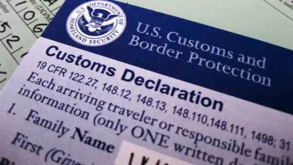

Bine ați venit în Chicago. După un zbor lung, iată cum ajungeți de la O'Hare la locul unde stați.

## Cum se leagă terminalele O'Hare

Al patrulea cel mai aglomerat hub aeroportuar din Statele Unite, Aeroportul Internațional Chicago O'Hare (ORD) are **patru terminale: 1, 2, 3 și 5** (T1, T2, T3, T5).

- **T1, T2 și T3** sunt conectate, așa că puteți merge pe jos între ele.
- **T5** deservește zborurile internaționale — inclusiv majoritatea zborurilor spre și din China — și este legat de celelalte terminale prin **Airport Transit System (ATS)**.

ATS este **gratuit** între terminale.

## Sosirea în Chicago

### Completați formularul de declarație vamală în avion

În timpul zborului, echipajul distribuie **formularul de declarație vamală** (există și o versiune în chineză). Dacă îl completați **înainte de aterizare**, sosirea devine mult mai simplă.

Câteva lucruri de urmărit când îl completați, altfel puteți fi trimis la întrebări suplimentare:

1. Dacă călătoriți cu familia și stați la aceeași adresă, puteți completa un singur formular împreună.
2. Declarați **scopul intrării cu sinceritate** — turism, afaceri, studii sau orice altceva.
3. Nu introduceți în țară:
   - fructe, legume, plante, semințe, alimente sau insecte;
   - carne, animale ori produse de origine animală și din fauna sălbatică;
   - culturi de agenți patogeni, culturi celulare sau melci;
   - pământ sau orice lucru care a fost într-o fermă, un ranch sau o stație de îngrășare.
4. Nu transportați **mai mult de 10.000 USD în numerar**.

### Trecerea prin imigrare

Odată ce avionul ajunge la O'Hare și echipajul anunță că puteți coborî, întindeți-vă picioarele, verificați că nu ați lăsat nimic în cabină — și urmați mulțimea **spre zona de imigrare**. Dacă pierdeți grupul pentru că v-ați oprit la toaletă, nu vă faceți griji: urmați indicatoarele „Immigration”.

La imigrare, mergeți la **rândul „Visa”** (nu la rândul „US Citizen”) și așteptați-vă rândul. Vorbiți încet și nu folosiți telefonul pentru a filma ofițerii.

Aveți la îndemână **pașaportul**, **formularul I-20**, **certificatul internațional de sănătate pentru călătorie** („cărticica roșie”), **certificatul internațional de vaccinare** („cărticica galbenă”) și **scrisoarea de admitere** sau **planul de studii**, dacă îl aveți.

Când ofițerul vă întreabă de ce veniți, **răspundeți sincer** despre școală și programul dvs. Apoi vă vor fotografia și vă vor lua amprentele, ceea ce încheie procesul de intrare.

### Bagaje și vamă

Urmați informațiile de pe eticheta bagajului până la banda corectă și **așteptați-vă bagajele**, verificându-le cu informațiile de pe ecrane — **ecranele aeroportului sunt sursa oficială**.

Dacă nu aveți nimic de declarat, de obicei puteți ieși direct. Dacă sunteți oprit pentru control, păstrați-vă calmul, cooperați cu ofițerii și **nu ascundeți nimic**.

Sala de sosiri din T5 are restaurante de toate dimensiunile, așa că, după ce ați trecut, vă puteți relaxa, cumpăra o băutură sau o gustare și vă puteți conecta la Wi-Fi-ul gratuit al aeroportului ca să anunțați familia că ați aterizat.

## Plecarea din aeroport

Dacă ați aranjat să fiți preluat de școală sau de altă organizație, urmați indicatoarele aeroportului până la poarta convenită.

Cei care merg în diferite zone pot urma și indicatoarele pentru fiecare opțiune de transport: cei care merg la Champaign, Purdue sau în alte locuri din regiune iau de obicei un autobuz charter, iar cei care merg în Chicago iau în general transportul la cerere sau CTA.

## Cum ajungeți în oraș

### Opțiunea 1: linia albastră CTA

Pentru a ajunge la și de la O'Hare cu CTA, trebuie să luați **linia albastră**. Mai întâi luați **naveta ATS** până la **Terminalul 2** și schimbați acolo — ATS este **gratuit** între terminale.

Linia albastră circulă **24 de ore pe zi, șapte zile pe săptămână**. Fiecare tren de la stația O'Hare trece prin centru în drum spre Forest Park, iar călătoria spre centru durează de obicei **40–45 de minute**.

Odată ajuns în **T2**, urmați **pictograma albastră de metrou** pentru a ajunge pe peronul liniei albastre. Trebuie să cumpărați un bilet de la automat înainte de a intra: **tariful între O'Hare și centru este de 5 USD** (tariful normal este de 2,50 USD). Unele automate nu dau rest, așa că pregătiți monede sau plătiți cu un card de credit ori de debit Visa sau Mastercard.

Nu trebuie să validați biletul la ieșire, dar **un bilet vă oferă până la două corespondențe gratuite cu un alt tren sau autobuz CTA în decurs de două ore**, așa că păstrați-l.

Dacă mergeți la **SAIC**, **DePaul (Loop)**, **Columbia College Chicago** sau **UIC**, nu trebuie să schimbați trenul — coborâți la Monroe, Jackson, LaSalle sau UIC-Halsted, după caz.

Pentru **DePaul (Lincoln Park)**, **Northwestern (Kellogg)**, **University of Chicago** sau **IIT**, va trebui să faceți corespondență cu o altă linie de metrou sau cu un autobuz.

### Opțiunea 2: transport la cerere

Dacă vreți cea mai simplă, rapidă și confortabilă opțiune, luați o mașină și scutiți-vă de târâtul bagajelor. Singurele dezavantaje sunt că este **scump** și **poate rămâne blocat în trafic la orele aglomerate**.

Uber și Lyft sunt cele două aplicații pe care le folosește toată lumea în Statele Unite. Descărcați versiunea internațională înainte de zbor și **asociați din timp un card de credit cu dublă monedă**. Odată ce ați aterizat și aveți conexiune la internet (Wi-Fi-ul aeroportului este suficient), puteți chema o mașină.

Dacă aterizați în **T5**, luați mai întâi **ATS** până la **Terminalul 2**, apoi urmați indicatoarele **Rideshare / Ride App** până la punctul de preluare de la **nivelul plecări**.

Atât Uber, cât și Lyft preiau doar de aici. Taxarea începe când șoferul ajunge la punctul de preluare, iar după o scurtă perioadă de grație (aproximativ cinci minute) vi se percepe un supliment — așa că cel mai bine este să **comandați mașina abia când sunteți la punctul de preluare din T2**.

După ce vă înregistrați și adăugați o metodă de plată, introduceți în aplicație punctul de plecare și destinația și alegeți tipul de vehicul. Când vă atribuie cel mai apropiat șofer, aplicația arată detaliile și evaluarea acestuia — **dacă evaluarea este mică, cereți un alt șofer**, pentru siguranță.

Aceeași cursă are un preț ușor diferit între cele două aplicații, dar serviciul este practic același (majoritatea șoferilor lucrează pentru ambele), așa că merită să comparați înainte de a confirma.

> Înainte de a urca, verificați detaliile șoferului și ale vehiculului — nume, model și număr de înmatriculare. Rămâneți vigilent în timpul cursei și verificați în aplicație că ruta este corectă.

### Opțiunea 3: autobuzul Pace

**(În special pentru studenții de la Northwestern)**

Pace operează autobuzele din suburbiile Chicago-ului, iar linia sa Pulse Dempster merge **de la O'Hare la Evanston**, unde se află Northwestern University, în aproximativ **50 de minute**, la fiecare **15–20 de minute** (la fiecare 20–30 de minute în weekend și în afara orelor de vârf).

Pentru a ajunge de la O'Hare la Evanston, **luați ATS până la MMF (Multi-Modal Facility)** și căutați **peronul 9** pentru autobuzul Pulse. Puteți valida un card Ventra în autobuz sau puteți plăti în numerar: tariful este de **2 USD** (2,25 USD în numerar).

## Un ultim sfat

Indiferent cum călătoriți, fiți atenți la ce se întâmplă în jur și verificați că nu ați uitat bagaje înainte de a urca sau de a coborî.

## Linkuri utile

- **Pe acest site**: [Chicago O'Hare ORD](/airport/ORD), [Statele Unite (US)](/country/US)
- **Wikipedia**: [Chicago O'Hare ORD](https://en.wikipedia.org/wiki/O'Hare_International_Airport)
- **Baidu Baike**: [Chicago O'Hare ORD](https://baike.baidu.com/item/%E5%A5%A5%E9%BB%91%E5%B0%94%E5%9B%BD%E9%99%85%E6%9C%BA%E5%9C%BA)
