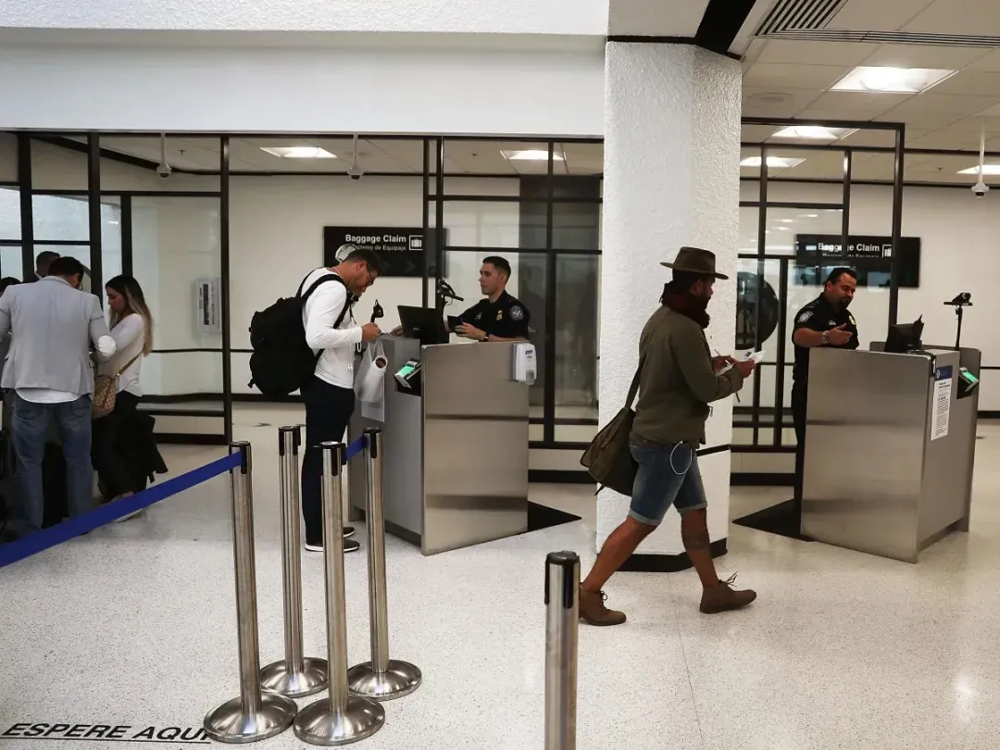
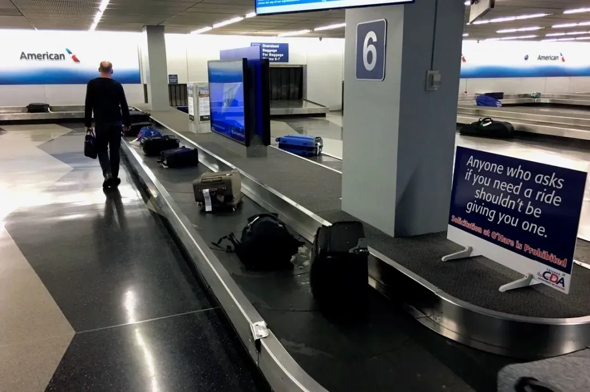
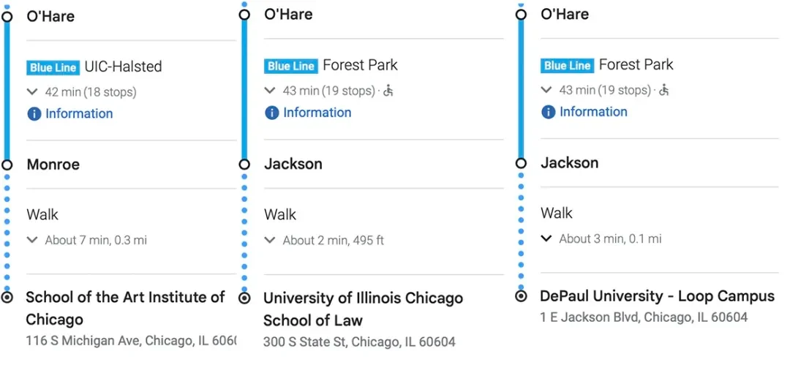

Välkommen till Chicago. Efter en lång flygning får du här veta hur du tar dig från O'Hare till platsen där du ska bo.

## Hur O'Hares terminaler hänger samman

Chicago O'Hare International (ORD) är USA:s fjärde mest trafikerade flygnav och har **fyra terminaler: 1, 2, 3 och 5** (T1, T2, T3, T5).

- **T1, T2 och T3** är sammankopplade, så du kan gå mellan dem.
- **T5** hanterar internationella flyg – bland annat de flesta flyg till och från Kina – och förbinds med de övriga via **Airport Transit System (ATS)**.

ATS är **kostnadsfri** mellan terminalerna.

## Ankomst till Chicago

### Fyll i tulldeklarationen ombord

Under flygningen delar besättningen ut **tulldeklarationsformuläret** (det finns en kinesisk version). Att fylla i det **innan du landar** gör ankomsten mycket smidigare.

Några saker att tänka på när du fyller i det, annars kan du skickas till extra förhör:

1. Om du reser med familjen och bor på samma adress kan ni dela på ett formulär.
2. Ange ditt **inresesyfte sanningsenligt** – turism, affärer, studier eller något annat.
3. Ta inte med dig:
   - frukt, grönsaker, växter, frön, mat eller insekter;
   - kött, djur eller produkter av djur och vilda djur;
   - sjukdomskulturer, cellkulturer eller sniglar;
   - jord eller något som har varit på en gård, ranch eller utfodringsanläggning.
4. Bär inte **mer än 10 000 US-dollar i kontanter**.

### Vidare till immigrationskontrollen

När planet är på O'Hare och besättningen meddelar att du får stiga av, sträck på benen, kontrollera att du inte lämnat något i kabinen – och följ folkmassan **till immigrationsområdet**. Om du tappar bort gruppen för att du stannade vid toaletten behöver du inte oroa dig: följ bara skyltarna mot Immigration.

Vid immigrationskontrollen ställer du dig i **"Visa"-kön** (inte "US Citizen"-kön) och väntar på din tur. Håll rösten dämpad och använd inte telefonen för att filma tjänstemännen.

Ha **passet**, **Form I-20**, ditt **internationella resehälsointyg** ("lilla röda boken"), ditt **internationella vaccinationsintyg** ("lilla gula boken") och ditt **antagningsbrev** eller din **studieplan** redo om du har något.

När tjänstemannen frågar varför du besöker landet ska du **svara sanningsenligt** om din skola och ditt program. Därefter fotograferas du och lämnar fingeravtryck, vilket avslutar inreseprocessen.

### Bagage och tull

Följ informationen på bagagebrickan till rätt bagageband och **vänta på dina väskor**; kontrollera dem mot skärmarna – **flygplatsens skärmar är avgörande**.

Om du inte har något att deklarera kan du vanligtvis gå rakt ut. Om du tas åt sidan för kontroll ska du hålla dig lugn, samarbeta med tjänstemännen och **inte undanhålla något**.

T5:s ankomsthall har restauranger i alla storlekar, så när du har kommit igenom kan du koppla av, köpa något att dricka eller ett mellanmål och ansluta till flygplatsens kostnadsfria wi-fi för att meddela familjen att du har landat.

## Lämna flygplatsen

Om du har ordnat hämtning med din skola eller en annan organisation följer du flygplatsskyltarna till den överenskomna porten.

Resenärer som ska till olika områden kan också följa skyltarna för respektive transportmedel: de som ska till Champaign, Purdue eller andra platser i regionen tar vanligtvis en chartrad buss, medan de som ska in till Chicago oftast tar en appbeställd bil eller CTA.

## Ta sig in till staden

### Alternativ 1: CTA Blue Line

För att ta sig till och från O'Hare med CTA tar du **Blue Line**. Först tar du **ATS-shuttlen** till **terminal 2** och byter där – ATS är **kostnadsfri** mellan terminalerna.

Blue Line går **dygnet runt, sju dagar i veckan**. Alla tåg från O'Hare-stationen passerar genom centrala staden på väg till Forest Park, och resan in till centrum tar vanligtvis **40–45 minuter**.

När du är på **T2** följer du den **blå tunnelbanans symbol** för att komma till Blue Line-plattformen. Du måste köpa biljett i automaten innan du går in: **priset mellan O'Hare och centrala Chicago är 5 dollar** (ordinarie pris är 2,50 dollar). Vissa automater ger inte växel, så ha mynt redo eller betala med ett Visa- eller Mastercard-kredit- eller betalkort.

Du behöver inte blippa ut på vägen ut, men **en biljett ger upp till två kostnadsfria byten till ett annat CTA-tåg eller en buss inom två timmar**, så behåll den.

Om du ska till **SAIC**, **DePaul (Loop)**, **Columbia College Chicago** eller **UIC** behöver du inte byta tåg – stig av vid Monroe, Jackson, LaSalle eller UIC-Halsted beroende på vart du ska.

För **DePaul (Lincoln Park)**, **Northwestern (Kellogg)**, **University of Chicago** eller **IIT** behöver du byta till en annan tunnelbanelinje eller busslinje.

### Alternativ 2: appbeställd bil

Om du vill ha det enklaste, snabbaste och bekvämaste alternativet tar du en bil och slipper släpa runt på bagaget. De enda nackdelarna är att det är **dyrt** och **kan fastna i trafik under rusningstid**.

Uber och Lyft är de två appar som alla använder i USA. Ladda ner den internationella versionen innan du flyger och **koppla ett kreditkort med två valutor** i förväg. När du har landat och har en anslutning (flygplatsens wi-fi fungerar) kan du beställa en bil.

Om du landar på **T5** tar du först **ATS** till **terminal 2** och följer sedan skyltarna för **Rideshare / Ride App** till upphämtningsplatsen på **avgångsnivån**.

Både Uber och Lyft hämtar endast här. Taxametern startar när föraren når upphämtningsplatsen, och efter en kort frist (cirka fem minuter) debiteras du extra – så det är bäst att **beställa bilen först när du står på upphämtningsplatsen vid T2**.

Efter att du har registrerat dig och lagt till en betalningsmetod anger du startpunkt och destination i appen och väljer fordonstyp. När appen matchar dig med närmaste förare visas förarens uppgifter och betyg – **om betyget är lågt bör du begära en annan förare** för att vara säker.

Samma resa har lite olika pris i de två apparna, men tjänsten är i princip densamma (de flesta förare kör för båda), så det är värt att jämföra innan du bekräftar.

> Kontrollera förarens och fordonets uppgifter – namn, modell och registreringsnummer – innan du sätter dig i. Var uppmärksam under resan och kontrollera i appen att rutten är korrekt.

### Alternativ 3: Pace-bussen

**(Särskilt för studenter vid Northwestern)**

Pace driver bussarna i Chicagos förorter, och linjen Pulse Dempster går **från O'Hare till Evanston**, där Northwestern University ligger, på cirka **50 minuter**, var **15–20:e minut** (var 20–30:e minut på helger och utanför rusningstid).

För att ta dig från O'Hare till Evanston **tar du ATS till MMF (Multi-Modal Facility)** och letar upp **hållplats 9** för Pulse-bussen. Du kan blippa ett Ventra-kort ombord eller betala kontant: priset är **2 dollar** (2,25 dollar kontant).

## Ett sista tips

Oavsett hur du reser bör du vara uppmärksam på omgivningen och kontrollera att du inte har lämnat något bagage efter dig innan du stiger på eller av.

## Relaterade länkar

- **På den här webbplatsen**: [Chicago O'Hare ORD](/airport/ORD), [USA (US)](/country/US)
- **Wikipedia**: [Chicago O'Hare ORD](https://en.wikipedia.org/wiki/O'Hare_International_Airport)
- **Baidu Baike**: [Chicago O'Hare ORD](https://baike.baidu.com/item/%E5%A5%A5%E9%BB%91%E5%B0%94%E5%9B%BD%E9%99%85%E6%9C%BA%E5%9C%BA)
