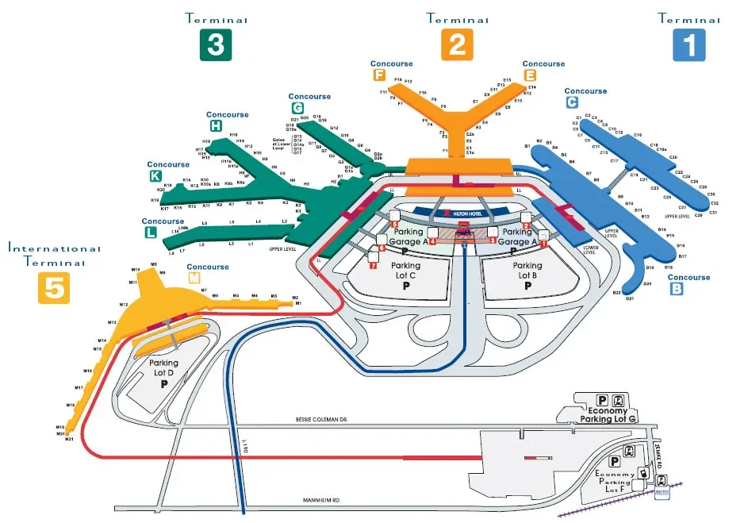
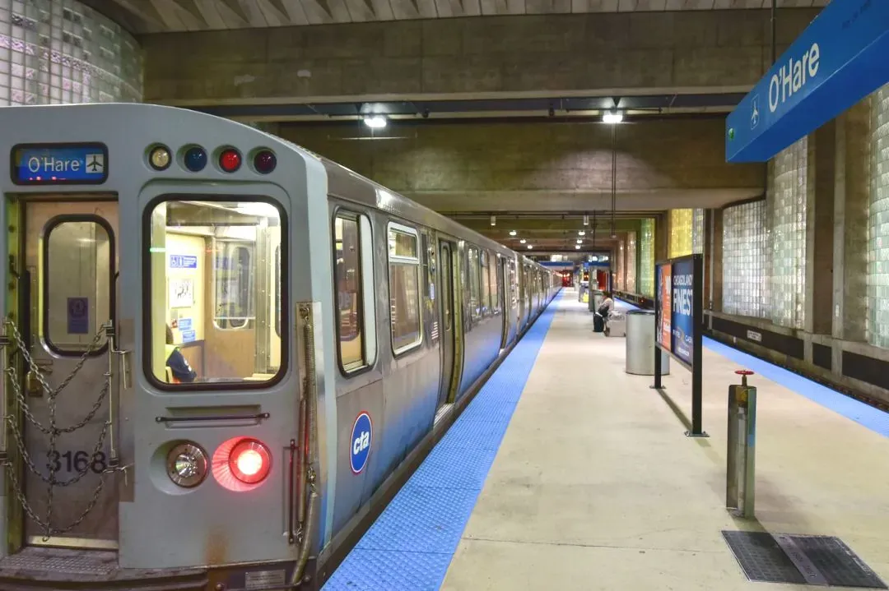

Karibu Chicago. Baada ya safari ndefu ya ndege, hii ni jinsi ya kufika kutoka O'Hare hadi unakokaa.

## Jinsi vituo vya O'Hare vinavyoungana

Ukiwa kitovu cha nne chenye shughuli nyingi zaidi za uwanja wa ndege nchini Marekani, Uwanja wa Ndege wa Kimataifa wa Chicago O'Hare (ORD) una **vituo vinne: 1, 2, 3 na 5** (T1, T2, T3, T5).

- **T1, T2 na T3** vimeunganishwa, kwa hiyo unaweza kutembea kati yao.
- **T5** inashughulikia ndege za kimataifa — ikiwemo ndege nyingi za kwenda na kutoka China — na inaunganishwa na vingine kwa **Mfumo wa Usafiri wa Uwanja wa Ndege (ATS)**.

ATS ni **bila malipo** kati ya vituo.

## Kuwasili Chicago

### Jaza fomu ya tamko la forodha ndani ya ndege

Wakati wa safari, wafanyakazi wa ndege hutoa **fomu ya tamko la forodha** (kuna toleo la Kichina). Kuijaza **kabla ya kutua** hurahisisha sana kuwasili.

Mambo machache ya kuzingatia unapoiandika, vinginevyo unaweza kupelekwa kwa mahojiano ya ziada:

1. Ikiwa unasafiri na familia na mnakaa kwenye anwani moja, mnaweza kutumia fomu moja.
2. Eleza **sababu ya kuingia kwa ukweli** — utalii, biashara, masomo au chochote kingine.
3. Usilete ndani ya nchi:
   - matunda, mboga, mimea, mbegu, chakula au wadudu;
   - nyama, wanyama, au bidhaa za wanyama na wanyamapori;
   - vikuzi vya magonjwa, vikuzi vya seli au konokono;
   - udongo, au kitu chochote kilichowahi kuwa shambani, kwenye ranchi au kwenye banda la mifugo.
4. Usibebe **zaidi ya dola 10,000 za Marekani taslimu**.

### Kupitia ukaguzi wa uhamiaji

Ndege inapofika O'Hare na wafanyakazi kutangaza kwamba mnaweza kushuka, nyoosha miguu, hakikisha hukuaacha kitu ndani ya chumba cha abiria — kisha fuata umati **kuelekea eneo la uhamiaji**. Ukikosa kundi kwa sababu ulisimama chooni, usijali: fuata tu alama za "Uhamiaji".

Kwenye uhamiaji, jiunge na **foleni ya "Visa"** (si ile ya "Raia wa Marekani") na subiri zamu yako. Punguza sauti, na usitumie simu yako kuwapiga picha maafisa.

Kuwa tayari na **pasipoti** yako, **Fomu I-20**, **cheti chako cha afya cha safari za kimataifa** ("kitabu kidogo chekundu"), **cheti chako cha kimataifa cha chanjo** ("kitabu kidogo cha njano"), na **barua yako ya kukubaliwa** au **mpango wako wa masomo** ikiwa unayo.

Afisa anapouliza kwa nini umetembelea, **jibu kwa ukweli** kuhusu shule na programu yako. Kisha watakupiga picha na kuchukua alama zako za vidole, jambo linalokamilisha mchakato wa kuingia.

### Mizigo na forodha

Fuata taarifa ya lebo ya mizigo hadi kwenye mzunguko sahihi na **subiri mizigo yako**, uikague dhidi ya skrini — **skrini za uwanja wa ndege ndizo za kuaminika**.

Ikiwa huna kitu cha kutangaza, kwa kawaida unaweza kutoka moja kwa moja. Ukichukuliwa kando kwa ukaguzi, tulia, shirikiana na maafisa na **usifishe chochote**.

Ukumbi wa kuwasili wa T5 una mikahawa ya kila ukubwa, kwa hiyo ukishamaliza unaweza kupumzika, kununua kinywaji au kitafunwa, na kuunganisha kwenye Wi-Fi ya bure ya uwanja wa ndege ili kuwajulisha familia yako kwamba umetua.

## Kuondoka uwanja wa ndege

Ikiwa umepanga kuchukuliwa na shule yako au taasisi nyingine, fuata alama za uwanja wa ndege hadi lango mlilokubaliana.

Wasafiri wanaoelekea maeneo mbalimbali wanaweza pia kufuata alama za kila chaguo la usafiri: wale wanaokwenda Champaign, Purdue au sehemu nyingine za kanda hiyo kwa kawaida huchukua basi la kukodi, ilhali wale wanaokwenda Chicago yenyewe kwa kawaida huchukua gari la programu au CTA.

## Kuingia mjini

### Chaguo 1: CTA Blue Line

Kwenda na kurudi O'Hare kwa CTA inamaanisha kuchukua **Blue Line**. Kwanza unachukua **basi la ATS** hadi **Kituo 2** na kubadilisha hapo — ATS ni **bila malipo** kati ya vituo.

Blue Line inaenda **saa 24 kwa siku, siku saba kwa wiki**. Kila treni kutoka kituo cha O'Hare inapita katikati ya mji ikielekea Forest Park, na safari ya katikati ya mji kwa kawaida huchukua **dakika 40–45**.

Ukiwa **T2**, fuata **alama ya bluu ya metro** kufikia jukwaa la Blue Line. Unahitaji kununua tiketi kwenye mashine kabla ya kuingia: **nauli kati ya O'Hare na katikati ya mji ni $5** (nauli ya kawaida ni $2.50). Mashine zingine hazitoi chenji, kwa hiyo kuwa na sarafu tayari, au lipa kwa kadi ya mkopo au benki ya Visa au Mastercard.

Huhitaji kugusa kadi unapotoka, lakini **tiketi moja inakupa hadi mabadiliko mawili ya bure kwa treni au basi lingine la CTA ndani ya saa mbili**, kwa hiyo iweke salama.

Ikiwa unaelekea **SAIC**, **DePaul (Loop)**, **Columbia College Chicago** au **UIC**, huhitaji kubadilisha treni — shuka Monroe, Jackson, LaSalle au UIC-Halsted ipasavyo.

Kwa **DePaul (Lincoln Park)**, **Northwestern (Kellogg)**, **Chuo Kikuu cha Chicago** au **IIT**, utahitaji kubadilisha kwenda njia nyingine ya metro au basi.

### Chaguo 2: kuagiza gari kwa programu

Ikiwa unataka chaguo rahisi zaidi, la haraka zaidi na la starehe zaidi, chukua gari na uepuke kuburuta mizigo yako huku na kule. Hasara pekee ni kwamba ni **ghali** na **linaweza kukwama kwenye msongamano wa magari nyakati za shughuli nyingi**.

Uber na Lyft ni programu mbili ambazo kila mtu anatumia nchini Marekani. Pakua toleo la kimataifa kabla ya kusafiri na **unganisha kadi ya mkopo ya sarafu mbili** mapema. Ukishatua na kupata mtandao (Wi-Fi ya uwanja wa ndege inatosha), unaweza kuita gari.

Ikiwa unatua **T5**, kwanza chukua **ATS** hadi **Kituo 2**, kisha fuata alama za **Rideshare / Ride App** hadi eneo la kuchukua gari kwenye **ngazi ya kuondoka**.

Uber na Lyft wote huchukua abiria hapa pekee. Mita huanza dereva wako anapofika eneo la kuchukua, na baada ya muda mfupi wa hisani (dakika tano hivi) unatozwa zaidi — kwa hiyo ni bora **kuagiza gari ukiwa tayari kwenye eneo la kuchukua la T2**.

Baada ya kujisajili na kuongeza njia ya malipo, ingiza mahali unapoanzia na unakoelekea kwenye programu na uchague aina ya gari. Mara inapokutanisha na dereva aliye karibu zaidi, inaonyesha taarifa na alama zake — **ikiwa alama ni ndogo, omba dereva mwingine** kwa usalama.

Safari hiyo hiyo ina bei tofauti kidogo kati ya programu mbili, lakini huduma kimsingi ni ile ile (madereva wengi hufanya kazi kwa zote mbili), kwa hiyo inafaa kulinganisha kabla ya kuthibitisha.

> Kabla ya kuingia, hakikisha taarifa za dereva na gari — jina, aina ya gari na namba ya sahani. Kaa makini wakati wa safari na angalia kwenye programu kwamba njia ni sahihi.

### Chaguo 3: basi la Pace

**(Hasa kwa wanafunzi wa Northwestern)**

Pace huendesha mabasi katika vitongoji vya Chicago, na njia yake ya Pulse Dempster inaenda **kutoka O'Hare hadi Evanston**, ambako Chuo Kikuu cha Northwestern kiko, kwa takriban **dakika 50**, kila **dakika 15–20** (kila dakika 20–30 mwishoni mwa wiki na nje ya saa za shughuli nyingi).

Ili kwenda kutoka O'Hare hadi Evanston, **chukua ATS hadi MMF (Kituo cha Usafiri wa Aina Nyingi)** na utafute **Banda 9** kwa basi la Pulse. Unaweza kugusa kadi ya Ventra ndani ya basi au kulipa taslimu: nauli ni **$2** ($2.25 kwa taslimu).

## Kidokezo kimoja cha mwisho

Njia yoyote unayotumia, kuwa makini na mazingira yako, na hakikisha hujaacha mizigo yoyote kabla ya kuingia au kushuka.

## Viungo vinavyohusiana

- **Kwenye tovuti hii**: [Chicago O'Hare ORD](/airport/ORD), [Marekani (US)](/country/US)
- **Wikipedia**: [Uwanja wa Ndege wa Chicago O'Hare ORD](https://en.wikipedia.org/wiki/O'Hare_International_Airport)
- **Baidu Baike**: [Uwanja wa Ndege wa Chicago O'Hare ORD](https://baike.baidu.com/item/%E5%A5%A5%E9%BB%91%E5%B0%94%E5%9B%BD%E9%99%85%E6%9C%BA%E5%9C%BA)
