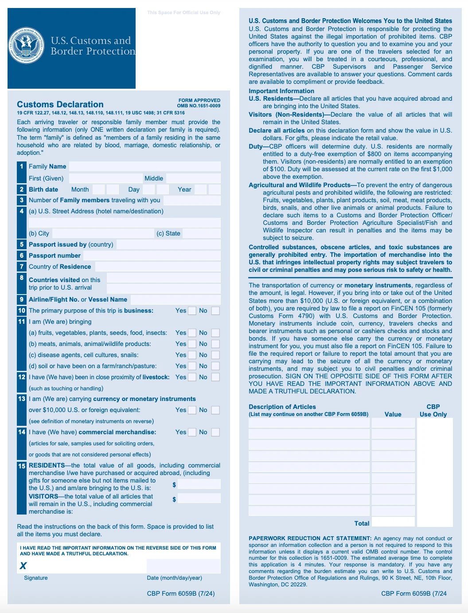
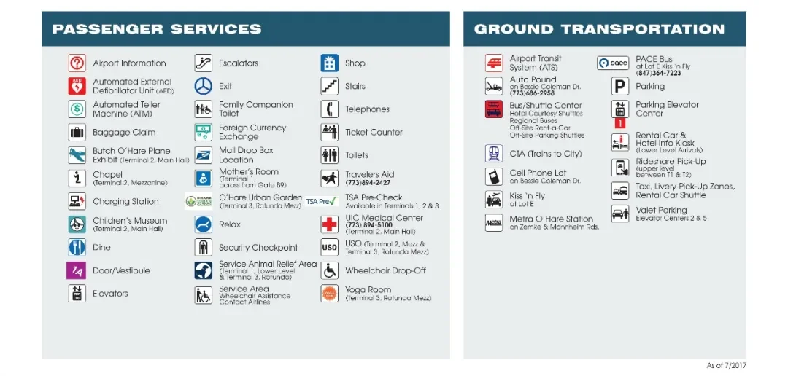
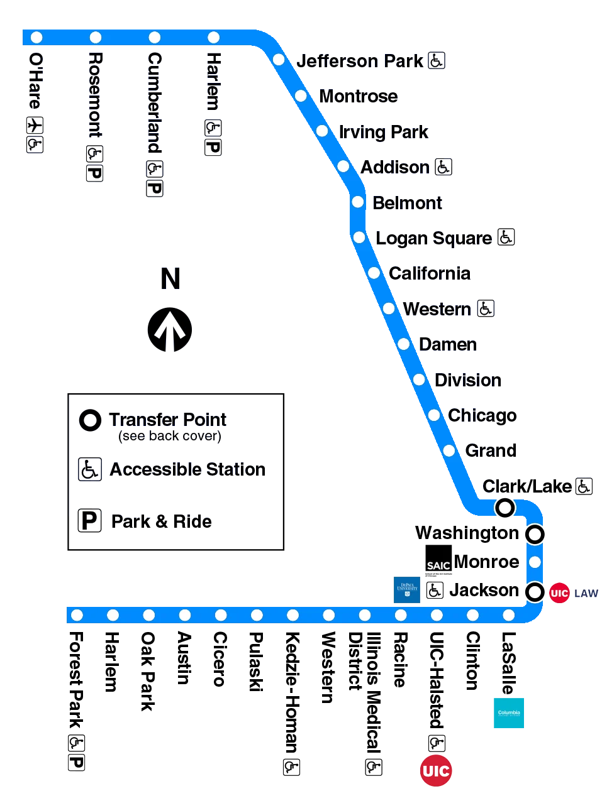
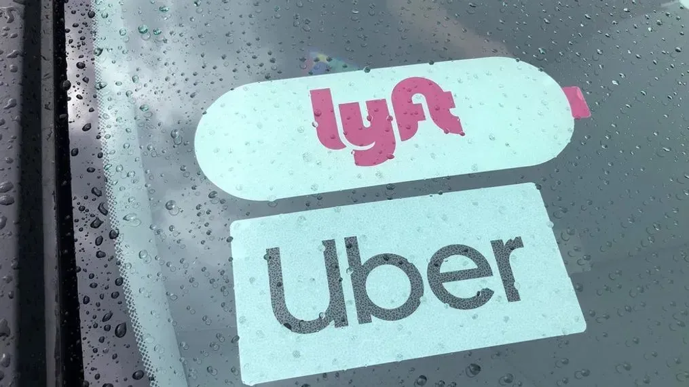
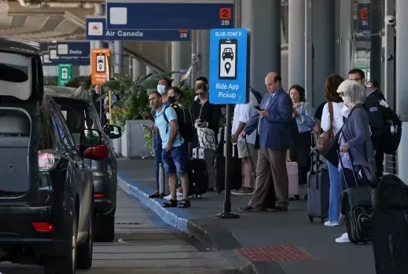

ยินดีต้อนรับสู่ชิคาโก หลังเที่ยวบินยาวนาน นี่คือวิธีเดินทางจากโอแฮร์ไปยังที่พักของคุณ

## อาคารผู้โดยสารของโอแฮร์เชื่อมต่อกันอย่างไร

ในฐานะศูนย์กลางการบินที่มีผู้โดยสารหนาแน่นเป็นอันดับสี่ของสหรัฐอเมริกา ท่าอากาศยานนานาชาติชิคาโกโอแฮร์ (ORD) มี**สี่อาคารผู้โดยสาร: 1, 2, 3 และ 5** (T1, T2, T3, T5)

- **T1, T2 และ T3** เชื่อมต่อกัน จึงเดินระหว่างกันได้
- **T5** รองรับเที่ยวบินระหว่างประเทศ — รวมถึงเที่ยวบินส่วนใหญ่ไปและกลับจากจีน — และเชื่อมกับอาคารอื่นด้วย**ระบบขนส่งสนามบิน (ATS)**

ATS ใช้บริการ**ฟรี**ระหว่างอาคารผู้โดยสาร

## การเดินทางมาถึงชิคาโก

### กรอกแบบฟอร์มสำแดงศุลกากรบนเครื่อง

ระหว่างเที่ยวบิน ลูกเรือจะแจก**แบบฟอร์มสำแดงศุลกากร** (มีฉบับภาษาจีน) การกรอก**ก่อนเครื่องลง**จะทำให้ขั้นตอนขาเข้าราบรื่นขึ้นมาก

สิ่งที่ควรระวังเมื่อกรอก มีฉะนั้นคุณอาจถูกส่งไปสอบถามเพิ่มเติม:

1. หากเดินทางกับครอบครัวและพักที่เดียวกัน สามารถใช้แบบฟอร์มร่วมกันได้หนึ่งใบ
2. ระบุ**วัตถุประสงค์การเข้าเมืองตามความจริง** — ท่องเที่ยว ธุรกิจ เรียน หรืออื่น ๆ
3. ห้ามนำเข้า:
   - ผลไม้ ผัก พืช เมล็ดพันธุ์ อาหาร หรือแมลง;
   - เนื้อสัตว์ สัตว์ หรือผลิตภัณฑ์จากสัตว์และสัตว์ป่า;
   - เชื้อโรค วัฒนธรรมเซลล์ หรือหอยทาก;
   - ดิน หรือสิ่งใดก็ตามที่เคยอยู่ในฟาร์ม ฟาร์มปศุสัตว์ หรือคอกปศุสัตว์
4. ห้ามพก**เงินสดเกิน 10,000 ดอลลาร์สหรัฐ**

### ผ่านด่านตรวจคนเข้าเมือง

เมื่อเครื่องจอดที่โอแฮร์และลูกเรือประกาศว่าลงได้แล้ว ให้ยืดเส้นยืดสาย ตรวจสอบว่าไม่ได้ลืมอะไรไว้ในห้องโดยสาร — แล้วเดินตามฝูงชน**ไปยังพื้นที่ตรวจคนเข้าเมือง** หากคุณพลาดกลุ่มเพราะแวะห้องน้ำ ไม่ต้องกังวล เพียงตามป้าย "Immigration"

ที่ด่านตรวจคนเข้าเมือง เข้าคิว **"Visa"** (ไม่ใช่คิว "US Citizen") แล้วรอตามลำดับ เก็บเสียงให้เบา และห้ามใช้โทรศัพท์ถ่ายวิดีโอเจ้าหน้าที่

เตรียม**หนังสือเดินทาง** **แบบฟอร์ม I-20** **สมุดสุขภาพระหว่างประเทศ** ("สมุดเล่มแดง") **สมุดรับรองการฉีดวัคซีนระหว่างประเทศ** ("สมุดเล่มเหลือง") และ**จดหมายตอบรับ**หรือ**แผนการเรียน**หากคุณมี

เมื่อเจ้าหน้าที่ถามว่ามาเยือนด้วยเหตุใด ให้**ตอบตามความจริง**เกี่ยวกับโรงเรียนและหลักสูตรของคุณ จากนั้นเจ้าหน้าที่จะถ่ายรูปและเก็บลายนิ้วมือ ซึ่งเป็นการเสร็จสิ้นขั้นตอนการเข้าเมือง

### รับกระเป๋าและศุลกากร

ตามข้อมูลป้ายกระเป๋าไปยังสายพานที่ถูกต้องและ**รอกระเป๋า** ตรวจสอบกับหน้าจอ — **หน้าจอของสนามบินถือเป็นข้อมูลที่ชี้ขาด**

หากไม่มีสิ่งของต้องสำแดง โดยปกติสามารถเดินออกได้เลย หากถูกเรียกไปตรวจ ให้ใจเย็น ร่วมมือกับเจ้าหน้าที่ และ**อย่าปิดบังสิ่งใด**

โถงผู้โดยสารขาเข้าของ T5 มีร้านอาหารทุกขนาด ดังนั้นเมื่อผ่านขั้นตอนแล้วคุณสามารถผ่อนคลาย ซื้อเครื่องดื่มหรือของว่าง และเชื่อมต่อ Wi-Fi ฟรีของสนามบินเพื่อบอกครอบครัวว่าคุณลงจอดแล้ว

## ออกจากสนามบิน

หากคุณนัดรับกับโรงเรียนหรือองค์กรอื่น ให้ตามป้ายของสนามบินไปยังประตูที่นัดหมาย

ผู้เดินทางที่มุ่งไปยังพื้นที่ต่าง ๆ ยังสามารถตามป้ายของแต่ละทางเลือกการเดินทางได้: ผู้ที่ไปแชมเปญ (Champaign) เพอร์ดู หรือสถานที่อื่นในภูมิภาคมักใช้รถบัสเช่าเหมา ส่วนผู้ที่มุ่งเข้าตัวชิคาโกมักใช้รถเรียกผ่านแอปหรือ CTA

## การเดินทางเข้าสู่ตัวเมือง

### ทางเลือกที่ 1: CTA สาย Blue Line

การเดินทางไปและกลับโอแฮร์ด้วย CTA หมายถึงการใช้**สาย Blue Line** คุณต้องนั่ง**รถรับส่ง ATS** ไปยัง**อาคารผู้โดยสาร 2** แล้วเปลี่ยนที่นั่น — ATS ใช้บริการ**ฟรี**ระหว่างอาคารผู้โดยสาร

Blue Line วิ่ง**ตลอด 24 ชั่วโมง ทุกวัน** รถไฟทุกขบวนจากสถานีโอแฮร์ผ่านใจกลางเมืองไปยัง Forest Park และการเดินทางเข้าสู่ใจกลางเมืองมักใช้เวลา **40–45 นาที**

เมื่อถึง **T2** ให้ตาม**ไอคอนรถไฟใต้ดินสีน้ำเงิน**ไปยังชานชาลา Blue Line คุณต้องซื้อตั๋วจากเครื่องก่อนเข้า: **ค่าโดยสารระหว่างโอแฮร์กับใจกลางเมืองคือ 5 ดอลลาร์** (ค่าโดยสารปกติ 2.50 ดอลลาร์) เครื่องจำหน่ายตั๋วบางเครื่องไม่ทอนเงิน จึงควรเตรียมเหรียญไว้ หรือชำระด้วยบัตรเครดิตหรือบัตรเดบิต Visa หรือ Mastercard

ไม่จำเป็นต้องแตะออกตอนออกจากสถานี แต่**ตั๋วหนึ่งใบให้การต่อรถฟรีได้ถึงสองครั้งไปยังรถไฟหรือรถบัส CTA อื่นภายในสองชั่วโมง** จึงควรเก็บตั๋วไว้

หากคุณมุ่งไปยัง **SAIC**, **DePaul (Loop)**, **Columbia College Chicago** หรือ **UIC** ไม่ต้องเปลี่ยนรถ — ลงที่ Monroe, Jackson, LaSalle หรือ UIC-Halsted ตามความเหมาะสม

สำหรับ **DePaul (Lincoln Park)**, **Northwestern (Kellogg)**, **University of Chicago** หรือ **IIT** คุณต้องต่อรถไฟใต้ดินหรือรถบัสสายอื่น

### ทางเลือกที่ 2: รถเรียกผ่านแอป

หากต้องการทางเลือกที่ง่ายที่สุด เร็วที่สุด และสะดวกที่สุด ให้ใช้รถยนต์และข้ามการลากกระเป๋าไปมา ข้อเสียเพียงอย่างเดียวคือ**มีราคาแพง**และ**อาจติดการจราจรในช่วงเวลาที่ผู้โดยสารหนาแน่น**

Uber และ Lyft เป็นสองแอปที่ทุกคนใช้ในสหรัฐอเมริกา ดาวน์โหลดเวอร์ชันระหว่างประเทศก่อนเดินทางและ**ผูกบัตรเครดิตสกุลเงินคู่**ไว้ล่วงหน้า เมื่อลงเครื่องและมีการเชื่อมต่อ (Wi-Fi ของสนามบินใช้ได้) คุณก็เรียกรถได้

หากเครื่องลงที่ **T5** ให้ขึ้น **ATS** ไปยัง**อาคารผู้โดยสาร 2** ก่อน แล้วตามป้าย **Rideshare / Ride App** ไปยังจุดรับผู้โดยสารที่**ชั้นขาออก**

Uber และ Lyft รับผู้โดยสารเฉพาะที่นี่เท่านั้น มิเตอร์จะเริ่มเมื่อคนขับถึงจุดรับ และหลังจากช่วงผ่อนผันสั้น ๆ (ประมาณห้านาที) คุณจะถูกคิดเงินเพิ่ม — จึงควร**สั่งรถเมื่อคุณอยู่ที่จุดรับ T2 แล้ว**

หลังจากลงทะเบียนและเพิ่มวิธีชำระเงินแล้ว ให้กรอกจุดเริ่มต้นและจุดหมายในแอปและเลือกประเภทยานพาหนะ เมื่อแอปจับคู่กับคนขับที่ใกล้ที่สุด จะแสดงรายละเอียดและคะแนนของคนขับ — **หากคะแนนต่ำ ให้ขอคนขับคนอื่น**เพื่อความปลอดภัย

การเดินทางเดียวกันมีราคาต่างกันเล็กน้อยระหว่างสองแอป แต่บริการโดยพื้นฐานเหมือนกัน (คนขับส่วนใหญ่ทำงานให้ทั้งสองแอป) จึงควรเปรียบเทียบก่อนยืนยัน

> ก่อนขึ้นรถ ตรวจสอบรายละเอียดคนขับและยานพาหนะ — ชื่อ รุ่น และป้ายทะเบียน ระวังตัวระหว่างเดินทางและตรวจในแอปว่าเส้นทางถูกต้อง

### ทางเลือกที่ 3: รถบัส Pace

**(โดยเฉพาะสำหรับนักศึกษา Northwestern)**

Pace ให้บริการรถบัสในชานเมืองชิคาโก และสาย Pulse Dempster วิ่ง**จากโอแฮร์ไปอีแวนสตัน** ซึ่งเป็นที่ตั้งของมหาวิทยาลัย Northwestern ในเวลาประมาณ **50 นาที** ทุก **15–20 นาที** (ทุก 20–30 นาทีในวันหยุดสุดสัปดาห์และนอกชั่วโมงเร่งด่วน)

ในการเดินทางจากโอแฮร์ไปอีแวนสตัน ให้**ขึ้น ATS ไปยัง MMF (Multi-Modal Facility)** และหาช่องจอด **Bay 9** สำหรับรถบัส Pulse คุณสามารถแตะบัตร Ventra บนรถหรือจ่ายเงินสด: ค่าโดยสาร **2 ดอลลาร์** (เงินสด 2.25 ดอลลาร์)

## เคล็ดลับสุดท้าย

ไม่ว่าคุณจะเดินทางวิธีใด ให้ระวังสภาพแวดล้อมรอบตัว และตรวจสอบว่าไม่ได้ลืมกระเป๋าไว้ก่อนขึ้นหรือลงรถ

## ลิงก์ที่เกี่ยวข้อง

- **ในเว็บไซต์นี้**: [ชิคาโกโอแฮร์ ORD](/airport/ORD), [สหรัฐอเมริกา (US)](/country/US)
- **Wikipedia**: [ชิคาโกโอแฮร์ ORD](https://en.wikipedia.org/wiki/O'Hare_International_Airport)
- **Baidu Baike**: [ชิคาโกโอแฮร์ ORD](https://baike.baidu.com/item/%E5%A5%A5%E9%BB%91%E5%B0%94%E5%9B%BD%E9%99%85%E6%9C%BA%E5%9C%BA)
