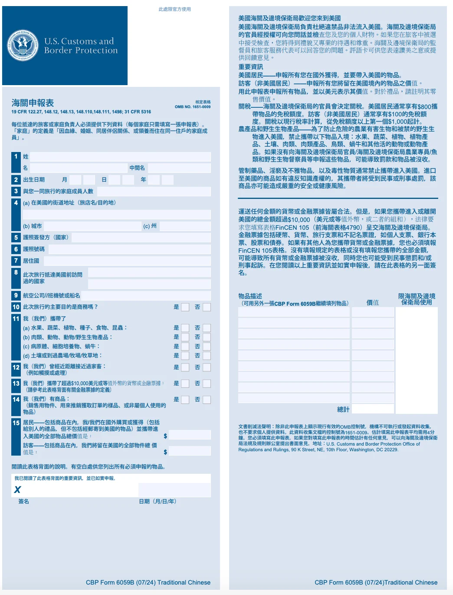

Ласкаво просимо до Чикаго. Після довгого перельоту ось як дістатися з О'Хари до місця, де ви зупинилися.

## Як влаштовані термінали О'Хари

Четвертий за завантаженістю авіаційний хаб США, міжнародний аеропорт Чикаго О'Хара (ORD), має **чотири термінали: 1, 2, 3 і 5** (T1, T2, T3, T5).

- **T1, T2 і T3** з'єднані, тож між ними можна переходити пішки.
- **T5** обслуговує міжнародні рейси — зокрема більшість рейсів до Китаю та з Китаю — і сполучений з іншими терміналами системою **Airport Transit System (ATS)**.

ATS **безкоштовний** між терміналами.

## Прибуття до Чикаго

### Заповніть митну декларацію в літаку

Під час польоту екіпаж роздає **митну декларацію** (є версія китайською). Заповнення **до посадки** значно спрощує прибуття.

Кілька речей, на які варто зважити під час заповнення, інакше вас можуть відправити на додаткові запитання:

1. Якщо ви подорожуєте з родиною й зупиняєтеся за однією адресою, можете заповнити одну декларацію на всіх.
2. **Правдиво вкажіть мету в'їзду** — туризм, бізнес, навчання чи будь-що інше.
3. Не ввозьте:
   - фрукти, овочі, рослини, насіння, продукти чи комах;
   - м'ясо, тварин або продукти тваринного й дикого походження;
   - культури збудників хвороб, клітинні культури чи равликів;
   - ґрунт або будь-що, що було на фермі, ранчо чи відгодівельному майданчику.
4. Не перевозьте **понад 10 000 доларів США готівкою**.

### Проходження паспортного контролю

Коли літак прибув до О'Хари й екіпаж оголосив, що можна виходити, розімніть ноги, перевірте, чи не забули чогось у салоні, — і йдіть за натовпом **до зони паспортного контролю**. Якщо ви відстали від групи, бо зупинилися в туалеті, не хвилюйтеся: просто йдіть за вказівниками «Immigration».

У зоні паспортного контролю станьте в **чергу «Visa»** (а не «US Citizen») і дочекайтеся своєї черги. Не говоріть голосно й не знімайте офіцерів на телефон.

Приготуйте **паспорт**, **форму I-20**, **міжнародний сертифікат про стан здоров'я для подорожей** («червону книжечку»), **міжнародний сертифікат про вакцинацію** («жовту книжечку»), а також **лист про зарахування** або **план навчання**, якщо він у вас є.

Коли офіцер запитає про мету візиту, **відповідайте правдиво** про свій навчальний заклад і програму. Потім вас сфотографують і знімуть відбитки пальців, і на цьому процедура в'їзду завершиться.

### Багаж і митниця

За інформацією з багажної бирки знайдіть потрібну стрічку й **дочекайтеся своїх валіз**, звіряючи їх із табло — **табло в аеропорту є визначальним**.

Якщо вам нема чого декларувати, зазвичай можете просто пройти. Якщо вас попросять на огляд, зберігайте спокій, співпрацюйте з офіцерами й **нічого не приховуйте**.

У залі прибуття T5 є заклади харчування на будь-який смак, тож, пройшовши все, ви можете розслабитися, купити напій чи перекуску й підключитися до безкоштовного Wi-Fi аеропорту, щоб повідомити рідних про прибуття.

## Як вийти з аеропорту

Якщо вас зустрічають від навчального закладу чи іншої організації, ідіть за вказівниками аеропорту до узгодженого виходу.

Ті, хто прямує в різні райони, можуть орієнтуватися за вказівниками для кожного виду транспорту: до Шампейна, Пердью чи інших місць регіону зазвичай їздять чартерним автобусом, а до самого Чикаго — переважно на викликаному авто або CTA.

## Як дістатися до міста

### Варіант 1: «синя лінія» CTA

Щоб дістатися до О'Хари та назад на CTA, потрібна **«синя лінія»**. Спершу ви їдете **шатлом ATS** до **терміналу 2** і там пересідаєте — ATS **безкоштовний** між терміналами.

«Синя лінія» працює **цілодобово, сім днів на тиждень**. Кожен потяг зі станції О'Хара проходить через центр міста дорогою до Форест-Парку, і поїздка до центру зазвичай триває **40–45 хвилин**.

Опинившись у **T2**, ідіть за **синім значком метро** до платформи «синьої лінії». Перед входом потрібно купити квиток в автоматі: **проїзд між О'Харою та центром коштує 5 доларів** (звичайний тариф — 2,50 долара). Деякі автомати не видають решти, тож приготуйте монети або сплатіть кредитною чи дебетовою карткою Visa чи Mastercard.

На виході прикладати картку не потрібно, але **один квиток дає до двох безкоштовних пересадок на інший потяг чи автобус CTA протягом двох годин**, тож зберігайте його.

Якщо ви прямуєте до **SAIC**, **DePaul (Loop)**, **Columbia College Chicago** чи **UIC**, пересідати не потрібно — виходьте на Monroe, Jackson, LaSalle або UIC-Halsted відповідно.

Для **DePaul (Lincoln Park)**, **Northwestern (Kellogg)**, **Чиказького університету** чи **IIT** доведеться пересісти на іншу лінію метро чи автобусний маршрут.

### Варіант 2: виклик авто

Якщо вам потрібен найпростіший, найшвидший і найзручніший варіант, беріть авто й не тягайте багаж. Єдині мінуси — це **дорого** і **можна застрягти в заторі в години пік**.

Uber і Lyft — два застосунки, якими користуються всі у США. Завантажте міжнародну версію до польоту й **прив'яжіть двовалютну кредитну картку** заздалегідь. Коли приземлитеся й матимете зв'язок (підійде Wi-Fi аеропорту), зможете викликати авто.

Якщо ви прилетіли в **T5**, спершу доїдьте **ATS** до **терміналу 2**, потім ідіть за вказівниками **Rideshare / Ride App** до місця посадки на **рівні вильотів**.

І Uber, і Lyft забирають пасажирів лише тут. Лічильник запускається, коли водій прибуває до місця посадки, і після короткого пільгового періоду (близько п'яти хвилин) стягується доплата — тож краще **викликати авто, коли ви вже на місці посадки в T2**.

Після реєстрації та додавання способу оплати введіть у застосунку початкову точку й пункт призначення та виберіть тип авто. Коли застосунок підбере найближчого водія, він покаже його дані та рейтинг — **якщо рейтинг низький, замовте іншого водія**, щоб бути в безпеці.

Та сама поїздка коштує в двох застосунках трохи по-різному, але сервіс по суті однаковий (більшість водіїв працюють в обох), тож варто порівняти перед підтвердженням.

> Перед тим як сісти, перевірте дані водія й авто — ім'я, модель і номерний знак. Будьте уважні під час поїздки та перевіряйте в застосунку, чи маршрут правильний.

### Варіант 3: автобус Pace

**(Особливо для студентів Northwestern)**

Pace обслуговує автобуси в передмістях Чикаго, і її лінія Pulse Dempster курсує **від О'Хари до Еванстона**, де розташований Північно-Західний університет, приблизно за **50 хвилин**, з інтервалом **15–20 хвилин** (20–30 хвилин у вихідні та в міжпікові години).

Щоб дістатися з О'Хари до Еванстона, **доїдьте ATS до MMF (Multi-Modal Facility)** і знайдіть **платформу 9** для автобуса Pulse. У салоні можна прикласти картку Ventra або сплатити готівкою: проїзд коштує **2 долари** (2,25 долара готівкою).

## Остання порада

Хоч би як ви їхали, будьте уважні до оточення й перевіряйте, чи не залишили багаж, перш ніж сісти чи вийти.

## Пов'язані посилання

- **На цьому сайті**: [Чикаго О'Хара ORD](/airport/ORD), [Сполучені Штати (US)](/country/US)
- **Вікіпедія**: [Міжнародний аеропорт Чикаго О'Хара](https://en.wikipedia.org/wiki/O'Hare_International_Airport)
- **Baidu Baike**: [Міжнародний аеропорт Чикаго О'Хара](https://baike.baidu.com/item/%E5%A5%A5%E9%BB%91%E5%B0%94%E5%9B%BD%E9%99%85%E6%9C%BA%E5%9C%BA)
