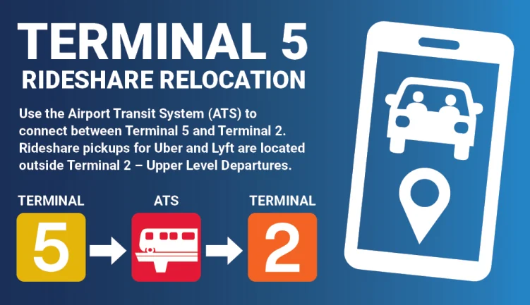
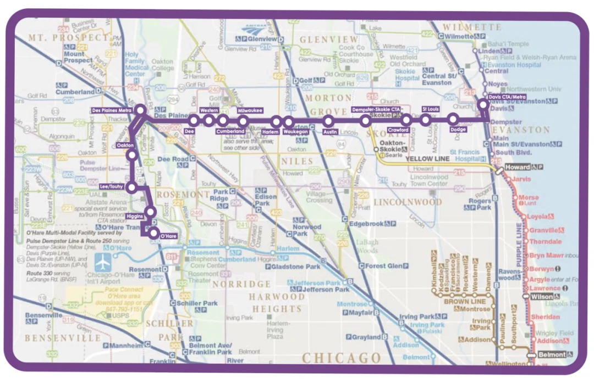

Chào mừng bạn đến Chicago. Sau một chuyến bay dài, đây là cách đi từ O'Hare đến nơi bạn lưu trú.

## Các nhà ga của O'Hare được kết nối với nhau như thế nào

Là trung tâm sân bay có lưu lượng lớn thứ tư tại Hoa Kỳ, Sân bay quốc tế Chicago O'Hare (ORD) có **bốn nhà ga: 1, 2, 3 và 5** (T1, T2, T3, T5).

- **T1, T2 và T3** được kết nối với nhau, nên bạn có thể đi bộ giữa các nhà ga.
- **T5** phục vụ các chuyến bay quốc tế — bao gồm phần lớn các chuyến bay đến và đi Trung Quốc — và được nối với các nhà ga khác bằng **Hệ thống trung chuyển sân bay (ATS)**.

ATS **miễn phí** giữa các nhà ga.

## Đến Chicago

### Điền tờ khai hải quan trên máy bay

Trong chuyến bay, tiếp viên phát **tờ khai hải quan** (có bản tiếng Trung). Điền tờ khai **trước khi hạ cánh** sẽ giúp việc nhập cảnh thuận lợi hơn nhiều.

Một số điều cần lưu ý khi điền, nếu không bạn có thể bị yêu cầu khai báo thêm:

1. Nếu bạn đi cùng gia đình và lưu trú tại cùng một địa chỉ, mọi người có thể dùng chung một tờ khai.
2. Khai **mục đích nhập cảnh trung thực** — du lịch, công tác, học tập hay mục đích khác.
3. Không mang vào:
   - trái cây, rau củ, thực vật, hạt giống, thực phẩm hoặc côn trùng;
   - thịt, động vật, hoặc sản phẩm từ động vật và động vật hoang dã;
   - mẫu bệnh phẩm, mẫu tế bào hoặc ốc;
   - đất, hoặc bất kỳ thứ gì đã từng ở trang trại, chăn nuôi hoặc trại nuôi gia súc.
4. Không mang **quá 10.000 USD tiền mặt**.

### Làm thủ tục nhập cảnh

Khi máy bay đã đỗ tại O'Hare và tiếp viên thông báo có thể xuống, hãy duỗi chân, kiểm tra xem bạn không để quên gì trong khoang — và đi theo đám đông **đến khu vực nhập cảnh**. Nếu bạn lạc khỏi nhóm vì dừng ở nhà vệ sinh, đừng lo: chỉ cần đi theo biển chỉ dẫn “Immigration”.

Tại khu nhập cảnh, xếp hàng **“Visa”** (không phải hàng “US Citizen”) và chờ đến lượt. Giữ giọng nói nhỏ, và không dùng điện thoại để quay phim nhân viên.

Chuẩn bị sẵn **hộ chiếu**, **Mẫu I-20**, **sổ khám sức khỏe du lịch quốc tế** (hay còn gọi là “sổ đỏ nhỏ”), **chứng nhận tiêm chủng quốc tế** (“sổ vàng nhỏ”), và **thư nhập học** hoặc **kế hoạch học tập** nếu có.

Khi nhân viên hỏi vì sao bạn đến, hãy **trả lời trung thực** về trường và chương trình học của bạn. Sau đó họ sẽ chụp ảnh và lấy dấu vân tay của bạn, hoàn tất quy trình nhập cảnh.

### Hành lý và hải quan

Đi theo thông tin trên thẻ hành lý để đến đúng băng chuyền và **chờ lấy hành lý**, đối chiếu với màn hình — **màn hình tại sân bay là thông tin chính xác nhất**.

Nếu bạn không có gì cần khai báo, thường bạn có thể đi thẳng ra ngoài. Nếu bị gọi sang kiểm tra, hãy bình tĩnh, hợp tác với nhân viên và **không giấu giếm bất cứ điều gì**.

Sảnh đến của T5 có đủ loại nhà hàng với mọi quy mô, nên sau khi qua cửa, bạn có thể thư giãn, mua đồ uống hoặc đồ ăn nhẹ, và kết nối Wi-Fi miễn phí của sân bay để báo cho gia đình biết bạn đã hạ cánh.

## Rời sân bay

Nếu bạn đã sắp xếp người đón với trường hoặc một tổ chức khác, hãy đi theo biển chỉ dẫn của sân bay đến cổng đã thỏa thuận.

Hành khách đi đến các khu vực khác nhau cũng có thể đi theo biển chỉ dẫn cho từng phương tiện: những người đi Champaign, Purdue hoặc các nơi khác trong vùng thường đi xe buýt thuê, còn những người vào trung tâm Chicago thường dùng xe gọi qua ứng dụng hoặc CTA.

## Vào thành phố

### Lựa chọn 1: tuyến CTA Blue Line

Đi đến và rời O'Hare bằng CTA có nghĩa là đi **tuyến Blue Line**. Trước tiên bạn đi **xe trung chuyển ATS** đến **Nhà ga 2** và đổi tuyến tại đó — ATS **miễn phí** giữa các nhà ga.

Blue Line chạy **24 giờ mỗi ngày, bảy ngày mỗi tuần**. Mọi chuyến tàu từ ga O'Hare đều đi qua trung tâm thành phố trên đường đến Forest Park, và chuyến đi vào trung tâm thường mất **40–45 phút**.

Khi đã ở **T2**, hãy đi theo **biểu tượng tàu điện ngầm màu xanh dương** để đến sân ga Blue Line. Bạn cần mua vé từ máy trước khi vào: **giá vé giữa O'Hare và trung tâm thành phố là 5 USD** (giá thông thường là 2,50 USD). Một số máy không trả tiền thừa, nên hãy chuẩn bị tiền xu, hoặc thanh toán bằng thẻ tín dụng hoặc thẻ ghi nợ Visa, Mastercard.

Bạn không cần quẹt thẻ khi ra, nhưng **một vé cho phép bạn đổi miễn phí tối đa hai lần sang tàu hoặc xe buýt CTA khác trong vòng hai giờ**, nên hãy giữ vé.

Nếu bạn đi đến **SAIC**, **DePaul (Loop)**, **Columbia College Chicago** hoặc **UIC**, bạn không cần đổi tàu — hãy xuống ở Monroe, Jackson, LaSalle hoặc UIC-Halsted tùy theo điểm đến.

Đối với **DePaul (Lincoln Park)**, **Northwestern (Kellogg)**, **Đại học Chicago** hoặc **IIT**, bạn sẽ cần đổi sang tuyến tàu điện ngầm hoặc xe buýt khác.

### Lựa chọn 2: xe gọi qua ứng dụng

Nếu bạn muốn lựa chọn dễ dàng, nhanh chóng và thoải mái nhất, hãy gọi xe và đỡ phải kéo hành lý đi khắp nơi. Nhược điểm duy nhất là **đắt** và **có thể bị kẹt xe vào giờ cao điểm**.

Uber và Lyft là hai ứng dụng mà mọi người sử dụng tại Hoa Kỳ. Hãy tải phiên bản quốc tế trước khi bay và **liên kết thẻ tín dụng hai loại tiền tệ** từ trước. Khi hạ cánh và có kết nối mạng (Wi-Fi của sân bay là đủ), bạn có thể gọi xe.

Nếu bạn hạ cánh ở **T5**, trước tiên hãy đi **ATS** đến **Nhà ga 2**, sau đó đi theo biển chỉ dẫn **Rideshare / Ride App** đến điểm đón ở **tầng khởi hành**.

Cả Uber và Lyft chỉ đón khách tại đây. Đồng hồ tính tiền bắt đầu khi tài xế đến điểm đón, và sau một khoảng thời gian ân hạn ngắn (khoảng năm phút), bạn sẽ bị tính thêm phí — vì vậy tốt nhất là **gọi xe khi bạn đã có mặt tại điểm đón ở T2**.

Sau khi đăng ký và thêm phương thức thanh toán, hãy nhập điểm đi và điểm đến trong ứng dụng rồi chọn loại xe. Khi ứng dụng ghép bạn với tài xế gần nhất, nó sẽ hiển thị thông tin và xếp hạng của tài xế — **nếu xếp hạng thấp, hãy yêu cầu tài xế khác** để an toàn hơn.

Cùng một chuyến đi có thể có giá hơi khác nhau giữa hai ứng dụng, nhưng dịch vụ về cơ bản giống nhau (phần lớn tài xế làm việc cho cả hai), nên bạn nên so sánh trước khi xác nhận.

> Trước khi lên xe, hãy kiểm tra thông tin tài xế và xe — tên, kiểu xe và biển số. Giữ cảnh giác trong suốt chuyến đi và kiểm tra trên ứng dụng xem lộ trình có đúng không.

### Lựa chọn 3: xe buýt Pace

**(Đặc biệt dành cho sinh viên Northwestern)**

Pace khai thác xe buýt ở vùng ngoại ô Chicago, và tuyến Pulse Dempster chạy **từ O'Hare đến Evanston**, nơi có Đại học Northwestern, trong khoảng **50 phút**, cứ **15–20 phút** một chuyến (20–30 phút một chuyến vào cuối tuần và ngoài giờ cao điểm).

Để đi từ O'Hare đến Evanston, **hãy đi ATS đến MMF (Cơ sở đa phương thức)** và tìm **Bến 9** để bắt xe buýt Pulse. Bạn có thể quẹt thẻ Ventra trên xe hoặc trả tiền mặt: giá vé là **2 USD** (2,25 USD nếu trả tiền mặt).

## Một lời khuyên cuối

Dù bạn đi bằng cách nào, hãy để ý xung quanh và kiểm tra xem mình không bỏ quên hành lý trước khi lên hoặc xuống xe.

## Liên kết liên quan

- **Trên trang này**: [Chicago O'Hare ORD](/airport/ORD), [Hoa Kỳ (US)](/country/US)
- **Wikipedia**: [Chicago O'Hare ORD](https://en.wikipedia.org/wiki/O'Hare_International_Airport)
- **Baidu Baike**: [Chicago O'Hare ORD](https://baike.baidu.com/item/%E5%A5%A5%E9%BB%91%E5%B0%94%E5%9B%BD%E9%99%85%E6%9C%BA%E5%9C%BA)
