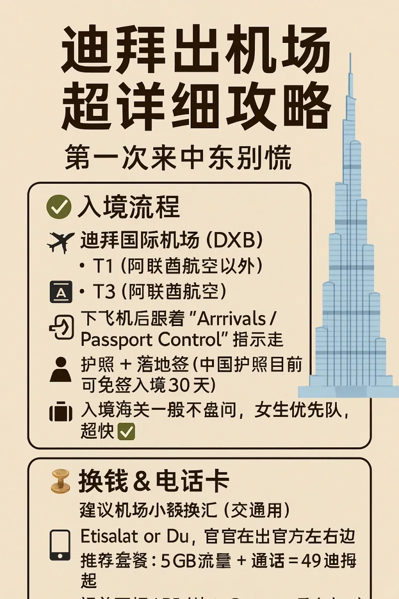
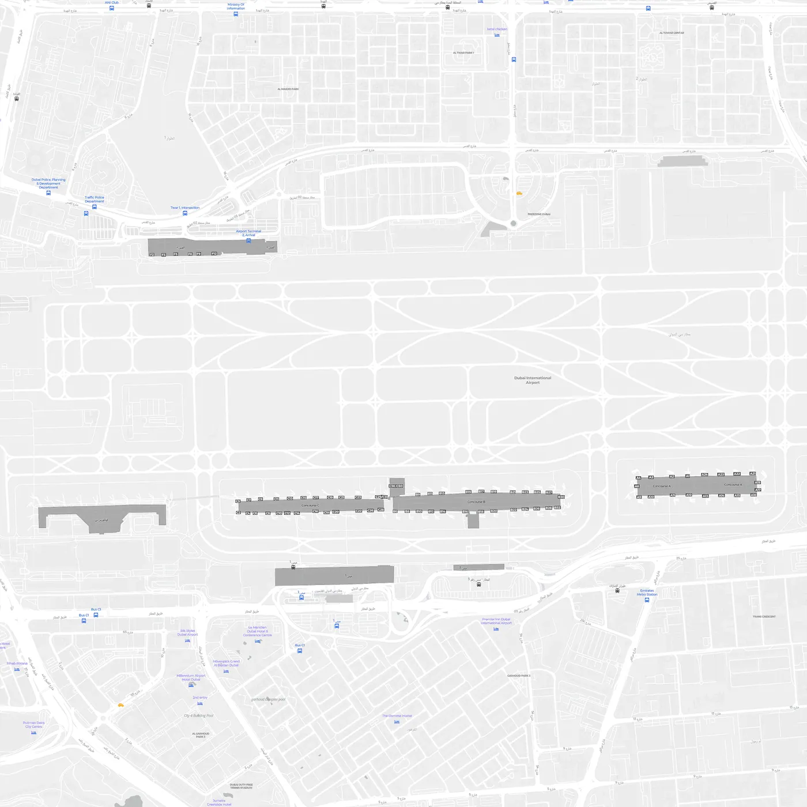

迪拜国际机场（Dubai International Airport，IATA 代码 **DXB**）常年是全球国际旅客吞吐量最高的机场之一。它的三座航站楼沿着同一条跑道排开，旅客从下飞机到走出到达大厅，顺利的话半小时内就能完成——但如果没提前弄清航站楼和动线，很容易在免税店和摆渡通道之间多绕一圈。

这篇攻略按“下飞机之后”的顺序写：先认清自己在哪座楼，再走过关、换钱、买电话卡，最后是地铁、出租车和网约车怎么选。文中价格来自作者 2025 年的实地记录，政策与票价会调整，出门前请再核对一次官方信息。

## 一、先认清自己在哪座航站楼

迪拜机场的三座航站楼分工很清楚，落地后先确认这件事，比看任何指示牌都重要：

| 航站楼 | 主要航空公司 | 特点 |
| --- | --- | --- |
| **T3** | 阿联酋航空（Emirates）及部分代码共享航班 | 全球最大的单体航站楼之一，A／B／C 三个登机区，国际出发与到达都在这里 |
| **T1** | 除阿联酋航空以外的大部分国际航司 | 与 T3 相连，步行或坐捷运（People Mover）可达 |
| **T2** | flydubai 等低成本航空 | 位于 T1／T3 的另一侧，需要乘车，航站楼较旧 |

T1 与 T3 之间有免费的内部捷运，跟着 **Connections** 指示牌走即可；T2 与另外两座楼之间没有步行通道，必须坐机场摆渡车或出租车。买机票时看清航站楼，转机时间在 3 小时以内的话，T2 转 T1／T3 要额外留出 40 分钟以上。

## 二、入境流程：跟着 Arrivals 走

下飞机后，指示牌会同时给出 **Arrivals（到达）** 与 **Connections（转机）** 两个方向。入境旅客跟着 Arrivals 和 **Passport Control** 走，通道尽头就是边检大厅。

以最常见的两种护照为例：

- **中国护照**：目前可免签入境阿联酋，停留期 30 天（以入境当日政策为准）。边检通常只核对护照与指纹，不做行程问询。
- **需要签证的护照**：提前办好电子签，或在机场的签证柜台办理；落地签窗口在边检大厅一侧，排队时间会比普通通道长。

边检之后是行李提取厅，屏幕会按航班号显示转盘号。DXB 的行李等候时间在国际机场里算中等，旺季（12 月至次年 1 月）宽体机集中到达时，等 30 分钟以上也属正常。取到行李后走绿色通道出关，海关抽查以行李扫描为主，食品和药品是重点。

**入境总耗时**：从下飞机到走出到达大厅，顺利时约 15–30 分钟；旺季排队或需要办落地签时，预留 1 小时更稳妥。

## 三、换钱与电话卡：出关后左手边

出关之后的到达大厅是一排柜台：换汇、电话卡、租车、酒店接送依次排开。两件事建议在这里一次办完。

**换汇**：机场汇率一般，只建议换够当天交通和零用的现金（100–200 迪拉姆即可）。迪拉姆与美元挂钩，市区兑换点的价格通常比机场好，大额换汇留到市区或直接用银行卡取现更划算。

**电话卡**：当地两大运营商 **Etisalat** 与 **Du** 的柜台就在出关后的左手边，护照实名登记即可购买。常见套餐是 5GB 流量加本地通话，49 迪拉姆起；停留超过一周的话，买 10GB 以上的套餐单价更低。如果要提前下载 Careem、Talabat 这类本地 App，记得留一个能收短信的号码——不少国内手机号在境外收不到验证码，这也是后面叫车时容易踩的坑。

## 四、出机场：地铁、出租车还是网约车

从 DXB 进市区有四条路：地铁、出租车、网约车、机场巴士。第一次来，最稳的是地铁或出租车；预算敏感又想避开堵车，地铁几乎是最优解。

### 地铁红线（推荐）

T1 和 T3 都有自己的地铁站，从到达大厅步行 5–8 分钟即到，跟着红色 **Metro** 标识走不会错。红线（Red Line）一路穿过 Deira、BurJuman、World Trade Centre、Burj Khalifa／Dubai Mall，到市中心约 20–30 分钟，票价按区间计算，刷 **Nol 卡** 进站。

Nol 卡在车站的自助机或人工柜台都能办，最常用的银卡（Silver）是 25 迪拉姆一张，其中 6 迪拉姆是卡费、19 迪拉姆是余额。第一次买卡建议直接充到 40–50 迪拉姆，够几天市内出行。

### 出租车

出口外侧是出租车上客区，按里程表计费。从机场到市中心（Burj Khalifa／Dubai Mall 一带）大约 70–90 迪拉姆，到朱美拉海滩区域会更高一些。上车前把目的地写成英文地址给司机看——中文的“迪拜塔”司机不一定听得懂，说 **Burj Khalifa** 就没问题。

### 网约车：Careem 与 Bolt

**Careem** 是迪拜本地最主流的网约车平台（相当于中东版 Uber），价格与出租车接近，下单即锁价。**Bolt** 近两年在迪拜铺开得很快，价格通常更低一档，而且对国内手机号友好——注册时能收到短信验证码，这一点比 Careem 省心。

需要提醒的是，DXB 的网约车上车点不在到达大厅门口，而在停车场指定的 Pick-up 区域，跟着 App 里的步行指引走，别在出口傻等。

### 机场巴士

机场巴士班次少、覆盖有限，主要服务周边酒店与部分远郊区域，第一次来不建议作为首选。

| 方式 | 到市中心用时 | 大致费用 | 适合谁 |
| --- | --- | --- | --- |
| 地铁红线 | 20–30 分钟 | 按区间计价（刷 Nol 卡） | 行李不多、想避开堵车 |
| 出租车 | 15–25 分钟 | 70–90 AED | 两人以上、行李多 |
| Careem／Bolt | 15–25 分钟 | 与出租车接近或略低 | 有本地号码、想锁价 |
| 机场巴士 | 40 分钟以上 | 较低 | 酒店在巴士沿线 |

## 五、第一次来中东的几个细节

- **着装**：迪拜比想象中开放，但商场和清真寺对着装有要求。机场冷气很强，随身带一件薄外套；进清真寺需要长袖长裤，女性要包头巾。
- **时差**：阿联酋比北京时间晚 4 小时，落地后把手机时区设为自动，别把登机时间看错。
- **插头**：英标三孔（G 型），和中国香港一致，中国内地插头需要转换头。
- **语言**：官方语言是阿拉伯语，但英语通用率极高，机场、地铁、商场的工作人员基本都能用英语沟通。
- **周五**：阿联酋的周末是周六和周日，周五是礼拜日，部分商店上午关门、地铁首班车也比平时晚，安排行程时留意。
- **小费**：餐厅账单通常已含服务费，不必额外给；出租车可以凑整。

## 六、把交通卡用起来

落地当天办好的 Nol 卡，是接下来几天在迪拜最实用的东西：地铁、公交、水上巴士（Abra）都能刷，余额不足在车站自助机充值即可。迪拜的公交车不收现金，没有 Nol 卡基本坐不了公交；地铁的单程票则是一张纸质二维码票，出站不回收，可以留作纪念。

关于 Nol 卡的卡种、充值方式、地铁换乘与公交线路，另有一篇更细的攻略：[迪拜公共交通与 Nol 卡指南](/zh/blog/dubai-transport-nol-card-guide)。

## 相关链接

- **本站页面**：[迪拜国际机场（DXB）](/zh/airport/DXB)、[阿联酋（AE）](/zh/country/AE)、[迪拜公共交通与 Nol 卡指南](/zh/blog/dubai-transport-nol-card-guide)
- **维基百科**：[迪拜国际机场](https://zh.wikipedia.org/wiki/%E8%BF%AA%E6%8B%9C%E5%9B%BD%E9%99%85%E6%9C%BA%E5%9C%BA)
- **百度百科**：[迪拜国际机场](https://baike.baidu.com/item/%E8%BF%AA%E6%8B%9C%E5%9B%BD%E9%99%85%E6%9C%BA%E5%9C%BA)
- **机场官网**：[Dubai Airports](https://www.dubaiairports.ae/)
- **地铁与公交**：[Dubai RTA](https://www.rta.ae/)

图片来源：作者实地拍摄与本站机场示意图。票价、营业时间与交通政策可能调整，出行前请以官方公告为准。
