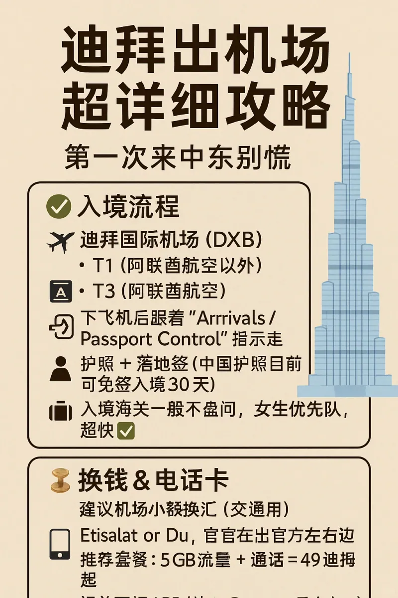

Aeroportul Internațional Dubai (**DXB**) se numără constant printre cele mai aglomerate aeroporturi din lume la pasageri internaționali. Cele trei terminale ale sale sunt aliniate de-a lungul acelorași piste, iar într-o zi bună puteți ieși din zona de sosiri în jumătate de oră de la coborârea din avion — dar, dacă nu știți în ce terminal sunteți și încotro să mergeți, magazinele scutite de taxe și coridoarele de tranzit pot consuma mult timp.

Acest ghid urmează ordinea evenimentelor după aterizare: stabiliți în ce terminal sunteți, treceți de imigrare, rezolvați banii și o cartelă SIM, apoi alegeți între metrou, taxi și o aplicație de transport la cerere. Prețurile provin din călătoria autorului din 2025; politicile și tarifele se schimbă, așa că verificați sursele oficiale înainte de a călători.

## 1. Stabiliți în ce terminal sunteți

Cele trei terminale ale Dubaiului sunt împărțite clar pe companii aeriene, iar să confirmați acest lucru înainte de orice altceva contează mai mult decât orice indicator:

| Terminal | Companii aeriene principale | Profil |
| --- | --- | --- |
| **T3** | Emirates și unii parteneri cu zboruri în partajare de cod | Una dintre cele mai mari clădiri de terminal din lume, cu sălile A, B și C; plecări și sosiri internaționale |
| **T1** | Majoritatea companiilor internaționale, în afară de Emirates | Legat de T3, accesibil pe jos sau cu trenulețul intern de pasageri |
| **T2** | flydubai și alte companii aeriene cu tarife reduse | În partea opusă față de T1 și T3; se ajunge cu autobuzul sau taxiul, clădire mai veche |

T1 și T3 sunt legate printr-o navetă internă gratuită — urmați indicatoarele **Connections**. Nu există traseu pietonal între T2 și celelalte două terminale, așa că autobuzul sau taxiul sunt singura opțiune; dacă aveți o corespondență de sub trei ore care implică T2, prevedeți 40 de minute în plus.

## 2. Imigrarea: urmați indicatoarele Arrivals

După ce coborâți din aeronavă, indicatoarele arată două direcții: **Arrivals** și **Connections**. Călătorii care sosesc urmează indicatoarele Arrivals și **Passport Control** până la sala de imigrare.

La ce să vă așteptați în cele două situații de pașaport cele mai frecvente:

- **Pașapoarte chineze**: în prezent fără viză pentru EAU, cu o ședere de 30 de zile, în funcție de regulile în vigoare în ziua respectivă. Ofițerii verifică de obicei pașaportul și amprentele și nu pun întrebări despre itinerariu.
- **Pașapoarte care necesită viză**: solicitați o viză electronică în avans sau folosiți ghișeul de vize din aeroport. Coada pentru viza la sosire este într-o parte a sălii și durează mai mult decât rândurile obișnuite.

Dincolo de imigrare se află sala de bagaje, cu numerele benzilor afișate pe ecrane, pe zboruri. Timpii de așteptare pentru bagaje la DXB sunt medii pentru un hub de asemenea dimensiuni; în sezonul de vârf (decembrie–ianuarie), o jumătate de oră este normală când aterizează simultan mai multe aeronave cu fuselaj larg. După ce vă ridicați bagajele, mergeți pe culoarul verde — controlul vamal se face în principal prin rază X, iar alimentele și medicamentele sunt examinate cel mai atent.

**Timp total**: 15–30 de minute de la aeronavă la sala de sosiri, într-o cursă fără probleme; prevedeți o oră când este aglomerat sau când aveți nevoie de viză la sosire.

## 3. Bani și cartele SIM: la stânga după vamă

Sala de sosiri este un șir de ghișee — schimb valutar, cartele SIM, închirieri auto, transferuri la hotel. Două dintre ele merită rezolvate dintr-un singur drum.

**Valuta**: cursurile de la aeroport sunt obișnuite, așa că schimbați doar ce aveți nevoie pentru transportul din prima zi și mici cumpărături (100–200 AED sunt suficienți). Dirhamul este legat de dolar, iar casele de schimb din oraș au de obicei cursuri mai bune decât aeroportul; pentru sume mai mari, retrageți bani de la un bancomat sau schimbați în oraș.

**Cartele SIM**: ghișeele **Etisalat** și **Du** sunt la stânga după vamă și vând pe baza pașaportului. Un pachet obișnuit este de 5 GB cu apeluri locale de la 49 AED; pentru șederi de peste o săptămână, pachetele de 10 GB și peste ies mai ieftin pe gigabyte. Dacă intenționați să instalați aplicații locale precum Careem sau Talabat, asigurați-vă că aveți un număr care poate primi SMS-uri — multe numere din China continentală nu primesc mesaje de verificare în străinătate, și exact aici apar problemele cu cursele comandate prin aplicație.

## 4. Cum ajungeți în oraș: metrou, taxi sau transport la cerere

De la DXB există patru opțiuni: metroul, taxiul, o aplicație de transport la cerere și autobuzul aeroportului. Pentru o primă vizită, metroul sau taxiul sunt alegerea sigură; dacă vreți să evitați traficul fără să cheltuiți mult, metroul este aproape de neîntrecut.

### Metroul de pe linia roșie (recomandat)

T1 și T3 au fiecare propria stație de metrou, la 5–8 minute de mers pe jos de zona de sosiri și ușor de găsit urmărind indicatoarele roșii **Metro**. Linia roșie trece prin Deira, BurJuman, World Trade Centre și Burj Khalifa／Dubai Mall, ajungând în centru în 20–30 de minute; tarifele sunt pe zone, iar la intrare și la ieșire validați un **card Nol**.

Cardurile Nol se obțin de la automatele de bilete sau de la ghișeul cu personal. Alegerea obișnuită este cardul argintiu la 25 AED, din care 6 AED sunt taxa pentru card și 19 AED sold. La prima achiziție, încărcați până la 40–50 AED, ceea ce acoperă mai multe zile de deplasări în oraș.

### Taxi

Stația de taxi este în afara ieșirilor și funcționează cu taximetru. De la aeroport până în centru (în jurul Burj Khalifa／Dubai Mall) costă aproximativ 70–90 AED, iar spre zonele de plajă Jumeirah mai mult. Scrieți destinația în engleză pentru șofer — „Dubai Tower” în chineză nu va ajuta, dar **Burj Khalifa** da.

### Transport la cerere: Careem și Bolt

**Careem** este platforma consacrată din Dubai, cu prețuri apropiate de taxi și tarif fixat la rezervare. **Bolt** s-a extins rapid în Dubai în ultimii doi ani, este de obicei ceva mai ieftin și mai prietenos cu numerele din China continentală — mesajul de verificare prin SMS ajunge, lucru care nu se poate spune despre Careem.

Un lucru de știut: punctul de preluare pentru transportul la cerere la DXB nu este la ușa sosirilor, ci într-o zonă special amenajată a parcării. Urmați indicațiile de mers pe jos din aplicație în loc să așteptați la ieșire.

### Autobuzele aeroportului

Autobuzele aeroportului sunt rare și au o acoperire limitată, deservind în principal hotelurile din apropiere și câteva zone periferice. Nu sunt prima alegere pentru o primă vizită.

| Opțiune | Timp până în centru | Cost aproximativ | Cea mai potrivită pentru |
| --- | --- | --- | --- |
| Metroul, linia roșie | 20–30 de minute | Tarif pe zone (card Nol) | Bagaje puține, evitarea traficului |
| Taxi | 15–25 de minute | 70–90 AED | Două sau mai multe persoane, multe bagaje |
| Careem／Bolt | 15–25 de minute | Asemănător sau sub taxi | Un număr local, prețuri fixe |
| Autobuzul aeroportului | 40 de minute și mai mult | Mai mic | Hoteluri de-a lungul unei rute de autobuz |

## 5. Mici detalii pentru o primă vizită în regiunea Golfului

- **Îmbrăcăminte**: Dubaiul este mai liberal decât vecinii săi, dar centrele comerciale și moscheile au cod vestimentar. Aeroportul este puternic climatizat, așa că luați o haină subțire; moscheile cer mâneci lungi și pantaloni, iar femeile au nevoie de o eșarfă pe cap.
- **Diferența de fus orar**: EAU este cu patru ore în urma Beijingului. Setați telefonul pe ora automată ca să nu citiți greșit o plecare.
- **Prize**: cu trei pini în stil britanic (tip G), ca în Hong Kong; prizele din China continentală au nevoie de adaptor.
- **Limba**: araba este oficială, dar engleza este vorbită pe scară largă — personalul din aeroport, metrou și centrele comerciale se descurcă în engleză.
- **Vineri**: weekendul în EAU este sâmbătă și duminică, iar vineri este ziua de rugăciune, când unele magazine se închid dimineața și metroul începe mai târziu. Planificați ținând cont de asta.
- **Bacșiș**: notele de restaurant includ de obicei serviciul, așa că nu mai e nevoie de nimic în plus; la taxi puteți rotunji suma.

## 6. Puneți cardul de transport la treabă

Cardul Nol pe care îl cumpărați la sosire este cel mai util lucru din buzunar pentru restul călătoriei: metroul, autobuzele și bacul de apă Abra îl acceptă toate, iar automatele de reîncărcare sunt în fiecare stație. Autobuzele din Dubai nu acceptă deloc numerar, așa că fără un card Nol pur și simplu nu puteți circula cu ele; biletele simple de metrou sunt bilete de hârtie cu cod QR care nu se colectează la ieșire, așa că le puteți păstra ca suvenir.

Pentru tipuri de carduri, reîncărcări, noduri de corespondență ale metroului și rute de autobuz în detaliu, vedeți ghidul separat: [Transportul public din Dubai și cardul Nol](/blog/dubai-transport-nol-card-guide).

## Linkuri utile

- **Pe acest site**: [Aeroportul Internațional Dubai (DXB)](/airport/DXB), [Emiratele Arabe Unite (AE)](/country/AE), [Transportul public din Dubai și cardul Nol](/blog/dubai-transport-nol-card-guide)
- **Wikipedia**: [Dubai International Airport](https://en.wikipedia.org/wiki/Dubai_International_Airport)
- **Baidu Baike**: [Dubai International Airport](https://baike.baidu.com/item/%E8%BF%AA%E6%8B%9C%E5%9B%BD%E9%99%85%E6%9C%BA%E5%9C%BA)
- **Site-ul aeroportului**: [Dubai Airports](https://www.dubaiairports.ae/)
- **Metroul și autobuzele**: [Dubai RTA](https://www.rta.ae/)

Sursa imaginilor: fotografiile autorului și diagrama aeroportului de pe acest site. Tarifele, orarele și politicile de transport se pot schimba; verificați anunțurile oficiale înainte de a călători.
