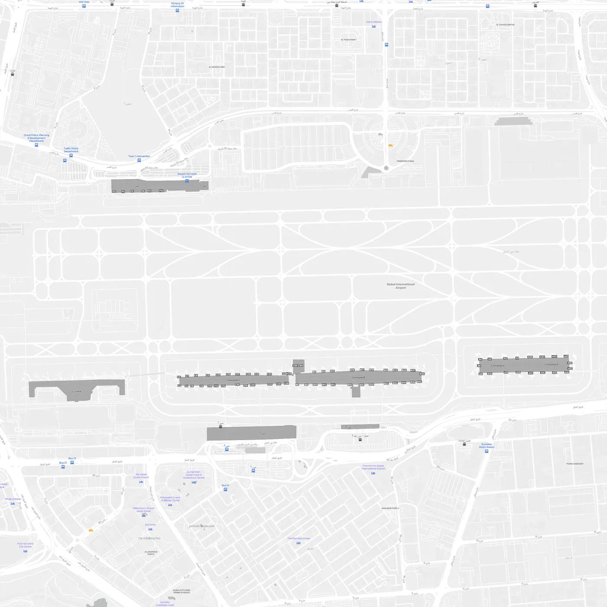

Dubai Uluslararası Havalimanı (**DXB**), uluslararası yolcu sayısında sürekli olarak dünyanın en yoğun havalimanları arasında. Üç terminali aynı pistler boyunca sıralanıyor ve iyi bir günde uçaktan indikten sonraki yarım saat içinde varış salonundan çıkabilirsiniz — ancak hangi terminalde olduğunuzu ve hangi yöne yürüyeceğinizi bilmezseniz duty-free salonları ve aktarma koridorları çok zaman yutabilir.

Bu rehber iniş sonrası olayların sırasını izliyor: hangi terminalde olduğunuzu belirleyin, pasaport kontrolünden geçin, para ve SIM kart işini halledin, ardından metro, taksi ve uygulama çağrılı araç arasında seçim yapın. Fiyatlar yazarın 2025'teki seyahatinden; politikalar ve ücretler değişir, bu yüzden seyahatten önce resmi kaynakları kontrol edin.

## 1. Hangi terminalde olduğunuzu belirleyin

Dubai'nin üç terminali havayoluna göre net biçimde ayrılmış ve her şeyden önce bunu teyit etmek herhangi bir tabeladan daha önemli:

| Terminal | Ana havayolları | Özellik |
| --- | --- | --- |
| **T3** | Emirates ve bazı kod paylaşımlı ortaklar | A, B ve C koridorlarıyla dünyanın en büyük terminal binalarından biri; uluslararası kalkış ve varışlar |
| **T1** | Emirates dışındaki uluslararası taşıyıcıların çoğu | T3'e bağlı; yürüyerek veya iç yolcu taşıma sistemiyle ulaşılabilir |
| **T2** | flydubai ve diğer düşük maliyetli taşıyıcılar | T1 ve T3'ün uzak tarafında; otobüs veya taksi gerekir, daha eski bir bina |

T1 ile T3 ücretsiz bir iç servisle birbirine bağlı — **Connections** (Aktarmalar) tabelalarını izleyin. T2 ile diğer iki terminal arasında yürüme yolu yok; tek seçenek otobüs veya taksi. Aktarmanız üç saatten kısaysa ve T2'yi içeriyorsa 40 dakika ek süre ayırın.

## 2. Pasaport kontrolü: Varışlar'ı izleyin

Uçaktan indikten sonra tabelalar iki yönü gösterir: **Arrivals** (Varışlar) ve **Connections** (Aktarmalar). Gelen yolcular Arrivals ve **Passport Control** (Pasaport Kontrolü) yönüne giderek pasaport salonuna ulaşır.

En yaygın iki pasaport durumunda bekleyebilecekleriniz:

- **Çin pasaportları**: BAE için şu anda 30 günlük kalışla vizesiz; o gün yürürlükteki kurallara tabi. Memurlar genellikle pasaportu ve parmak izlerini kontrol eder, seyahat planını sorgulamaz.
- **Vize gereken pasaportlar**: Önceden e-vize başvurusu yapın veya havalimanındaki vize gişesini kullanın. Varışta vize kuyruğu salonun bir tarafındadır ve normal gişelerden daha uzun sürer.

Pasaport kontrolünün ötesinde bagaj salonu var; bant numaraları ekranlarda uçuşa göre gösterilir. DXB'nin bagaj bekleme süreleri, büyüklüğüne göre orta düzeyde; yoğun sezonda (aralık-ocak) birkaç geniş gövdeli uçak aynı anda indiğinde yarım saat normal. Bavullarınızı aldıktan sonra yeşil koridoru kullanın — gümrük taraması çoğunlukla X-ray ile yapılır; en dikkatli bakılan şeyler yiyecek ve ilaçlardır.

**Toplam süre**: Sorunsuz bir seferde uçaktan varış salonuna 15–30 dakika; yoğunken veya varışta vize almanız gerekiyorsa bir saat ayırın.

## 3. Para ve SIM kartlar: gümrükten sonra sola

Varış salonu bir sıra gişeden oluşuyor — döviz bürosu, SIM kartlar, araç kiralama, otel transferleri. Bunlardan ikisini tek durakta halletmeye değer.

**Para**: Havalimanı kurları olağan, bu yüzden yalnızca ilk günün ulaşımı ve küçük alışverişler için ihtiyacınız kadar bozdurun (100–200 AED yeterli). Dirhem dolara sabitlenmiş ve şehirdeki döviz büroları genellikle havalimanından daha iyi; daha büyük miktarlar için ATM'den çekin veya şehirde bozdurun.

**SIM kartlar**: **Etisalat** ve **Du** gişeleri gümrükten sonra solda ve pasaportla satış yapıyor. Yaygın bir paket, yerel aramalarla birlikte 5 GB ve 49 AED'den başlıyor; bir haftadan uzun kalışlarda 10 GB ve üzeri paketler gigabayt başına daha ucuza geliyor. Careem veya Talabat gibi yerel uygulamaları kuracaksanız SMS alabilen bir numaranız olduğundan emin olun — birçok Çin anakarası numarası yurt dışında doğrulama mesajı almaz; uygulama çağrılı araç yolculuklarının ters gittiği yer tam olarak burasıdır.

## 4. Şehre ulaşım: metro, taksi veya uygulama

DXB'den dört seçenek var: metro, taksi, uygulama çağrılı araç ve havalimanı otobüsü. İlk ziyaret için metro veya taksi güvenli seçim; fazla harcamadan trafikten kaçınmak istiyorsanız metro neredeyse yenilmez.

### Kırmızı Hat metro (önerilir)

T1 ve T3'ün her birinin kendi metro istasyonu var; varıştan 5–8 dakika yürüyüş ve kırmızı **Metro** tabelalarını izleyerek bulmak kolay. Kırmızı Hat Deira, BurJuman, World Trade Centre ve Burj Khalifa／Dubai Mall üzerinden geçerek merkeze 20–30 dakikada ulaşıyor; ücretler bölgeye göre ve **Nol kartı** ile giriş-çıkış yapıyorsunuz.

Nol kartlar bilet makinelerinden veya personelli gişeden alınır. Olağan seçim 25 AED'lik gümüş kart; bunun 6 AED'si kart ücreti, 19 AED'si bakiyedir. İlk alımda 40–50 AED'ye yükleyin; bu birkaç günlük şehir içi ulaşıma yeter.

### Taksi

Taksi durağı çıkışların dışında ve taksimetreyle çalışıyor. Havalimanından merkeze (Burj Khalifa／Dubai Mall civarı) yaklaşık 70–90 AED, Jumeirah sahil bölgelerine daha fazla. Şoföre varış yerini İngilizce yazın — Çince “Dubai Tower” işe yaramaz, ama **Burj Khalifa** yarar.

### Uygulama çağrılı araç: Careem ve Bolt

**Careem** Dubai'nin yerleşik platformu; fiyatları taksiye yakın ve ücret rezervasyonda sabitleniyor. **Bolt** son birkaç yılda Dubai'de hızla büyüdü, genellikle bir tık daha ucuz ve Çin anakarası numaralarına daha dost — SMS doğrulaması geliyor; Careem için aynısı söylenemez.

Bilmeniz gereken bir şey: DXB'nin uygulama çağrılı araç alım noktası varış kapısında değil, otoparkın belirlenmiş bir alanında. Çıkışta beklemek yerine uygulamadaki yürüme tarifini izleyin.

### Havalimanı otobüsleri

Havalimanı otobüsleri seyrek ve kapsamı sınırlı; çoğunlukla yakındaki otellere ve birkaç uzak bölgeye hizmet veriyor. İlk ziyaret için ilk seçenek değil.

| Seçenek | Merkeze süre | Yaklaşık maliyet | En uygun olduğu durum |
| --- | --- | --- | --- |
| Kırmızı Hat metro | 20–30 dakika | Bölgeye göre ücret (Nol kartı) | Hafif bagaj, trafikten kaçınma |
| Taksi | 15–25 dakika | 70–90 AED | İki veya daha fazla kişi, çok bagaj |
| Careem／Bolt | 15–25 dakika | Taksiye benzer veya daha düşük | Yerel numara, sabit fiyat |
| Havalimanı otobüsü | 40 dakika ve üzeri | Daha düşük | Otobüs güzergâhındaki oteller |

## 5. Körfez'e ilk ziyaret için küçük ayrıntılar

- **Giyim**: Dubai komşularına göre daha serbest, ama alışveriş merkezlerinin ve camilerin kıyafet kuralları var. Havalimanında klima güçlü, yanınıza ince bir kat alın; camiler uzun kol ve pantolon ister, kadınların başörtüsü gerekir.
- **Saat farkı**: BAE, Pekin'in dört saat gerisinde. Kalkışı yanlış okumamak için telefonunuzu otomatik saate ayarlayın.
- **Prizler**: Hong Kong'daki gibi Birleşik Krallık tipi üç pinli (tip G); Çin anakarası prizleri için adaptör gerekir.
- **Dil**: Resmi dil Arapça, ama İngilizce yaygın konuşuluyor — havalimanı, metro ve AVM personeli İngilizceyle idare ediyor.
- **Cuma**: BAE'de hafta sonu cumartesi ve pazar; cuma dua günü, bazı dükkânlar sabah kapanıyor ve metro daha geç başlıyor. Planınızı buna göre yapın.
- **Bahşiş**: Restoran hesaplarına genellikle servis dahil, ek bir şey gerekmez; taksilerde yuvarlamak yeterli.

## 6. Ulaşım kartını işe koşun

Varışta aldığınız Nol kartı, yolculuğun geri kalanında cebinizdeki en kullanışlı şey: metro, otobüsler ve Abra su otobüsü hepsi kabul ediyor ve her istasyonda yükleme makineleri var. Dubai otobüsleri hiç nakit almıyor, yani Nol kartı olmadan binmeniz mümkün değil; metro tek biletleri ise çıkışta toplanmayan kâğıt QR biletler, hatıra olarak saklayabilirsiniz.

Kart türleri, yükleme, metro aktarmaları ve otobüs güzergâhları hakkında daha ayrıntılı bilgi için ayrı rehbere bakın: [Dubai toplu taşıması ve Nol kartı](/blog/dubai-transport-nol-card-guide).

## İlgili bağlantılar

- **Bu sitede**: [Dubai Uluslararası Havalimanı (DXB)](/airport/DXB), [Birleşik Arap Emirlikleri (AE)](/country/AE), [Dubai toplu taşıması ve Nol kartı](/blog/dubai-transport-nol-card-guide)
- **Wikipedia**: [Dubai International Airport](https://en.wikipedia.org/wiki/Dubai_International_Airport)
- **Baidu Baike**: [Dubai International Airport](https://baike.baidu.com/item/%E8%BF%AA%E6%8B%9C%E5%9B%BD%E9%99%85%E6%9C%BA%E5%9C%BA)
- **Havalimanı web sitesi**: [Dubai Airports](https://www.dubaiairports.ae/)
- **Metro ve otobüsler**: [Dubai RTA](https://www.rta.ae/)

Görsel kaynağı: yazarın fotoğrafları ve bu sitenin havalimanı şeması. Ücretler, saatler ve ulaşım politikaları değişebilir; seyahatten önce resmi duyuruları kontrol edin.
