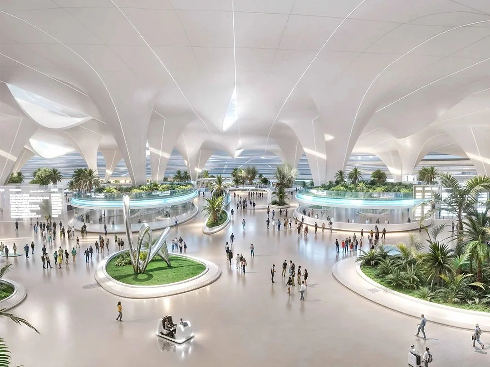

Dne 28. dubna 2024 oznámil šejk Muhammad bin Rášid Al Maktúm, vládce Dubaje, že schválil plány na nový terminál na mezinárodním letišti Al Maktoum (DWC). Podle plánů bude stát přibližně 35 miliard dolarů, zabere areál o rozloze 70 kilometrů čtverečních, bude mít 400 bran a pět paralelních vzletových a přistávacích drah a postaví se po etapách v průběhu příštího desetiletí. Po dokončení zvládne 260 milionů cestujících a 12 milionů tun nákladu ročně a veškerý provoz mezinárodního letiště Dubaj se sem přesune.

Není to ani tak stavební povolení jako prohlášení o tom, čím chce Dubaj být. „Stavíme nový projekt pro budoucí generace, který zajistí nepřetržitý a stabilní rozvoj našim dětem a jejich dětem,“ řekl šejk Muhammad. „Dubaj bude světovým letištěm, přístavem, městským centrem a novým globálním centrem.“ Spojit letiště, přístav a město v jedné větě je způsob, jakým Dubaj funguje už dvě desetiletí: nejdřív postavit infrastrukturu a pak nechat cestující a náklad, aby ji zaplnili. Následující text se zabývá čísly, načasováním, lokalitou a riziky.

## 1. Čísla: 70 kilometrů čtverečních, 400 bran

Oficiální dokumenty jsou konkrétní: přibližně 35 miliard dolarů investic, 70 kilometrů čtverečních půdy, pět paralelních drah, 400 bran, pět osobních terminálů a první etapa dokončená do deseti let. Na vizualizacích je terminál sledem bílých, zvlněných střech, které připomínají tradiční beduínský stan Arabského poloostrova — „beduín“ označuje nomády pouště, kteří se přesouvali za vodou a pastvou. Použití stanu jako motivu přenáší myšlenku zastávky v poušti přímo do budovy.

| Položka | Zveřejněný údaj |
| --- | --- |
| Investice | Přibližně 35 miliard dolarů |
| Plocha | 70 kilometrů čtverečních |
| Dráhy | 5 paralelních drah |
| Brány | 400 |
| Osobní terminály | 5 |
| Maximální kapacita cestujících | 260 milionů ročně |
| Kapacita nákladu | 12 milionů tun ročně |
| První etapa | Do 10 let |
| Kapacita cestujících v první etapě | 150 milionů ročně |

Vyplatí se rozlišovat „maximální“ a „první etapu“. Údaj 260 milionů je kapacita dokončeného letiště; oficiální infografika uvádí, že po dokončení první etapy do deseti let dosáhne roční kapacita 150 milionů. To je už dnes o více než sedmdesát procent víc než provoz mezinárodního letiště Dubaj — jinými slovy, i první etapa by byla hubem v jiném měřítku, než jaký Dubaj má nyní.

## 2. Proč právě teď: strop DXB

Mezinárodní letiště Dubaj (DXB) patří k nejvytíženějším mezinárodním letištím na světě, v roce 2023 odbavilo téměř 87 milionů cestujících. Jeho limitem nejsou terminálové budovy, ale dráhy a pozemky: dvě paralelní dráhy určují strop ve špičce a město se kolem areálu už uzavřelo, takže na rozšíření téměř není místo. Poptávka dál roste; technické kapacity jsou téměř vyčerpané.

Tuto poptávku pohánějí dva motory. Prvním je Emirates. Letecká společnost sídlící v Dubaji je dlouhodobě předním dopravcem na dálkových linkách, s flotilou postavenou kolem A380 a 777; její finanční výsledky se čtou jako barometr širší ekonomiky městského státu — když se aerolince daří, jsou tam cestující i obchodní aktivita. Druhým je cestovní ruch: v první polovině roku 2023 překonal počet mezinárodních návštěvníků Dubaje úroveň před pandemií, což bylo nejlepší pololetí, jaké turistický průmysl emirátu zaznamenal. Právě tento skok v provozu je přímým důvodem, proč byl projekt „největšího letiště světa“ urychlen.

Logika je jasná. Dubaj nestaví odlehčovací letiště; dává už plnému hubu mnohem větší nádobu. Přesun všech operací DXB znamená naráz přenastavit provozní prostředí zralé sítě linek — volba, o níž může vážně uvažovat jen město tohoto rozsahu.

## 3. Proč na jih: rodící se koridor

DWC leží ve čtvrti Dubai South na jihozápadě emirátu, vedle přístavu Džebel Ali a vedle areálu Expo 2020, jehož kampus se po skončení výstavy znovu otevřel jako Expo City Dubai. Letiště na tomto místě staví letecký náklad, námořní náklad, výstaviště a bydlení na jeden kus země: Džebel Ali řeší kontejnery, letiště vysoce hodnotný letecký náklad a Expo City s okolními čtvrtěmi dodává ruch.

Je to také známá dubajská metoda: nečekat, až město doroste k letišti, ale použít letiště k tomu, aby město táhlo tím směrem. DXB také vzniklo na okraji města a město ho nakonec obklopilo; tentokrát plánovači umístili nové letiště dál a oněch 70 kilometrů čtverečních je zároveň letištní areál i rámec budoucího městského růstu.

## 4. Riziko: jeden přesun, deset let

Největším rizikem nejsou peníze, ale přesun. Přesunout všechny operace mezinárodního letiště Dubaj do DWC znamená znovu postavit základnu Emirates, návazné vlny, nákladní zařízení a pozemní dopravní síť. Aerolinky se nestěhují proto, že terminál dobře vypadá; stěhují se kvůli minimálním přestupním časům, spolehlivosti zavazadlového systému a hustým vlnám letů. Pokud se cokoli z toho zadrhne, provoz se přesune do Dauhá, Abú Zabí nebo Istanbulu.

Druhým rizikem je etapizace. Deset let je dlouhé okno a první etapa na 150 milionů cestujících má smysl jen tehdy, pokud s ní porostou i aerolinky a destinace. Třetím rizikem je náklad: DWC je už dnes v nákladu silné a cíl 12 milionů tun znamená rozšířit stávající byznys, ne ho jen přestěhovat. Čtvrtým rizikem je samotná poptávka. Číslo 260 milionů popisuje plně postavené letiště, ne cíl na příští desetiletí; pokud globální růst letectví zpomalí, budou dráhy a brány stát prázdné.

## 5. Co to znamená pro cestující

Zatím se nic měnit nemusí. DWC nyní odbavuje hlavně náklad a jen malý počet osobních letů; DXB zůstává hlavní osobní branou Dubaje. Nový terminál se bude stavět po etapách a přesun operací také proběhne postupně, takže v blízké budoucnosti bude letištěm, které v Dubaji využijete, téměř jistě stále DXB.

Rozhodující je jízdní řád, ne vizualizace. Jakmile provozovatel zveřejní, v jakých dávkách se lety přesunou, bude možná nutné přepočítat přestupy přes Dubaj: obě letiště dělí desítky kilometrů a dostavit se na špatné z nich stojí mnohem víc než hodina rezervy navíc. Před cestou si zkontrolujte nejnovější oznámení aerolinky a provozovatele letiště — to je jediný spolehlivý postup.

## 6. Aktualizace 2026: od výkresů k tendrům

Schválení v roce 2024 bylo jen výchozím bodem. V srpnu 2026 Dubaj oznámila, že do konce roku zadá zakázky za přibližně 55 miliard dirhamů (AED) na rozšíření Al Maktoum ([The National](https://www.thenationalnews.com/business/aviation/2026/08/26/dubai-to-award-dh55bn-in-contracts-by-year-end-for-al-maktoum-airport-expansion/)); šéf Dubai Airports řekl [Khaleej Times](https://www.khaleejtimes.com/business/no-slowdown-in-al-maktoum-airport-construction-despite-regional-conflict-dubai-airports-chief), že regionální konflikt stavbu nezpomalil. Pro cestující zůstává harmonogram otevření střednědobou proměnnou: DXB dál nese hlavní osobní zátěž, zatímco DWC roste v nákladu a části osobního provozu před plným přesunem.

Proto se příběh o „největším letišti světa“ co pár měsíců vrací. Milníky, na kterých záleží, nejsou vizualizace, ale smlouvy, dráhy a předávání terminálů. Dokud DXB funguje normálně, je každý tendr na DWC přípravou na příští desetiletí, nikoli změnou vaší příští cesty.

## Související odkazy

- **Na tomto webu**: [Mezinárodní letiště Dubaj (DXB)](/airport/DXB), [Spojené arabské emiráty (AE)](/country/AE)
- **Wikipedia**: [Mezinárodní letiště Al Maktoum](https://en.wikipedia.org/wiki/Al_Maktoum_International_Airport), [Mezinárodní letiště Dubaj](https://en.wikipedia.org/wiki/Dubai_International_Airport)
- **Baidu Baike**: [Mezinárodní letiště Al Maktoum](https://baike.baidu.com/item/%E9%98%BF%E5%8B%92%E9%A9%AC%E5%85%8B%E5%9B%BE%E5%A7%86%E5%9B%BD%E9%99%85%E6%9C%BA%E5%9C%BA)

Zdroj obrázků: GA Global Architecture a Dubai Government Media Office. Údaje o projektu a harmonogramy vycházejí z publikací Dubai Airports a provozovatele; před cestou si ověřte stránky provozovatele.
