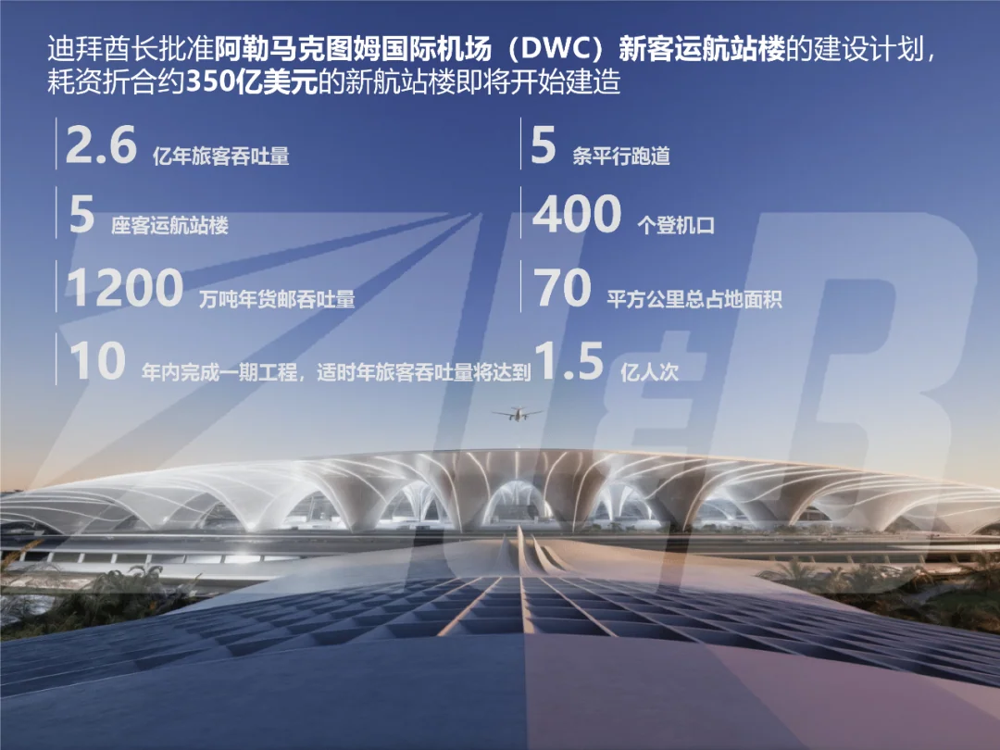

2024年4月28日、ドバイ首長シェイク・モハメッド・ビン・ラシド・アル・マクトゥーム氏は、アル・マクトゥーム国際空港（DWC）に新ターミナルを建設する計画を承認したと発表しました。計画では約350億米ドルを投じ、70平方キロメートルの用地に400のゲートと5本の平行滑走路を設け、今後10年かけて段階的に建設します。完成すれば年間2億6,000万人の旅客と1,200万トンの貨物を扱えるようになり、ドバイ国際空港の全機能がここへ移転します。

これは単なる建設許可ではなく、ドバイが何を目指すのかという宣言です。「私たちは未来の世代のために新しいプロジェクトを建設し、子どもたち、そしてその子どもたちへと続く継続的で安定した発展を確保します」と同氏は述べました。「ドバイは世界の空港、港、都市ハブ、そして新しい世界の中心になります」。空港、港、都市を一文に並べるのは、ドバイが20年間続けてきたやり方です。まずインフラを造り、そこに旅客と貨物を呼び込む。以下では数字、時期、立地、リスクを見ていきます。

## 1. 数字：70平方キロメートル、400ゲート

公式文書は具体的です。約350億米ドルの投資、70平方キロメートルの土地、5本の平行滑走路、400のゲート、5つの旅客ターミナル、そして最初の段階を10年以内に完成させるという内容です。完成予想図では、ターミナルはアラビア半島の伝統的なベドウィンのテントを思わせる、白くうねる屋根の連なりとして描かれています。「ベドウィン」は水と牧草を求めて移動した砂漠の遊牧民を指します。テントをモチーフにすることで、砂漠の中の立ち寄り場所というイメージをそのまま建物に取り込んでいます。

| 項目 | 公表値 |
| --- | --- |
| 投資額 | 約350億米ドル |
| 用地 | 70平方キロメートル |
| 滑走路 | 5本の平行滑走路 |
| ゲート | 400 |
| 旅客ターミナル | 5 |
| 最終的な旅客処理能力 | 年間2億6,000万人 |
| 貨物処理能力 | 年間1,200万トン |
| 第1期 | 今後10年以内 |
| 第1期の旅客処理能力 | 年間1億5,000万人 |

「最終」と「第1期」は分けて考える必要があります。2億6,000万人という数字は完成時の能力です。公式インフォグラフィックによれば、10年以内に第1期が完成した時点で年間能力は1億5,000万人に達します。これはすでに現在のドバイ国際空港の旅客数より7割以上多く、つまり第1期だけでも、今のドバイとは桁の違うハブになるということです。

## 2. なぜ今なのか：DXBの限界

ドバイ国際空港（DXB）は世界有数の国際空港で、2023年には約8,700万人の旅客を扱いました。制約になっているのはターミナルビルではなく、滑走路と土地です。平行な2本の滑走路がピーク時の処理能力の上限を決め、市街地が空港の周りに迫って拡張の余地はほとんどありません。需要は伸び続け、設備はほぼ限界に達しています。

需要を押し上げるエンジンは2つあります。1つはエミレーツ航空です。ドバイを拠点とする同社は長距離路線の主要な運航会社であり続け、A380と777を中心とした機材構成を持っています。その業績は都市国家の経済全体のバロメーターとして読まれます。航空会社が利益を出しているときは、旅客もビジネスもそこにあるということです。もう1つは観光です。2023年上半期、ドバイの外国人観光客数はパンデミック前の水準を超え、首長国の観光産業にとって過去最高の半年となりました。この旅客の急増が、「世界最大の空港」計画を前倒しした直接の理由です。

論理はこうです。ドバイは緩和用の空港を造っているのではありません。すでに満杯のハブに、はるかに大きな器を与えようとしているのです。DXBの全機能を移すということは、成熟した路線網の運用環境を一度に作り直すことであり、この規模の都市でしか真剣に検討できない選択です。

## 3. なぜ南部なのか：形づくられる回廊

DWCは首長国の南西部、ドバイ・サウスに位置し、ジュベル・アリ港の隣、そして2020年万博の会場跡地の隣にあります。万博会場は閉幕後、Expo City Dubaiとして再開しました。空港をそこに置くことで、航空貨物、海上貨物、展示会、住宅が同じ土地に集まります。ジュベル・アリがコンテナを扱い、空港が高価値の航空貨物を扱い、Expo Cityと周辺地区が活動を供給する構図です。

これもドバイではおなじみの手法です。都市が空港まで広がるのを待つのではなく、空港を使って都市をその方向へ引っ張るのです。DXBも都市の縁に造られ、やがて都市がその周りを囲みました。今回は計画者が新しい空港をさらに外側に置き、70平方キロメートルは空港用地であると同時に、将来の都市成長の枠組みにもなっています。

## 4. リスク：一度の移転、10年という歳月

最大のリスクは資金ではなく移転です。ドバイ国際空港の全機能をDWCへ移すということは、エミレーツの拠点、乗り継ぎの波、貨物施設、地上交通網を作り直すことを意味します。航空会社はターミナルが格好いいから移転するのではありません。最短乗り継ぎ時間、手荷物システムの信頼性、そして密度の高いフライトの波のために移るのです。どれか一つが滞れば、旅客はドーハ、アブダビ、イスタンブールへ流れます。

2つ目のリスクは段階的な建設です。10年は長い期間であり、第1期の1億5,000万人という能力は、航空会社と目的地がそれに合わせて成長して初めて意味を持ちます。3つ目は貨物です。DWCはすでに貨物に強く、1,200万トンという目標は既存事業を単に移すのではなく拡大することを意味します。4つ目は需要そのものです。2億6,000万人という数字は完成後の空港を表すもので、今後10年の目標ではありません。世界の航空需要の伸びが鈍れば、滑走路とゲートは遊休資産になります。

## 5. 旅行者にとっての意味

今すぐ何かが変わるわけではありません。DWCは現在、主に貨物と少数の旅客便を扱っており、DXBがドバイの主要な旅客玄関口であり続けています。新しいターミナルは段階的に建設され、機能の移転も段階的に進むため、当面ドバイで利用する空港はほぼ確実にDXBのままです。

重要なのは完成予想図ではなく日程です。運営会社がどの便をどの段階で移すかを公表したら、ドバイ経由の乗り継ぎは計算し直す必要があるかもしれません。2つの空港は数十キロ離れており、間違った空港に行くと、余裕を1時間増やすよりはるかに高くつきます。旅行前に航空会社と空港運営会社の最新のお知らせを確認する。それが唯一確実な方法です。

## 6. 2026年の更新：図面から入札へ

2024年の承認は出発点にすぎませんでした。2026年8月、ドバイはアル・マクトゥーム拡張のために年末までに約550億ディルハムの契約を発注すると発表し（[The National](https://www.thenationalnews.com/business/aviation/2026/08/26/dubai-to-award-dh55bn-in-contracts-by-year-end-for-al-maktoum-airport-expansion/)）、ドバイ空港の責任者は[Khaleej Times](https://www.khaleejtimes.com/business/no-slowdown-in-al-maktoum-airport-construction-despite-regional-conflict-dubai-airports-chief)に対し、地域紛争は建設を遅らせていないと語りました。旅行者にとって、開業時期は依然として中期的な変数です。完全移転まではDXBが主な旅客を担い続け、DWCは貨物と一部の旅客を伸ばしていきます。

「世界最大の空港」という話が数か月おきに蒸し返されるのはそのためです。重要なマイルストーンは完成予想図ではなく、契約、滑走路、ターミナルの引き渡しです。DXBが正常に運航している限り、DWCの入札は次の10年の準備であり、次の旅行を変えるものではありません。

## 関連リンク

- **このサイト内**：[ドバイ国際空港 (DXB)](/airport/DXB)、[アラブ首長国連邦 (AE)](/country/AE)
- **Wikipedia**：[アル・マクトゥーム国際空港](https://en.wikipedia.org/wiki/Al_Maktoum_International_Airport)、[ドバイ国際空港](https://en.wikipedia.org/wiki/Dubai_International_Airport)
- **百度百科**：[アル・マクトゥーム国際空港](https://baike.baidu.com/item/%E9%98%BF%E5%8B%92%E9%A9%AC%E5%85%8B%E5%9B%BE%E5%A7%86%E5%9B%BD%E9%99%85%E6%9C%BA%E5%9C%BA)

画像出典：GA Global Architectureおよびドバイ政府メディアオフィス。プロジェクトの数値と日程はドバイ空港と運営会社の発表によるものです。旅行前に運営会社のサイトを確認してください。
