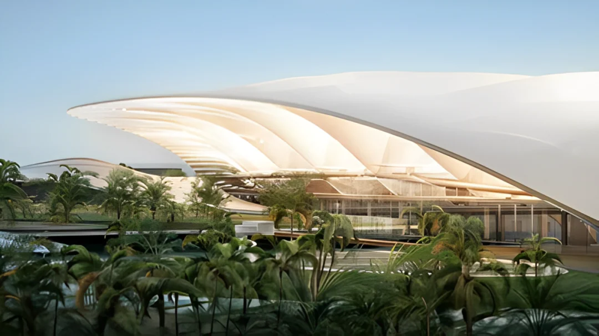
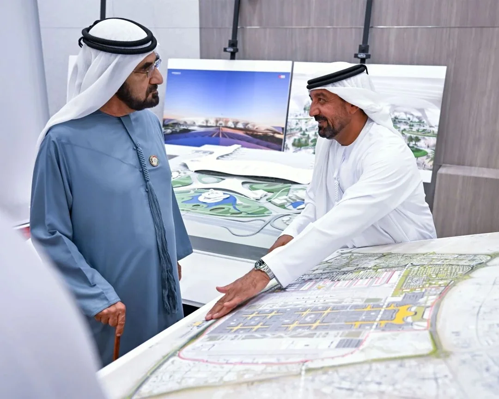
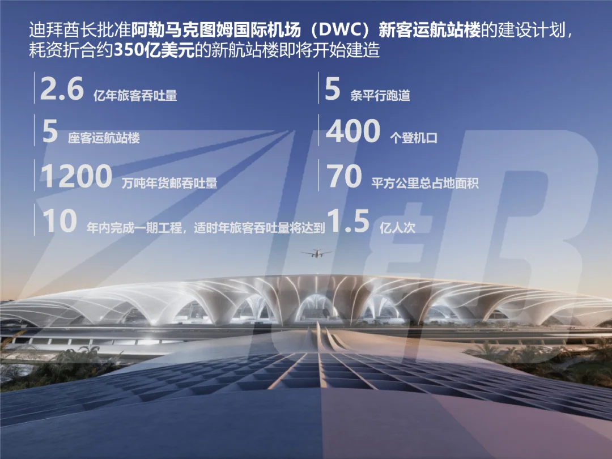
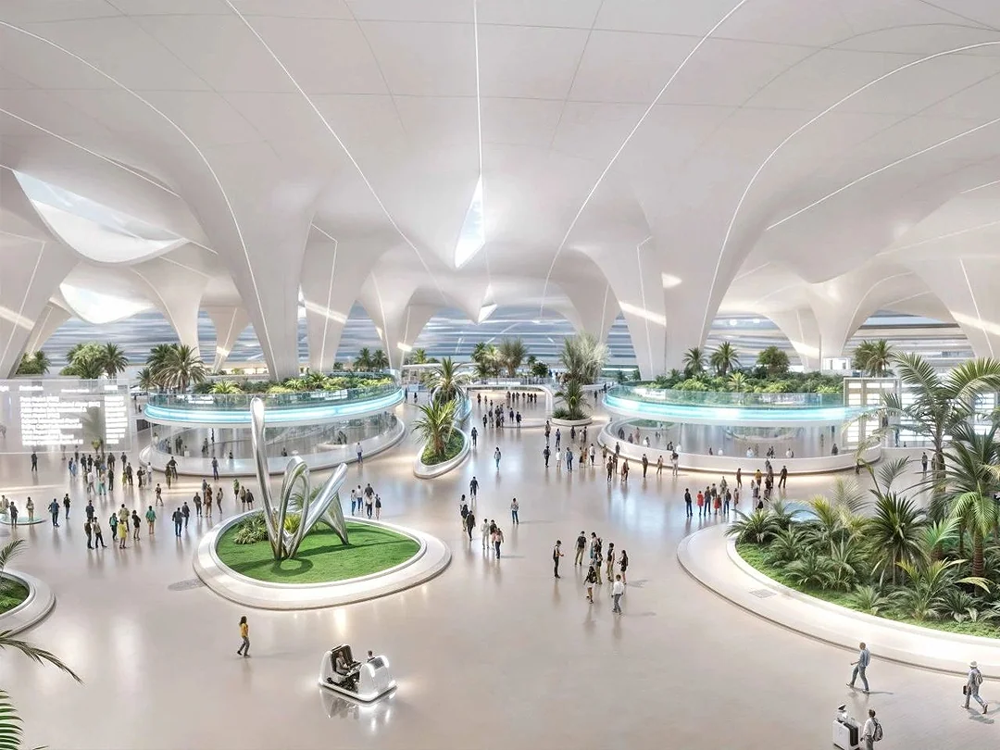
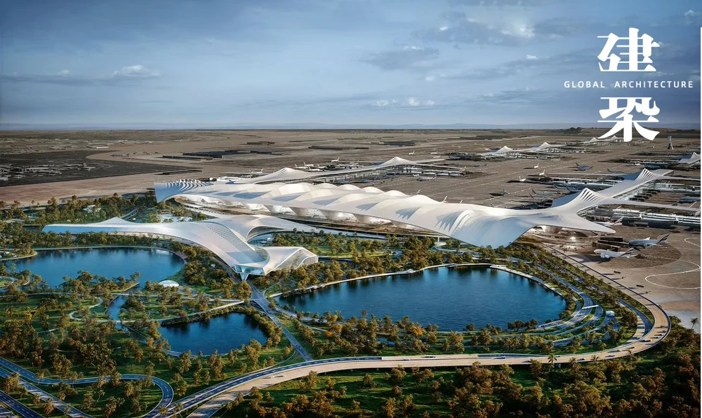

2024년 4월 28일, 두바이 통치자 셰이크 모하메드 빈 라시드 알막툼은 알막툼 국제공항(DWC)의 새 터미널 계획을 승인했다고 발표했습니다. 계획대로라면 약 350억 달러가 들고, 70제곱킬로미터 부지를 차지하며, 400개 게이트와 5개의 평행 활주로를 갖추고, 향후 10년에 걸쳐 단계적으로 건설됩니다. 완공되면 연간 여객 2억 6천만 명과 화물 1,200만 톤을 처리할 수 있게 되며, 두바이 국제공항의 모든 운영이 이곳으로 옮겨 갑니다.

이것은 건설 허가라기보다 두바이가 무엇이 되려는지에 대한 선언에 가깝습니다. 셰이크 모하메드는 "우리는 미래 세대를 위한 새 프로젝트를 짓고 있으며, 우리 아이들과 그 아이들에게 이어지는 지속적이고 안정적인 발전을 보장합니다"라고 말했습니다. "두바이는 세계의 공항이자 항만, 도시 허브, 그리고 새로운 글로벌 중심지가 될 것입니다." 공항과 항만, 도시를 한 문장에 담는 방식은 두바이가 20년 동안 일해 온 방식입니다. 인프라를 먼저 짓고, 그다음 승객과 화물이 그 안을 채우게 하는 것입니다. 이하에서는 숫자와 시기, 부지, 그리고 위험을 살펴봅니다.

## 1. 숫자: 70제곱킬로미터, 400개 게이트

공식 문서는 구체적입니다. 약 350억 달러의 투자, 70제곱킬로미터의 부지, 5개의 평행 활주로, 400개 게이트, 5개 여객 터미널, 그리고 10년 안에 완공되는 1단계입니다. 조감도에서 터미널은 아라비아반도의 전통적인 베두인 천막을 연상시키는 물결치는 흰 지붕이 길게 이어진 모습으로 그려집니다. '베두인'은 물과 목초지를 따라 이동하던 사막의 유목민을 뜻합니다. 천막을 모티프로 삼은 것은 사막 속 쉼터라는 개념을 건물 안으로 직접 끌어들인 것입니다.

| 항목 | 발표된 수치 |
| --- | --- |
| 투자 | 약 350억 달러 |
| 부지 | 70제곱킬로미터 |
| 활주로 | 평행 활주로 5개 |
| 게이트 | 400개 |
| 여객 터미널 | 5개 |
| 최종 여객 처리 능력 | 연간 2억 6천만 명 |
| 화물 처리 능력 | 연간 1,200만 톤 |
| 1단계 | 향후 10년 이내 |
| 1단계 여객 처리 능력 | 연간 1억 5,000만 명 |

'최종'과 '1단계'를 구분해서 볼 필요가 있습니다. 2억 6천만 명이라는 수치는 완공된 공항의 처리 능력입니다. 공식 인포그래픽은 10년 안에 1단계가 완공되면 연간 처리 능력이 1억 5,000만 명에 이른다고 밝힙니다. 이는 이미 오늘날 두바이 국제공항의 여객 수보다 70퍼센트 이상 많은 규모입니다. 즉 1단계만으로도 지금 두바이가 가진 허브와는 차원이 다른 규모의 허브가 됩니다.

## 2. 왜 지금인가: DXB의 한계

두바이 국제공항(DXB)은 세계에서 가장 붐비는 국제공항 중 하나로, 2023년 여객 수가 8,700만 명에 육박했습니다. 제약은 터미널 건물이 아니라 활주로와 부지입니다. 평행 활주로 두 개가 첨두 시간 처리량의 한계를 정하고, 도시가 부지 주변을 에워싸면서 확장할 공간이 거의 남지 않았습니다. 수요는 계속 늘어나는데 하드웨어는 한계에 가깝습니다.

이 수요를 이끄는 두 개의 엔진이 있습니다. 첫째는 에미레이트항공입니다. 두바이에 본사를 둔 이 항공사는 오랫동안 장거리 노선의 선두 운항사였으며, A380과 777을 중심으로 기단을 구성했습니다. 그 실적은 이 도시국가 경제 전반의 바로미터로 읽힙니다. 항공사가 돈을 번다는 것은 승객과 비즈니스 활동이 그만큼 있다는 뜻입니다. 둘째는 관광입니다. 2023년 상반기 두바이의 외국인 방문객 수는 팬데믹 이전 수준을 넘어섰고, 이는 이 에미리트 관광 산업이 기록한 최고의 반기 실적이었습니다. 이러한 여객 급증이 '세계 최대 공항' 프로젝트가 앞당겨진 직접적인 이유입니다.

논리는 자연스럽게 이어집니다. 두바이는 대체 공항을 짓는 것이 아니라, 이미 꽉 찬 허브에 훨씬 큰 그릇을 쥐여 주는 것입니다. DXB의 모든 운영을 옮긴다는 것은 성숙한 노선망의 운영 환경을 한 번에 재설정한다는 뜻이며, 이 규모의 도시만이 진지하게 고려할 수 있는 선택입니다.

## 3. 왜 남쪽인가: 형성 중인 회랑

DWC는 에미리트 남서부의 두바이 사우스(Dubai South)에 자리하며, 제벨 알리(Jebel Ali) 항구와 2020 두바이 엑스포 부지 옆에 있습니다. 엑스포 폐막 후 그 부지는 엑스포 시티 두바이(Expo City Dubai)로 다시 문을 열었습니다. 공항을 그곳에 두는 것은 항공 화물, 해상 화물, 전시, 주거를 같은 땅 위에 올려놓는 일입니다. 제벨 알리가 컨테이너를 처리하고, 공항이 고부가가치 항공 화물을 처리하며, 엑스포 시티와 주변 지구가 활기를 공급합니다.

이것은 또한 두바이에게 익숙한 방식입니다. 도시가 공항까지 성장해 오기를 기다리는 대신, 공항으로 도시를 그 방향으로 끌어당기는 것입니다. DXB도 도시 외곽에 지어졌고 결국 도시가 그 주위를 둘러쌌습니다. 이번에는 계획가들이 새 공항을 더 바깥에 배치했고, 70제곱킬로미터는 공항 부지이자 향후 도시 성장의 틀이기도 합니다.

## 4. 위험: 한 번의 이전, 10년

가장 큰 위험은 돈이 아니라 이전입니다. 두바이 국제공항의 모든 운영을 DWC로 옮긴다는 것은 에미레이트항공의 기지, 환승 파도, 화물 시설, 지상 교통망을 다시 짓는 일입니다. 항공사는 터미널이 멋있어서 이전하지 않습니다. 최소 환승 시간, 수하물 시스템의 신뢰성, 촘촘하게 짜인 항공편 뭉치를 위해 이전합니다. 이 중 하나라도 어긋나면 여객은 도하, 아부다비, 이스탄불로 흘러갈 것입니다.

두 번째 위험은 단계별 건설입니다. 10년은 긴 기간이고, 1단계의 1억 5천만 명은 항공사와 목적지가 함께 성장할 때만 의미가 있습니다. 세 번째는 화물입니다. DWC는 이미 화물에서 강하고, 1,200만 톤이라는 목표는 기존 사업을 단순히 이전하는 것이 아니라 확장하는 것을 뜻합니다. 네 번째는 수요 자체입니다. 2억 6천만 명이라는 수치는 완공된 공항을 설명하는 값이지 향후 10년의 목표가 아닙니다. 세계 항공 성장이 둔화되면 활주로와 게이트는 놀게 됩니다.

## 5. 여행자에게 의미하는 것

아직 바뀌는 것은 없습니다. DWC는 현재 주로 화물과 소수의 여객편을 처리하고, DXB가 계속 두바이의 주 여객 관문입니다. 새 터미널은 단계적으로 지어지고 운영 이전도 단계적으로 이루어지므로, 가까운 미래에 두바이에서 이용할 공항은 거의 확실히 여전히 DXB입니다.

중요한 것은 조감도가 아니라 시간표입니다. 운영사가 항공편 이전 순서를 발표하면 두바이를 경유하는 연결이 재계산될 수 있습니다. 두 공항은 수십 킬로미터 떨어져 있고, 잘못된 공항에 도착하면 여유 시간 한 시간을 더 쓰는 것보다 훨씬 큰 비용이 듭니다. 여행 전에 항공사와 공항 운영사의 최신 공지를 확인하십시오. 그것이 유일하게 신뢰할 수 있는 방법입니다.

## 6. 2026년 업데이트: 도면에서 입찰로

2024년의 승인은 출발점일 뿐이었습니다. 2026년 8월 두바이는 알막툼 확장을 위해 연말까지 약 550억 디르함 규모의 계약을 발주하겠다고 밝혔고([The National](https://www.thenationalnews.com/business/aviation/2026/08/26/dubai-to-award-dh55bn-in-contracts-by-year-end-for-al-maktoum-airport-expansion/)), 두바이 공항공사 대표는 지역 분쟁에도 불구하고 건설이 둔화되지 않았다고 [Khaleej Times](https://www.khaleejtimes.com/business/no-slowdown-in-al-maktoum-airport-construction-despite-regional-conflict-dubai-airports-chief)에 말했습니다. 여행자에게 개항 일정은 여전히 중기적 변수입니다. 전면 이전 전까지 DXB가 주 여객 물량을 계속 담당하고, DWC는 화물과 일부 여객 물량을 키워 나갑니다.

그래서 '세계 최대 공항' 이야기가 몇 달마다 다시 떠오릅니다. 중요한 이정표는 조감도가 아니라 계약, 활주로, 터미널 인도입니다. DXB가 정상 운영되는 한, DWC의 입찰 하나하나는 다음 10년을 위한 준비일 뿐, 다음 여행을 바꾸는 일은 아닙니다.

## 관련 링크

- **이 사이트에서**: [두바이 국제공항(DXB)](/airport/DXB), [아랍에미리트(AE)](/country/AE)
- **Wikipedia**: [알막툼 국제공항](https://en.wikipedia.org/wiki/Al_Maktoum_International_Airport), [두바이 국제공항](https://en.wikipedia.org/wiki/Dubai_International_Airport)
- **Baidu Baike**: [알막툼 국제공항](https://baike.baidu.com/item/%E9%98%BF%E5%8B%92%E9%A9%AC%E5%85%8B%E5%9B%BE%E5%A7%86%E5%9B%BD%E9%99%85%E6%9C%BA%E5%9C%BA)

이미지 출처: GA Global Architecture 및 두바이 정부 미디어 오피스. 프로젝트 수치와 일정은 두바이 공항공사와 운영사가 발표한 내용을 따랐으므로, 여행 전에 운영사 사이트를 확인하십시오.
