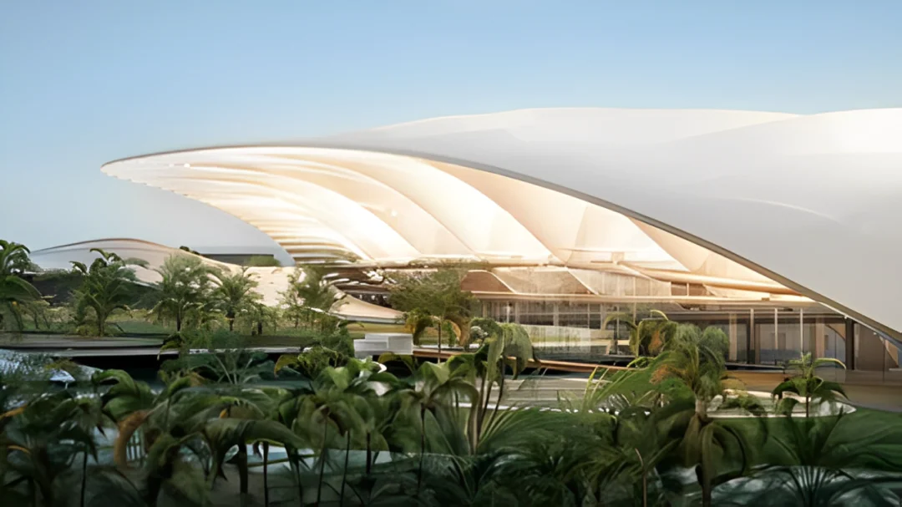

28 kwietnia 2024 r. szejk Mohammed bin Rashid Al Maktoum, władca Dubaju, ogłosił zatwierdzenie planów nowego terminalu na lotnisku Al Maktoum International (DWC). Zgodnie z planem będzie kosztować około 35 mld dolarów, zajmie teren o powierzchni 70 km², będzie mieć 400 bramek i pięć równoległych dróg startowych, a jego budowa potrwa dekadę i będzie prowadzona etapami. Po ukończeniu obsłuży 260 mln pasażerów i 12 mln ton ładunków rocznie, a cała działalność Dubai International zostanie tam przeniesiona.

To mniej pozwolenie na budowę, a bardziej deklaracja, kim Dubaj zamierza być. „Budujemy nowy projekt dla przyszłych pokoleń, zapewniając ciągły i stabilny rozwój naszym dzieciom i ich dzieciom" — powiedział szejk Mohammed. — „Dubaj będzie lotniskiem, portem, ośrodkiem miejskim i nowym globalnym centrum świata." Umieszczenie lotniska, portu i miasta w jednym zdaniu to sposób, w jaki Dubaj działa od dwóch dekad: najpierw zbudować infrastrukturę, a potem pozwolić, by wypełnili ją pasażerowie i ładunki. W dalszej części przyjrzymy się liczbom, harmonogramowi, lokalizacji i ryzyku.

## 1. Liczby: 70 km², 400 bramek

Oficjalne dokumenty są konkretne: około 35 mld dolarów inwestycji, 70 km² gruntu, pięć równoległych dróg startowych, 400 bramek, pięć terminali pasażerskich i pierwszy etap oddany w ciągu dziesięciu lat. Na wizualizacjach terminal to ciąg białych, falujących dachów, które przywodzą na myśl tradycyjny beduiński namiot Półwyspu Arabskiego — „Beduin" oznacza koczownika pustyni, który wędrował za wodą i pastwiskami. Użycie namiotu jako motywu przenosi wprost do budynku ideę miejsca odpoczynku na pustyni.

| Element | Opublikowana wartość |
| --- | --- |
| Inwestycja | Około 35 mld dolarów |
| Teren | 70 km² |
| Drogi startowe | 5 równoległych dróg startowych |
| Bramki | 400 |
| Terminale pasażerskie | 5 |
| Docelowa przepustowość pasażerska | 260 mln rocznie |
| Przepustowość cargo | 12 mln ton rocznie |
| Pierwszy etap | W ciągu najbliższych 10 lat |
| Przepustowość pasażerska pierwszego etapu | 150 mln rocznie |

Warto oddzielić wartość „docelową" od „pierwszego etapu". Liczba 260 mln to przepustowość ukończonego lotniska; oficjalna infografika podaje, że po ukończeniu pierwszego etapu w ciągu dekady roczna przepustowość sięgnie 150 mln. To już ponad siedemdziesiąt procent więcej niż dzisiejszy ruch Dubai International — innymi słowy, nawet pierwszy etap byłby hubem w innej skali niż ten, który Dubaj ma obecnie.

## 2. Dlaczego teraz: limit DXB

Dubai International (DXB) należy do najruchliwszych lotnisk międzynarodowych na świecie — w 2023 r. obsłużyło blisko 87 mln pasażerów. Ograniczeniem nie są budynki terminali, lecz drogi startowe i teren: dwie równoległe drogi startowe wyznaczają limit w godzinach szczytu, a miasto zabudowało się wokół lotniska, zostawiając niemal zero miejsca na rozbudowę. Popyt wciąż rośnie, a infrastruktura jest niemal na granicy przepustowości.

Ten popyt napędzają dwa silniki. Pierwszym są Emirates. Linia z siedzibą w Dubaju od dawna należy do czołowych przewoźników na trasach długodystansowych, z flotą opartą na A380 i 777; jej wyniki finansowe są odczytywane jako barometr szerszej gospodarki miasta-państwa — gdy linia zarabia, oznacza to, że pasażerowie i biznes są na miejscu. Drugim jest turystyka: w pierwszej połowie 2023 r. liczba zagranicznych turystów w Dubaju przekroczyła poziom sprzed pandemii, co było najlepszym półroczem w historii branży turystycznej emiratu. Ten skok ruchu to bezpośredni powód przyspieszenia projektu „największego lotniska świata".

Logika jest konsekwentna. Dubaj nie buduje lotniska odciążającego — daje już pełnemu hubowi znacznie większe naczynie. Przeniesienie całej działalności DXB oznacza jednorazowe zresetowanie środowiska operacyjnego dojrzałej siatki połączeń — wybór, który na poważnie może rozważać tylko miasto tej skali.

## 3. Dlaczego południe: kształtujący się korytarz

DWC leży w Dubai South, w południowo-zachodniej części emiratu, obok portu Jebel Ali i terenu Expo 2020, którego kompleks po zamknięciu wystawy otwarto ponownie jako Expo City Dubai. Umieszczenie tam lotniska skupia na tym samym obszarze fracht lotniczy, fracht morski, wystawy i zabudowę mieszkaniową: Jebel Ali obsługuje kontenery, lotnisko — cenne ładunki lotnicze, a Expo City i okoliczne dzielnice dostarczają aktywności.

To także znana metoda Dubaju: zamiast czekać, aż miasto dorośnie do lotniska, użyć lotniska, by pociągnąć miasto w jego stronę. DXB też zbudowano na skraju miasta, aż w końcu je otoczyło; tym razem planiści umieścili nowe lotnisko dalej, a 70 km² to zarówno teren lotniska, jak i rama przyszłego rozwoju miejskiego.

## 4. Ryzyko: jedna przeprowadzka, dziesięć lat

Największym ryzykiem nie są pieniądze, lecz przeprowadzka. Przeniesienie całej działalności Dubai International do DWC oznacza odbudowanie bazy Emirates, fal połączeń przesiadkowych, obiektów cargo i naziemnej sieci transportowej. Linie lotnicze nie przenoszą się dlatego, że terminal dobrze wygląda; przenoszą się dla minimalnego czasu przesiadki, niezawodności systemu bagażowego i gęstych bloków rejsów. Jeśli którykolwiek z tych elementów zawiedzie, ruch odpłynie do Dohy, Abu Zabi lub Stambułu.

Drugim ryzykiem jest etapowanie. Dziesięć lat to długie okno, a pierwszy etap na 150 mln pasażerów ma sens tylko wtedy, gdy linie i kierunki będą rosły razem z nim. Trzecim jest cargo: DWC jest już mocne w frachcie, a cel 12 mln ton oznacza skalowanie istniejącego biznesu, a nie tylko jego przeniesienie. Czwartym jest sam popyt. Liczba 260 mln opisuje w pełni zbudowane lotnisko, a nie cel na najbliższą dekadę; jeśli globalny wzrost lotnictwa zwolni, drogi startowe i bramki będą stać puste.

## 5. Co to oznacza dla podróżnych

Nic jeszcze nie musi się zmieniać. DWC obsługuje obecnie głównie cargo oraz niewielką liczbę lotów pasażerskich; DXB pozostaje główną bramą pasażerską Dubaju. Nowy terminal będzie budowany etapami, a przenoszenie działalności również będzie następować stopniowo, więc w najbliższej przyszłości lotniskiem, z którego skorzystasz w Dubaju, niemal na pewno pozostanie DXB.

Liczy się harmonogram, a nie wizualizacje. Gdy operator opublikuje partie lotów przenoszonych w kolejnych etapach, przesiadki przez Dubaj mogą wymagać przeliczenia: oba lotniska dzieli kilkadziesiąt kilometrów, a stawienie się na niewłaściwym kosztuje znacznie więcej niż dodatkowa godzina zapasu. Przed podróżą sprawdź najnowsze komunikaty linii lotniczej i operatora lotniska — to jedyne niezawodne podejście.

## 6. Aktualizacja z 2026 r.: od rysunków do przetargów

Zatwierdzenie z 2024 r. było tylko punktem wyjścia. W sierpniu 2026 r. Dubaj zapowiedział, że do końca roku przyzna kontrakty o wartości około 55 mld dirhamów na rozbudowę Al Maktoum ([The National](https://www.thenationalnews.com/business/aviation/2026/08/26/dubai-to-award-dh55bn-in-contracts-by-year-end-for-al-maktoum-airport-expansion/)); szef Dubai Airports powiedział [Khaleej Times](https://www.khaleejtimes.com/business/no-slowdown-in-al-maktoum-airport-construction-despite-regional-conflict-dubai-airports-chief), że konflikt regionalny nie spowolnił budowy. Dla podróżnych harmonogram otwarcia pozostaje zmienną średnioterminową: DXB nadal dźwiga główny ciężar ruchu pasażerskiego, podczas gdy DWC rozwija cargo i część ruchu pasażerskiego przed pełnym przeniesieniem.

Dlatego historia „największego lotniska świata" co kilka miesięcy wraca. Kamienie milowe, które się liczą, to nie wizualizacje, lecz kontrakty, drogi startowe i przekazywanie terminali. Dopóki DXB działa normalnie, każdy przetarg DWC jest przygotowaniem na następną dekadę, a nie zmianą w twojej najbliższej podróży.

## Powiązane linki

- **Na tej stronie**: [Lotnisko Dubai International (DXB)](/airport/DXB), [Zjednoczone Emiraty Arabskie (AE)](/country/AE)
- **Wikipedia**: [Al Maktoum International Airport](https://en.wikipedia.org/wiki/Al_Maktoum_International_Airport), [Dubai International Airport](https://en.wikipedia.org/wiki/Dubai_International_Airport)
- **Baidu Baike**: [Al Maktoum International Airport](https://baike.baidu.com/item/%E9%98%BF%E5%8B%92%E9%A9%AC%E5%85%8B%E5%9B%BE%E5%A7%86%E5%9B%BD%E9%99%85%E6%9C%BA%E5%9C%BA)

Źródło zdjęć: GA Global Architecture i Dubai Government Media Office. Dane i harmonogram projektu podano zgodnie z publikacjami Dubai Airports i operatora; przed podróżą sprawdź stronę operatora.
