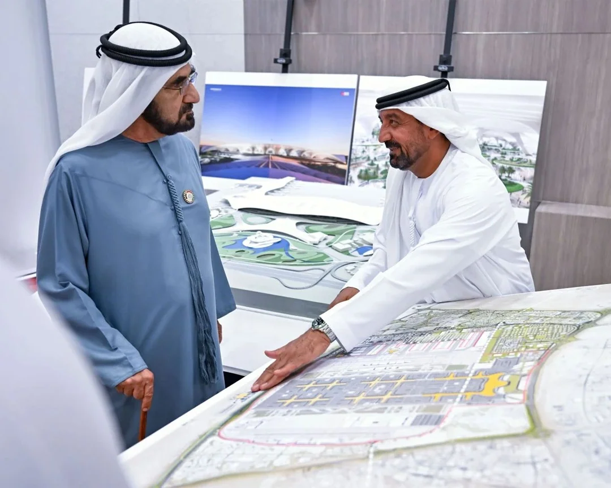
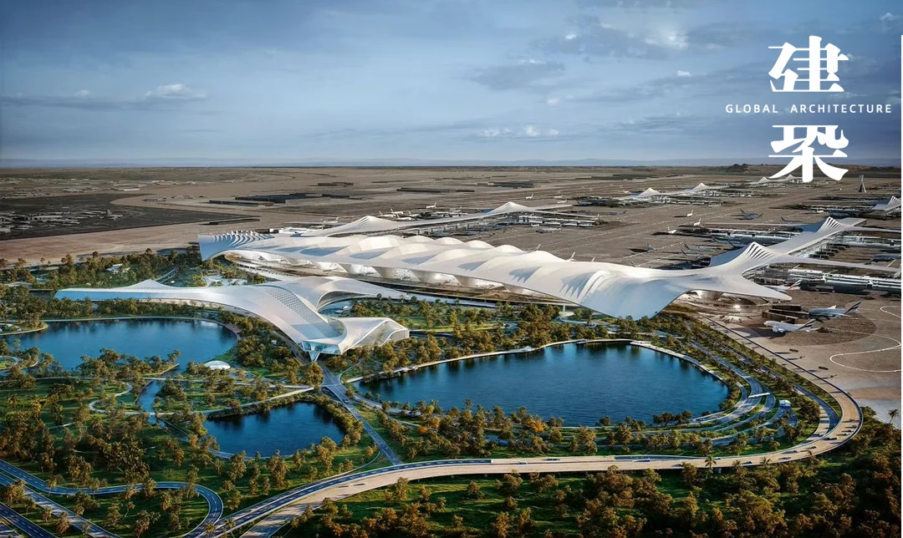

Pe 28 aprilie 2024, șeicul Mohammed bin Rashid Al Maktoum, conducătorul Dubaiului, a anunțat că a aprobat planurile pentru un nou terminal la Aeroportul Internațional Al Maktoum (DWC). Potrivit planurilor, acesta va costa aproximativ 35 de miliarde de dolari, va ocupa un amplasament de 70 de kilometri pătrați, va avea 400 de porți și cinci piste paralele și va fi construit în etape de-a lungul următorului deceniu. După finalizare, va putea deservi 260 de milioane de pasageri și 12 milioane de tone de marfă pe an, iar toate operațiunile Aeroportului Internațional Dubai se vor muta acolo.

Este mai puțin o autorizație de construcție și mai mult o declarație despre ceea ce intenționează Dubaiul să fie. „Construim un proiect nou pentru generațiile viitoare, asigurând o dezvoltare continuă și stabilă pentru copiii noștri și copiii copiilor lor”, a spus șeicul Mohammed. „Dubaiul va fi aeroportul, portul, centrul urban și noul centru global al lumii.” A pune aeroportul, portul și orașul în aceeași propoziție este modul în care Dubaiul a funcționat timp de două decenii: construiește mai întâi infrastructura, apoi lasă pasagerii și mărfurile să o umple. În continuare sunt analizate cifrele, calendarul, amplasamentul și riscul.

## 1. Cifrele: 70 de kilometri pătrați, 400 de porți

Documentele oficiale sunt precise: investiții de aproximativ 35 de miliarde de dolari, 70 de kilometri pătrați de teren, cinci piste paralele, 400 de porți, cinci terminale de pasageri și o primă etapă livrată în zece ani. În randări, terminalul este o succesiune de acoperișuri albe și ondulate care evocă cortul tradițional beduin din Peninsula Arabică — „beduin” desemnând nomazii deșertului care se deplasau odată cu apa și pășunile. Folosirea cortului ca motiv aduce ideea unui loc de popas în deșert direct în clădire.

| Element | Cifra publicată |
| --- | --- |
| Investiție | Aproximativ 35 de miliarde de dolari |
| Amplasament | 70 de kilometri pătrați |
| Piste | 5 piste paralele |
| Porți | 400 |
| Terminale de pasageri | 5 |
| Capacitate finală de pasageri | 260 de milioane pe an |
| Capacitate de marfă | 12 milioane de tone pe an |
| Prima etapă | În următorii 10 ani |
| Capacitate de pasageri în prima etapă | 150 de milioane pe an |

Merită să separăm „final” de „prima etapă”. Cifra de 260 de milioane este capacitatea aeroportului finalizat; infograficul oficial precizează că, la finalizarea primei etape în decurs de un deceniu, capacitatea anuală va ajunge la 150 de milioane. Aceasta este deja cu peste șaptezeci la sută mai mare decât traficul actual al Aeroportului Internațional Dubai — cu alte cuvinte, chiar și prima etapă ar fi un hub la o scară diferită de cea pe care o are Dubaiul acum.

## 2. De ce acum: plafonul DXB

Aeroportul Internațional Dubai (DXB) este printre cele mai aglomerate aeroporturi internaționale din lume, cu aproape 87 de milioane de pasageri în 2023. Constrângerea nu o reprezintă clădirile terminalelor, ci pistele și terenul: două piste paralele stabilesc limita orelor de vârf, iar orașul s-a strâns în jurul amplasamentului, lăsând aproape fără spațiu de extindere. Cererea crește continuu; infrastructura este aproape de capacitatea maximă.

Două motoare alimentează această cerere. Primul este Emirates. Compania aeriană, cu baza în Dubai, este de multă vreme un operator de frunte pe rutele pe distanțe lungi, cu o flotă construită în jurul A380 și 777; rezultatele sale financiare sunt citite ca un barometru al economiei mai largi a orașului-stat — când compania câștigă bani, pasagerii și activitatea economică sunt acolo. Al doilea este turismul: în prima jumătate a anului 2023, numărul vizitatorilor internaționali ai Dubaiului a depășit nivelul de dinainte de pandemie, cea mai bună jumătate de an consemnată de industria turistică a emiratului. Această creștere a traficului este motivul direct pentru care proiectul „cel mai mare aeroport din lume” a fost accelerat.

Logica decurge de la sine. Dubaiul nu construiește un aeroport care să mai descongestioneze traficul; îi oferă unui hub deja plin un recipient mult mai mare. Mutarea tuturor operațiunilor DXB înseamnă resetarea mediului operațional al unei rețele de rute mature dintr-o singură mișcare — o alegere pe care doar un oraș de această amploare o poate lua în serios.

## 3. De ce sudul: un coridor care prinde contur

DWC se află în Dubai South, în sud-vestul emiratului, lângă portul Jebel Ali și lângă amplasamentul Expo 2020, al cărui campus a fost redeschis ca Expo City Dubai după închiderea expoziției. Plasarea aeroportului acolo aduce transportul aerian de marfă, transportul maritim, expozițiile și locuințele pe același teritoriu: Jebel Ali se ocupă de containere, aeroportul de mărfurile aeriene de mare valoare, iar Expo City și cartierele din jur asigură activitatea.

Este și o metodă tipică pentru Dubai: în loc să aștepte ca orașul să se extindă până la aeroport, folosește aeroportul pentru a atrage orașul în acea direcție. Și DXB a fost construit la marginea orașului, iar orașul l-a înconjurat în cele din urmă; de data aceasta, planificatorii au plasat noul aeroport mai departe, iar cei 70 de kilometri pătrați sunt atât un amplasament aeroportuar, cât și cadrul pentru viitoarea creștere urbană.

## 4. Riscul: o singură mutare, zece ani

Cel mai mare risc nu este banii, ci mutarea. Transferarea tuturor operațiunilor Aeroportului Internațional Dubai la DWC înseamnă reconstruirea bazei Emirates, a valurilor de conexiuni, a facilităților de marfă și a rețelei de transport terestru. Companiile aeriene nu se mută pentru că un terminal arată bine; se mută pentru timpi minimi de conexiune, fiabilitatea sistemului de bagaje și grupuri dense de zboruri. Dacă oricare dintre acestea scârțâie, traficul se va îndrepta spre Doha, Abu Dhabi sau Istanbul.

Al doilea risc este etapizarea. Zece ani este o fereastră lungă, iar o primă etapă de 150 de milioane de pasageri are sens doar dacă companiile aeriene și destinațiile cresc odată cu ea. Al treilea este marfa: DWC este deja puternic pe segmentul de marfă, iar o țintă de 12 milioane de tone înseamnă extinderea afacerii existente, nu doar mutarea ei. Al patrulea este cererea în sine. Cifra de 260 de milioane descrie aeroportul complet construit, nu o țintă pentru următorul deceniu; dacă creșterea aviației globale încetinește, pistele și porțile rămân neutilizate.

## 5. Ce înseamnă pentru călători

Deocamdată nu trebuie schimbat nimic. DWC se ocupă în prezent în principal de marfă, împreună cu un număr mic de zboruri de pasageri; DXB rămâne principala poartă de pasageri a Dubaiului. Noul terminal va fi construit în etape, iar transferul operațiunilor va veni și el în etape, așa că, în viitorul apropiat, aeroportul pe care îl vei folosi în Dubai va fi aproape sigur tot DXB.

Ce contează este calendarul, nu randările. Odată ce operatorul publică seriile în care se mută zborurile, conexiunile prin Dubai pot necesita recalculare: cele două aeroporturi sunt la zeci de kilometri distanță, iar prezentarea la cel greșit costă mult mai mult decât o oră suplimentară de rezervă. Verifică cele mai recente notificări ale companiei aeriene și ale operatorului aeroportului înainte de a călători — aceasta este singura abordare de încredere.

## 6. Actualizarea din 2026: de la desene la licitații

Aprobarea din 2024 a fost doar punctul de plecare. În august 2026, Dubaiul a anunțat că va atribui contracte de aproximativ 55 de miliarde AED până la sfârșitul anului pentru extinderea Al Maktoum ([The National](https://www.thenationalnews.com/business/aviation/2026/08/26/dubai-to-award-dh55bn-in-contracts-by-year-end-for-al-maktoum-airport-expansion/)); șeful Dubai Airports a declarat pentru [Khaleej Times](https://www.khaleejtimes.com/business/no-slowdown-in-al-maktoum-airport-construction-despite-regional-conflict-dubai-airports-chief) că conflictul regional nu a încetinit construcția. Pentru călători, calendarul de deschidere rămâne o variabilă pe termen mediu: DXB continuă să transporte principalul volum de pasageri, în timp ce DWC își crește traficul de marfă și o parte din traficul de pasageri înainte de transferul complet.

De aceea povestea „cel mai mare aeroport din lume” reapare la fiecare câteva luni. Reperele care contează nu sunt randările, ci contractele, pistele și predările terminalelor. Atât timp cât DXB funcționează normal, fiecare licitație DWC este o pregătire pentru următorul deceniu, nu o schimbare pentru următoarea ta călătorie.

## Linkuri conexe

- **Pe acest site**: [Aeroportul Internațional Dubai (DXB)](/airport/DXB), [Emiratele Arabe Unite (AE)](/country/AE)
- **Wikipedia**: [Aeroportul Internațional Al Maktoum](https://en.wikipedia.org/wiki/Al_Maktoum_International_Airport), [Aeroportul Internațional Dubai](https://en.wikipedia.org/wiki/Dubai_International_Airport)
- **Baidu Baike**: [Aeroportul Internațional Al Maktoum](https://baike.baidu.com/item/%E9%98%BF%E5%8B%92%E9%A9%AC%E5%85%8B%E5%9B%BE%E5%A7%86%E5%9B%BD%E9%99%85%E6%9C%BA%E5%9C%BA)

Sursa imaginii: GA Global Architecture și Dubai Government Media Office. Cifrele și termenele proiectului sunt cele publicate de Dubai Airports și de operator; verifică site-ul operatorului înainte de a călători.
