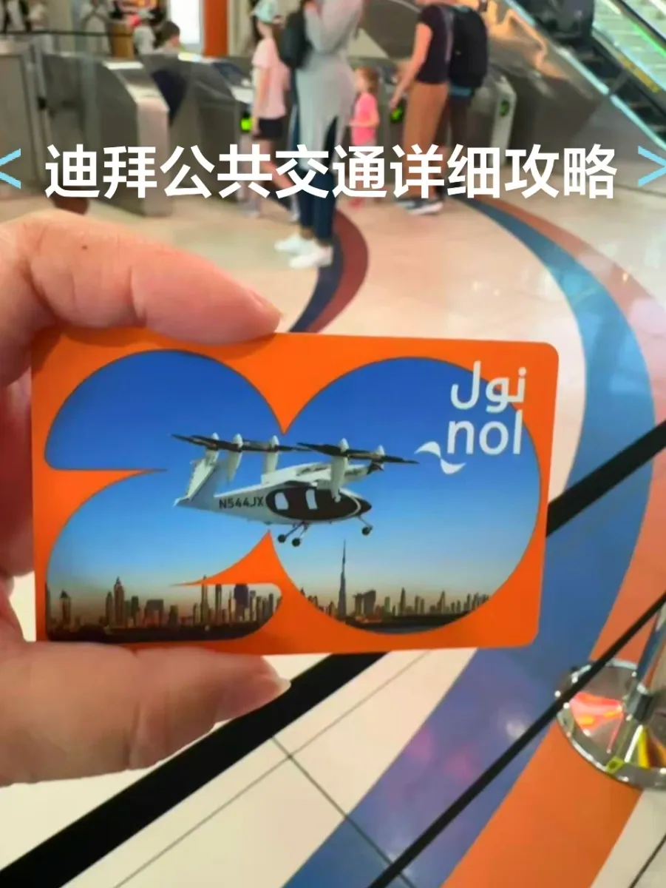
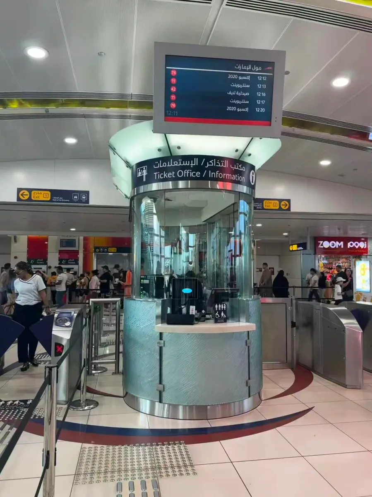
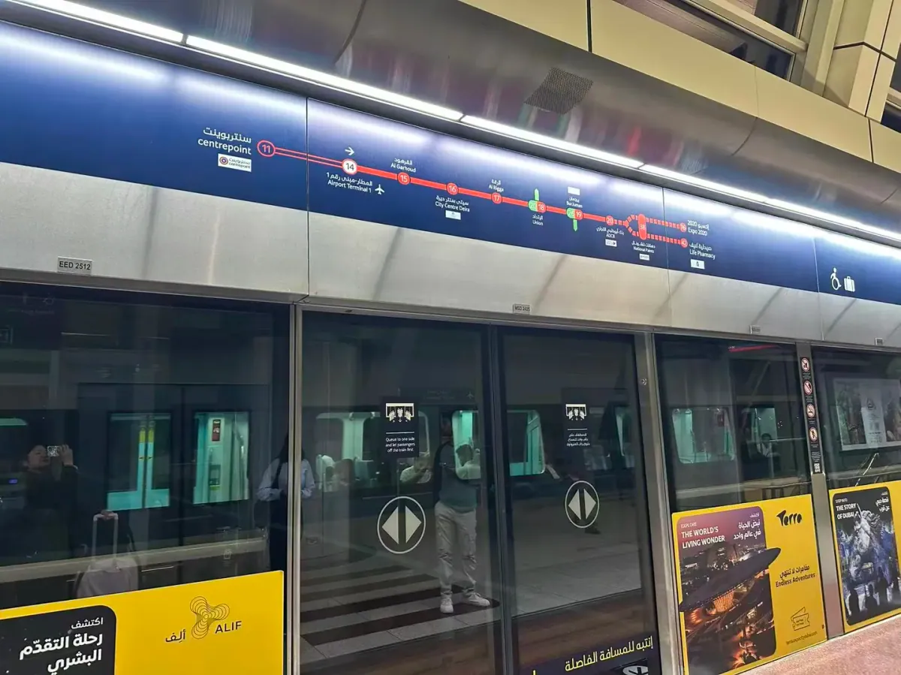
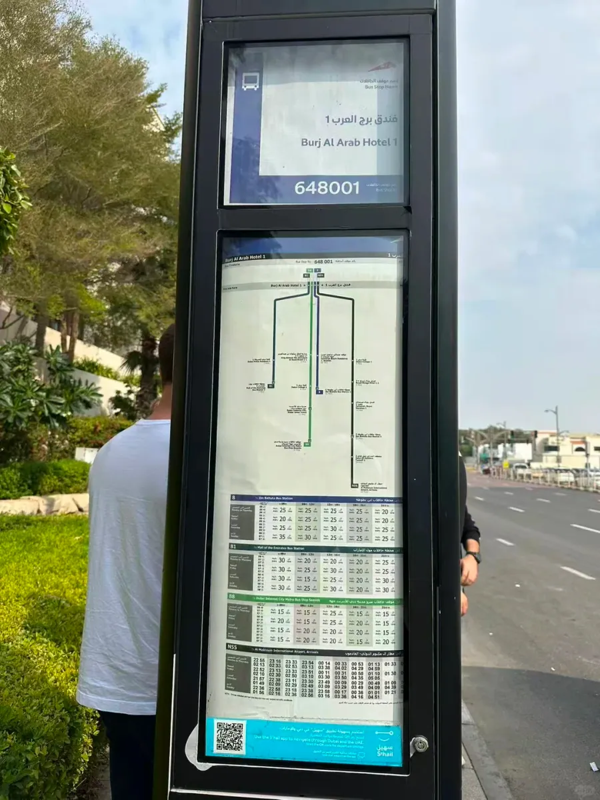
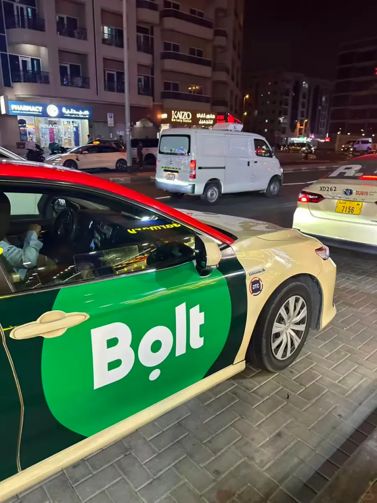

Der öffentliche Nahverkehr in Dubai wird unterschätzt. Viele Besucher nehmen an, die Stadt funktioniere nur mit Taxi oder Mietwagen – dabei ist die Metro sauber, pünktlich und erreicht fast jeden Ort, den ein Tourist sehen möchte, und die Busse sind so günstig, dass man sie als Sightseeing nutzen kann. Es gibt eigentlich nur zwei Hürden: eine **Nol-Karte** besorgen und verstehen, dass eine Metro-Linie in zwei Richtungen fährt.

Dieser Leitfaden folgt der Reihenfolge, in der Sie die Dinge nutzen: die Karte, die Metro, die Busse, dann Taxis und Apps. Die Preise stammen aus der Reise des Autors Ende 2025; die RTA passt die Fahrpreise von Zeit zu Zeit an – prüfen Sie vor der Reise die offizielle Website.

## 1. Die Nol-Karte: eine Karte für Metro, Busse und den Wasserbus

Die **Nol-Karte** ist die Guthabenkarte, die von Dubais Roads and Transport Authority (RTA) ausgegeben wird. Sie gilt in der Metro, in den Bussen, im Abra-Wasserbus und auf einigen Parkplätzen. Ihr eigentlicher Wert liegt nicht im Rabatt, sondern im Zugang: **Bei vielen Verbindungen kommen Sie ohne sie nicht an Bord**. Dubais Busse nehmen überhaupt kein Bargeld, und obwohl die Fahrkartenautomaten der Metro Einzelfahrscheine aus Papier verkaufen, ist eine Karte weit einfacher, sobald Sie die Linie wechseln oder mehr als einmal fahren.

Die Wahl der Karte richtet sich nach dem Einsatzzweck:

| Karte | Preis | Für wen | Hinweise |
| --- | --- | --- | --- |
| Rote Fahrkarte | etwa AED 4 | Eine oder zwei Fahrten | Papierticket, Zahlung pro Fahrt, nicht für die regelmäßige Nutzung |
| Silberkarte | AED 25 (AED 6 Kartengebühr + AED 19 Guthaben) | Fast jeder Besucher | Der Standard; das Guthaben lässt sich aufladen |
| Goldkarte | AED 50 | Wer erste Klasse fahren möchte | Zugang zum Wagen der Gold Class |
| Blaue Karte | AED 70 | Einwohner | Personalisiert, an Ihre Daten gebunden |

Für eine kurze Reise ist die **Silberkarte** die richtige Wahl. Die AED 25 enthalten AED 19 nutzbares Guthaben, genug für vier oder fünf Metro-Fahrten; laden Sie an den Automaten in der Station (sie nehmen Bankkarten) oder am besetzten Schalter (Bargeld, Visa oder UnionPay) auf.

Karten erhalten Sie an den Metro-Stationen des Flughafens, an besetzten Schaltern der großen Umsteigestationen und in einigen Convenience-Stores. Der bequemste Weg ist der Kauf bei der Ankunft – die Terminals T1 und T3 des DXB verfügen beide über Metro-Stationen, 5–8 Minuten zu Fuß von der Ankunftshalle, wenn Sie den roten Metro-Schildern folgen.

## 2. Die Metro: zwei Linien und eine Richtungsfalle

Dubais Metro hat zwei fahrerlose Linien mit Bahnsteigtüren und Wagen, die in Bereiche für die Standardklasse, für Frauen und Kinder sowie für die Gold Class unterteilt sind:

- **Red Line**: von Centrepoint im Norden über die Flughafenstationen T1 und T3, Deira, BurJuman, World Trade Centre, Burj Khalifa／Dubai Mall, Business Bay, Marina und Ibn Battuta – die Linie, die Besucher am häufigsten nutzen.
- **Green Line**: durch die Altstadt von Deira und Bur Dubai, mit Endstationen im Raum Al Qusais und Creek.
- **Umsteigestationen**: **Union** und **BurJuman**, wo sich die beiden Linien kreuzen.

Der klassische Fehler betrifft die Richtung. Auf derselben Linie **nutzen die beiden Richtungen unterschiedliche Bahnsteige**, lesen Sie also vor der Wahl der Ebene das Ziel auf dem Bahnsteigbildschirm. Google Maps liegt bei der Frage, welcher Bahnsteig der richtige ist, manchmal falsch; die Anzeigen in der Station sind verlässlicher, und wenn Sie unsicher sind, nennen Sie einem Mitarbeiter die gewünschte Station, und er weist Ihnen den richtigen Weg.

Fahrkarten gibt es auf drei Wegen: am Fahrkartenautomaten (Bankkarten), am besetzten Schalter (Bargeld, Visa, UnionPay) oder indem Sie mit der Nol-Karte direkt durchgehen. **Einzelfahrscheine aus Papier werden am Ausgang nicht eingezogen**, anders als in vielen Städten, Sie können sie also behalten.

Die Betriebszeiten unterscheiden sich je nach Wochentag und reichen etwa vom frühen Morgen bis Mitternacht; **an Freitagen beginnt der Betrieb wegen des Mittagsgebets später**. Prüfen Sie vor einer späten Fahrt den letzten Zug.

## 3. Busse: ohne Karte keine Fahrt

Dubais Busse sind sauber, günstig und zuverlässig, doch die Regel ist streng: **kein Bargeld, nur Nol-Karte**, und anders als in Singapur können Sie nicht einfach eine Visa-Karte auflegen. Sie legen die Karte beim Einsteigen und beim Aussteigen je einmal auf, und der Fahrpreis wird nach Zone berechnet.

Die Aushänge an den Haltestellen sind ausführlich: Name und Nummer der Haltestelle, die bedienten Linien, die erste und die letzte Abfahrt und die Taktzeiten jeder Linie – alles auf einer Tafel. An der Haltestelle Burj Al Arab Hotel 1 auf dem Foto listet die Tafel die Linie 8 (zum Busbahnhof Ibn Battuta), 81 (zur Mall of the Emirates), 88 (zum Deira City Centre) und die Nachtlinie N55 (zum Flughafen).

Ein paar praktische Hinweise:

- **Guthaben ausreichend halten**: Liegt das Guthaben unter dem Mindestfahrpreis, wird die Karte nicht validiert. Prüfen Sie es vor dem Aufbruch in der App oder an einem Automaten.
- **Vorne einsteigen, in der Mitte aussteigen**: Beim Einsteigen vorne auflegen, beim Aussteigen an der mittleren Tür – so wie es die Einheimischen machen.
- **Sitzplätze für Frauen und Kinder**: Der vordere Bereich ist rosa markiert; Männer sollten ihn meiden.
- **Nachtlinien**: Die Linien mit dem Präfix N bedienen den Flughafen und die Hauptstraßen – nützlich, wenn Sie um 3 Uhr morgens landen und lieber kein Taxi nehmen möchten.

## 4. Taxis und Apps: Careem oder Bolt

Dubais Taxis sind cremefarben mit rotem Dach und lassen sich auf der Straße oder an den Ständen bei Einkaufszentren und Krankenhäusern anhalten. Die Grundgebühr ist niedrig, und eine kurze Fahrt in der Stadt kostet meist AED 15–30, über mehrere Zonen oder hinaus bis zur Marina eher AED 50 und mehr. Sie fahren nach Taxameter – achten Sie darauf, dass der Fahrer ihn einschaltet.

Zwei Apps sind wichtig:

- **Careem**: die etablierte lokale Plattform, viele Fahrzeuge, Preise nahe am Taxi. Der Haken ist die Registrierung, für die ein SMS-Code nötig ist – **manche Mobilfunknummern aus dem chinesischen Festland erhalten ihn nie**, und ohne Verifizierung ist die App nutzlos.
- **Bolt**: der europäische Neueinsteiger, der in Dubai schnell gewachsen ist und meist etwas günstiger als Careem liegt. In der Praxis **erhalten Mobilfunknummern aus dem chinesischen Festland seine Verifizierungs-SMS**, und Registrierung, Bestellung und Zahlung funktionieren; Sie können am Ende beim Fahrer in bar bezahlen.

Scheitern beide Verifizierungen, gibt es einen dritten Weg: Bitten Sie das Personal im Hotel oder im Einkaufszentrum, ein Fahrzeug zu rufen, oder nutzen Sie einen Taxistand. Dubai hat reichlich Taxis, und die Wartezeiten in der Stadt liegen selten über zehn Minuten.

## 5. Ein paar Dinge, die die Reise reibungsloser machen

- **Karte bei der Ankunft kaufen**: Die Metro-Station am Flughafen verkauft Nol-Silberkarten – warten Sie nicht bis zur Innenstadt.
- **Spitzenzeiten meiden**: Werktags von 07:00–09:00 und 17:00–19:00 ist die Red Line in Richtung Zentrum voll.
- **Freitagsrhythmus**: Am Freitagmorgen sind die Geschäfte geschlossen und die Metro startet später; verschieben Sie Pläne im Freien auf den Nachmittag.
- **Wagen für Frauen und Kinder**: Der zweite Wagen ist reserviert; Männer sollten einen anderen nutzen.
- **Die Abra**: Der Wasserbus, der in der Altstadt den Dubai Creek überquert, kostet mit einem Nol-Auflegen AED 1 – das günstigste Sightseeing der Stadt.
- **Englische Adressen**: Fahrer kennen chinesische Ortsnamen womöglich nicht – nennen Sie den englischen Namen des Hotels und den Stadtteil zusammen.

Fahrpreise, Linien und Betriebszeiten stammen aus Veröffentlichungen der RTA und aus den eigenen Notizen des Autors; Fahrpreise werden politisch angepasst, prüfen Sie vor der Reise also die Website der RTA oder die Aushänge in den Stationen.

## Weiterführende Links

- **Auf dieser Website**: [Flughafen Dubai International (DXB)](/airport/DXB), [Vereinigte Arabische Emirate (AE)](/country/AE), [Vom Flughafen Dubai in die Stadt](/blog/dubai-airport-arrival-guide)
- **Wikipedia**: [Dubai Metro](https://en.wikipedia.org/wiki/Dubai_Metro)
- **Baidu Baike**: [Dubai Metro](https://baike.baidu.com/item/%E8%BF%AA%E6%8B%9C%E5%9C%B0%E9%93%81)
- **Betreiber**: [Dubai RTA](https://www.rta.ae/)
- **Originalbeitrag**: [Xiaohongshu @巴拉克](https://www.xiaohongshu.com/explore/69509fcb0000000021031c8a)

Bildquelle: die eigenen Fotografien des Autors. Fahrpreise, Kartentypen und Linien entsprechen den Veröffentlichungen der RTA.
