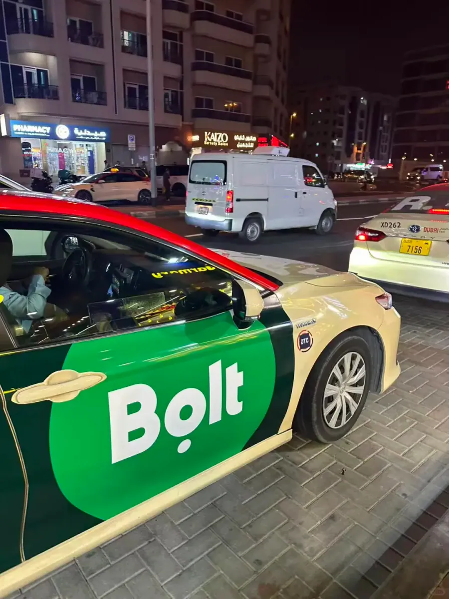

Transport publiczny w Dubaju jest niedoceniany. Wielu odwiedzających zakłada, że po mieście da się poruszać tylko taksówką lub wynajętym autem, tymczasem metro jest czyste, punktualne i dociera niemal wszędzie, gdzie chce trafić turysta, a autobusy są tak tanie, że można nimi zwiedzać. Tak naprawdę są tylko dwie przeszkody: zdobyć **kartę Nol** i zrozumieć, że linia metra biegnie w dwóch kierunkach.

Ten przewodnik idzie w kolejności, w jakiej będziesz z tych rzeczy korzystać: karta, metro, autobusy, a potem taksówki i aplikacje. Ceny pochodzą z podróży autora pod koniec 2025 r.; RTA od czasu do czasu zmienia taryfy — przed wyjazdem sprawdź oficjalną stronę.

## 1. Karta Nol: jedna karta do metra, autobusów i wodnego autobusu

**Karta Nol** to bilet przedpłacony wydawany przez dubajski Urząd Dróg i Transportu (RTA). Działa w metrze, autobusach, wodnym autobusie Abra i na niektórych parkingach. Jej prawdziwa wartość to nie zniżka, lecz dostęp: **w wielu środkach transportu nie wsiądziesz bez niej**. Dubajskie autobusy nie przyjmują gotówki, a choć automaty biletowe w metrze sprzedają papierowe bilety jednorazowe, karta jest znacznie wygodniejsza, gdy przesiadasz się między liniami lub jedziesz więcej niż raz.

Kartę wybierz według zastosowania:

| Karta | Cena | Dla kogo | Uwagi |
| --- | --- | --- | --- |
| Bilet czerwony | Około 4 dirhamów | Na jeden lub dwa przejazdy | Papierowy bilet, płatność za przejazd, nie do regularnego użytku |
| Srebrna | 25 dirhamów (6 dirhamów opłaty za kartę + 19 dirhamów salda) | Dla niemal każdego odwiedzającego | Domyślny wybór; saldo można doładować |
| Złota | 50 dirhamów | Dla chcących pierwszej klasy | Dostęp do wagonu Gold Class |
| Niebieska | 70 dirhamów | Dla mieszkańców | Spersonalizowana, powiązana z danymi posiadacza |

Na krótki wyjazd **srebrna karta** jest odpowiedzią. Za 25 dirhamów dostajesz 19 dirhamów salda — dość na cztery–pięć przejazdów metrem; doładuj ją w automatach na stacji (przyjmują karty bankowe) lub w kasie z obsługą (gotówka, Visa lub UnionPay).

Karty można dostać na lotniskowych stacjach metra, w kasach na dużych węzłach przesiadkowych i w niektórych sklepach convenience. Kupno karty zaraz po przylocie to najprostsza droga — przy terminalach T1 i T3 lotniska DXB są stacje metra, 5–8 minut spacerem od hali przylotów, wystarczy iść za czerwonymi znakami Metro.

## 2. Metro: dwie linie i pułapka kierunku

Dubajskie metro ma dwie bezzałogowe linie, z ekranami na peronach i wagonami podzielonymi na część standardową, część dla kobiet i dzieci oraz Gold Class:

- **Linia czerwona**: od Centrepoint na północy przez stacje lotniskowe T1 i T3, Deirę, BurJuman, World Trade Centre, Burj Khalifa／Dubai Mall, Business Bay, Marinę i Ibn Battutę — linia najczęściej używana przez turystów.
- **Linia zielona**: przez starą część miasta — Deirę i Bur Dubai — kończąca bieg w okolicach Al Qusais i Creek.
- **Węzły przesiadkowe**: **Union** i **BurJuman**, gdzie obie linie się przecinają.

Klasyczny błąd dotyczy kierunku. Na tej samej linii **oba kierunki odjeżdżają z różnych peronów**, więc zanim wybierzesz poziom, przeczytaj kierunek na ekranie peronowym. Google Maps czasem się myli co do peronu; wywieszki na stacji są wiarygodniejsze, a w razie wątpliwości powiedz pracownikowi, na którą stację chcesz dojechać, a wskaże właściwą drogę.

Bilety można kupić na trzy sposoby: w automatach (karty bankowe), w kasie z obsługą (gotówka, Visa, UnionPay) lub po prostu przechodząc przez bramkę z kartą Nol. **Papierowych biletów jednorazowych nie zbiera się przy wyjściu**, inaczej niż w wielu miastach, więc możesz je zatrzymać.

Godziny pracy różnią się w zależności od dnia — mniej więcej od wczesnego rana do północy — a **w piątki metro rusza później** z powodu południowych modlitw. Przed późnym wieczornym przejazdem sprawdź ostatni pociąg.

## 3. Autobusy: bez karty nie pojedziesz

Dubajskie autobusy są czyste, tanie i punktualne, ale zasada jest sztywna: **żadnej gotówki, tylko karta Nol**, a w przeciwieństwie do Singapuru nie da się po prostu przyłożyć karty Visa. Kartę przykłada się raz przy wejściu i raz przy wyjściu, a opłata jest naliczana według strefy.

Rozkłady na przystankach są wyczerpujące: nazwa i numer przystanku, obsługiwane linie oraz pierwsze i ostatnie odjazdy z częstotliwością dla każdej linii — wszystko na jednej tablicy. Na przystanku Burj Al Arab Hotel 1 ze zdjęcia tablica wymienia linię 8 (do dworca autobusowego Ibn Battuta), 81 (do Mall of the Emirates), 88 (do Deira City Centre) i nocną linię N55 (na lotnisko).

Kilka praktycznych uwag:

- **Pilnuj salda**: jeśli saldo jest niższe niż minimalna opłata, karta się nie zwaliduje. Sprawdź je w aplikacji lub w automacie, zanim wyruszysz.
- **Wsiadanie przednimi drzwiami, wyjście środkowymi**: przyłóż kartę przy wejściu z przodu i przy wyjściu środkowymi drzwiami, tak jak robią miejscowi.
- **Miejsca dla kobiet i dzieci**: przednia część jest oznaczona kolorem różowym; mężczyźni powinni jej nie zajmować.
- **Linie nocne**: kursy z literą N obsługują lotnisko i główne drogi, co jest przydatne, gdy lądujesz o 3:00 i wolisz nie brać taksówki.

## 4. Taksówki i aplikacje: Careem czy Bolt

Dubajskie taksówki są kremowe z czerwonym dachem; można je złapać na ulicy lub z postoju przy centrach handlowych i szpitalach. Opłata początkowa jest niska, a krótki przejazd po mieście kosztuje zwykle 15–30 dirhamów, bardziej 50 dirhamów i więcej przy przejazdach między strefami lub do Mariny. Jeżdżą na liczniku — tylko upewnij się, że kierowca go włączył.

Liczą się dwie aplikacje:

- **Careem**: ugruntowana lokalna platforma, dużo samochodów, ceny zbliżone do taksówki. Haczyk to rejestracja wymagająca kodu SMS — **niektóre numery z Chin kontynentalnych nigdy go nie otrzymują**, a bez weryfikacji aplikacja jest bezużyteczna.
- **Bolt**: europejski gracz, który szybko urósł w Dubaju i zwykle wycenia przejazdy nieco taniej niż Careem. W praktyce **numery z Chin kontynentalnych otrzymują jego SMS weryfikacyjny**, a rejestracja, zamawianie i płatność działają; na koniec można zapłacić kierowcy gotówką.

Jeśli obie weryfikacje zawiodą, jest trzecia droga: poproś obsługę hotelu lub centrum handlowego o zamówienie samochodu albo skorzystaj z postoju taksówek. W Dubaju taksówek nie brakuje, a oczekiwanie w mieście rzadko przekracza dziesięć minut.

## 5. Kilka rzeczy, które ułatwiają podróż

- **Kup kartę na lotnisku**: stacja metra na lotnisku sprzedaje srebrne karty Nol — nie czekaj do centrum.
- **Unikaj godzin szczytu**: w dni powszednie między 07:00 a 09:00 i 17:00 a 19:00 tłoczno jest na linii czerwonej w stronę centrum.
- **Piątkowy rytm**: w piątkowe przedpołudnia sklepy są zamknięte, a metro rusza później, więc plany na świeżym powietrzu przełóż na popołudnie.
- **Wagon dla kobiet i dzieci**: drugi wagon jest zarezerwowany; mężczyźni powinni korzystać z innego.
- **Abra**: wodny autobus przez Dubai Creek w starej części miasta kosztuje 1 dirham przyłożoną kartą Nol — najtańsze zwiedzanie w mieście.
- **Adresy po angielsku**: kierowcy mogą nie znać chińskich nazw miejsc — podaj angielską nazwę hotelu razem z dzielnicą.

Taryfy, trasy i godziny pochodzą z publikacji RTA i notatek autora; opłaty zmieniają się wraz z polityką, więc przed podróżą sprawdź stronę RTA lub komunikaty na stacji.

## Powiązane linki

- **Na tej stronie**: [Lotnisko Dubai International (DXB)](/airport/DXB), [Zjednoczone Emiraty Arabskie (AE)](/country/AE), [Jak wydostać się z lotniska w Dubaju](/blog/dubai-airport-arrival-guide)
- **Wikipedia**: [Metro w Dubaju](https://en.wikipedia.org/wiki/Dubai_Metro)
- **Baidu Baike**: [Metro w Dubaju](https://baike.baidu.com/item/%E8%BF%AA%E6%8B%9C%E5%9C%B0%E9%93%81)
- **Operator**: [Dubai RTA](https://www.rta.ae/)

Źródło zdjęć: fotografie autora. Taryfy, rodzaje kart i trasy podano zgodnie z publikacjami RTA.
