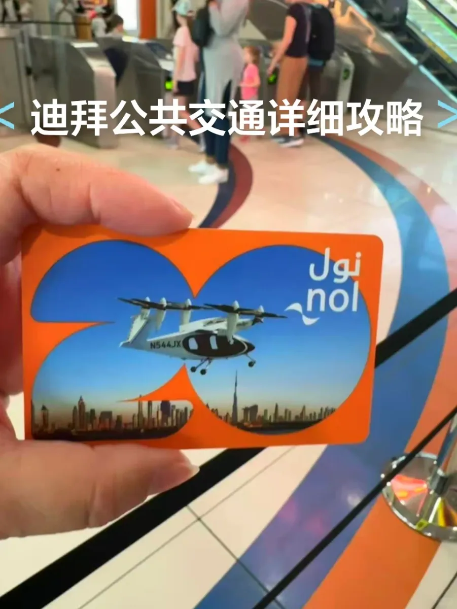
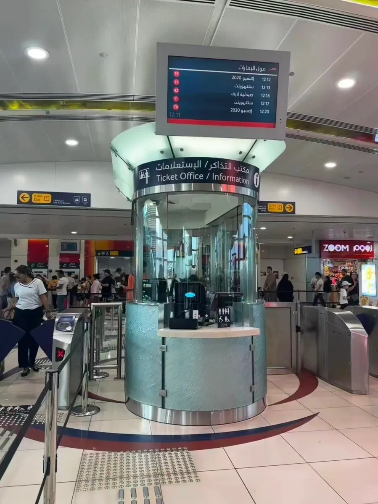

Usafiri wa umma wa Dubai haujathaminiwi ipasavyo. Wageni wengi hudhani jiji linafanya kazi kwa teksi au gari la kukodi pekee, ilhali kwa kweli metro ni safi, hudumu kwa wakati na hufikia karibu kila mahali mtalii anapotaka kwenda, na mabasi ni ya bei nafuu kiasi cha kutumika kama safari za kutazama. Kwa kweli kuna vizuizi viwili tu: pata **kadi ya Nol**, na uelewe kwamba njia ya metro huenda pande mbili.

Mwongozo huu unafuata mpangilio utakaotumia vitu: kadi, metro, mabasi, kisha teksi na programu. Bei zinatoka kwenye safari ya mwandishi mwishoni mwa 2025, na RTA hurekebisha nauli mara kwa mara — angalia tovuti rasmi kabla ya kusafiri.

## 1. Kadi ya Nol: kadi moja kwa metro, mabasi na basi la maji

**Kadi ya Nol** ni tikiti ya thamani iliyohifadhiwa inayotolewa na Mamlaka ya Barabara na Usafiri ya Dubai (RTA). Inafanya kazi kwenye metro, mabasi, basi la maji la Abra na baadhi ya maeneo ya kuegesha magari. Thamani yake halisi si punguzo bali ufikiaji: **kwenye huduma nyingi huwezi kupanda bila kadi**. Mabasi ya Dubai hayapokei pesa taslimu kabisa, na ingawa mashine za tikiti za metro huuza tikiti za karatasi za safari moja, kadi ni rahisi zaidi mara unapobadilisha njia au kusafiri zaidi ya mara moja.

Chagua kadi kulingana na matumizi:

| Kadi | Bei | Inamfaa nani | Maelezo |
| --- | --- | --- | --- |
| Tikiti Nyekundu | Takriban AED 4 | Safari moja au mbili | Tikiti ya karatasi, lipa kadri unavyotumia, si ya matumizi ya kawaida |
| Fedha | AED 25 (ada ya kadi AED 6 + salio AED 19) | Karibu kila mgeni | Chaguo la kawaida; salio linaweza kuongezwa |
| Dhahabu | AED 50 | Mtu yeyote anayetaka daraja la kwanza | Ufikiaji wa behewa la Daraja la Dhahabu |
| Bluu | AED 70 | Wakazi | Imeundwa kibinafsi, imeunganishwa na taarifa zako |

Kwa safari fupi **kadi ya fedha** ndiyo jibu. AED 25 inajumuisha salio la matumizi la AED 19, la kutosha kwa safari nne au tano za metro; ongeza salio kwenye mashine za kituoni (zinapokea kadi za benki) au kwenye kaunta yenye wafanyakazi (pesa taslimu, Visa au UnionPay).

Kadi hupatikana kwenye vituo vya metro vya uwanja wa ndege, kaunta zenye wafanyakazi kwenye vituo vikubwa vya kubadilishia na baadhi ya maduka madogo ya bidhaa za kila siku. Kununua moja unapowasili ndiyo njia rahisi zaidi — T1 na T3 za DXB zote zina vituo vya metro, dakika 5–8 kwa miguu kutoka eneo la kuwasili ukifuata alama nyekundu za Metro.

## 2. Metro: njia mbili, na mtego wa mwelekeo

Metro ya Dubai ina njia mbili zisizo na dereva, zenye milango ya kioo kwenye jukwaa na mabehewa yaliyogawanywa katika sehemu za kawaida, wanawake na watoto, na Daraja la Dhahabu:

- **Njia Nyekundu**: kutoka Centrepoint kaskazini kupitia vituo vya uwanja wa ndege T1 na T3, Deira, BurJuman, World Trade Centre, Burj Khalifa／Dubai Mall, Business Bay, Marina na Ibn Battuta — njia inayotumiwa zaidi na wageni.
- **Njia ya Kijani**: kupitia mji wa kale wa Deira na Bur Dubai, ikimalizika karibu na Al Qusais na Creek.
- **Vituo vya kubadilishia**: **Union** na **BurJuman**, ambapo njia mbili zinavukana.

Kosa la kawaida ni mwelekeo. Kwenye njia moja, **pande mbili hutumia majukwaa tofauti**, kwa hivyo soma marudio kwenye skrini ya jukwaa kabla ya kuchagua ngazi. Google Maps wakati mwingine hukosea kuhusu jukwaa la kutumia; maonyesho ya ndani ya kituo huwa ya kuaminika zaidi, na ikiwa una shaka, mwambie mfanyakazi kituo unachotaka na atakuonyesha njia sahihi.

Tikiti zinapatikana kwa njia tatu: mashine za tikiti (kadi za benki), kaunta yenye wafanyakazi (pesa taslimu, Visa, UnionPay) au kugusa moja kwa moja kwa kadi ya Nol. **Tikiti za karatasi za safari moja hazikusanywi unapotoka**, tofauti na miji mingi, kwa hivyo unaweza kuzihifadhi.

Saa za huduma hutofautiana kwa siku, takriban asubuhi na mapema hadi usiku wa manane, na **Ijumaa huduma huanza baadaye** kwa sababu ya sala za mchana. Angalia treni ya mwisho kabla ya safari ya usiku wa manane.

## 3. Mabasi: hakuna kadi, hakuna safari

Mabasi ya Dubai ni safi, ya bei nafuu na ya kuaminika, lakini sheria ni kali: **hakuna pesa taslimu, kadi ya Nol pekee**, na tofauti na Singapore huwezi kugusa kadi ya Visa tu. Unagusa mara moja unapopanda na mara moja unaposhuka, na nauli hutozwa kwa kanda.

Maonyesho ya vituo ni ya kina: jina la kituo, namba ya kituo, njia zinazohudumiwa, na safari za kwanza na za mwisho pamoja na vipindi kati ya safari kwa kila njia, yote kwenye ubao mmoja. Kwenye kituo cha Burj Al Arab Hotel 1 kwenye picha, ubao unaorodhesha njia 8 (kuelekea kituo cha mabasi cha Ibn Battuta), 81 (kuelekea Mall of the Emirates), 88 (kuelekea Deira City Centre) na njia ya usiku N55 (kuelekea uwanja wa ndege).

Maelezo machache ya kiutendaji:

- **Weka salio la kutosha**: ikiwa salio ni chini ya nauli ya chini, kadi haitakubaliwa. Angalia kwenye programu au kwenye mashine kabla ya kuanza safari.
- **Panda kwa mlango wa mbele, shuka kwa mlango wa kati**: gusa kadi mbele, gusa tena mlango wa kati unaposhuka, ukifuata wanavyofanya wenyeji.
- **Viti vya wanawake na watoto**: sehemu ya mbele imewekwa alama ya rangi ya waridi; wanaume wanapaswa kuiacha.
- **Njia za usiku**: huduma zinazoanza na N hushughulikia uwanja wa ndege na barabara kuu, jambo ambalo ni muhimu ikiwa utatua saa 3 asubuhi na usipende kuchukua teksi.

## 4. Teksi na programu: Careem au Bolt

Teksi za Dubai ni za rangi ya krimu zenye paa nyekundu, zinaweza kuitwa barabarani au kwenye vituo vya teksi kwenye maduka makubwa na hospitali. Nauli ya kuanzia ni ndogo na safari fupi ya jijini kwa kawaida hugharimu AED 15–30, zaidi kama AED 50 na kuendelea kuvuka kanda au kuelekea Marina. Zinatumia mita — hakikisha tu dereva anaianzisha.

Programu mbili ni muhimu:

- **Careem**: jukwaa la jadi la ndani, magari mengi, bei karibu na teksi. Tatizo ni usajili, unaohitaji msimbo wa SMS — **baadhi ya namba za China bara hazipokei kamwe**, na bila uthibitisho programu haina matumizi.
- **Bolt**: kampuni ya Ulaya iliyoingia sokoni, ambayo imekua haraka Dubai na kwa kawaida hupanga bei chini kidogo kuliko Careem. Kivitendo **namba za China bara hupokea ujumbe wake wa uthibitisho**, na kusajili, kuagiza na kulipa yote hufanya kazi; unaweza kumlipa dereva pesa taslimu mwishoni.

Ikiwa uthibitisho wa zote mbili utashindikana, kuna njia ya tatu: omba wafanyakazi wa hoteli au maduka makubwa wakuitie gari, au tumia kituo cha teksi. Dubai ina teksi nyingi, na kusubiri jijini mara chache huzidi dakika kumi.

## 5. Mambo machache yanayofanya safari kuwa rahisi

- **Nunua kadi unapowasili**: kituo cha metro cha uwanja wa ndege huuza kadi za fedha za Nol — usisubiri hadi katikati ya jiji.
- **Epuka saa za msongamano**: siku za kazi 07:00–09:00 na 17:00–19:00 kuna msongamano kwenye Njia Nyekundu kuelekea katikati.
- **Mdundo wa Ijumaa**: maduka hufungwa Ijumaa asubuhi na metro huanza baadaye, kwa hivyo peleka mipango ya nje mchana.
- **Behewa la wanawake na watoto**: behewa la pili limetengwa; wanaume wanapaswa kutumia lingine.
- **Abra**: basi la maji la mji wa kale kuvuka Dubai Creek linagharimu AED 1 kwa kugusa kadi ya Nol, safari ya kutazama ya bei nafuu zaidi jijini.
- **Anwani za Kiingereza**: madereva huenda hawajui majina ya maeneo ya Kichina — toa jina la hoteli kwa Kiingereza pamoja na wilaya.

Nauli, njia na saa zinatoka kwenye machapisho ya RTA na maelezo ya mwandishi mwenyewe; nauli hubadilika kwa sera, kwa hivyo angalia tovuti ya RTA au taarifa za vituo kabla ya kusafiri.

## Viungo vinavyohusiana

- **Kwenye tovuti hii**: [Uwanja wa Ndege wa Kimataifa wa Dubai (DXB)](/airport/DXB), [Falme za Kiarabu (AE)](/country/AE), [Kutoka Uwanja wa Ndege wa Dubai](/blog/dubai-airport-arrival-guide)
- **Wikipedia**: [Metro ya Dubai](https://en.wikipedia.org/wiki/Dubai_Metro)
- **Baidu Baike**: [Metro ya Dubai](https://baike.baidu.com/item/%E8%BF%AA%E6%8B%9C%E5%9C%B0%E9%93%81)
- **Mwendeshaji**: [RTA ya Dubai](https://www.rta.ae/)

Chanzo cha picha: picha za mwandishi. Nauli, aina za kadi na njia ni kama zilivyochapishwa na RTA.
