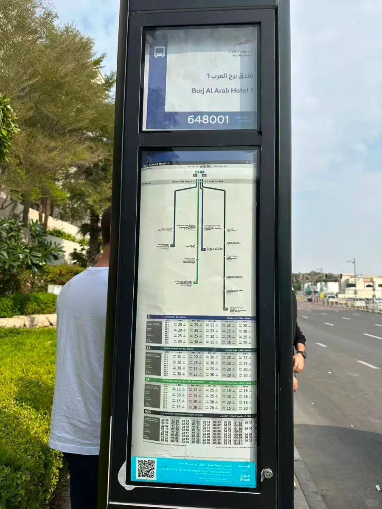

การขนส่งสาธารณะของดูไบถูกประเมินต่ำเกินไป ผู้มาเยือนจำนวนมากคิดว่าเมืองนี้เดินทางได้ด้วยรถแท็กซี่หรือรถเช่าเท่านั้น ทั้งที่จริงรถไฟใต้ดินสะอาด ตรงเวลา และเข้าถึงเกือบทุกที่ที่นักท่องเที่ยวต้องการไป ส่วนรถบัสก็ราคาถูกพอจะใช้แทนรถชมเมืองได้ มีอุปสรรคจริง ๆ เพียงสองข้อ: หา**บัตร Nol** ให้ได้ และเข้าใจว่าเส้นทางรถไฟใต้ดินวิ่งสองทิศทาง

คู่มือนี้เรียงตามลำดับการใช้งาน: บัตร รถไฟใต้ดิน รถบัส แล้วจึงรถแท็กซี่และแอป ราคามาจากการเดินทางของผู้เขียนช่วงปลายปี 2025 และ RTA ปรับค่าโดยสารเป็นครั้งคราว — ตรวจสอบเว็บไซต์ทางการก่อนเดินทาง

## 1. บัตร Nol: บัตรเดียวสำหรับรถไฟใต้ดิน รถบัส และเรือข้ามฟาก

**บัตร Nol** คือตั๋วเติมเงินที่ออกโดยการทางหลวงและการขนส่งดูไบ (RTA) ใช้ได้กับรถไฟใต้ดิน รถบัส เรือ Abra และลานจอดรถบางแห่ง คุณค่าที่แท้จริงไม่ใช่ส่วนลดแต่คือการเข้าถึง: **บนบริการหลายประเภทคุณขึ้นไม่ได้หากไม่มีบัตร** รถบัสดูไบไม่รับเงินสดเลย และแม้เครื่องจำหน่ายตั๋วรถไฟใต้ดินจะขายตั๋วกระดาษเที่ยวเดียว แต่บัตรสะดวกกว่ามากเมื่อคุณต้องเปลี่ยนสายหรือเดินทางมากกว่าหนึ่งครั้ง

เลือกบัตรตามการใช้งาน:

| บัตร | ราคา | เหมาะกับ | หมายเหตุ |
| --- | --- | --- | --- |
| ตั๋วสีแดง | ประมาณ AED 4 | หนึ่งหรือสองเที่ยว | ตั๋วกระดาษ จ่ายตามใช้ ไม่เหมาะกับการใช้ประจำ |
| สีเงิน | AED 25 (ค่าบัตร AED 6 + ยอดคงเหลือ AED 19) | ผู้มาเยือนเกือบทุกคน | ตัวเลือกเริ่มต้น เติมยอดได้ |
| สีทอง | AED 50 | ผู้ที่ต้องการชั้นหนึ่ง | เข้าถึงตู้โดยสาร Gold Class |
| สีน้ำเงิน | AED 70 | ผู้พักอาศัย | ลงทะเบียนส่วนตัว ผูกกับข้อมูลของคุณ |

สำหรับทริปสั้น **บัตรสีเงิน**คือคำตอบ AED 25 ประกอบด้วยยอดใช้ได้ AED 19 ซึ่งพอสำหรับรถไฟใต้ดินสี่ถึงห้าเที่ยว เติมได้ที่เครื่องในสถานี (รับบัตรธนาคาร) หรือที่เคาน์เตอร์ที่มีเจ้าหน้าที่ (เงินสด, Visa หรือ UnionPay)

บัตรมีจำหน่ายที่สถานีรถไฟใต้ดินในสนามบิน เคาน์เตอร์ที่มีเจ้าหน้าที่ที่จุดเปลี่ยนสายใหญ่ และร้านสะดวกซื้อบางแห่ง การซื้อเมื่อมาถึงคือทางที่ราบรื่นที่สุด — T1 และ T3 ของ DXB ต่างมีสถานีรถไฟใต้ดิน เดิน 5–8 นาทีจากโถงขาเข้าตามป้าย Metro สีแดง

## 2. รถไฟใต้ดิน: สองสาย และกับดักเรื่องทิศทาง

รถไฟใต้ดินดูไบมีสองสายที่ขับเคลื่อนอัตโนมัติ ไม่มีพนักงานขับ มีประตูกั้นชานชาลา และตู้โดยสารแบ่งเป็นชั้นมาตรฐาน ผู้หญิงและเด็ก และ Gold Class:

- **สาย Red**: จาก Centrepoint ทางเหนือลงมาผ่านสถานีสนามบิน T1 และ T3, Deira, BurJuman, World Trade Centre, Burj Khalifa／Dubai Mall, Business Bay, Marina และ Ibn Battuta — สายที่ผู้มาเยือนใช้มากที่สุด
- **สาย Green**: ผ่านเมืองเก่าดีราและบุร์ดูไบ สิ้นสุดบริเวณ Al Qusais และ Creek
- **จุดเปลี่ยนสาย**: **Union** และ **BurJuman** ซึ่งสองสายตัดกัน

ความผิดพลาดคลาสสิกคือทิศทาง บนสายเดียวกัน **สองทิศทางใช้ชานชาลาคนละแห่ง** จึงควรอ่านจุดหมายบนหน้าจอชานชาลาก่อนเลือกชั้น Google Maps บางครั้งระบุชานชาลาผิด หน้าจอในสถานีเชื่อถือได้มากกว่า และหากไม่แน่ใจ ให้บอกเจ้าหน้าที่ว่าต้องการไปสถานีใด แล้วพวกเขาจะชี้ทางที่ถูกให้

ตั๋วมีสามวิธี: เครื่องจำหน่ายตั๋ว (บัตรธนาคาร) เคาน์เตอร์ที่มีเจ้าหน้าที่ (เงินสด, Visa, UnionPay) หรือแตะผ่านด้วยบัตร Nol โดยตรง **ตั๋วกระดาษเที่ยวเดียวไม่ถูกเก็บคืนที่ทางออก** ต่างจากหลายเมือง คุณจึงเก็บไว้ได้

เวลาให้บริการแตกต่างตามวัน โดยประมาณตั้งแต่เช้าตรู่ถึงเที่ยงคืน และ**วันศุกร์เริ่มให้บริการช้าลง**เพราะมีการละหมาดช่วงเที่ยง ตรวจสอบรถเที่ยวสุดท้ายก่อนเดินทางตอนดึก

## 3. รถบัส: ไม่มีบัตร ไม่มีที่นั่ง

รถบัสดูไบสะอาด ราคาถูก และเชื่อถือได้ แต่กฎเข้มงวด: **ไม่รับเงินสด ใช้เฉพาะบัตร Nol** และต่างจากสิงคโปร์ คุณไม่สามารถแตะบัตร Visa ได้เลย แตะหนึ่งครั้งตอนขึ้นและอีกครั้งตอนลง โดยคิดค่าโดยสารตามโซน

ป้ายหยุดรถให้ข้อมูลครบถ้วน: ชื่อป้าย หมายเลขป้าย เส้นทางที่ให้บริการ และเที่ยวแรก–สุดท้ายพร้อมความถี่ของแต่ละเส้นทาง ทั้งหมดบนป้ายเดียว ที่ป้าย Burj Al Arab Hotel 1 ในภาพ ป้ายระบุเส้นทาง 8 (ไปสถานีรถบัส Ibn Battuta), 81 (ไป Mall of the Emirates), 88 (ไป Deira City Centre) และเส้นทางกลางคืน N55 (ไปสนามบิน)

หมายเหตุการใช้งานบางประการ:

- **เก็บยอดคงเหลือให้พอ**: หากยอดต่ำกว่าค่าโดยสารขั้นต่ำ บัตรจะไม่ผ่านการตรวจสอบ ตรวจสอบในแอปหรือที่เครื่องก่อนออกเดินทาง
- **ขึ้นประตูหน้า ลงประตูกลาง**: แตะเข้าที่ประตูหน้า แตะออกที่ประตูกลาง ตามที่คนท้องถิ่นทำ
- **ที่นั่งผู้หญิงและเด็ก**: ส่วนหน้าถูกทำเครื่องหมายสีชมพู ผู้ชายไม่ควรใช้
- **เส้นทางกลางคืน**: บริการที่ขึ้นต้นด้วย N ครอบคลุมสนามบินและถนนสายหลัก ซึ่งมีประโยชน์หากคุณลงเครื่องตอนตีสามและไม่อยากนั่งแท็กซี่

## 4. รถแท็กซี่และแอป: Careem หรือ Bolt

รถแท็กซี่ดูไบสีครีมหลังคาแดง เรียกได้จากข้างทางหรือจากจุดจอดที่ห้างสรรพสินค้าและโรงพยาบาล ค่าเปิดมิเตอร์ต่ำและทริปสั้นในเมืองมักอยู่ที่ AED 15–30 ส่วนการข้ามโซนหรือไปมารีน่าอยู่ที่ประมาณ AED 50 ขึ้นไป รถคิดตามมิเตอร์ — เพียงตรวจสอบว่าคนขับเปิดมิเตอร์

แอปสำคัญสองตัว:

- **Careem**: แพลตฟอร์มท้องถิ่นที่มั่นคง มีรถมาก ราคาใกล้เคียงรถแท็กซี่ ข้อติดคือการลงทะเบียนซึ่งต้องใช้รหัส SMS — **หมายเลขจากจีนแผ่นดินใหญ่บางหมายเลขไม่ได้รับรหัสเลย** และหากยืนยันไม่ได้ แอปก็ใช้ไม่ได้
- **Bolt**: ผู้เล่นจากยุโรปที่เติบโตเร็วในดูไบ และมักตั้งราคาต่ำกว่า Careem หนึ่งขั้น ในทางปฏิบัติ **หมายเลขจากจีนแผ่นดินใหญ่ได้รับข้อความยืนยันของ Bolt** และการลงทะเบียน สั่งรถ และชำระเงินทำได้ทั้งหมด คุณสามารถจ่ายเงินสดให้คนขับตอนสิ้นสุดการเดินทาง

หากการยืนยันทั้งสองแบบล้มเหลว มีวิธีที่สาม: ขอให้พนักงานโรงแรมหรือห้างสรรพสินค้าเรียกรถให้ หรือใช้จุดจอดแท็กซี่ ดูไบมีแท็กซี่มากมายและในเมืองแทบไม่ต้องรอเกินสิบนาที

## 5. หลายสิ่งที่จะทำให้การเดินทางราบรื่นขึ้น

- **ซื้อบัตรเมื่อมาถึง**: สถานีรถไฟใต้ดินในสนามบินขายบัตร Nol สีเงิน — อย่ารอจนถึงใจกลางเมือง
- **หลีกเลี่ยงชั่วโมงเร่งด่วน**: วันธรรมดา 07:00–09:00 และ 17:00–19:00 สาย Red ไปใจกลางเมืองจะแออัด
- **จังหวะวันศุกร์**: ร้านค้าปิดเช้าวันศุกร์และรถไฟใต้ดินเริ่มช้า จึงควรเลื่อนแผนกลางแจ้งไปช่วงบ่าย
- **ตู้โดยสารผู้หญิงและเด็ก**: ตู้ที่สองถูกสงวนไว้ ผู้ชายควรใช้ตู้อื่น
- **เรือ Abra**: เรือข้ามฟากเมืองเก่าข้าม Dubai Creek ราคา AED 1 เมื่อแตะบัตร Nol เป็นการชมเมืองที่ถูกที่สุดในเมือง
- **ที่อยู่ภาษาอังกฤษ**: คนขับอาจไม่รู้ชื่อสถานที่ภาษาจีน — ให้ชื่อภาษาอังกฤษของโรงแรมพร้อมชื่อย่าน

ค่าโดยสาร เส้นทาง และเวลาให้บริการมาจากเอกสารของ RTA และบันทึกของผู้เขียน ค่าโดยสารเปลี่ยนตามนโยบาย จึงควรตรวจสอบเว็บไซต์ RTA หรือประกาศในสถานีก่อนเดินทาง

## ลิงก์ที่เกี่ยวข้อง

- **ในเว็บไซต์นี้**: [ท่าอากาศยานนานาชาติดูไบ (DXB)](/airport/DXB), [สหรัฐอาหรับเอมิเรตส์ (AE)](/country/AE), [ออกจากสนามบินดูไบ](/blog/dubai-airport-arrival-guide)
- **Wikipedia**: [รถไฟใต้ดินดูไบ](https://en.wikipedia.org/wiki/Dubai_Metro)
- **Baidu Baike**: [รถไฟใต้ดินดูไบ](https://baike.baidu.com/item/%E8%BF%AA%E6%8B%9C%E5%9C%B0%E9%93%81)
- **ผู้ให้บริการ**: [Dubai RTA](https://www.rta.ae/)

ที่มาของภาพ: ภาพถ่ายของผู้เขียน ค่าโดยสาร ประเภทบัตร และเส้นทางเป็นไปตามที่ RTA เผยแพร่
