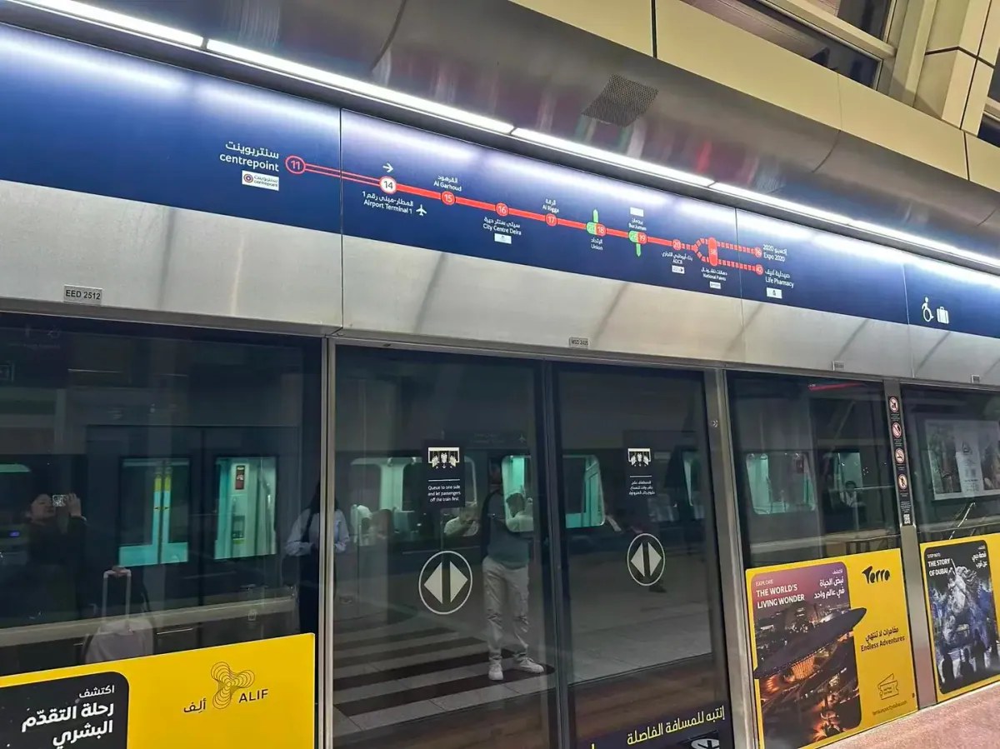

Dubai'nin toplu taşıması hak ettiği değeri görmüyor. Birçok ziyaretçi şehrin yalnızca taksi veya kiralık arabayla işlediğini sanıyor; oysa metro temiz, dakik ve bir turistin gitmek isteyeceği neredeyse her yere ulaşıyor, otobüsler ise gezinti aracı olarak kullanılacak kadar ucuz. Aslında yalnızca iki engel var: bir **Nol kartı** almak ve bir metro hattının iki yönde çalıştığını anlamak.

Bu rehber, şeyleri kullanma sıranızı izliyor: kart, metro, otobüsler, ardından taksiler ve uygulamalar. Fiyatlar yazarın 2025 sonundaki seyahatinden ve RTA ücretleri zaman zaman ayarlıyor — seyahatten önce resmi siteyi kontrol edin.

## 1. Nol kartı: metro, otobüsler ve su otobüsü için tek kart

**Nol kartı**, Dubai'nin Yollar ve Ulaşım Kurumu (RTA) tarafından çıkarılan bakiyeli bilettir. Metro, otobüsler, Abra su otobüsü ve bazı otoparklarda geçerlidir. Gerçek değeri indirim değil, erişim: **birçok hizmete kart olmadan binemezsiniz**. Dubai otobüsleri hiç nakit almıyor ve metro bilet makineleri kâğıt tek bilet satsa da hat değiştirdiğinizde veya birden fazla yolculuk yaptığınızda kart çok daha basit.

Kartı kullanım durumuna göre seçin:

| Kart | Fiyat | Kime uygun | Notlar |
| --- | --- | --- | --- |
| Kırmızı bilet | Yaklaşık 4 AED | Bir veya iki yolculuk | Kâğıt bilet, kullandıkça öde, düzenli kullanım için değil |
| Gümüş | 25 AED (6 AED kart ücreti + 19 AED bakiye) | Neredeyse her ziyaretçi | Varsayılan seçenek; bakiye yüklenebilir |
| Altın | 50 AED | Birinci sınıf isteyenler | Altın Sınıf vagona erişim |
| Mavi | 70 AED | Sakinler | Kişiselleştirilmiş, bilgilerinize bağlı |

Kısa bir gezi için **gümüş kart** cevaptır. 25 AED'nin 19 AED'si kullanılabilir bakiyedir; dört veya beş metro yolculuğuna yeter. İstasyon makinelerinde (banka kartı kabul eder) veya personelli gişede (nakit, Visa veya UnionPay) yükleme yapın.

Kartlar havalimanı metro istasyonlarından, büyük aktarma merkezlerindeki personelli gişelerden ve bazı marketlerden alınır. Varışta bir tane almak en akıcı yol — DXB'nin T1 ve T3'ünde de metro istasyonu var; varıştan kırmızı Metro tabelalarını izleyerek 5–8 dakika yürüyüş.

## 2. Metro: iki hat ve bir yön tuzağı

Dubai metrosunda sürücüsüz iki hat var; peron perde kapıları ve standart, kadın-çocuk ile Altın Sınıf bölümlerine ayrılmış vagonlar:

- **Kırmızı Hat**: kuzeyde Centrepoint'ten başlayıp havalimanı T1 ve T3 istasyonları, Deira, BurJuman, World Trade Centre, Burj Khalifa／Dubai Mall, Business Bay, Marina ve İbn Battuta üzerinden geçiyor — ziyaretçilerin en çok kullandığı hat.
- **Yeşil Hat**: eski Deira ve Bur Dubai şehri boyunca, Al Qusais ve Creek civarında sona eriyor.
- **Aktarmalar**: iki hattın kesiştiği **Union** ve **BurJuman**.

Klasik hata yöndür. Aynı hatta **iki yön farklı peronları kullanır**, bu yüzden kat seçmeden önce peron ekranındaki varış yerini okuyun. Google Maps hangi peronun kullanılacağı konusunda bazen yanılır; istasyon içi ekranlar daha güvenilirdir ve şüpheniz varsa bir görevliye gitmek istediğiniz istasyonu söyleyin, sizi doğru yöne yönlendirir.

Biletlerin üç yolu var: bilet makineleri (banka kartları), personelli gişe (nakit, Visa, UnionPay) veya doğrudan Nol kartıyla geçiş. **Kâğıt tek biletler çıkışta toplanmaz**, birçok şehrin aksine, bu yüzden saklayabilirsiniz.

Saatler güne göre değişir, kabaca sabahın erken saatlerinden gece yarısına kadar ve **cuma günleri öğle namazı nedeniyle hizmet daha geç başlar**. Gece geç bir yolculuktan önce son treni kontrol edin.

## 3. Otobüsler: kart yoksa yolculuk yok

Dubai otobüsleri temiz, ucuz ve güvenilir, ama kural katı: **nakit yok, yalnızca Nol kartı** ve Singapur'un aksine Visa kartı öylece okutamazsınız. Binerken bir, inerken bir kez okutursunuz ve ücret bölgeye göre alınır.

Durak panoları eksiksiz: durak adı, durak numarası, hizmet veren hatlar ve her hat için ilk ve son kalkışlar ile sefer aralıkları, hepsi tek panoda. Fotoğraftaki Burj Al Arab Hotel 1 durağında pano 8 (İbn Battuta otobüs terminaline), 81 (Mall of the Emirates'e), 88 (Deira City Centre'a) ve gece hattı N55'i (havalimanına) listeliyor.

Birkaç pratik not:

- **Yeterli bakiye bulundurun**: bakiye minimum ücretin altındaysa kart doğrulama yapmaz. Yola çıkmadan önce uygulamada veya bir makinede kontrol edin.
- **Ön kapıdan binin, orta kapıdan inin**: önde okutun, orta kapıda okutun; yerel halkın yaptığını izleyin.
- **Kadın-çocuk oturma alanı**: ön bölüm pembe işaretli; erkekler burayı kullanmamalı.
- **Gece hatları**: N önekli servisler havalimanını ve ana yolları kapsıyor; gece 3'te inerseniz ve taksi istemiyorsanız kullanışlı.

## 4. Taksiler ve uygulamalar: Careem veya Bolt

Dubai taksileri krem renkli ve kırmızı çatılı; sokaktan veya AVM ve hastane duraklarından çağrılabilir. Açılış ücreti düşük ve kısa bir şehir içi yolculuk genellikle 15–30 AED tutuyor; bölgeler arası veya Marina'ya gidişte 50 AED ve üzeri. Taksimetreyle çalışırlar — şoförün taksimetreyi başlattığını kontrol edin.

İki uygulama önemli:

- **Careem**: yerleşik yerel platform, bol araç, fiyatlar taksine yakın. Püf noktası kayıt; SMS kodu gerekiyor — **bazı Çin anakarası numaraları kodu hiç almaz** ve doğrulama olmadan uygulama işe yaramaz.
- **Bolt**: Avrupalı girişimci; Dubai'de hızla büyüdü ve genellikle Careem'in bir tık altında fiyatlıyor. Pratikte **Çin anakarası numaraları doğrulama mesajını alır** ve kayıt, sipariş ile ödeme çalışır; sonunda şoföre nakit ödeyebilirsiniz.

Her iki doğrulama da başarısız olursa üçüncü bir yol var: otel veya AVM personelinden araç çağırmasını isteyin ya da taksi durağını kullanın. Dubai'de bol taksi var ve şehirde bekleme nadiren on dakikayı aşar.

## 5. Yolculuğu kolaylaştıran birkaç şey

- **Kartı varışta alın**: havalimanı metro istasyonu Nol gümüş kart satıyor — şehir merkezine kadar beklemeyin.
- **Yoğun saatlerden kaçının**: hafta içi 07:00–09:00 ve 17:00–19:00, merkez yönündeki Kırmızı Hat'ta kalabalık olur.
- **Cuma ritmi**: cuma sabahları dükkânlar kapanır ve metro geç başlar; açık hava planlarınızı öğleden sonraya bırakın.
- **Kadın-çocuk vagonu**: ikinci vagon ayrılmıştır; erkekler başka bir vagona binmeli.
- **Abra**: Dubai Creek üzerindeki eski şehir su otobüsü Nol okutmayla 1 AED; şehirdeki en ucuz gezinti.
- **İngilizce adresler**: şoförler Çince yer adlarını bilmeyebilir — otelin İngilizce adını ve bölgeyi birlikte verin.

Ücretler, güzergâhlar ve saatler RTA yayınlarından ve yazarın kendi notlarından; ücretler politikayla değişir, seyahatten önce RTA web sitesini veya istasyon duyurularını kontrol edin.

## İlgili bağlantılar

- **Bu sitede**: [Dubai Uluslararası Havalimanı (DXB)](/airport/DXB), [Birleşik Arap Emirlikleri (AE)](/country/AE), [Dubai Havalimanı'ndan Çıkış](/blog/dubai-airport-arrival-guide)
- **Wikipedia**: [Dubai Metro](https://en.wikipedia.org/wiki/Dubai_Metro)
- **Baidu Baike**: [Dubai Metro](https://baike.baidu.com/item/%E8%BF%AA%E6%8B%9C%E5%9C%B0%E9%93%81)
- **İşletmeci**: [Dubai RTA](https://www.rta.ae/)

Görsel kaynağı: yazarın fotoğrafları. Ücretler, kart türleri ve güzergâhlar RTA'nın yayımladığı şekildedir.
