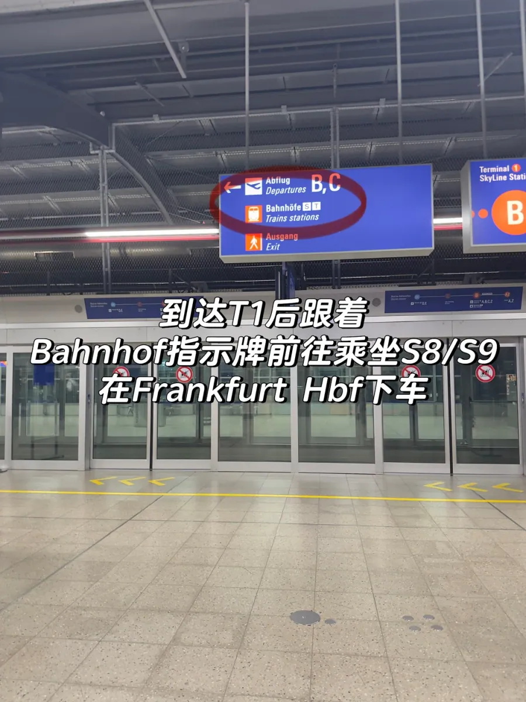

ফ্রাঙ্কফুর্ট বিমানবন্দর (FRA) জার্মানির ব্যস্ততম বিমানবন্দর এবং মহাদেশীয় ইউরোপের প্রধান ট্রান্সফার হাবগুলোর একটি। এতে দুটি টার্মিনাল। টার্মিনাল 1 লুফথানসা ও বেশিরভাগ স্টার অ্যালায়েন্স এয়ারলাইন সামলায়; টার্মিনাল 2 বাকিদের। দুটির মাঝে অ্যাপ্রন ও ট্যাক্সিওয়ে, যা পেরিয়ে গেছে SkyLine নামের উঁচু চালকবিহীন পিপল মুভার।

অস্বস্তিকর দিকটি হলো, টার্মিনাল 2-এ নামলে দেখবেন বিমানবন্দরের রেলস্টেশন টার্মিনাল 2-এর নিচে নেই। এটি টার্মিনাল 1-এর নিচে। ম্যাপ অ্যাপ দেখে বুঝবে আপনি শহরে যেতে চান, আর সহজেই বাসের পরামর্শ দেবে — মূল নোটের লেখক এ ব্যাপারে স্পষ্ট: **বাসের জন্য গুগল ম্যাপস বিশ্বাস করবেন না**।

এই গাইড সেই পথ অনুসরণ করে যা সত্যিই হাঁটা হয়েছিল: টার্মিনাল 2 আগমন, টার্মিনাল 1-এর চিহ্ন অনুসরণ, SkyLine-এ চড়ে টার্মিনাল 1, **Bahnhöfe / Train stations** চিহ্ন ধরে আঞ্চলিক স্টেশনে নামা, তারপর S8 বা S9-এ প্রায় পনেরো মিনিটে ফ্রাঙ্কফুর্ট (মাইন) হাউপটবানহফ, শহরের প্রধান স্টেশন। প্রতিটি ধাপ টার্মিনাল ও স্টেশন ভবনের ভেতরে, তাই স্যুটকেস নিয়ে কারও কার্বে দাঁড়াতে হবে না।

## 1. বিমানবন্দরের বাস কেন ভুল পছন্দ

বিমানবন্দর ও শহরকে একই ম্যাপে বসালে বাস প্রায় সোজা রেখার মতো দেখায়: টার্মিনাল থেকে বেরোন, রাস্তা পেরোন, উঠে পড়ুন, কয়েক স্টপ পরে শহরের কেন্দ্রের প্রান্তে। কিন্তু ম্যাপ সমতল দূরত্ব মাপে, আর বিমানবন্দর উল্লম্বভাবে কাজ করে। আসলে সমস্যা বাস নয়; সমস্যা ভবন থেকে বেরোনো।

ফ্রাঙ্কফুর্টে বাস থামে টার্মিনালের বাইরের রাস্তায়। টার্মিনাল 2 আগমন থেকে প্রথমে ট্র্যাফিক লেন পার হতে হয়, সঠিক স্টপ খুঁজতে হয়, দিক বুঝতে হয়, তারপর খোলা জায়গায় অপেক্ষা। ফ্রাঙ্কফুর্টের শীত ঠান্ডা ও ভেজা, বসন্ত ও শরৎ বৃষ্টিময়; স্টপে দশ মিনিটই সিদ্ধান্তের জন্য আফসোস করতে যথেষ্ট। লাগেজ থাকলে ব্যাগ নিজেই ওঠাতে-নামাতে হয়। এরপর বাস শহরের রাস্তা ব্যবহার করে, যা সকালের পিক আওয়ারে জ্যামে আটকে যায়, আর শহরে পৌঁছানোর পর শেষ অংশের জন্য সাধারণত U-Bahn বা S-Bahn লাগে — ব্যাগ নিয়ে দ্বিতীয়বার চলাচল।

এই রুটটি ঘুরপথ মনে হয় কারণ বিমানবন্দর নিজেই স্তরে স্তরে গড়া। টার্মিনাল 1 1970-এর দশকে নির্মিত এবং শুরু থেকেই নিচে রেলস্টেশন ছিল। টার্মিনাল 2 1990-এর দশকে অতিরিক্ত ধারণক্ষমতার জন্য যোগ হয় এবং নিজের রেল প্ল্যাটফর্ম কখনও পায়নি। তাই বিমানবন্দর দুটি ভবনকে উঁচু শাটল দিয়ে যুক্ত করেছে: প্রথমে পাশাপাশি টার্মিনাল বদলান, তারপর ট্রেনের জন্য নিচে নামুন। এটা পরিষ্কার হলে "টার্মিনাল 2-এর নিচে স্টেশন কেন নেই?" প্রশ্নের উত্তর নিজেই মিলে যায়।

ভেতরের পথে শুধু হাঁটার পরিশ্রম, টাকা লাগে না। SkyLine বিনামূল্যে এবং প্রতি কয়েক মিনিটে চলে, S-Bahn ভূগর্ভে ট্র্যাফিক থেকে দূরে চলে, আর পুরো পথে লিফট ও এসকেলেটর আছে। চিহ্ন জার্মান ও ইংরেজিতে, তাই কাউকে জিজ্ঞাসা করতে হয় না। টাকা লাগে কেবল S-Bahn-এ, আর সে টিকিট যেভাবেই কিনতে হতো।

এটি দ্রুততম উপায়ও নয়। টার্মিনাল 2 আগমন থেকে হাউপটবানহফের প্ল্যাটফর্ম পর্যন্ত, হাঁটা ও অপেক্ষা ধরে আধা ঘণ্টা স্বাভাবিক। অবতরণ ও পরবর্তী সংযোগের মধ্যে মাত্র এক ঘণ্টা থাকলে ট্যাক্সিই নিরাপদ পছন্দ। হাতে সময় থাকলে বাস স্টপে অপেক্ষা করার কারণ নেই।

## 2. টার্মিনাল 2 থেকে টার্মিনাল 1: SkyLine খুঁজে নেওয়া

টার্মিনাল 2 আগমন থেকে বেরিয়ে নীল ওভারহেড চিহ্নের দিকে তাকান। এদের যুক্তি বুঝতে একটু সময় লাগে: **"Terminal 1 A,B,C,Z" বলতে অন্য টার্মিনালের চেক-ইন হলগুলো বোঝায়**, আর শুধু "D,E" মানে টার্মিনাল 2-এর নিজের দুটি হল। প্রথমবার আসা মানুষ দুটো গুলিয়ে ফেলেন, D ও E অনুসরণ করেন, আর টার্মিনাল 2-এর ভেতরেই ঘুরতে থাকেন।

টার্মিনাল 1 লেখা লাইনটি লক্ষ্য করে তীর অনুসরণ করুন। পাশে উদ্ভিদ-স্বাস্থ্য ও রোগ-নিয়ন্ত্রণ নোটিশের সারি পাবেন, যেখানে নিষিদ্ধ উদ্ভিদজাত পণ্য আনার বিরুদ্ধে সতর্কতা; সেগুলো উপেক্ষা করে এগিয়ে যান যতক্ষণ না উপরে ওঠার এসকেলেটরে পৌঁছান।

কয়েক ধাপ পরে একই চিহ্নের ক্লোজ-আপ আরও স্পষ্ট: উপরের লাইনে **Ausgang / Exit**, মাঝে Terminal 1 A,B,C,Z, নিচে ব্যাগেজ ক্লেইম ও D, E হল। এখানে একটি নিয়ম মনে রাখুন: **স্টেশনে যেতে চাইলে Exit অনুসরণ করবেন না**। Exit রাস্তায় বের করে, আর SkyLine উপরে।

যদি বাইরে চলে যান, শান্ত থাকুন। টার্মিনালে ফিরে ছাদের ছোট ট্রেন আইকন দেখে আবার উপরে যান। ফ্রাঙ্কফুর্ট এ ব্যাপারে বেশ সহজ: SkyLine প্রতীক আগমন স্তর থেকেই দেখা যায়, তাই কাউকে জিজ্ঞাসা করতে হবে না।

এসকেলেটর আপনাকে SkyLine প্ল্যাটফর্মে নিয়ে যায়। SkyLine ফ্রাঙ্কফুর্টের অভ্যন্তরীণ পিপল মুভার: দুটি টার্মিনালের মধ্যে উঁচু ট্র্যাকে ছোট স্বয়ংক্রিয় কামরা চলে। এটি **বিনামূল্যে**, টিকিট লাগে না, গেট নেই, আর প্ল্যাটফর্ম স্ক্রিনে পরবর্তী ছাড়ার সময় দেখায়। ট্রেন **প্রতি দুই-তিন মিনিটে** আসে।

কামরাগুলো ছোট এবং পিক সময়ে ভরে যায়, তাই ব্যাগ এক পাশে রাখুন। প্ল্যাটফর্ম ভিড় হলে পরের ট্রেনের অপেক্ষা সাধারণত ঠেলে ওঠার চেয়ে দ্রুত — বিরতি মাত্র কয়েক মিনিট। খুব মাঝে মাঝে রক্ষণাবেক্ষণের জন্য SkyLine বন্ধ থাকে ও বিকল্প বাস চলে; প্ল্যাটফর্মের ঘোষণায় তা বলা হয়। সে ক্ষেত্রে কর্মীদের অনুসরণ করে ভূপৃষ্ঠের পথে যান এবং বিশ মিনিট যোগ করুন।

দিক মাত্র দুটি, আর প্ল্যাটফর্মের চিহ্নই বলে কোনটি কোন দিক। টার্মিনাল 1 পর্যন্ত যাত্রা প্রায় দুই মিনিট, ঘোষণা ও আলোকিত রুট ম্যাপ থাকে। নেমে ভিড়ের সঙ্গে টার্মিনাল 1 আগমনে যান। এখান থেকে কীওয়ার্ড বদলায়: আর Terminal নয়, Bahnhof।

## 3. টার্মিনাল 1 থেকে প্ল্যাটফর্ম: "Bahnhof" অনুসরণ করুন

টার্মিনাল 1-এর ভেতরে চিহ্ন বদলে **Bahnhöfe / Train stations** হয়, সাধারণত S ও ট্রেন আইকনসহ। তারা একটি প্ল্যাটফর্মের দিকে নয়, বিমানবন্দর স্টেশনের দুটি আলাদা অংশের দিকে দেখায়। টার্মিনাল 1-এর নিচে **Regionalbahnhof** (আঞ্চলিক স্টেশন, ট্র্যাক 1–3) S-Bahn ও আঞ্চলিক ট্রেনের জন্য, আর **Fernbahnhof** (দীর্ঘপথ স্টেশন, ট্র্যাক 4–7) ICE সার্ভিসের জন্য, যা The Squaire নামের লম্বা ভবনের নিচে।

হাউপটবানহফের জন্য চাই Regionalbahnhof। এটি টার্মিনাল 1-এর ঠিক নিচে: চিহ্ন ধরে এক-দুই স্তর নিচে নামুন, ছোট দোকানের আর্কেড পেরিয়ে পৌঁছে যাবেন। বিপরীতে Fernbahnhof অন্য দিকে লম্বা করিডরের শেষে। চিহ্নে দুটির পার্থক্য একটিমাত্র শব্দ, আর ভুলটি ধরলে পনেরো মিনিট হারাবেন।

সঠিক পথে আছেন কিনা দেখার দুটি দ্রুত উপায়। প্রথমত প্ল্যাটফর্ম নম্বর: 1–3 মানে আঞ্চলিক স্টেশন, 4–7 দীর্ঘপথ। দ্বিতীয়ত আশপাশের মানুষ — বড় স্যুটকেস টেনে ICE ছাড়ার দিকে তাকিয়ে থাকা যাত্রীরা সাধারণত Fernbahnhof-এ যান। Regionalbahnhof-এর প্রবেশপথ টার্মিনাল 1-এর মাঝখানে, নিচে যাওয়ার পথ ছোট; The Squaire কখনও পেরোবেন না।

নিচে পথ দুভাগ হয়। এক দিকে Bahnhöfe ও **AiRail Terminal**, লুফথানসার এয়ার-রেল চেক-ইন; অন্যদিকে বাস ও ট্যাক্সি বেরোনোর পথ। টার্মিনাল 1-এ মানুষ সবচেয়ে বেশি দ্বিধা করেন এখানেই। একটি তথ্য ধরে রাখুন — S-Bahn Regionalbahnhof থেকে ছাড়ে — তাহলে Bus/Taxi চিহ্ন আপনাকে বাইরে টেনে নিতে পারবে না। স্ট্রলার বা ভারী স্যুটকেস থাকলে এসকেলেটরে ধস্তাধস্তি না করে করিডরের শেষে লিফট খুঁজুন।

ভুলে Fernbahnhof-এ পড়লে বিপর্যয় নয়: ICE আপনাকে প্রায় পনেরো মিনিটে হাউপটবানহফে পৌঁছে দেবে। কিন্তু আপনার S-Bahn টিকিট বৈধ থাকবে না, দীর্ঘপথের টিকিট লাগবে, আর কিছু ট্রেনে রিজার্ভেশন দরকার। প্রথম সফরে সবচেয়ে সহজ সমাধান Regionalbahnhof-এ ফিরে হাঁটা।

## 4. S8 বা S9-এ পনেরো মিনিট

Regionalbahnhof-এর ট্র্যাক 1 থেকে 3 কনকোর্সের এক স্তর নিচে পাশাপাশি। নীল চিহ্নে লেখা **Gleis 1 / Track 1**, তারপর Frankfurt City ও S-Bahn প্রতীক, নিচ ও পাশে তীর। শহরমুখী বেশিরভাগ যাত্রী এই দিক ব্যবহার করেন।

প্ল্যাটফর্মে নেমে শহরের দিকে **S8 বা S9** ধরুন। দুটি লাইনই বিমানবন্দরে আসে এবং দুটিই হাউপটবানহফে থামে; শহরের কেন্দ্রের পর রুট সামান্য আলাদা, যা হাউপটবানহফ আপনার গন্তব্য হলে কোনো পার্থক্য করে না। অন্য দিকটি ধরবেন না — ওই দিক মাইনৎস ও ভিসবাডেনের দিকে যায়, প্রতি স্টপে আপনাকে আরও দূরে নিয়ে।

পনেরো মিনিট পর, গেটওয়ে গার্ডেনস ও নিডাররাড পেরিয়ে আপনি পৌঁছাবেন **Frankfurt (Main) Hauptbahnhof**-এ। ঘোষণায় আগে স্টেশনের নাম, তারপর সংযোগ লাইন। হাউপটবানহফের S-Bahn প্ল্যাটফর্ম মাটির এক স্তর নিচে; Hauptbahnhof বা Ausgang চিহ্ন অনুসরণ করে উপরে উঠলে গোলাকার ঘড়ি ও উপর তলায় প্রধান লাইন প্ল্যাটফর্মের সারি থাকা বড় হলটিতে বেরোবেন।

হাউপওয়াখে বা কনস্টাবলারভাখে ঘিরে শহরের কেন্দ্রে যেতে চাইলে হাউপটবানহফে নামার দরকারই নেই: S8 ও S9 টানেল দিয়ে পূর্বে চলে এবং দুটিতেই থামে। দীর্ঘপথের ট্রেনে বদলাতে হলে বা স্টেশনের কাছে থাকলে হাউপটবানহফ ভালো পছন্দ। উল্টো দিকে, শহর থেকে বিমানবন্দরে, একই লাইন বিপরীতে; ওঠার আগে প্ল্যাটফর্ম স্ক্রিনে গন্তব্য দেখে নিন।

হাউপটবানহফের একটি মানস-চিত্র মনে রাখা ভালো। এটি জার্মানির বৃহত্তম টার্মিনাস স্টেশনগুলোর একটি: প্রধান লাইন প্ল্যাটফর্ম সারিতে চলে এবং বিশ-এর ঘরে নম্বর, আর S-Bahn এক স্তর নিচে। প্রথমবার আসা মানুষ হলে দিক হারান; তাই আগে চিহ্নে Gleis নম্বর পড়ুন, তারপর কোন স্তরে যাবেন ঠিক করুন। ICE ধরতে প্ল্যাটফর্মের শেষ পর্যন্ত হাঁটুন, যেখানে ক্রস-প্যাসেজ ট্র্যাকগুলোকে যুক্ত করে।

## 5. টিকিট, চলাচলের বিরতি ও পাঁচটি সাধারণ ভুল

এই রুটে কেবল S-Bahn-এর টিকিট লাগে। ফ্রাঙ্কফুর্টের শহরতলি রেল **RMV** ভাড়া নেটওয়ার্কের (Rhein-Main-Verkehrsverbund) অংশ, আর বিমানবন্দর ও শহর একই ভাড়া ব্যবস্থার মধ্যে। কনকোর্সের নীল টিকিট মেশিন ইংরেজিতে বদলে যায়: গন্তব্য Frankfurt Hbf বাছুন, মেশিন ভাড়া বের করে দেবে। RMV বা DB Navigator অ্যাপে আগেই ই-টিকিটও কিনতে পারেন। S-Bahn প্ল্যাটফর্মে **টিকিট গেট নেই**, কিন্তু ট্রেনে পরিদর্শক ওঠেন, আর বৈধ টিকিট ছাড়া — বা যাচাই না করা কাগজের টিকিট নিয়ে — ভ্রমণে জরিমানা হয়। কাগজ কিনলে ওঠার আগে প্ল্যাটফর্মের ছোট মেশিনে স্ট্যাম্প করুন।

সেদিন কয়েকবার যাত্রা করলে বারবার একক টিকিটের চেয়ে দিনের টিকিট (Tageskarte) সাধারণত সহজ, আর মেশিনে গ্রুপ টিকিটও বিক্রি হয়। শুরুর সময় খেয়াল করুন: কাগজের দিনের টিকিট স্ট্যাম্প করার মুহূর্ত থেকে বৈধ, কেনার মুহূর্ত থেকে নয়। অ্যাপ টিকিটে স্ট্যাম্প লাগে না, তবে পরিদর্শনের জন্য অর্ডার পেজ খোলা রাখুন।

| ধাপ | কীভাবে | সময় | বিরতি | খরচ |
| --- | --- | --- | --- | --- |
| T2 → T1 | টার্মিনাল 1 চিহ্ন ধরে এসকেলেটরে উঠুন, SkyLine-এ চড়ুন | প্রায় 2 মিনিট | প্রতি 2–3 মিনিটে | বিনামূল্যে |
| T1 আগমন → স্টেশন স্তর | Bahnhöfe/Train stations চিহ্ন ধরে নিচে নামুন | 5–8 মিনিট | — | — |
| স্টেশন স্তর → S-Bahn প্ল্যাটফর্ম | Gleis 1/Frankfurt City খুঁজুন, আরও এক স্তর নিচে যান | 2–3 মিনিট | — | — |
| T1 → হাউপটবানহফ | গেটওয়ে গার্ডেনস ও নিডাররাড হয়ে শহরমুখী S8 বা S9 | প্রায় 15 মিনিট | প্রায় প্রতি 15 মিনিটে | RMV ভাড়া |

টুকরোগুলো জোড়া দিলে সত্যিই ভুল করার জায়গা পাঁচটি:

1. **টার্মিনাল 2-এ Exit অনুসরণ** করে ট্যাক্সি স্ট্যান্ডে পৌঁছানো, তারপর ফিরে এসে SkyLine খোঁজা।
2. **D ও E-কে টার্মিনাল 1 পড়া** এবং টার্মিনাল 2-এর ভেতরে গোল ঘোরা।
3. **টার্মিনাল 1-এ Fernbahnhof-এ হেঁটে যাওয়া**, সেখানে কেবল ICE ট্রেন ও অকার্যকর S-Bahn টিকিট পাওয়া।
4. **Regionalbahnhof-এ ভুল দিকে ওঠা**, মাইনৎসের দিকে, আর শহরকে দূরে সরে যেতে দেখা।
5. **হাউপটবানহফে মূল হল খুঁজে না পাওয়া**, অথচ Ausgang চিহ্ন সোজা সেখানে নিয়ে যায়।

উল্টো দিকে, শহর থেকে বিমানবন্দরে, টিকিটের গন্তব্য হিসেবে **Frankfurt Flughafen Regionalbahnhof** বাছুন, Frankfurt Flughafen Fernbahnhof নয়। দ্বিতীয়টি দীর্ঘপথ স্টেশন, S-Bahn সেখানে কখনও থামে না, আর সেই টিকিটে ট্রেনে উঠতে পারবেন না। নাম দুটির পার্থক্য এক শব্দ, আর মেশিনে এটি সবচেয়ে সহজ ভুল। প্ল্যাটফর্ম স্ক্রিন কোন ট্র্যাক ব্যবহার করবেন তা বলে দেবে; S8 ও S9-এর মধ্যে যেটি আগে আসে সেটিই নিন।

এই রুট 2025 সালের সেপ্টেম্বরে এক ভ্রমণকারীর হেঁটে দেখা পথ থেকে; SkyLine ও S-Bahn-এর বিরতি ও ভাড়া সেদিনের সাইট ও পরিচালনকারীর ওয়েবসাইটের তথ্য অনুযায়ী। প্রথমবার চেষ্টায় অবতরণ থেকে S-Bahn-এ বসা পর্যন্ত এক ঘণ্টা ধরুন, তাহলে তাড়াহুড়ো করতে হবে না। হাউপটবানহফে দীর্ঘপথের ট্রেনে সংযোগ থাকলে বদলের হাঁটার সময় যোগ করুন।

## সম্পর্কিত লিংক

- **এই সাইটে**: [ফ্রাঙ্কফুর্ট বিমানবন্দর (FRA)](/airport/FRA), [জার্মানি (DE)](/country/DE)
- **উইকিপিডিয়া**: [ফ্রাঙ্কফুর্ট বিমানবন্দর](https://en.wikipedia.org/wiki/Frankfurt_Airport)
- **বাইদু বাইকে**: [ফ্রাঙ্কফুর্ট বিমানবন্দর](https://baike.baidu.com/item/%E6%B3%95%E5%85%B0%E5%85%8B%E7%A6%8F%E6%9C%BA%E5%9C%BA)
