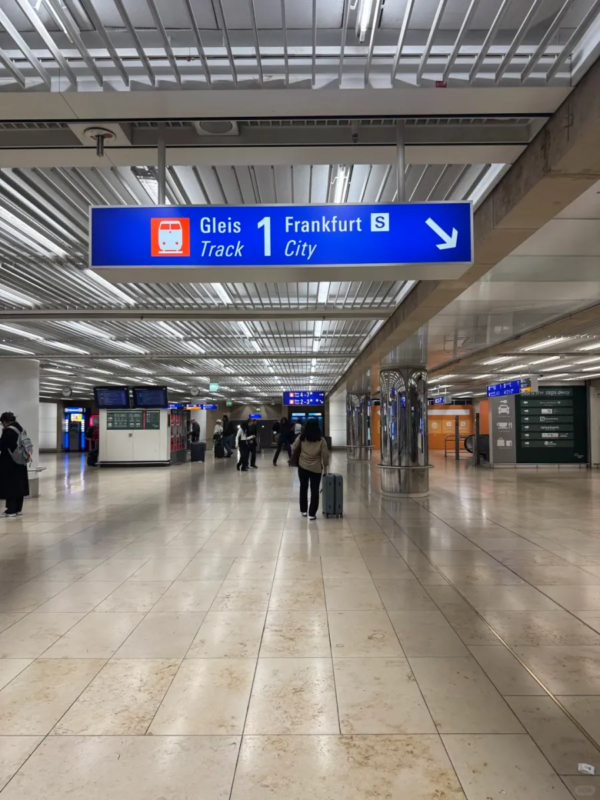

Letiště Frankfurt (FRA) je nejvytíženější letiště v Německu a jeden z hlavních přestupních uzlů kontinentální Evropy. Má dva terminály. Terminál 1 odbavuje Lufthansu a většinu dopravců Star Alliance; terminál 2 slouží ostatním. Mezi nimi leží odbavovací plocha a pojezdové dráhy, přes které vede nadzemní automatický přepravní systém SkyLine bez řidiče.

Nepříjemný detail, pokud přistanete na terminálu 2, je ten, že letištní nádraží není vůbec pod terminálem 2. Leží pod terminálem 1. Mapové aplikace vidí, že se chcete dostat do města, a ochotně navrhnou autobus — autor původní poznámky to říká bez obalu: **nevěřte Google Maps, co se týče autobusu**.

Tento průvodce sleduje trasu, která byla skutečně prošlá: přílety terminálu 2, sledovat značky Terminal 1, svézt se SkyLine do terminálu 1, po značkách **Bahnhöfe / Train stations** sejít dolů do regionálního nádraží a pak jet S8 nebo S9 zhruba patnáct minut na Frankfurt (Main) Hauptbahnhof, hlavní nádraží města. Každý krok se odehrává uvnitř terminálů a nádražních budov, takže nikdy nestojíte s kufrem na obrubníku.

## 1. Proč je letištní autobus špatná volba

Dejte letiště a město na stejnou mapu a autobus vypadá téměř jako přímka: vyjdete z terminálu, přejdete silnici, nastoupíte a o pár zastávek později jste na okraji centra. Jenže mapa měří vzdálenost po ploše a letiště funguje vertikálně. Problém není autobus jako takový; problém je vyjít z budovy.

Autobusové zastávky ve Frankfurtu jsou na silnicích před terminály. Z příletů terminálu 2 nejdřív projdete mezi dopravními pruhy, najdete správnou zastávku, vymyslíte směr a pak čekáte pod širým nebem. Frankfurtské zimy jsou studené a vlhké, jaro a podzim deštivé; deset minut na zastávce stačí k tomu, aby člověk litoval. S zavazadly si navíc tašky sám nakládáte a vykládáte. Autobus pak jede po městských ulicích, které se v ranní špičce ucpané, a když dorazíte do města, obvykle ještě potřebujete U-Bahn nebo S-Bahn na poslední úsek — druhý přesun s bagáží.

Tato trasa vypadá oklikou proto, že letiště samo je vrstvené. Terminál 1 vznikl v 70. letech a nádraží měl pod sebou od začátku. Terminál 2 přibyl v 90. letech kvůli vyšší kapacitě a vlastní vlaková nástupiště nikdy nedostal. Letiště proto obě budovy spojuje nadzemním shuttle: nejdřív se posunete stranou na jiný terminál a teprve pak jdete dolů na vlak. Jakmile je to jasné, otázka „proč pod terminálem 2 není nádraží?“ odpovídá sama.

Vnitřní trasa vás nestojí nic než chůzi. SkyLine je zdarma a jezdí každé dvě minuty, S-Bahn jede pod zemí mimo provoz a celá cesta je obsluhovaná výtahy a eskalátory. Cedule jsou německy a anglicky, takže se nikdy nemusíte ptát. Jediné, co platíte, je S-Bahn, a tu jízdenku byste si museli koupit tak jako tak.

Ani není nejrychlejší. Z příletů terminálu 2 na nástupiště na Hauptbahnhof je při započtení chůze a čekání běžně půl hodiny. Pokud máte mezi přistáním a dalším přestupem jen hodinu, taxík je jistější. Když máte čas, není důvod čekat na autobusové zastávce.

## 2. Z terminálu 2 do terminálu 1: najít SkyLine

Když vyjdete z příletů terminálu 2, podívejte se nahoru na modré zavěšené cedule. Jejich logika chvíli trvá: **„Terminal 1 A,B,C,Z“ označuje odbavovací haly druhého terminálu**, zatímco prosté „D,E“ znamená vlastní dvě haly terminálu 2. Návštěvníci, kteří tu jsou poprvé, si to pletou, jdou za D a E a zůstanou v terminálu 2 a krouží v kruhu.

Zaměřte se na řádek s nápisem Terminal 1 a jděte za šipkami. Projdete kolem řady oznámení o rostlinolékařské kontrole a ochraně proti chorobám, která varují před přinášením zakázaných rostlinných produktů; ignorujte je a jděte dál, dokud nedorazíte k eskalátoru nahoru.

O pár kroků dál je stejná cedule zblízka jasnější: **Ausgang / Exit** v horním řádku, Terminal 1 A,B,C,Z uprostřed, výdej zavazadel a haly D a E dole. Zapamatujte si jedno pravidlo: **abyste se dostali na nádraží, nechoďte za Exit**. Exit vede ven na silnici a SkyLine je nahoře.

Pokud se přesto ocitnete venku, zachovejte klid. Vraťte se do terminálu a jděte znovu nahoru podle ikony vláčku na stropě. Frankfurt je v tomto bodě celkem vstřícný: symbol SkyLine je vidět už z úrovně příletů, takže se nemusíte nikoho ptát.

Eskalátor vás vyveze na nástupiště SkyLine. SkyLine je frankfurtský vnitřní přepravní systém: malé automatické vozy jezdí po nadzemní dráze mezi oběma terminály. Je **zdarma**, nepotřebuje jízdenku a nemá turnikety a obrazovka na nástupišti ukazuje nejbližší odjezd. Vlaky jezdí **každé dvě až tři minuty**.

Vozy jsou malé a ve špičce se plní, takže si zavazadla držte stranou. Pokud je nástupiště přeplněné, čekání na další vlak je obvykle rychlejší než se cpát dovnitř — interval jsou jen dvě minuty. Zcela výjimečně bývá SkyLine zavřený kvůli údržbě a jezdí náhradní autobusy; oznámení na nástupišti to vysvětlí. V takovém případě jděte s personálem na povrchovou trasu a přidejte dvacet minut.

Jsou tu jen dva směry a cedule na nástupišti říkají, který je který. Jízda do terminálu 1 trvá asi dvě minuty, doprovázejí ji oznámení a podsvícené schéma trasy. Vystupte a nechte se proudem lidí vést do příletů terminálu 1. Odteď se klíčové slovo mění: už ne Terminal, ale Bahnhof.

## 3. Z terminálu 1 na nástupiště: jděte za „Bahnhof“

Uvnitř terminálu 1 se cedule přepnou na **Bahnhöfe / Train stations**, obvykle s ikonou S a vlaku. Neukazují na jedno nástupiště, ale na dvě různé poloviny letištního nádraží. Pod terminálem 1 je **Regionalbahnhof** (regionální nádraží, koleje 1–3) pro S-Bahn a regionální vlaky a **Fernbahnhof** (nádraží dálkových vlaků, koleje 4–7) pro spoje ICE, který leží pod dlouhou budovou zvanou The Squaire.

Na Hauptbahnhof chcete Regionalbahnhof. Je přímo pod terminálem 1: jděte po značkách o jedno nebo dvě patra dolů, projděte krátkou pasáží obchodů a jste tam. Fernbahnhof je naproti tomu na konci dlouhé chodby jiným směrem. Na cedulích se oba liší jediným slovem a špatná volba vás stojí čtvrt hodiny.

Jsou dva rychlé způsoby, jak si ověřit, že jste na správné cestě. Za prvé čísla nástupišť: 1–3 znamenají regionální nádraží, 4–7 to dálkové. Za druhé lidé kolem vás — cestující táhnoucí velké kufry a mhouřící oči nad odjezdy ICE obvykle míří na Fernbahnhof. Vstup na Regionalbahnhof je uprostřed terminálu 1 a průchod dolů z něj je krátký; kolem The Squaire nikdy nejdete.

Dole se chodba rozděluje. Jeden směr vede k Bahnhöfe a k **AiRail Terminal**, odbavovacímu terminálu Lufthansy pro cestu vlakem a letadlem; druhý vede k východům na autobusy a taxíky. Tady lidé v terminálu 1 váhají nejvíc. Držte se jednoho faktu — S-Bahn odjíždí z Regionalbahnhof — a cedule Bus/Taxi vás ven nevylákají. Pokud máte kočárek nebo těžká zavazadla, hledejte výtah na konci chodby, místo abyste zápasili s eskalátorem.

Pokud se omylem ocitnete na Fernbahnhof, není to katastrofa: ICE vás na Hauptbahnhof doveze za zhruba čtvrt hodiny. Vaše jízdenka na S-Bahn ale platit nebude, budete potřebovat jízdenku na dálkový vlak a některé vlaky vyžadují rezervaci. Při první návštěvě je nejjednodušší vrátit se zpět na Regionalbahnhof.

## 4. Patnáct minut v S8 nebo S9

Koleje 1 až 3 regionálního nádraží leží vedle sebe o jedno patro pod vestibulem. Modrá cedule hlásí **Gleis 1 / Track 1**, za tím Frankfurt City a symbol S-Bahnu, se šipkou směrem dolů a do strany. To je strana, kterou používá většina cestujících do města.

Dole na nástupišti nastupte do **S8 nebo S9** směrem do města. Obě linky obsluhují letiště a obě zastavují na Hauptbahnhof; za centrem města jedou mírně odlišně, což nehraje roli, pokud vystupujete na Hauptbahnhof. Nejezděte opačným směrem — ten vede na Mainz a Wiesbaden a každou zastávkou vás vzdaluje.

O čtvrt hodiny později, po Gateway Gardens a Frankfurt-Niederrad, dorazíte na **Frankfurt (Main) Hauptbahnhof**. Oznámení nejdřív uvede název stanice a pak návazné linky. Nástupiště S-Bahnu na Hauptbahnhof jsou jedno patro pod zemí; jděte nahoru po značkách Hauptbahnhof nebo Ausgang a vyjdete ve velké hale s kulatými hodinami a řadami nástupišť hlavních linek nad sebou.

Pokud míříte do centra kolem Hauptwache nebo Konstablerwache, vůbec nemusíte vystupovat na Hauptbahnhof: S8 a S9 pokračují tunelem na východ a zastavují na obou. Hauptbahnhof je lepší volba, pokud přestupujete na dálkový vlak nebo bydlíte u nádraží. Opačným směrem, z města na letiště, je to stejná linka pozpátku; před nástupem si jen na obrazovce na nástupišti zkontrolujte cílovou stanici.

Hauptbahnhof si zaslouží vlastní mentální obrázek. Je to jedno z největších německých hlavových nádraží: nástupiště hlavních linek jdou v řadě za sebou a číslují se až do dvacátých čísel, zatímco S-Bahn je o patro níž. Kdo tu je poprvé, v hale snadno ztratí orientaci, takže si nejdřív přečtěte číslo Gleis na ceduli a teprve pak se rozhodněte, do kterého patra jít. K vlaku ICE se dostanete na konec nástupiště, kde koleje propojuje příčná chodba.

## 5. Jízdenky, intervaly a pět obvyklých chyb

Na této trase potřebuje jízdenku jen S-Bahn. Frankfurtská příměstská železnice je součástí tarifní sítě **RMV** (Rhein-Main-Verkehrsverbund) a letiště i město spadají do stejného tarifního systému. Modré jízdenkové automaty ve vestibulu umí přepnout do angličtiny: zvolte jako cíl Frankfurt Hbf a automat jízdné spočítá. E-jízdenku můžete koupit předem v aplikaci RMV nebo DB Navigator. Na nástupištích S-Bahnu **nejsou turnikety**, ale revizoři ve vlacích jezdí, a jízda bez platné jízdenky — nebo s neoznačenou papírovou jízdenkou — je pokutována. Pokud si koupíte papírovou, před nástupem ji označte v malém přístroji na nástupišti.

Pokud toho dne pojedete víckrát, celodenní jízdenka (Tageskarte) je obvykle jednodušší než opakované jednotlivé, a automaty prodávají i skupinové jízdenky. Dejte pozor na začátek platnosti: papírová celodenní jízdenka platí od chvíle, kdy ji označíte, ne od chvíle, kdy ji koupíte. Jízdenky v aplikaci označovat netřeba, ale nechte si objednávku otevřenou pro kontrolu.

| Úsek | Jak | Čas | Interval | Cena |
| --- | --- | --- | --- | --- |
| T2 → T1 | Jděte po značkách Terminal 1 nahoru po eskalátoru, jeďte SkyLine | asi 2 minuty | každé 2–3 minuty | zdarma |
| Přílety T1 → úroveň nádraží | Jděte po značkách Bahnhöfe/Train stations dolů | 5–8 minut | — | — |
| Úroveň nádraží → nástupiště S-Bahnu | Hledejte Gleis 1/Frankfurt City, sejděte ještě o patro níž | 2–3 minuty | — | — |
| T1 → Hauptbahnhof | S8 nebo S9 směrem do města, přes Gateway Gardens a Niederrad | asi 15 minut | zhruba každých 15 minut | tarif RMV |

Když to složíte dohromady, je tu vlastně jen pět míst, kde se dá udělat chyba:

1. **Jít za Exit na terminálu 2**, skončit na stanovišti taxíků a pak se muset vrátit dovnitř a hledat SkyLine.
2. **Považovat D a E za terminál 1** a kroužit uvnitř terminálu 2.
3. **Dojít na terminálu 1 na Fernbahnhof**, najít jen vlaky ICE a neplatnou jízdenku na S-Bahn.
4. **Nastoupit na Regionalbahnhof špatným směrem**, na Mainz, a sledovat, jak se město vzdaluje.
5. **Nenajít hlavní halu na Hauptbahnhof**, i když značky Ausgang vedou přímo nahoru k ní.

Opačným směrem, z města na letiště, zvolte jako cíl jízdenky **Frankfurt Flughafen Regionalbahnhof**, ne Frankfurt Flughafen Fernbahnhof. Druhý je nádraží dálkových vlaků, S-Bahn tam nikdy nezastavuje a jízdenka vás do vlaku nedostane. Názvy se liší jediným slovem a je to nejsnazší chyba, jakou lze u automatu udělat. Obrazovka na nástupišti vám řekne, kterou kolej použít; nastupte do toho z S8 a S9, který přijede první.

Tato trasa vychází z procházky cestovatele v září 2025; intervaly SkyLine a S-Bahnu a jízdné se řídí aktuálními informacemi na místě a na webu provozovatele. Při prvním pokusu si vyhraďte hodinu od přistání po usazení v S-Bahnu a nebudete muset spěchat. Pokud na Hauptbahnhof přestupujete na dálkový vlak, přidejte čas na chůzi při přestupu.

## Související odkazy

- **Na tomto webu**: [Letiště Frankfurt (FRA)](/airport/FRA), [Německo (DE)](/country/DE)
- **Wikipedia**: [Letiště Frankfurt](https://en.wikipedia.org/wiki/Frankfurt_Airport)
- **Baidu Baike**: [Letiště Frankfurt](https://baike.baidu.com/item/%E6%B3%95%E5%85%B0%E5%85%8B%E7%A6%8F%E6%9C%BA%E5%9C%BA)
