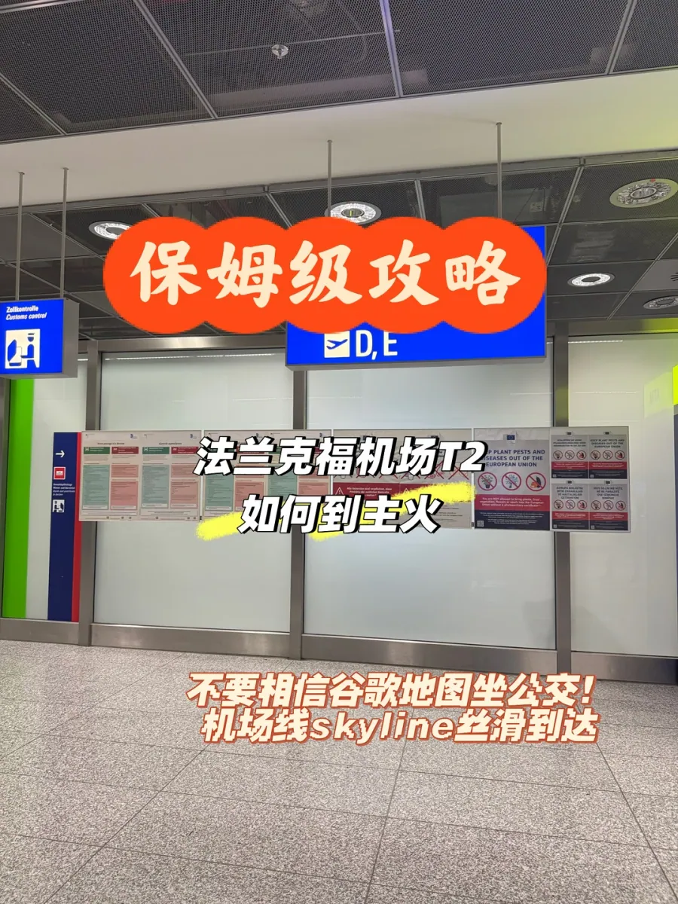

Der Flughafen Frankfurt (FRA) ist der verkehrsreichste Flughafen Deutschlands und eines der wichtigsten Drehkreuze Kontinentaleuropas. Er hat zwei Terminals: Terminal 1 und Terminal 2. Lufthansa und die meisten Star-Alliance-Airlines starten in T1, T2 dient den übrigen Gesellschaften. Zwischen den beiden Gebäuden liegen Vorfeld und Rollbahnen; verbunden sind sie durch eine in der Luft hängende Passagierbeförderung, die SkyLine.

Für alle, die in T2 landen, liegt die Schwierigkeit darin, dass der Bahnhof des Flughafens nicht unter T2 liegt, sondern unter T1. Karten-Apps sehen, dass Sie in die Stadt wollen, und schlagen gern eine Busverbindung vor — genau davor warnt der Autor der Originalnotiz ausdrücklich: **Trauen Sie Google Maps beim Bus nicht.**

Diese Anleitung folgt dem tatsächlich gegangenen Weg: Ankunft in T2, den Schildern zu Terminal 1 folgen, mit der SkyLine nach T1, den Schildern **Bahnhöfe / Train stations** hinunter zum Regionalbahnhof, dann mit der S8 oder S9 in etwa fünfzehn Minuten zum Frankfurt (Main) Hauptbahnhof. Alles spielt sich in den Terminal- und Bahnhofsgebäuden ab; Sie stehen also nie mit dem Koffer am Straßenrand.

## 1. Warum der Bus die falsche Wahl ist

Legen Sie Flughafen und Stadt auf dieselbe Karte, sieht eine Buslinie fast wie eine Gerade aus: aus dem Terminal, über eine Fahrspur, einsteigen, und ein paar Haltestellen später sind Sie am Rand der Innenstadt. Doch die Karte misst die Fläche, und der Flughafen funktioniert in der Höhe. Das Problem ist weniger der Bus als der Schritt vor die Tür.

Die Bushaltestellen in Frankfurt liegen an den Straßen außerhalb der Terminals. Von der Ankunftshalle in T2 gehen Sie zuerst durch die Fahrspuren, suchen die richtige Haltestelle, prüfen die Fahrtrichtung und warten dann im Freien. Frankfurter Winter sind feuchtkalt, Frühjahr und Herbst regnerisch; zehn Minuten an der Haltestelle genügen, um die Entscheidung zu bereuen. Mit Gepäck laden Sie die Koffer außerdem selbst ein und aus. Der Bus fährt dann über Stadtstraßen, die im Berufsverkehr verstopfen, und in der Stadt brauchen Sie für das letzte Stück meist noch eine U-Bahn oder S-Bahn — ein zweites Umpacken mit den Koffern.

Umständlich wirkt diese Route, weil der Flughafen selbst zweigeteilt ist. Terminal 1 entstand in den 1970er-Jahren, der Bahnhof war von Anfang an darunter geplant. Terminal 2 kam in den 1990er-Jahren für mehr Kapazität dazu und bekam nie eigene Bahnsteige. Deshalb verbindet der Flughafen die beiden Gebäude mit einer Hochbahn: Sie wechseln zuerst seitlich das Terminal und fahren dann nach unten zum Zug. Ist das einmal klar, beantwortet sich die Frage „warum gibt es unter T2 keinen Bahnhof?“ von selbst.

Die Route im Gebäude kostet Sie nur den Weg. Die SkyLine ist kostenlos und fährt alle paar Minuten, die S-Bahn läuft unterirdisch und damit ohne Stau, und der ganze Weg ist mit Aufzügen und Rolltreppen erschlossen. Die Schilder sind zweisprachig, deutsch und englisch, Sie müssen also niemanden fragen. Bezahlen müssen Sie nur die S-Bahn — und dieses Ticket hätten Sie ohnehin gebraucht.

Und sie ist nicht die schnellste Variante: Von der Ankunft in T2 bis zum Bahnsteig am Hauptbahnhof sind mit Fußweg und Wartezeit eine halbe Stunde normal. Wenn zwischen Landung und Anschluss nur eine Stunde liegt, ist ein Taxi die sicherere Wahl. Ist Zeit vorhanden, gibt es keinen Grund, an einer Bushaltestelle zu stehen.

## 2. T2 nach T1: die SkyLine

Wenn Sie die Ankunftshalle von T2 verlassen, schauen Sie nach oben zu den blauen Hängeschildern. Ihre Logik erschließt sich nicht sofort: **„Terminal 1 A,B,C,Z“ bezeichnet die Check-in-Bereiche des anderen Terminals**, ein allein stehendes „D,E“ dagegen die beiden Bereiche von T2. Wer zum ersten Mal hier ist, verwechselt die Zeilen leicht, folgt D und E und dreht in T2 seine Runden.

Halten Sie sich an die Zeile mit Terminal 1 und folgen Sie den Pfeilen. Unterwegs passieren Sie eine Reihe von Hinweisen zu Pflanzenschutz und Seuchenvorsorge, die vor der Einfuhr verbotener Pflanzenprodukte warnen; bleiben Sie nicht stehen, sondern gehen Sie weiter bis zur aufwärts führenden Rolltreppe.

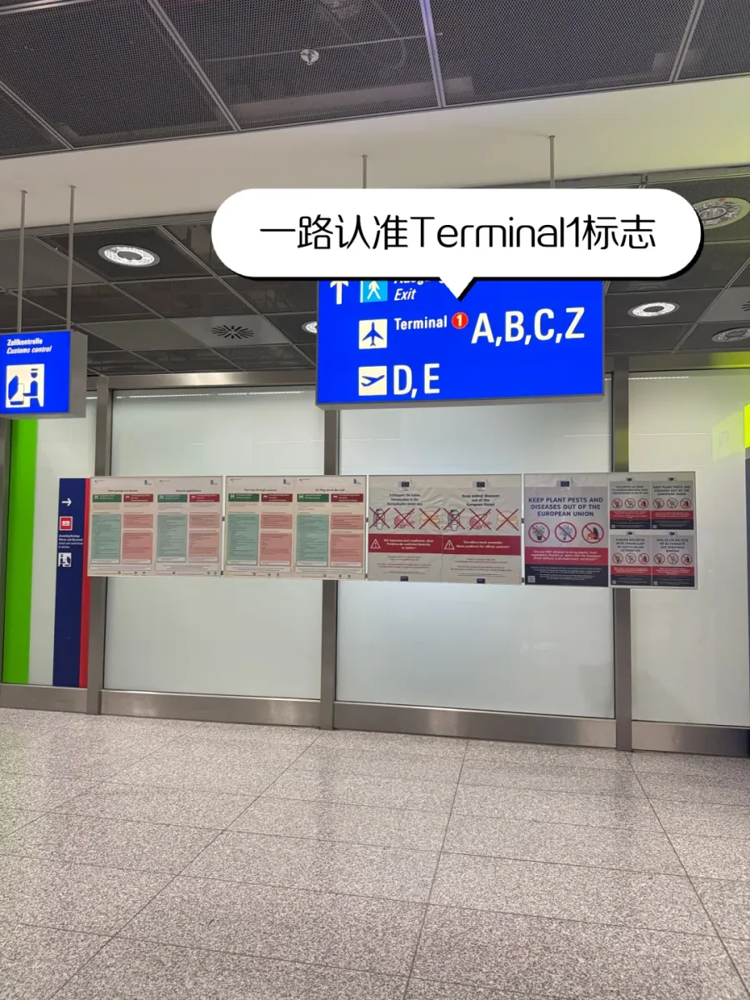

Ein paar Schritte weiter wird dasselbe Schild aus der Nähe deutlicher: oben **Ausgang / Exit**, in der Mitte Terminal 1 A,B,C,Z, darunter die Gepäckausgabe sowie die Bereiche D und E. Eine Regel sollten Sie hier behalten: **Zum Bahnhof folgen Sie nicht dem Exit.** Der Exit führt hinaus auf die Fahrspur, die SkyLine liegt eine Ebene höher.

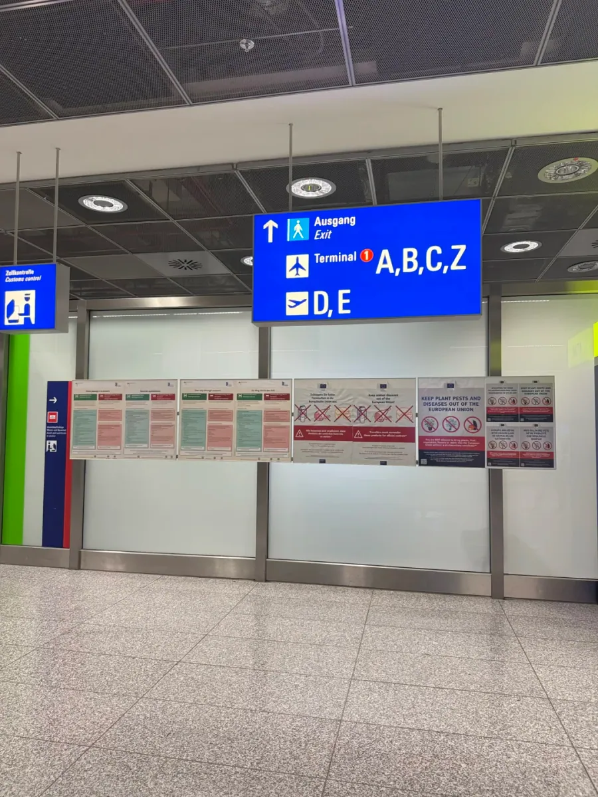

Falls Sie doch draußen gelandet sind: kein Grund zur Sorge. Gehen Sie ins Terminal zurück und fahren Sie über das Symbol der kleinen Bahn an der Decke wieder nach oben — Sie verlieren nur etwa fünfzehn Minuten. Frankfurt ist an dieser Stelle freundlich: Das SkyLine-Zeichen ist von der Ankunftsebene aus zu sehen, Sie müssen sich also nicht durchfragen.

Die Rolltreppe endet direkt am SkyLine-Bahnsteig. Die SkyLine ist der interne Passagiertransport des Flughafens: kleine, fahrerlose Wagen auf einer Hochbahn zwischen den beiden Terminals. Sie ist **kostenlos**, es gibt keine Fahrkarten und keine Sperren, und der Bildschirm am Bahnsteig zeigt die nächste Abfahrt. Die Züge fahren **alle 2–3 Minuten**.

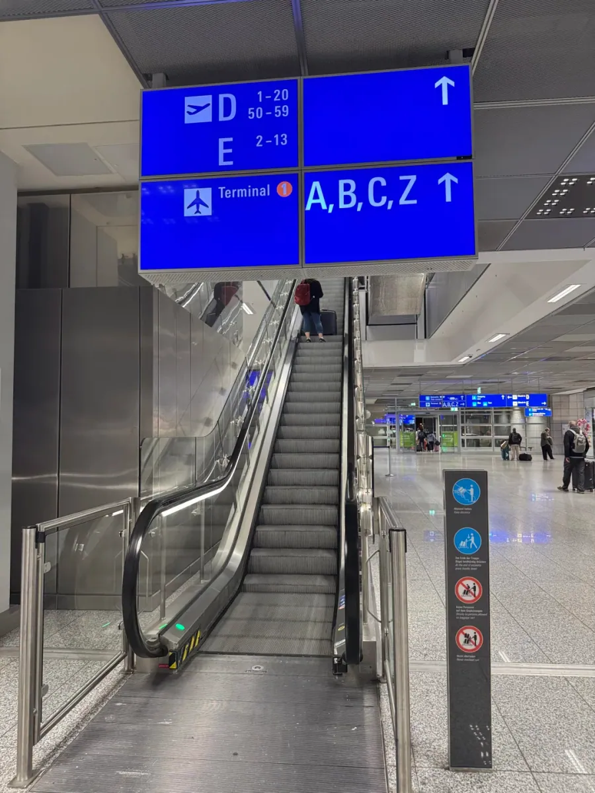

Die Wagen sind klein und im Berufsverkehr schnell voll; halten Sie die Koffer an der Seite. Steht am Bahnsteig zu viel Gedränge, ist die nächste Fahrt meist schneller als das Hineinquetschen — der Takt liegt bei nur zwei bis drei Minuten. Sehr selten wird die SkyLine für Wartungsarbeiten geschlossen, dann fahren Ersatzbusse; die Ansagen am Bahnsteig erklären es. In diesem Fall folgen Sie dem Personal zur Strecke an der Oberfläche und rechnen Sie zwanzig Minuten mehr ein.

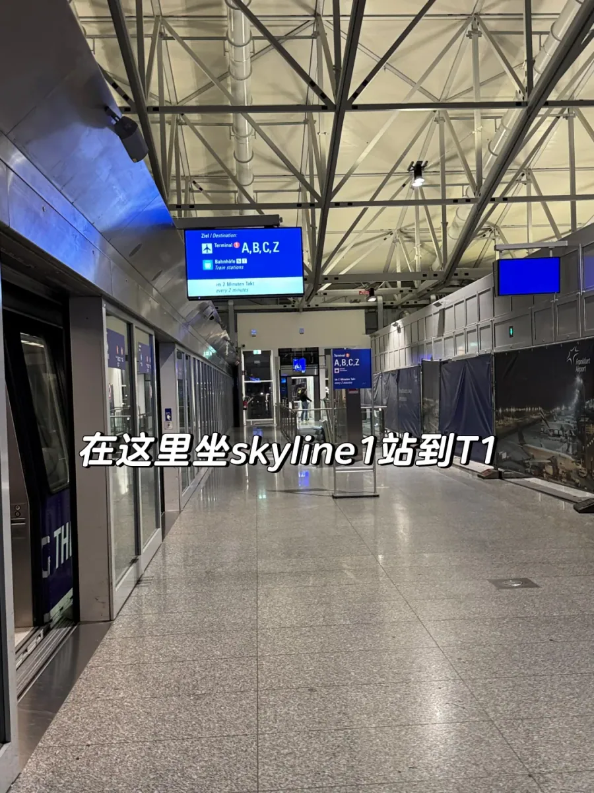

Es gibt nur zwei Richtungen, und die Schilder am Bahnsteig sagen, welche gilt. Die Fahrt nach Terminal 1 dauert etwa zwei Minuten, mit Ansagen und einem beleuchteten Linienband. Steigen Sie aus und folgen Sie dem Strom in die Ankunftsebene von T1. Ab hier wechselt das Schlüsselwort: nicht mehr Terminal, sondern Bahnhof.

## 3. T1 zum Bahnsteig: den Bahnhof-Schildern folgen

Im Inneren von T1 wechseln die Schilder auf **Bahnhöfe / Train stations**, meist mit einem S und einem Zug-Symbol daneben. Sie zeigen nicht auf einen einzelnen Bahnsteig, sondern auf zwei verschiedene Hälften des Flughafenbahnhofs. Unter Terminal 1 liegt der **Regionalbahnhof** (Gleise 1–3) für S-Bahn und Regionalzüge, unter dem langen Gebäude The Squaire der **Fernbahnhof** (Gleise 4–7) für ICE und andere Fernzüge.

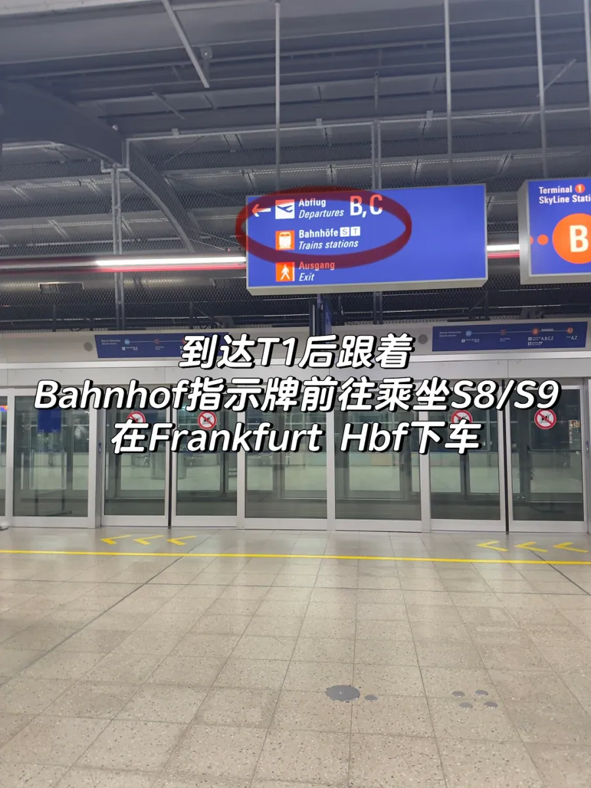

Zum Hauptbahnhof brauchen Sie den Regionalbahnhof. Er liegt direkt unter Terminal 1: den Schildern ein bis zwei Ebenen nach unten folgen, an einer kurzen Ladenpassage vorbei, und Sie sind da. Der Fernbahnhof dagegen liegt am Ende eines langen Gangs in einer anderen Richtung. Auf den Schildern unterscheiden sich die beiden um ein einziges Wort; der falsche Weg kostet Sie eine Viertelstunde.

Zwei Dinge zeigen Ihnen, ob Sie richtig laufen: erstens die Gleisnummern — 1–3 Regionalbahnhof, 4–7 Fernbahnhof. Zweitens die Menschen um Sie herum: Wer große Koffer zieht und nach ICE-Verbindungen Ausschau hält, ist meist auf dem Weg zum Fernbahnhof. Der Eingang zum Regionalbahnhof liegt in der Mitte von T1, der Gang nach unten ist kurz, und Sie kommen nie an The Squaire vorbei.

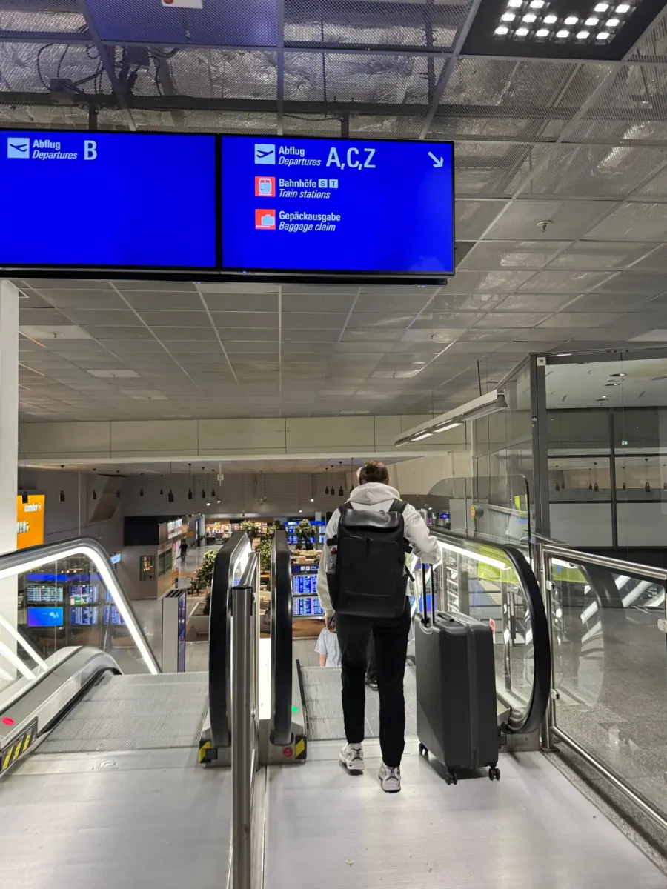

Unten teilt sich der Gang. Die eine Richtung führt zu den Bahnhöfen und zum **AiRail Terminal**, dem Check-in für Lufthansas Air-Rail-Verbindungen; die andere zu den Ausgängen Bus und Taxi. Hier zögern die meisten in T1. Merken Sie sich einen Satz — die S-Bahn fährt vom Regionalbahnhof ab —, dann locken Sie die Schilder Bus und Taxi nicht nach draußen. Mit Kinderwagen oder schwerem Gepäck halten Sie am Ende des Gangs nach dem Aufzug Ausschau, statt sich mit der Rolltreppe abzumühen.

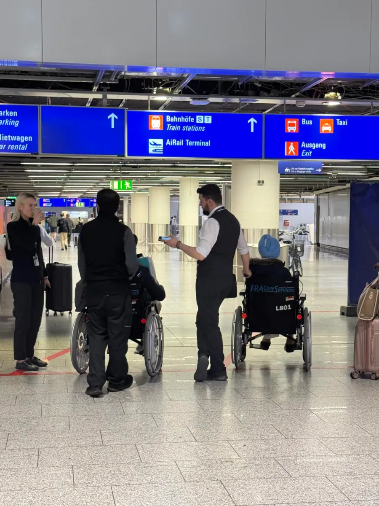

Sollten Sie versehentlich am Fernbahnhof landen, ist das kein Drama: Ein ICE bringt Sie in etwa einer Viertelstunde zum Hauptbahnhof. Ihr S-Bahn-Ticket gilt dort aber nicht, Sie brauchen eine Fernverkehrsfahrkarte, und für manche Züge ist eine Reservierung nötig. Beim ersten Besuch ist der einfachste Ausweg, zum Regionalbahnhof zurückzugehen.

## 4. Mit S8/S9 zum Hauptbahnhof

Die Gleise 1 bis 3 des Regionalbahnhofs liegen nebeneinander eine Ebene unter der Halle. Ein blaues Schild zeigt **Gleis 1 / Track 1**, dahinter Frankfurt City und das S-Bahn-Zeichen, der Pfeil deutet schräg nach unten. Das ist die Seite, die die meisten Fahrgäste in die Stadt nehmen.

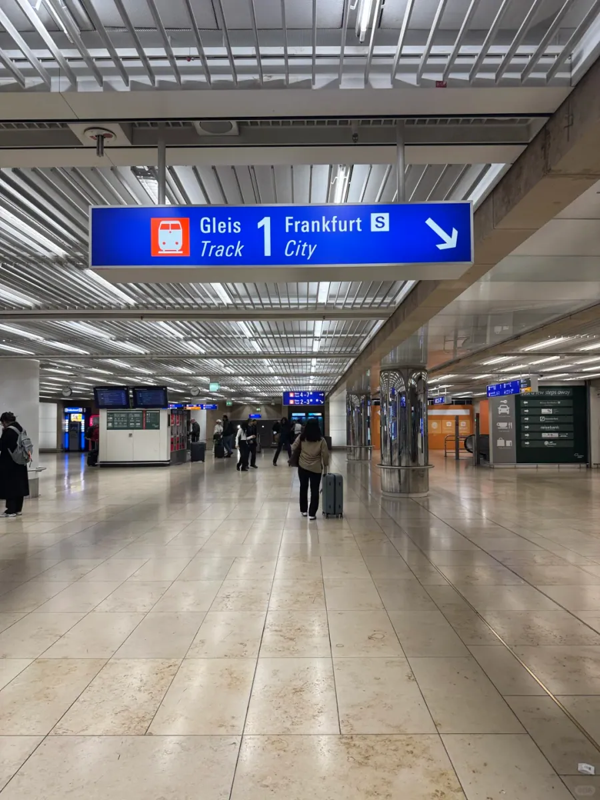

Unten am Bahnsteig nehmen Sie die **S8 oder S9** in Richtung Stadt. Beide Linien bedienen den Flughafen und halten am Hauptbahnhof; hinter der Innenstadt trennen sich ihre Wege leicht, was für Sie keine Rolle spielt, wenn Sie am Hauptbahnhof aussteigen. Achten Sie auf die Gegenrichtung: Dort geht es nach Mainz und Wiesbaden, also mit jeder Station weiter weg.

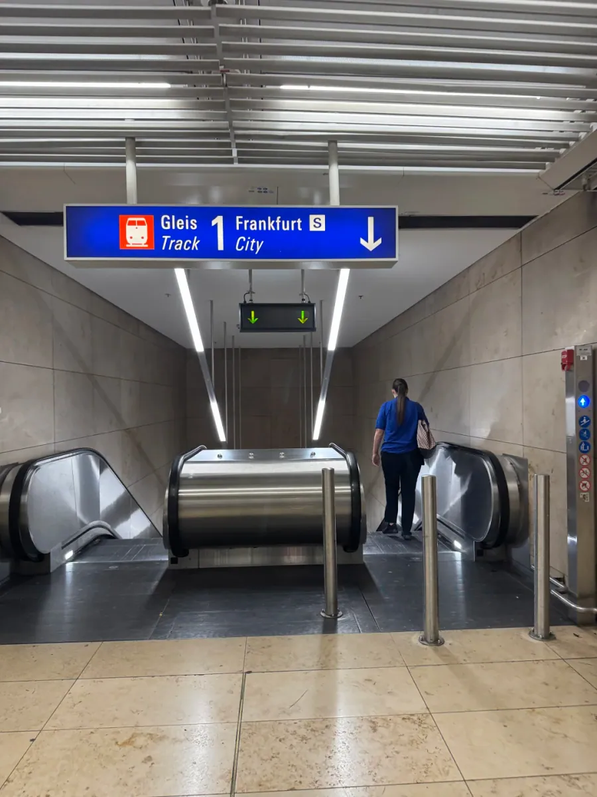

Nach etwa fünfzehn Minuten, über Gateway Gardens und Frankfurt-Niederrad, erreichen Sie den **Frankfurt (Main) Hauptbahnhof**. Die Ansage nennt zuerst den Stationsnamen, dann die Anschlusslinien. Die S-Bahn-Bahnsteige am Hauptbahnhof liegen eine Ebene unter der Erde; folgen Sie den Schildern Hauptbahnhof oder Ausgang nach oben, stehen Sie in der großen Halle mit der runden Uhr und den vielen Fernbahnsteigen darüber.

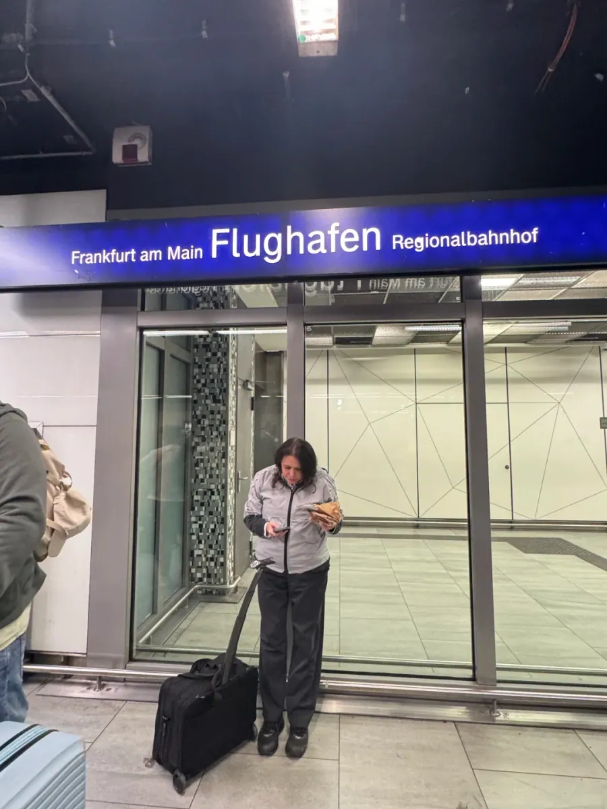

Wenn Ihr Ziel die Innenstadt um Hauptwache oder Konstablerwache ist, müssen Sie am Hauptbahnhof gar nicht aussteigen: S8 und S9 fahren weiter nach Osten durch den Tunnel und halten an beiden Stationen. Der Hauptbahnhof passt besser, wenn Sie auf einen Fernzug umsteigen oder in der Nähe übernachten. Anders herum, von der Stadt zum Flughafen, ist es dieselbe Strecke in Gegenrichtung; prüfen Sie vor dem Einsteigen nur das Ziel auf dem Bahnsteigbildschirm.

Vom Hauptbahnhof selbst sollten Sie ein Bild im Kopf haben. Er ist einer der größten Kopfbahnhöfe Deutschlands: Die Fernbahnsteige liegen in einer Reihe und sind bis in die Zwanziger nummeriert, die S-Bahn eine Ebene darunter. Beim ersten Mal verliert man in der Halle leicht die Orientierung; schauen Sie zuerst auf die Gleisnummer auf dem Schild und entscheiden Sie dann, in welche Ebene Sie gehen. Zu einem ICE gehen Sie ans Bahnsteigende, wo ein Quergang die Gleise verbindet.

## 5. Tickets, Takt und typische Fehler

Auf der ganzen Route brauchen Sie nur für die S-Bahn eine Fahrkarte. Die Frankfurter S-Bahn gehört zum Tarifgebiet des **RMV** (Rhein-Main-Verkehrsverbund), Flughafen und Stadt liegen im selben Tarifsystem. In der Halle stehen blaue Automaten, die sich auf Englisch umstellen lassen: Ziel Frankfurt Hbf wählen, und der Automat zeigt den passenden Preis. Sie können die Fahrkarte auch vorab per App kaufen, mit RMV oder DB Navigator. **An den S-Bahn-Bahnsteigen gibt es keine Sperren**, aber es wird kontrolliert: Wer ohne gültige oder ohne entwertete Fahrkarte fährt, muss mit einem erhöhten Beförderungsentgelt rechnen. Papiertickets entwerten Sie also vor dem Einsteigen am kleinen Automaten am Bahnsteig.

Wer am selben Tag mehrfach fährt, ist mit einer Tageskarte meist besser dran als mit vielen Einzelfahrscheinen; die Automaten verkaufen auch Gruppentickets. Achten Sie auf den Beginn der Gültigkeit: Eine Papiertageskarte gilt ab dem Entwerten, nicht ab dem Kauf. Tickets aus der App müssen nicht entwertet werden, halten Sie aber die Bestellseite für die Kontrolle bereit.

| Abschnitt | Weg | Dauer | Takt | Kosten |
| --- | --- | --- | --- | --- |
| T2 → T1 | Den Schildern Terminal 1 nach oben folgen, SkyLine fahren | etwa 2 Minuten Fahrzeit | alle 2–3 Minuten | kostenlos |
| T1 Ankunftsebene → Bahnhofsebene | Den Schildern Bahnhöfe / Train stations nach unten folgen | 5–8 Minuten | — | — |
| Bahnhofsebene → S-Bahn-Bahnsteig | Gleis 1 / Frankfurt City suchen, eine Ebene tiefer | 2–3 Minuten | — | — |
| T1 → Hauptbahnhof | S8 oder S9 Richtung Stadt, über Gateway Gardens und Niederrad | etwa 15 Minuten | etwa alle 15 Minuten | nach RMV-Tarif |

Setzt man die Teile zusammen, gibt es nur fünf Stellen, an denen man sich verläuft:

1. **In T2 dem Exit gefolgt** und auf dem Taxistand gelandet, dann wieder hinein und die SkyLine suchen.
2. **D und E für Terminal 1 gehalten** und in T2 im Kreis gelaufen.
3. **In T1 zum Fernbahnhof gelaufen**, nur ICE gefunden und ein S-Bahn-Ticket, das nicht gilt.
4. **Am Regionalbahnhof in die falsche Richtung eingestiegen**, nach Mainz, und die Stadt kleiner werden sehen.
5. **Am Hauptbahnhof die große Halle nicht gefunden**, obwohl die Ausgang-Schilder direkt hinaufführen.

Umgekehrt, von der Stadt zum Flughafen, wählen Sie am Automaten als Ziel **Frankfurt Flughafen Regionalbahnhof** und nicht Frankfurt Flughafen Fernbahnhof. Der zweite ist der Fernbahnhof, die S-Bahn hält dort nie, und mit dieser Fahrkarte kommen Sie in keinen Zug. Die Namen unterscheiden sich um ein Wort, und genau hier vertut man sich am Automaten am leichtesten. Welches Gleis gilt, sagt der Bildschirm; nehmen Sie die S8 oder S9, die zuerst kommt.

Diese Route folgt den Aufzeichnungen einer Reisenden vom September 2025; Takt und Preise von SkyLine und S-Bahn gelten nach den Angaben des Tages vor Ort und auf der Website des Betreibers. Beim ersten Versuch sollten Sie von der Landung bis zum Sitzplatz in der S-Bahn eine Stunde einplanen, dann müssen Sie nicht hetzen. Wenn Sie am Hauptbahnhof auf einen Fernzug umsteigen, rechnen Sie die Fußwege für den Umstieg dazu.

## Weiterführende Links

- **Auf dieser Website**: [Flughafen Frankfurt (FRA)](/airport/FRA), [Deutschland (DE)](/country/DE)
- **Wikipedia**: [Flughafen Frankfurt](https://en.wikipedia.org/wiki/Frankfurt_Airport)
- **Baidu Baike**: [Flughafen Frankfurt](https://baike.baidu.com/item/%E6%B3%95%E5%85%B0%E5%85%8B%E7%A6%8F%E6%9C%BA%E5%9C%BA)
