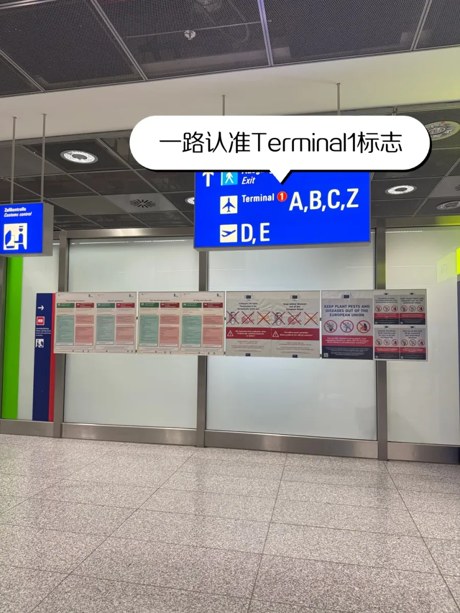
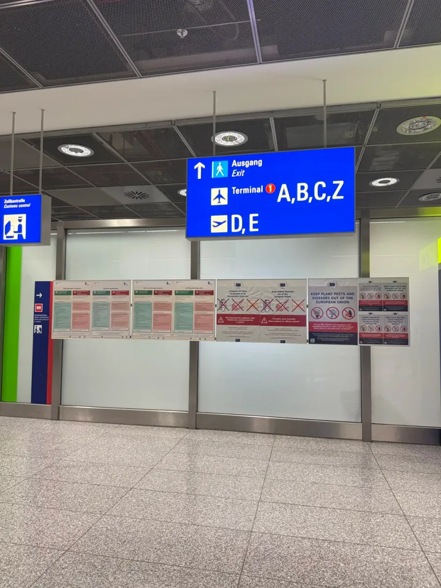

O Aeroporto de Frankfurt (FRA) é o mais movimentado da Alemanha e um dos principais hubs de conexão da Europa continental. Tem dois terminais. O Terminal 1 atende a Lufthansa e a maioria das companhias da Star Alliance; o Terminal 2 atende as demais. Entre eles ficam o pátio e as taxiways, atravessados por um people mover elevado e sem condutor chamado SkyLine.

A parte incômoda, se você pousa no Terminal 2, é que a estação ferroviária do aeroporto não fica embaixo do Terminal 2 de jeito nenhum. Ela fica sob o Terminal 1. Os aplicativos de mapa veem que você quer chegar à cidade e sugerem um ônibus com toda a boa vontade — o autor da nota original é direto sobre isso: **não confie no Google Maps para o ônibus**.

Este guia segue a rota que foi realmente percorrida: chegadas do Terminal 2, siga as placas do Terminal 1, pegue o SkyLine até o Terminal 1, siga **Bahnhöfe / Train stations** para baixo até a estação regional e então pegue o S8 ou o S9 por cerca de quinze minutos até a Frankfurt (Main) Hauptbahnhof, a estação central da cidade. Cada passo acontece dentro dos prédios do terminal e da estação, então você nunca fica na calçada com a mala.

## 1. Por que o ônibus do aeroporto é a escolha errada

Coloque o aeroporto e a cidade no mesmo mapa e o ônibus parece quase uma linha reta: saia do terminal, atravesse uma via, entre e, algumas paradas depois, você está na borda do centro. Mas o mapa mede distância plana, e o aeroporto funciona na vertical. O ônibus não é bem o problema; sair do prédio é.

As paradas de ônibus em Frankfurt ficam nas vias do lado de fora dos terminais. Das chegadas do Terminal 2, você primeiro atravessa as faixas de tráfego, encontra a parada certa, descobre o sentido e depois espera ao relento. Os invernos de Frankfurt são frios e úmidos, e a primavera e o outono são chuvosos; dez minutos em uma parada bastam para se arrepender da decisão. Com bagagem, você ainda carrega e descarrega as malas sozinho. O ônibus depois usa as ruas da cidade, que engarrafam no pico da manhã, e, ao chegar à cidade, você normalmente vai precisar de um U-Bahn ou S-Bahn para o último trecho — uma segunda etapa com as malas.

Esta rota parece dar uma volta porque o próprio aeroporto é em camadas. O Terminal 1 foi construído nos anos 1970 com a estação ferroviária embaixo desde o início. O Terminal 2 foi acrescentado nos anos 1990 para capacidade extra e nunca ganhou plataformas ferroviárias próprias. Então o aeroporto liga os dois prédios com um shuttle elevado: você troca de terminal lateralmente primeiro e depois desce para o trem. Uma vez isso claro, a pergunta “por que não há uma estação sob o Terminal 2?” responde a si mesma.

A rota interna não custa nada além de caminhada. O SkyLine é gratuito e passa a cada dois ou três minutos, o S-Bahn corre no subsolo longe do trânsito, e todo o caminho é servido por elevadores e escadas rolantes. As placas estão em alemão e inglês, então você nunca precisa perguntar. A única parte paga é o S-Bahn, e você teria de comprar essa passagem de qualquer forma.

Também não é a opção mais rápida. Das chegadas do Terminal 2 até a plataforma da Hauptbahnhof, contando caminhada e espera, meia hora é normal. Se você tem só uma hora entre o pouso e a próxima conexão, o táxi é a aposta mais segura. Com tempo de sobra, não há motivo para esperar em uma parada de ônibus.

## 2. Do Terminal 2 ao Terminal 1: encontrando o SkyLine

Ao sair das chegadas do Terminal 2, olhe para cima, para as placas azuis suspensas. A lógica delas leva um instante: **“Terminal 1 A,B,C,Z” se refere aos saguões de check-in do outro terminal**, enquanto um simples “D,E” indica os dois saguões do próprio Terminal 2. Quem chega pela primeira vez mistura os dois, segue D e E e fica no Terminal 2 andando em círculos.

Fixe a linha que diz Terminal 1 e siga as setas. Você passa por uma fileira de avisos de fitossanidade e controle de doenças que alertam contra produtos vegetais restritos; ignore-os e continue até chegar a uma escada rolante para cima.

Poucos passos adiante, a mesma placa em close fica mais clara: **Ausgang / Exit** na linha de cima, Terminal 1 A,B,C,Z no meio, retirada de bagagem e saguões D e E embaixo. Lembre-se de uma regra aqui: **para chegar à estação, não siga Exit**. O Exit leva para a rua, e o SkyLine fica no andar de cima.

Se você acabar do lado de fora, mantenha a calma. Volte para dentro do terminal e suba de novo seguindo o pequeno ícone de trem no teto. Frankfurt é razoavelmente generoso nesse ponto: o símbolo do SkyLine é visível a partir do nível de chegadas, então você não vai precisar perguntar a ninguém.

A escada rolante leva você à plataforma do SkyLine. O SkyLine é o people mover interno de Frankfurt: pequenos vagões automatizados que correm em uma via elevada entre os dois terminais. É **gratuito**, não precisa de bilhete e não tem catracas, e a tela da plataforma mostra a próxima partida. Os trens passam **a cada dois ou três minutos**.

Os vagões são pequenos e enchem nos horários de pico, então mantenha as malas de um lado. Se a plataforma estiver cheia, esperar o próximo trem costuma ser mais rápido do que se espremer — o intervalo é de apenas alguns minutos. Muito ocasionalmente, o SkyLine fecha para manutenção e ônibus substitutos circulam; os avisos na plataforma explicam. Nesse caso, siga a equipe até a rota de superfície e acrescente vinte minutos.

Há apenas dois sentidos, e as placas da plataforma dizem qual é qual. A viagem até o Terminal 1 leva cerca de dois minutos, com anúncios e um mapa de rota iluminado. Desça e siga o fluxo até as chegadas do Terminal 1. A partir daqui a palavra-chave muda: não mais Terminal, mas Bahnhof.

## 3. Do Terminal 1 à plataforma: siga “Bahnhof”

Dentro do Terminal 1, as placas passam a **Bahnhöfe / Train stations**, geralmente com um S e um ícone de trem. Elas não apontam para uma única plataforma, mas para duas metades diferentes da estação do aeroporto. Sob o Terminal 1 fica o **Regionalbahnhof** (estação regional, vias 1–3) para o S-Bahn e os trens regionais, e o **Fernbahnhof** (estação de longa distância, vias 4–7) para os serviços ICE, localizado sob o longo edifício chamado The Squaire.

Para a Hauptbahnhof você quer o Regionalbahnhof. Ele fica diretamente abaixo do Terminal 1: siga as placas para baixo um ou dois níveis, passe por uma pequena galeria de lojas e você chegou. O Fernbahnhof, em contraste, fica no fim de um longo corredor em outra direção. Nas placas, os dois diferem por uma única palavra, e pegar o errado custa um quarto de hora.

Há duas formas rápidas de confirmar que você está no caminho certo. Primeiro, os números das plataformas: 1–3 significam a estação regional, 4–7 a de longa distância. Segundo, as pessoas ao seu redor — viajantes arrastando malas grandes e espiando as partidas de ICE geralmente vão para o Fernbahnhof. A entrada do Regionalbahnhof fica no meio do Terminal 1, e a passagem para baixo a partir dela é curta; você nunca passa pelo The Squaire.

No fundo, a passagem se divide. Uma direção é Bahnhöfe e o **AiRail Terminal**, o check-in ferroviário da Lufthansa; a outra leva às saídas de ônibus e táxi. É aqui que as pessoas mais hesitam no Terminal 1. Agarre-se a um fato — o S-Bahn parte do Regionalbahnhof — e as placas de ônibus/táxi não vão atrair você para fora. Se você tem carrinho de bebê ou malas pesadas, procure o elevador no fim da passagem em vez de brigar com a escada rolante.

Se você se encontrar no Fernbahnhof por engano, não é uma tragédia: um ICE leva você à Hauptbahnhof em cerca de um quarto de hora. Mas o seu bilhete de S-Bahn não será válido, você vai precisar de um bilhete de longa distância, e alguns trens exigem reserva. Em uma primeira visita, a solução mais simples é voltar caminhando ao Regionalbahnhof.

## 4. Quinze minutos no S8 ou no S9

As vias 1 a 3 do Regionalbahnhof ficam lado a lado, um nível abaixo do saguão. Uma placa azul diz **Gleis 1 / Track 1**, seguida de Frankfurt City e do símbolo do S-Bahn, com uma seta apontando para baixo e para o lado. É o lado que a maioria dos passageiros com destino à cidade usa.

Lá embaixo, na plataforma, pegue o **S8 ou o S9** no sentido da cidade. As duas linhas atendem o aeroporto e param na Hauptbahnhof; elas seguem rotas ligeiramente diferentes depois do centro, o que não faz diferença se a Hauptbahnhof é a sua parada. Não pegue o outro sentido — aquele lado vai para Mainz e Wiesbaden e leva você para mais longe a cada parada.

Um quarto de hora depois, após Gateway Gardens e Frankfurt-Niederrad, você chega à **Frankfurt (Main) Hauptbahnhof**. O anúncio diz primeiro o nome da estação e depois as linhas de conexão. As plataformas do S-Bahn na Hauptbahnhof ficam um nível abaixo do solo; siga as placas Hauptbahnhof ou Ausgang para cima e você sai no grande salão com o relógio redondo e as fileiras de plataformas de longa distância acima.

Se você vai para o centro, perto de Hauptwache ou Konstablerwache, não precisa descer na Hauptbahnhof: o S8 e o S9 continuam para o leste pelo túnel e param nas duas. A Hauptbahnhof é a melhor escolha se você vai trocar para um trem de longa distância ou ficar perto da estação. No sentido inverso, da cidade para o aeroporto, é a mesma linha ao contrário; só confira o destino na tela da plataforma antes de embarcar.

A própria Hauptbahnhof merece uma imagem mental. É uma das maiores estações terminus da Alemanha: as plataformas de longa distância correm em fileira e vão até a casa dos vinte, enquanto o S-Bahn fica um nível abaixo. Quem chega pela primeira vez tende a se perder no salão, então leia primeiro o número do Gleis na placa e depois decida qual nível pegar. Para chegar a um ICE, caminhe até o fim da plataforma, onde uma passagem transversal liga as vias.

## 5. Bilhetes, frequências e os cinco erros habituais

Só o S-Bahn precisa de bilhete nesta rota. O trem suburbano de Frankfurt faz parte da rede tarifária **RMV** (Rhein-Main-Verkehrsverbund), e o aeroporto e a cidade estão dentro do mesmo sistema tarifário. As máquinas azuis do saguão mudam para o inglês: escolha Frankfurt Hbf como destino e a máquina calcula a tarifa. Você também pode comprar um bilhete eletrônico com antecedência pelo aplicativo da RMV ou do DB Navigator. **Não há catracas** nas plataformas do S-Bahn, mas os fiscais andam nos trens, e viajar sem bilhete válido — ou com um bilhete de papel não validado — gera multa. Se comprar papel, carimbe-o na maquininha da plataforma antes de embarcar.

Se você for andar várias vezes no mesmo dia, um bilhete diário (Tageskarte) costuma ser mais simples do que várias passagens avulsas, e as máquinas também vendem bilhetes de grupo. Atenção ao horário de início: um bilhete diário de papel é válido a partir do momento em que você o carimba, não do momento em que o compra. Bilhetes de aplicativo não precisam de carimbo, mas mantenha a página do pedido aberta para a inspeção.

| Trecho | Como | Tempo | Frequência | Custo |
| --- | --- | --- | --- | --- |
| T2 → T1 | Siga as placas do Terminal 1 até a escada rolante, pegue o SkyLine | cerca de 2 minutos | a cada 2–3 minutos | gratuito |
| Chegadas do T1 → nível da estação | Siga Bahnhöfe/Train stations para baixo | 5–8 minutos | — | — |
| Nível da estação → plataforma do S-Bahn | Procure Gleis 1/Frankfurt City, desça mais um nível | 2–3 minutos | — | — |
| T1 → Hauptbahnhof | S8 ou S9 no sentido do centro, via Gateway Gardens e Niederrad | cerca de 15 minutos | cerca de cada 15 minutos | tarifa RMV |

Juntando as peças, há realmente só cinco lugares onde errar:

1. **Seguir Exit no Terminal 2** e acabar no ponto de táxi, tendo de voltar para dentro e achar o SkyLine.
2. **Ler D e E como Terminal 1** e rodar em círculos dentro do Terminal 2.
3. **Caminhar até o Fernbahnhof no Terminal 1**, encontrar só trens ICE e um bilhete de S-Bahn inválido.
4. **Embarcar no sentido errado no Regionalbahnhof**, para Mainz, e ver a cidade se afastar.
5. **Não encontrar o salão principal na Hauptbahnhof**, quando as placas de Ausgang levam direto até ele.

No sentido inverso, da cidade para o aeroporto, escolha **Frankfurt Flughafen Regionalbahnhof** como destino do bilhete, não Frankfurt Flughafen Fernbahnhof. O segundo é a estação de longa distância, o S-Bahn nunca para lá, e o bilhete não vai te colocar em um trem. Os nomes diferem por uma palavra e é o erro mais fácil de cometer em uma máquina. A tela da plataforma indica qual via usar; pegue o primeiro que chegar entre o S8 e o S9.

Esta rota vem de um relato de viajante de setembro de 2025; as frequências e tarifas do SkyLine e do S-Bahn estão sujeitas às informações do dia no local e no site do operador. Em uma primeira tentativa, reserve uma hora do pouso até estar sentado no S-Bahn e você não precisará correr. Se você vai trocar para um trem de longa distância na Hauptbahnhof, acrescente o tempo de caminhada da baldeação.

## Links relacionados

- **Neste site**: [Aeroporto de Frankfurt (FRA)](/airport/FRA), [Alemanha (DE)](/country/DE)
- **Wikipédia**: [Aeroporto de Frankfurt](https://en.wikipedia.org/wiki/Frankfurt_Airport)
- **Baidu Baike**: [Aeroporto de Frankfurt](https://baike.baidu.com/item/%E6%B3%95%E5%85%B0%E5%85%8B%E7%A6%8F%E6%9C%BA%E5%9C%BA)
