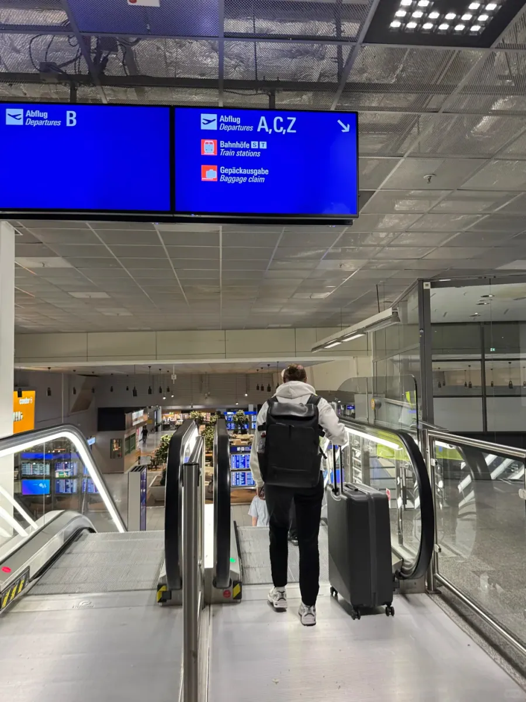
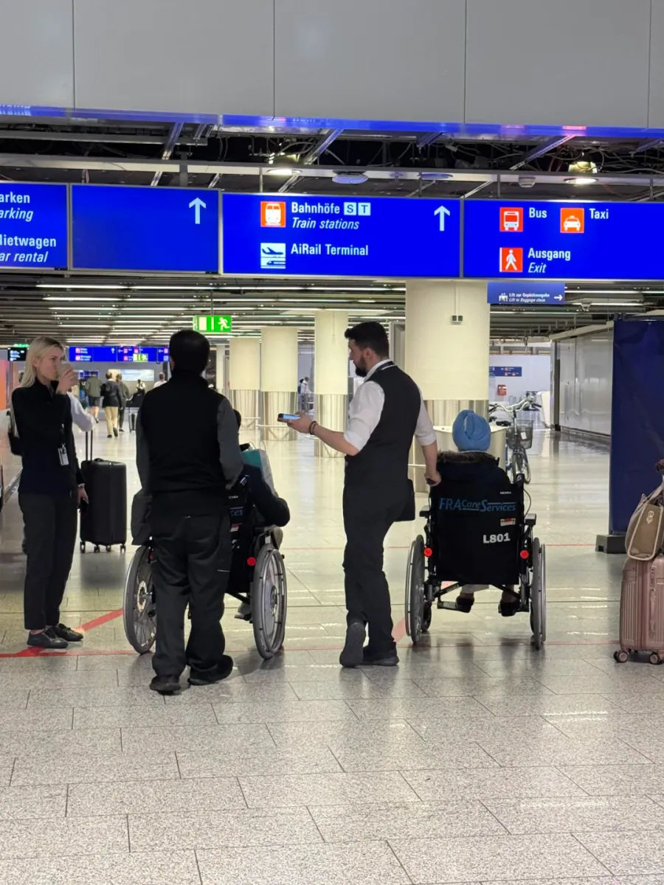

Frankfurt flygplats (FRA) är Tysklands mest trafikerade flygplats och en av de viktigaste bytespunkterna i det kontinentala Europa. Den har två terminaler. Terminal 1 sköter Lufthansa och de flesta Star Alliance-bolag; terminal 2 betjänar resten. Mellan dem ligger uppställningsplatser och taxibanor, som korsas av en upphöjd förarlös förflyttare som heter SkyLine.

Det besvärliga, om du landar på terminal 2, är att flygplatsens järnvägsstation inte alls ligger under terminal 2. Den ligger under terminal 1. Kartappar ser att du vill till city och föreslår gärna en buss – författaren till originalanteckningen är tydlig: **lita inte på Google Maps när det gäller bussen**.

Den här guiden följer rutten som faktiskt gicks: ankomst terminal 2, följ skyltarna mot terminal 1, ta SkyLine till terminal 1, följ **Bahnhöfe / Train stations** ner till regionalstationen och ta sedan S8 eller S9 i cirka femton minuter till Frankfurt (Main) Hauptbahnhof, stadens centralstation. Varje steg sker inne i terminal- och stationsbyggnaderna, så du står aldrig på trottoaren med resväskan.

## 1. Varför flygbussen är fel val

Sätt flygplatsen och staden på samma karta och bussen ser nästan ut som en rak linje: gå ut från terminalen, korsa en väg, stig på, och några hållplatser senare är du vid kanten av centrum. Men kartan mäter avstånd i planet, och flygplatsen fungerar vertikalt. Bussen är egentligen inte problemet; det är att lämna byggnaden.

Busshållplatserna i Frankfurt ligger på vägarna utanför terminalerna. Från ankomsten på terminal 2 går du först genom trafikfilerna, hittar rätt hållplats, listar ut riktningen och väntar sedan utomhus. Frankfurts vintrar är kalla och blöta och vår och höst regniga; tio minuter på en hållplats räcker för att ångra beslutet. Med bagage lastar du dessutom av och på väskorna själv. Bussen använder sedan stadens gator, som stockar sig i morgonrusningen, och när du väl är i city behöver du oftast U-Bahn eller S-Bahn för sista biten – ett andra lyft med väskorna.

Rutten verkar krånglig eftersom flygplatsen i sig är skiktad. Terminal 1 byggdes på 1970-talet med järnvägsstationen under sig från början. Terminal 2 tillkom på 1990-talet för extra kapacitet och fick aldrig egna spårplattformar. Så flygplatsen förbinder de två byggnaderna med en upphöjd skyttel: du byter terminal i sidled först och går sedan ner till tåget. När det är klart besvarar frågan "varför finns det ingen station under terminal 2?" sig själv.

Den inomhusrutt kostar dig inget annat än promenader. SkyLine är gratis och går varannan minut, S-Bahn går under jord bort från trafiken, och hela vägen betjänas av hissar och rulltrappor. Skyltarna är på tyska och engelska, så du behöver aldrig fråga. Det enda du betalar för är S-Bahn, och den biljetten hade du behövt köpa ändå.

Det är inte det snabbaste alternativet heller. Från ankomsten på terminal 2 till plattformen på Hauptbahnhof är en halvtimme normalt, medräknat promenader och väntan. Om du bara har en timme mellan landning och nästa anslutning är taxi det säkrare valet. Har du tid är det ingen anledning att vänta på en busshållplats.

## 2. Terminal 2 till terminal 1: hitta SkyLine

När du kommer ut från ankomsten på terminal 2, titta upp efter de blå skyltarna i taket. Deras logik tar en stund: **"Terminal 1 A,B,C,Z" syftar på den andra terminalens incheckningshallar**, medan ett enkelt "D,E" betyder terminal 2:s egna två hallar. Förstagångsbesökare blandar ihop dem, följer D och E och blir kvar i terminal 2 och går i cirklar.

Sikta in dig på raden där det står Terminal 1 och följ pilarna. Du passerar en rad meddelanden om växtskydd och sjukdomskontroll som varnar för att ta med otillåtna växtprodukter; ignorera dem och fortsätt tills du når en rulltrappa uppåt.

Några steg längre fram är samma skylt närmare och tydligare: **Ausgang / Exit** på översta raden, Terminal 1 A,B,C,Z i mitten och bagageutlämning samt hallarna D och E nedanför. Kom ihåg en regel här: **för att nå stationen, följ inte Exit**. Exit leder ut till vägen, och SkyLine ligger en trappa upp.

Om du ändå hamnar utomhus, ta det lugnt. Gå tillbaka in i terminalen och ta dig upp igen med hjälp av det lilla tågikonen i taket. Frankfurt är ganska snällt på den här punkten: SkyLine-symbolen syns från ankomstnivån, så du behöver inte fråga någon.

Rulltrappan tar dig till SkyLine-plattformen. SkyLine är Frankfurts interna förflyttare: små automatiserade vagnar som går på en upphöjd bana mellan de två terminalerna. Den är **kostnadsfri**, kräver ingen biljett och har inga spärrar, och skärmen på plattformen visar nästa avgång. Tågen går **varannan till var tredje minut**.

Vagnarna är små och fylls i rusningstid, så håll väskorna åt sidan. Om plattformen är full går det oftast snabbare att vänta på nästa tåg än att tränga sig in – intervallet är bara ett par minuter. Någon enstaka gång stängs SkyLine för underhåll och ersättningsbussar går; utropen på plattformen förklarar det. Följ då personalen till ytvägen och lägg till tjugo minuter.

Det finns bara två riktningar, och skyltarna på plattformen visar vilken som är vilken. Resan till terminal 1 tar ungefär två minuter, med utrop och en upplyst linjekarta. Stig av och följ flödet in i ankomsten på terminal 1. Härifrån ändras nyckelordet: inte längre Terminal, utan Bahnhof.

## 3. Terminal 1 till plattformen: följ "Bahnhof"

Inne i terminal 1 byter skyltarna till **Bahnhöfe / Train stations**, vanligtvis med ett S och en tågikon. De pekar inte mot en enda plattform utan mot två olika halvor av flygplatsstationen. Under terminal 1 ligger **Regionalbahnhof** (regionalstationen, spår 1–3) för S-Bahn och regionaltåg, och **Fernbahnhof** (fjärrtågsstationen, spår 4–7) för ICE-tågen, belägen under den långa byggnaden som heter The Squaire.

För Hauptbahnhof vill du till Regionalbahnhof. Den ligger direkt under terminal 1: följ skyltarna en eller två nivåer ner, förbi en kort butiksarkad, och du är framme. Fernbahnhof ligger däremot i slutet av en lång korridor i en annan riktning. På skyltarna skiljer sig de två åt med ett enda ord, och tar du fel kostar det dig en kvart.

Det finns två snabba sätt att kontrollera att du är på rätt väg. För det första plattformsnumren: 1–3 betyder regionalstationen, 4–7 fjärrtågsstationen. För det andra människorna omkring dig – resenärer som släpar stora väskor och kisar mot ICE-avgångar är oftast på väg till Fernbahnhof. Ingången till Regionalbahnhof ligger mitt i terminal 1, och passagen ner dit är kort; du passerar aldrig The Squaire.

Nere delar sig passagen. En riktning är Bahnhöfe och **AiRail Terminal**, Lufthansas flyg-tåg-incheckning; den andra leder till buss- och taxutgångarna. Det är här folk tvekar mest i terminal 1. Håll fast vid ett faktum – S-Bahn avgår från Regionalbahnhof – så lockar inte buss- och taxiskyltarna ut dig. Har du barnvagn eller tunga väskor, leta efter hissen i slutet av passagen i stället för att brottas med rulltrappan.

Om du av misstag hamnar på Fernbahnhof är det ingen katastrof: ett ICE-tåg tar dig till Hauptbahnhof på ungefär en kvart. Men din S-Bahn-biljett gäller inte, du behöver en fjärrtågsbiljett och vissa tåg kräver platsreservation. Vid ett första besök är den enklaste lösningen att gå tillbaka till Regionalbahnhof.

## 4. Femton minuter med S8 eller S9

Regionalbahnhofs spår 1 till 3 ligger sida vid sida en nivå under hallen. En blå skylt visar **Gleis 1 / Track 1**, följt av Frankfurt City och S-Bahn-symbolen, med en pil som pekar ner och åt sidan. Det är den sida de flesta passagerare mot city använder.

Nere på plattformen tar du **S8 eller S9** mot city. Båda linjerna trafikerar flygplatsen och båda stannar vid Hauptbahnhof; de går lite olika vägar efter stadskärnan, vilket inte spelar någon roll om Hauptbahnhof är din hållplats. Ta inte den andra riktningen – den går mot Mainz och Wiesbaden och tar dig längre bort för varje hållplats.

En kvart senare, efter Gateway Gardens och Frankfurt-Niederrad, är du framme vid **Frankfurt (Main) Hauptbahnhof**. Utropet anger stationsnamnet först och sedan anslutningslinjerna. S-Bahn-plattformarna på Hauptbahnhof ligger en nivå under mark; följ skyltarna mot Hauptbahnhof eller Ausgang uppåt och du kommer ut i den stora hallen med den runda klockan och raderna av fjärrtågsplattformar ovanför.

Ska du till stadskärnan kring Hauptwache eller Konstablerwache behöver du inte alls stiga av vid Hauptbahnhof: S8 och S9 fortsätter österut genom tunneln och stannar vid båda. Hauptbahnhof är det bättre valet om du ska byta till ett fjärrtåg eller bo nära stationen. Åt andra hållet, från city till flygplatsen, är det samma linje i omvänd riktning; kontrollera bara destinationen på skärmen på plattformen innan du stiger på.

Hauptbahnhof i sig förtjänar en mental bild. Det är en av Tysklands största säckstationer: fjärrtågsplattformarna ligger på rad och är numrerade upp till tjugotalet, medan S-Bahn ligger en nivå under. Förstagångsbesökare tenderar att tappa orienteringen i hallen, så läs först spårnumret på skylten och bestäm sedan vilken nivå du ska ta. För att nå ett ICE-tåg, gå till änden av plattformen, där en tvärgång förbinder spåren.

## 5. Biljetter, turtäthet och de fem vanliga misstagen

Bara S-Bahn kräver biljett på den här rutten. Frankfurts pendeltåg ingår i **RMV**-taxenätet (Rhein-Main-Verkehrsverbund), och flygplatsen och staden ligger inom samma taxesystem. Blå biljettautomater i hallen kan ställas om till engelska: välj Frankfurt Hbf som destination och automaten räknar ut priset. Du kan också köpa en e-biljett i förväg med appen RMV eller DB Navigator. Det finns **inga biljettsprärrar** vid S-Bahn-plattformarna, men kontrollanter åker med tågen, och att resa utan giltig biljett – eller med en ostämplad pappersbiljett – leder till böter. Köper du pappersbiljett, stämpla den i den lilla maskinen på plattformen innan du stiger på.

Ska du åka flera gånger samma dag är ett dagkort (Tageskarte) oftast enklare än upprepade enkelbiljetter, och automaterna säljer även gruppbiljetter. Håll koll på starttiden: ett pappersdagkort gäller från det att du stämplar det, inte från det att du köper det. Biljetter i appen behöver inte stämplas, men håll beställningssidan öppen för kontroll.

| Etapp | Hur | Tid | Turtäthet | Kostnad |
| --- | --- | --- | --- | --- |
| T2 → T1 | Följ skyltarna mot terminal 1 uppför rulltrappan, åk SkyLine | cirka 2 minuter | var 2–3:e minut | kostnadsfritt |
| Ankomst T1 → stationsnivå | Följ Bahnhöfe/Train stations neråt | 5–8 minuter | — | — |
| Stationsnivå → S-Bahn-plattform | Leta efter Gleis 1/Frankfurt City, gå ner ytterligare en nivå | 2–3 minuter | — | — |
| T1 → Hauptbahnhof | S8 eller S9 mot city, via Gateway Gardens och Niederrad | cirka 15 minuter | ungefär var 15:e minut | RMV-taxa |

Sätter man ihop delarna finns det egentligen bara fem ställen att gå fel:

1. **Att följa Exit på terminal 2** och hamna på taxistationen, för att sedan behöva gå in igen och hitta SkyLine.
2. **Att läsa D och E som terminal 1** och cirkla runt inne i terminal 2.
3. **Att gå till Fernbahnhof på terminal 1**, bara hitta ICE-tåg och en ogiltig S-Bahn-biljett.
4. **Att stiga på i fel riktning vid Regionalbahnhof**, mot Mainz, och se staden försvinna.
5. **Att inte hitta stora hallen på Hauptbahnhof**, när Ausgang-skyltarna leder rakt upp till den.

Åt andra hållet, från city till flygplatsen, välj **Frankfurt Flughafen Regionalbahnhof** som biljettdestination, inte Frankfurt Flughafen Fernbahnhof. Den senare är fjärrtågsstationen, S-Bahn stannar aldrig där, och biljetten tar dig inte ombord på något tåg. Namnen skiljer sig med ett ord och det är det lättaste misstaget att göra vid en automat. Skärmen på plattformen visar vilket spår du ska använda; ta det av S8 och S9 som kommer först.

Rutten kommer från en resenärs genomgång i september 2025; SkyLine- och S-Bahn-turtäthet och priser följer dagens information på plats och på operatörens webbplats. Vid ett första försök, räkna med en timme från landning till att du sitter på S-Bahn, så behöver du inte skynda. Ska du byta till ett fjärrtåg på Hauptbahnhof, lägg till promenadtiden för bytet.

## Relaterade länkar

- **På den här sidan**: [Frankfurt flygplats (FRA)](/airport/FRA), [Tyskland (DE)](/country/DE)
- **Wikipedia**: [Frankfurt flygplats](https://en.wikipedia.org/wiki/Frankfurt_Airport)
- **Baidu Baike**: [Frankfurt flygplats](https://baike.baidu.com/item/%E6%B3%95%E5%85%B0%E5%85%8B%E7%A6%8F%E6%9C%BA%E5%9C%BA)
