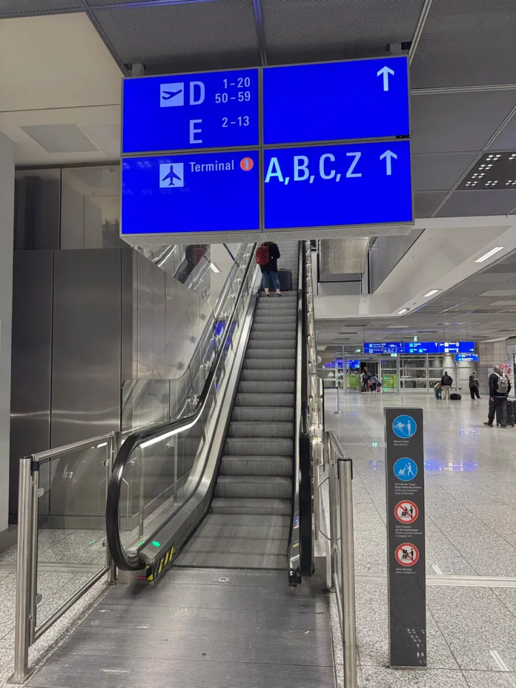

Uwanja wa Ndege wa Frankfurt (FRA) ni uwanja wa ndege wenye shughuli nyingi zaidi Ujerumani na mojawapo ya vituo vikuu vya kubadilishia katika bara la Ulaya. Una majumba mawili ya abiria. Jumba la Abiria la 1 huhudumia Lufthansa na mashirika mengi ya Star Alliance; Jumba la Abiria la 2 huhudumia mengine. Kati yao kuna eneo la kuegesha ndege na njia za teksi, ambavyo huvukwa na gari la juu la kusafirisha watu lisilo na dereva liitwalo SkyLine.

Sehemu isiyofaa, ikiwa utatua kwenye Jumba la Abiria la 2, ni kwamba kituo cha treni cha uwanja wa ndege hakiko chini ya Jumba la Abiria la 2 kabisa. Kiko chini ya Jumba la Abiria la 1. Programu za ramani zinaona unataka kufika jijini na kwa furaha hupendekeza basi — mwandishi wa maandishi ya awali yuko wazi kuhusu hili: **usiamini Google Maps kwa basi**.

Mwongozo huu unafuata njia iliyopitiwa kwa kweli: eneo la kuwasili la Jumba la Abiria la 2, fuata alama za Jumba la Abiria la 1, panda SkyLine hadi Jumba la Abiria la 1, fuata **Bahnhöfe / Vituo vya treni** kushuka hadi kituo cha treni za mkoa, kisha chukua S8 au S9 kwa dakika kama kumi na tano hadi Frankfurt (Main) Hauptbahnhof, kituo kikuu cha jiji. Kila hatua hufanyika ndani ya majengo ya kituo na uwanja wa ndege, kwa hivyo hutawahi kusimama kando ya barabara na sanduku lako.

## 1. Kwa nini basi la uwanja wa ndege ni chaguo lisilofaa

Weka uwanja wa ndege na jiji kwenye ramani moja na basi linaonekana karibu kama mstari ulionyooka: toka kwenye jumba la abiria, vuka barabara, panda, na baada ya vituo vichache uko pembezoni mwa katikati ya jiji. Lakini ramani hupima umbali tambarare, na uwanja wa ndege hufanya kazi kwa wima. Basi si tatizo hasa; kutoka nje ya jengo ndilo tatizo.

Vituo vya mabasi huko Frankfurt viko kando ya barabara nje ya majumba ya abiria. Kutoka eneo la kuwasili la Jumba la Abiria la 2, kwanza unatembea kupitia njia za magari, utafute kituo sahihi, tambua mwelekeo, kisha subiri nje ya wazi. Majira ya baridi Frankfurt ni ya baridi na yenye unyevu na masika na vuli yake ni yenye mvua; dakika kumi kwenye kituo zinatosha kujuta uamuzi huo. Ukiwa na mizigo pia unapakia na kushusha mizigo mwenyewe. Kisha basi hutumia barabara za jiji, ambazo hujaa asubuhi wakati wa kilele, na mara unapofika jijini kwa kawaida utahitaji U-Bahn au S-Bahn kwa sehemu ya mwisho — hatua ya pili ukiwa na mizigo.

Njia hii inaonekana ya kuzunguka kwa sababu uwanja wa ndege wenyewe una tabaka. Jumba la Abiria la 1 lilijengwa miaka ya 1970 likiwa na kituo cha treni chini yake tangu mwanzo. Jumba la Abiria la 2 liliongezwa miaka ya 1990 kwa uwezo wa ziada na halikupata majukwaa yake ya treni kamwe. Kwa hivyo uwanja wa ndege huunganisha majengo mawili kwa gari la juu la kusafirisha watu: kwanza unabadilisha jumba la abiria kwa upande, kisha unashuka kwa treni. Hilo likiwa wazi, swali "kwa nini hakuna kituo chini ya Jumba la Abiria la 2?" linajijibu lenyewe.

Njia ya ndani ya jengo haikugharimu chochote isipokuwa kutembea. SkyLine ni bure na huenda kila baada ya dakika kadhaa, S-Bahn huenda chini ya ardhi mbali na trafiki, na njia yote inahudumiwa na lifti na ngazi zinazosonga. Alama ziko kwa Kijerumani na Kiingereza, kwa hivyo hutalazimika kuuliza. Sehemu pekee unayolipia ni S-Bahn, na bado ungelazimika kununua tikiti hiyo.

Pia si chaguo la haraka zaidi. Kutoka eneo la kuwasili la Jumba la Abiria la 2 hadi jukwaa la Hauptbahnhof, ukizingatia kutembea na kusubiri, nusu saa ni kawaida. Ikiwa una saa moja tu kati ya kutua na muunganisho wako ujao, teksi ni chaguo salama zaidi. Ukiwa na muda mkononi, hakuna sababu ya kusubiri kwenye kituo cha basi.

## 2. Kutoka Jumba la Abiria la 2 hadi Jumba la Abiria la 1: kutafuta SkyLine

Ukitoka eneo la kuwasili la Jumba la Abiria la 2, tazama juu kutafuta alama za bluu. Mantiki yake inachukua muda kueleweka: **"Terminal 1 A,B,C,Z" inahusu kumbi za kuingia za jumba lingine la abiria**, wakati "D,E" pekee inamaanisha kumbi mbili za Jumba la Abiria la 2 wenyewe. Wageni wa mara ya kwanza huchanganya mbili, hufuata D na E, na kubaki Jumba la Abiria la 2 wakizunguka.

Kaza mawazo kwenye mstari unaosema Terminal 1 na fuata mishale. Unapita safu ya taarifa za afya ya mimea na udhibiti wa magonjwa zinazokataza kuleta bidhaa za mimea zilizozuiwa; zipuuze na uendelee hadi ufike kwenye ngazi inayosonga kwenda juu.

Hatua chache mbele, alama hiyo hiyo kwa karibu ni wazi zaidi: **Ausgang / Exit** kwenye mstari wa juu, Terminal 1 A,B,C,Z katikati, eneo la kuchukua mizigo na kumbi D na E chini. Kumbuka sheria moja hapa: **kufika kituoni, usifuate alama ya kutoka**. Alama ya kutoka inaelekeza nje kwenye barabara, na SkyLine iko juu.

Ikiwa utaishia nje, tulia. Rudi ndani ya jumba la abiria na uelekee juu tena ukitumia ikoni ndogo ya treni iliyo kwenye dari. Frankfurt ni mkarimu kwa kiasi kuhusu jambo hili: alama ya SkyLine inaonekana kutoka ngazi ya kuwasili, kwa hivyo hutahitaji kumuuliza mtu.

Ngazi inayosonga inakuleta kwenye jukwaa la SkyLine. SkyLine ni gari la ndani la Frankfurt la kusafirisha watu: mabehewa madogo yanayojiendesha yanayotembea kwenye reli iliyoinuka kati ya majumba mawili ya abiria. Ni **bure**, haihitaji tikiti na haina lango, na skrini ya jukwaa inaonyesha safari inayofuata. Treni huja **kila baada ya dakika mbili hadi tatu**.

Mabehewa ni madogo na hujaa nyakati za kilele, kwa hivyo weka mizigo yako upande mmoja. Ikiwa jukwaa limejaa, kusubiri treni inayofuata kwa kawaida ni haraka zaidi kuliko kubana ndani — muda wa mapumziko ni dakika kadhaa tu. Mara chache sana SkyLine hufungwa kwa matengenezo na mabasi ya badala huendeshwa; matangazo ya jukwaa hueleza hilo. Ikifanyika hivyo, fuata wafanyakazi kuelekea njia ya juu ya ardhi na ongeza dakika ishirini.

Kuna mielekeo miwili tu, na alama za jukwaa zinaeleza ipi ni ipi. Safari hadi Jumba la Abiria la 1 inachukua kama dakika mbili, pamoja na matangazo na ramani ya njia iliyoangaziwa. Shuka na ufuate mtiririko hadi eneo la kuwasili la Jumba la Abiria la 1. Kuanzia hapa neno muhimu hubadilika: si tena "Terminal", bali "Bahnhof".

## 3. Kutoka Jumba la Abiria la 1 hadi jukwaa: fuata "Bahnhof"

Ndani ya Jumba la Abiria la 1 alama hubadilika kuwa **Bahnhöfe / Vituo vya treni**, kwa kawaida zikiwa na herufi S na ikoni ya treni. Hazielekezi jukwaa moja bali sehemu mbili tofauti za kituo cha uwanja wa ndege. Chini ya Jumba la Abiria la 1 kuna **Regionalbahnhof** (kituo cha treni za mkoa, njia 1–3) kwa S-Bahn na treni za mkoa, na **Fernbahnhof** (kituo cha treni za masafa marefu, njia 4–7) kwa huduma za ICE, kilichoko chini ya jengo refu liitwalo The Squaire.

Kwa Hauptbahnhof unataka Regionalbahnhof. Iko moja kwa moja chini ya Jumba la Abiria la 1: fuata alama kushuka ngazi moja au mbili, upite ukanda mfupi wa maduka, na umefika. Fernbahnhof, kinyume chake, iko mwisho wa ukanda mrefu kuelekea upande mwingine. Kwenye alama mbili hutofautiana kwa neno moja, na kuchukua isiyofaa kunakugharimu robo saa.

Kuna njia mbili za haraka kuthibitisha uko kwenye njia sahihi. Kwanza, namba za majukwaa: 1–3 zinamaanisha kituo cha mkoa, 4–7 kile cha masafa marefu. Pili, watu wanaokuzunguka — wasafiri wanaovuta masanduku makubwa na kuchungulia safari za ICE kwa kawaida wanaelekea Fernbahnhof. Kiingilio cha Regionalbahnhof kiko katikati ya Jumba la Abiria la 1, na njia ya kushuka kutoka hapo ni fupi; hutapita The Squaire.

Chini, ukanda hugawanyika. Upande mmoja ni Bahnhöfe na **AiRail Terminal**, kituo cha kuingia cha Lufthansa cha treni na ndege; upande mwingine unaenda kwenye njia za kutoka za mabasi na teksi. Hapa ndipo watu wanasitasita zaidi ndani ya Jumba la Abiria la 1. Shikilia ukweli mmoja — S-Bahn huondoka kutoka Regionalbahnhof — na alama za mabasi/teksi hazitakuvuta nje. Ikiwa una kigari cha mtoto au masanduku mazito, tafuta lifti mwishoni mwa ukanda badala ya kugombana na ngazi inayosonga.

Ukijikuta Fernbahnhof kwa makosa, si janga: ICE itakufikisha Hauptbahnhof kwa kama robo saa. Lakini tikiti yako ya S-Bahn haitakuwa halali, utahitaji tikiti ya masafa marefu, na baadhi ya treni zinahitaji uhifadhi wa nafasi. Kwa ziara ya kwanza, suluhisho rahisi ni kurudi kwa miguu hadi Regionalbahnhof.

## 4. Dakika kumi na tano kwa S8 au S9

Njia 1 hadi 3 za Regionalbahnhof ziko kando kwa kando ngazi moja chini ya ukumbi. Alama ya bluu inasomeka **Gleis 1 / Track 1**, ikifuatiwa na Frankfurt City na alama ya S-Bahn, ikiwa na mshale unaoelekeza chini na kando. Hiyo ni upande ambao wasafiri wengi wanaelekea jijini wanatumia.

Chini kwenye jukwaa, chukua **S8 au S9** kuelekea jijini. Njia zote mbili huhudumia uwanja wa ndege na zote husimama Hauptbahnhof; zinatumia njia tofauti kidogo baada ya katikati ya jiji, jambo ambalo haina tofauti ikiwa Hauptbahnhof ni kituo chako. Usichukue mwelekeo mwingine — upande huo unaenda Mainz na Wiesbaden na unakupeleka mbali zaidi kwa kila kituo.

Dakika kumi na tano baadaye, baada ya Gateway Gardens na Frankfurt-Niederrad, unafika **Frankfurt (Main) Hauptbahnhof**. Tangazo hutoa jina la kituo kwanza, kisha njia za kuunganisha. Majukwaa ya S-Bahn huko Hauptbahnhof yako ngazi moja chini ya ardhi; fuata alama za Hauptbahnhof au Ausgang juu na unatokea kwenye ukumbi mkubwa wenye saa ya mviringo na safu za majukwaa ya treni kuu juu.

Ikiwa unaelekea katikati ya jiji karibu na Hauptwache au Konstablerwache, huhitaji kushuka Hauptbahnhof kabisa: S8 na S9 zinaendelea kuelekea mashariki kupitia handaki na kusimama katika zote mbili. Hauptbahnhof ni chaguo bora ikiwa unabadilisha kwenda treni ya masafa marefu au unakaa karibu na kituo. Kuelekea upande mwingine, kutoka jijini hadi uwanja wa ndege, ni njia hiyo hiyo kinyume chake; hakikisha tu marudio kwenye skrini ya jukwaa kabla ya kupanda.

Hauptbahnhof yenyewe inafaa kuwa na picha akilini. Ni mojawapo ya vituo vikubwa vya mwisho vya treni Ujerumani: majukwaa ya treni kuu yapo kwa mstari na namba zake zinafikia ishirini na kadhaa, wakati S-Bahn iko ngazi moja chini. Wageni wa mara ya kwanza hupoteza mwelekeo kwenye ukumbi, kwa hivyo soma namba ya Gleis kwenye alama kwanza kisha amua ngazi ipi kuchukua. Kufika ICE, tembea hadi mwisho wa jukwaa, ambapo ukanda wa kuvuka huunganisha njia za treni.

## 5. Tikiti, vipindi na makosa matano ya kawaida

Ni S-Bahn pekee inayohitaji tikiti kwenye njia hii. Reli ya mijini ya Frankfurt ni sehemu ya mtandao wa nauli wa **RMV** (Rhein-Main-Verkehrsverbund), na uwanja wa ndege na jiji viko katika mfumo huo huo wa nauli. Mashine za bluu za tikiti kwenye ukumbi hubadilika kwenda Kiingereza: chagua Frankfurt Hbf kama marudio na mashine itahesabu nauli. Unaweza pia kununua tikiti ya kielektroniki mapema kwa programu ya RMV au DB Navigator. **Hakuna lango la tikiti** kwenye majukwaa ya S-Bahn, lakini wakaguzi hupanda treni, na kusafiri bila tikiti halali — au kwa tikiti ya karatasi isiyothibitishwa — kunaleta faini. Ikiwa utanunua ya karatasi, weka muhuri kwenye mashine ndogo kwenye jukwaa kabla ya kupanda.

Ikiwa utasafiri mara kadhaa siku hiyo, tikiti ya siku (Tageskarte) kwa kawaida ni rahisi kuliko tikiti za safari moja zinazorudiwa, na mashine huuza pia tikiti za vikundi. Angalia muda wa kuanza: tikiti ya karatasi ya siku ni halali kuanzia unapoweka muhuri, si kuanzia unapoinunua. Tikiti za programu hazihitaji muhuri, lakini weka ukurasa wa oda wazi kwa ukaguzi.

| Sehemu | Jinsi | Muda | Vipindi | Gharama |
| --- | --- | --- | --- | --- |
| T2 → T1 | Fuata alama za Jumba la Abiria la 1 juu kwa ngazi inayosonga, panda SkyLine | kama dakika 2 | kila dakika 2–3 | bure |
| Kuwasili T1 → ngazi ya kituo | Fuata Bahnhöfe/Vituo vya treni kushuka | dakika 5–8 | — | — |
| Ngazi ya kituo → jukwaa la S-Bahn | Tafuta Gleis 1/Frankfurt City, shuka ngazi moja zaidi | dakika 2–3 | — | — |
| T1 → Hauptbahnhof | S8 au S9 kuelekea jijini, kupitia Gateway Gardens na Niederrad | kama dakika 15 | kama kila dakika 15 | nauli ya RMV |

Kuunganisha vipande pamoja, kwa kweli kuna maeneo matano tu ya kukosea:

1. **Kufuata alama ya kutoka kwenye Jumba la Abiria la 2** na kuishia kwenye kituo cha teksi, kisha kulazimika kurudi ndani na kutafuta SkyLine.
2. **Kudhani D na E ni Jumba la Abiria la 1** na kuzunguka ndani ya Jumba la Abiria la 2.
3. **Kutembea hadi Fernbahnhof kwenye Jumba la Abiria la 1**, kukuta treni za ICE pekee na tikiti ya S-Bahn isiyo halali.
4. **Kupanda mwelekeo usiofaa kwenye Regionalbahnhof**, kuelekea Mainz, na kuitazama jiji likirudi nyuma.
5. **Kushindwa kupata ukumbi mkuu huko Hauptbahnhof**, wakati alama za Ausgang zinaelekeza moja kwa moja juu.

Kuelekea upande mwingine, kutoka jijini hadi uwanja wa ndege, chagua **Frankfurt Flughafen Regionalbahnhof** kama marudio ya tikiti, si Frankfurt Flughafen Fernbahnhof. Ya pili ni kituo cha masafa marefu, S-Bahn haisimami kamwe hapo, na tikiti haitakupandisha treni. Majina hutofautiana kwa neno moja na ndilo kosa rahisi zaidi kufanya kwenye mashine. Skrini ya jukwaa itakuambia njia ipi kutumia; chukua yoyote kati ya S8 na S9 itakayofika kwanza.

Njia hii inatokana na safari ya msafiri mnamo Septemba 2025; vipindi na nauli za SkyLine na S-Bahn hutegemea taarifa ya siku hiyo kwenye eneo na kwenye tovuti ya mwendeshaji. Kwenye jaribio la kwanza, ruhusu saa moja kutoka kutua hadi kukaa kwenye S-Bahn na hutahitaji kuharakisha. Ikiwa unaunganisha kwenda treni ya masafa marefu huko Hauptbahnhof, ongeza muda wa kutembea kwa ajili ya kubadilisha.

## Viungo vinavyohusiana

- **Kwenye tovuti hii**: [Uwanja wa Ndege wa Frankfurt (FRA)](/airport/FRA), [Ujerumani (DE)](/country/DE)
- **Wikipedia**: [Uwanja wa Ndege wa Frankfurt](https://en.wikipedia.org/wiki/Frankfurt_Airport)
- **Baidu Baike**: [Uwanja wa Ndege wa Frankfurt](https://baike.baidu.com/item/%E6%B3%95%E5%85%B0%E5%85%8B%E7%A6%8F%E6%9C%BA%E5%9C%BA)
