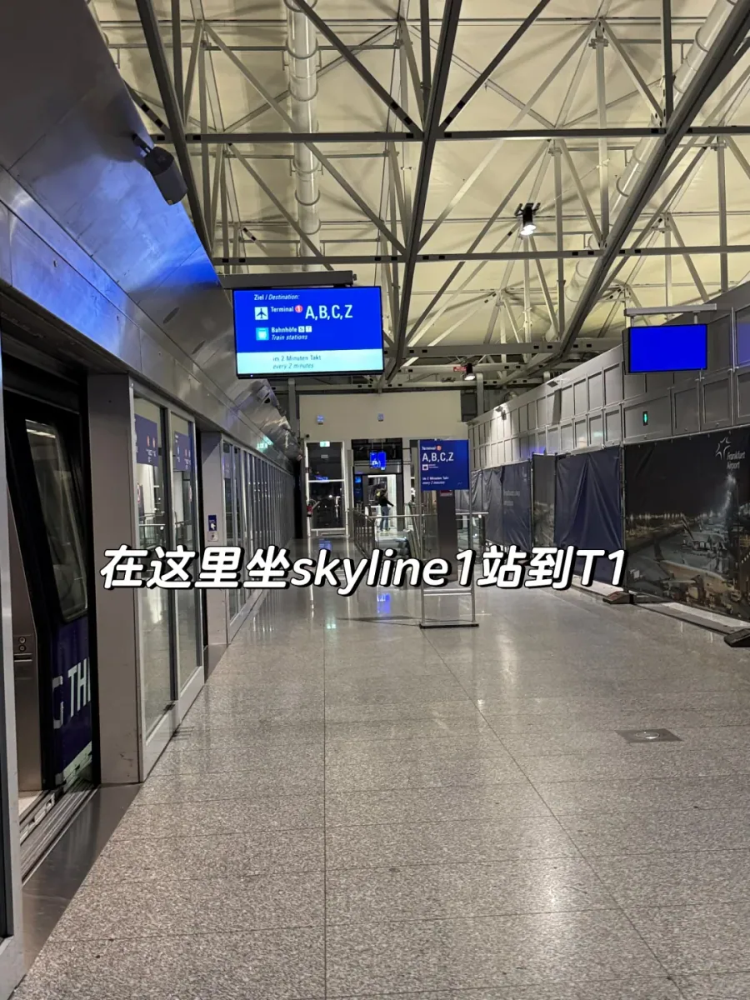

สนามบินแฟรงก์เฟิร์ต (FRA) เป็นสนามบินที่หนาแน่นที่สุดของเยอรมนีและเป็นหนึ่งในศูนย์กลางการเปลี่ยนเครื่องหลักของยุโรปภาคพื้นทวีป มีอาคารผู้โดยสารสองหลัง อาคารผู้โดยสาร 1 รองรับ Lufthansa และสายการบินส่วนใหญ่ใน Star Alliance ส่วนอาคารผู้โดยสาร 2 รองรับที่เหลือ ระหว่างสองอาคารมีพื้นที่ลานจอดและทางขับเครื่องบิน ซึ่งถูกข้ามด้วยรถรับส่งอัตโนมัติยกสูงชื่อ SkyLine

ส่วนที่ยุ่งยากหากคุณลงจอดที่อาคารผู้โดยสาร 2 คือสถานีรถไฟของสนามบินไม่ได้อยู่ใต้ดินของอาคารผู้โดยสาร 2 เลย แต่อยู่ใต้อาคารผู้โดยสาร 1 แอปแผนที่เห็นว่าคุณต้องการเข้าเมืองและยินดีเสนอรถบัส — ผู้เขียนบันทึกต้นฉบับพูดตรง ๆ ว่า **อย่าเชื่อ Google Maps เรื่องรถบัส**

คู่มือนี้เดินตามเส้นทางที่เดินจริง: ขาเข้าอาคารผู้โดยสาร 2 ตามป้าย Terminal 1 ขึ้น SkyLine ไปอาคารผู้โดยสาร 1 ตาม **Bahnhöfe / Train stations** ลงไปยังสถานีภูมิภาค แล้วขึ้น S8 หรือ S9 ประมาณสิบห้านาทีไปยัง Frankfurt (Main) Hauptbahnhof สถานีกลางของเมือง ทุกขั้นตอนอยู่ในอาคารผู้โดยสารและอาคารสถานี คุณจึงไม่ต้องยืนรอที่ขอบถนนพร้อมกระเป๋า

## 1. ทำไมรถบัสสนามบินจึงเป็นตัวเลือกที่ผิด

วางสนามบินกับเมืองบนแผนที่เดียวกัน แล้วรถบัสดูเกือบเป็นเส้นตรง: ออกจากอาคารผู้โดยสาร ข้ามถนน ขึ้นรถ แล้วอีกไม่กี่ป้ายคุณก็ถึงชายขอบใจกลางเมือง แต่แผนที่วัดระยะทางราบ ขณะที่สนามบินทำงานในแนวตั้ง ปัญหาไม่ใช่รถบัสจริง ๆ แต่คือการออกจากอาคาร

ป้ายรถบัสในแฟรงก์เฟิร์ตอยู่บนถนนนอกอาคารผู้โดยสาร จากขาเข้าอาคารผู้โดยสาร 2 คุณต้องเดินข้ามช่องจราจรก่อน หาป้ายให้ถูก คิดทิศทาง แล้วยืนรอกลางแจ้ง ฤดูหนาวแฟรงก์เฟิร์ตหนาวและเปียก ส่วนฤดูใบไม้ผลิและใบไม้ร่วงมีฝน สิบนาทีที่ป้ายก็เพียงพอให้เสียใจกับการตัดสินใจนั้น หากมีกระเป๋า คุณยังต้องยกขึ้นและลงเอง จากนั้นรถบัสใช้ถนนในเมืองซึ่งติดขัดในช่วงเช้าเร่งด่วน และเมื่อถึงเมืองโดยปกติคุณยังต้องต่อ U-Bahn หรือ S-Bahn อีกช่วงหนึ่ง — เป็นการย้ายกระเป๋าครั้งที่สอง

เส้นทางนี้ดูอ้อมเพราะตัวสนามบินมีหลายชั้น อาคารผู้โดยสาร 1 สร้างในทศวรรษ 1970 พร้อมสถานีรถไฟใต้ดินตั้งแต่แรก อาคารผู้โดยสาร 2 เพิ่มในทศวรรษ 1990 เพื่อเพิ่มความจุและไม่เคยมีชานชาลารถไฟของตัวเอง สนามบินจึงเชื่อมสองอาคารด้วยรถรับส่งยกสูง: คุณเปลี่ยนอาคารตามแนวราบก่อน แล้วจึงลงไปขึ้นรถไฟ เมื่อเข้าใจตรงนี้ คำถามที่ว่า "ทำไมไม่มีสถานีใต้อาคารผู้โดยสาร 2?" ก็ตอบตัวเอง

เส้นทางในอาคารไม่มีค่าใช้จ่ายใด ๆ นอกจากเวลาเดิน SkyLine ฟรีและวิ่งทุกสองสามนาที S-Bahn วิ่งใต้ดินหลีกเลี่ยงการจราจร และตลอดเส้นทางมีลิฟต์และบันไดเลื่อน ป้ายเป็นภาษาเยอรมันและอังกฤษ คุณจึงไม่ต้องถามใคร ส่วนเดียวที่ต้องจ่ายคือ S-Bahn ซึ่งยังไงก็ต้องซื้อตั๋วอยู่ดี

เส้นทางนี้ก็ไม่ใช่ทางที่เร็วที่สุดเช่นกัน จากขาเข้าอาคารผู้โดยสาร 2 ถึงชานชาลาที่ Hauptbahnhof เมื่อเผื่อเวลาเดินและรอ ครึ่งชั่วโมงเป็นเรื่องปกติ หากคุณมีเวลาระหว่างลงเครื่องกับเที่ยวต่อเพียงหนึ่งชั่วโมง รถแท็กซี่เป็นตัวเลือกที่ปลอดภัยกว่า หากมีเวลาเหลือเฟือ ไม่มีเหตุผลใดที่จะไปรอที่ป้ายรถบัส

## 2. จากอาคารผู้โดยสาร 2 ไปอาคารผู้โดยสาร 1: หา SkyLine

เมื่อออกจากขาเข้าอาคารผู้โดยสาร 2 ให้เงยดูป้ายแขวนสีน้ำเงิน ตรรกะของมันต้องใช้เวลาสักครู่: **"Terminal 1 A,B,C,Z" หมายถึงโถงเช็คอินของอีกอาคาร** ส่วน "D,E" เฉย ๆ หมายถึงสองโถงของอาคารผู้โดยสาร 2 เอง ผู้มาเยือนครั้งแรกมักสับสนระหว่างสองอย่าง ตาม D กับ E แล้ววนอยู่ในอาคารผู้โดยสาร 2

เล็งไปที่บรรทัดที่เขียน Terminal 1 แล้วตามลูกศร คุณจะผ่านป้ายควบคุมโรคและสุขภาพพืชที่เตือนเรื่องการนำผลิตภัณฑ์พืชต้องห้าม ผ่านไปแล้วเดินต่อจนถึงบันไดเลื่อนขึ้น

อีกไม่กี่ก้าว ป้ายเดียวกันในภาพระยะใกล้ชัดเจนขึ้น: **Ausgang / Exit** อยู่บรรทัดบน Terminal 1 A,B,C,Z อยู่ตรงกลาง และจุดรับกระเป๋ากับโถง D และ E อยู่ด้านล่าง จำกฎข้อหนึ่งตรงนี้: **ไปสถานีรถไฟ อย่าตาม Exit** Exit นำออกไปถนน ส่วน SkyLine อยู่ชั้นบน

หากคุณหลุดออกไปข้างนอกจริง ๆ ให้ใจเย็น เดินกลับเข้าอาคารผู้โดยสารแล้วมุ่งขึ้นอีกครั้งโดยดูไอคอนรถไฟเล็ก ๆ บนเพดาน แฟรงก์เฟิร์ตค่อนข้างใจดีในจุดนี้: สัญลักษณ์ SkyLine มองเห็นได้จากชั้นขาเข้า คุณจึงไม่ต้องถามใคร

บันไดเลื่อนพาคุณขึ้นสู่ชานชาลา SkyLine SkyLine คือรถรับส่งภายในของแฟรงก์เฟิร์ต: ตู้เล็กอัตโนมัติวิ่งบนรางยกสูงระหว่างสองอาคารผู้โดยสาร ใช้บริการ**ฟรี** ไม่ต้องมีตั๋ว ไม่มีประตูกั้น และหน้าจอชานชาลาแสดงเที่ยวถัดไป รถมา**ทุกสองถึงสามนาที**

ตู้โดยสารมีขนาดเล็กและแน่นในช่วงเร่งด่วน จึงควรเก็บกระเป๋าไว้ด้านหนึ่ง หากชานชาลาแออัด การรอรถเที่ยวถัดไปมักเร็วกว่าฝืนเบียด — ช่วงห่างเพียงสองสามนาที บางครั้งนาน ๆ ครั้ง SkyLine ปิดซ่อมและมีรถบัสทดแทน ประกาศที่ชานชาลาจะอธิบาย ในกรณีนั้นให้ตามเจ้าหน้าที่ไปยังเส้นทางระดับพื้นดินและเผื่อเวลาเพิ่มยี่สิบนาที

มีเพียงสองทิศทาง และป้ายบนชานชาลาระบุว่าทิศใดเป็นทิศใด การนั่งไปอาคารผู้โดยสาร 1 ใช้เวลาประมาณสองนาที มีประกาศเสียงและแผนที่เส้นทางที่มีไฟสว่าง ลงรถแล้วตามกระแสผู้คนเข้าสู่ขาเข้าอาคารผู้โดยสาร 1 จากจุดนี้คำสำคัญเปลี่ยน: ไม่ใช่ Terminal อีกต่อไป แต่เป็น Bahnhof

## 3. จากอาคารผู้โดยสาร 1 ถึงชานชาลา: ตามป้าย "Bahnhof"

ภายในอาคารผู้โดยสาร 1 ป้ายเปลี่ยนเป็น **Bahnhöfe / Train stations** มักมีตัว S และไอคอนรถไฟ ป้ายไม่ได้ชี้ไปยังชานชาลาเดียว แต่ชี้ไปยังสองครึ่งที่แตกต่างกันของสถานีสนามบิน ใต้อาคารผู้โดยสาร 1 มี **Regionalbahnhof** (สถานีภูมิภาค ชานชาลา 1–3) สำหรับ S-Bahn และรถไฟภูมิภาค และ **Fernbahnhof** (สถานีรถไฟระยะไกล ชานชาลา 4–7) สำหรับบริการ ICE ซึ่งตั้งอยู่ใต้อาคารยาวชื่อ The Squaire

สำหรับ Hauptbahnhof คุณต้องการ Regionalbahnhof ซึ่งอยู่ใต้ดินของอาคารผู้โดยสาร 1 โดยตรง: ตามป้ายลงหนึ่งหรือสองชั้น ผ่านทางเดินร้านค้าสั้น ๆ แล้วคุณก็ถึง ส่วน Fernbahnhof อยู่อีกทิศทางที่ปลายทางเดินยาว บนป้ายสองแห่งต่างกันเพียงคำเดียว และการเลือกผิดทำให้เสียเวลาสิบห้านาที

มีสองวิธีเร็ว ๆ ในการตรวจว่าคุณมาถูกทาง วิธีแรกคือหมายเลขชานชาลา: 1–3 คือสถานีภูมิภาค 4–7 คือสถานีระยะไกล วิธีที่สองคือผู้คนรอบตัว — ผู้เดินทางที่ลากกระเป๋าใบใหญ่และเพ่งดูเที่ยวบิน ICE มักมุ่งไป Fernbahnhof ทางเข้าสถานี Regionalbahnhof อยู่กลางอาคารผู้โดยสาร 1 และทางเดินลงจากตรงนั้นสั้น คุณจะไม่ผ่าน The Squaire

ที่ด้านล่าง ทางเดินแยกออกเป็นสองทาง ทางหนึ่งไป Bahnhöfe และ **AiRail Terminal** จุดเช็คอินทางอากาศ–รถไฟของ Lufthansa อีกทางนำไปทางออก Bus และ Taxi นี่คือจุดที่ผู้คนลังเลมากที่สุดในอาคารผู้โดยสาร 1 ยึดข้อเท็จจริงหนึ่งไว้ — S-Bahn ออกจาก Regionalbahnhof — แล้วป้าย Bus/Taxi ก็จะล่อคุณออกนอกอาคารไม่ได้ หากคุณมีรถเข็นเด็กหรือกระเป๋าหนัก ให้มองหาลิฟต์ที่ปลายทางเดินแทนที่จะฝืนบันไดเลื่อน

หากคุณเผลอไปถึง Fernbahnhof ก็ไม่ใช่หายนะ: ICE พาคุณถึง Hauptbahnhof ได้ในประมาณสิบห้านาที แต่ตั๋ว S-Bahn ของคุณจะใช้ไม่ได้ คุณต้องซื้อตั๋วระยะไกล และบางขบวนต้องจองที่นั่ง สำหรับการมาเยือนครั้งแรก วิธีแก้ที่ง่ายที่สุดคือเดินกลับไป Regionalbahnhof

## 4. สิบห้านาทีบน S8 หรือ S9

ชานชาลา 1 ถึง 3 ของ Regionalbahnhof เรียงเคียงกันอยู่ชั้นล่างของโถงผู้โดยสารหนึ่งชั้น ป้ายสีน้ำเงินเขียน **Gleis 1 / Track 1** ตามด้วย Frankfurt City และสัญลักษณ์ S-Bahn พร้อมลูกศรชี้ลงและไปด้านข้าง นั่นคือฝั่งที่ผู้โดยสารมุ่งเข้าเมืองส่วนใหญ่ใช้

ที่ชานชาลาด้านล่าง ให้ขึ้น **S8 หรือ S9** ที่มุ่งเข้าเมือง ทั้งสองสายให้บริการสนามบินและจอดที่ Hauptbahnhof ทั้งคู่ โดยหลังใจกลางเมืองเส้นทางจะต่างกันเล็กน้อย ซึ่งไม่ส่งผลหาก Hauptbahnhof คือจุดที่คุณลง อย่าขึ้นทิศตรงข้าม — ฝั่งนั้นวิ่งไป Mainz และ Wiesbaden และพาคุณห่างออกไปทุกป้าย

สิบห้านาทีต่อมา หลังผ่าน Gateway Gardens และ Frankfurt-Niederrad คุณจะถึง **Frankfurt (Main) Hauptbahnhof** ประกาศจะบอกชื่อสถานีก่อน แล้วจึงบอกสายที่ต่อได้ ชานชาลา S-Bahn ที่ Hauptbahnhof อยู่ใต้ดินหนึ่งชั้น ตามป้าย Hauptbahnhof หรือ Ausgang ขึ้นไป คุณจะออกมาที่โถงใหญ่ซึ่งมีนาฬิกาแขวนทรงกลมและแถวชานชาลารถไฟสายหลักอยู่ด้านบน

หากคุณมุ่งไปใจกลางเมืองบริเวณ Hauptwache หรือ Konstablerwache ไม่จำเป็นต้องลงที่ Hauptbahnhof เลย: S8 และ S9 วิ่งต่อไปทางตะวันออกผ่านอุโมงค์และจอดทั้งสองแห่ง Hauptbahnhof เป็นตัวเลือกที่ดีกว่าหากคุณต้องต่อรถไฟระยะไกลหรือพักใกล้สถานี ในทิศกลับกัน จากเมืองไปสนามบิน ก็เป็นสายเดียวกันย้อนกลับ เพียงตรวจจุดหมายบนหน้าจอชานชาลาก่อนขึ้นรถ

ตัว Hauptbahnhof เองควรมีภาพในใจไว้ สถานีนี้เป็นหนึ่งในสถานีปลายทางที่ใหญ่ที่สุดของเยอรมนี: ชานชาลารถไฟสายหลักเรียงเป็นแถวและมีหมายเลขถึงยี่สิบกว่าชานชาลา ส่วน S-Bahn อยู่ต่ำลงหนึ่งชั้น ผู้มาใหม่มักหลงทิศในโถง จึงควรอ่านหมายเลข Gleis บนป้ายก่อนแล้วจึงตัดสินใจว่าจะขึ้นชั้นใด หากจะไปขึ้น ICE ให้เดินไปปลายชานชาลาซึ่งมีทางเชื่อมข้ามราง

## 5. ตั๋ว ความถี่ และความผิดพลาดห้าจุดที่พบบ่อย

บนเส้นทางนี้มีเพียง S-Bahn ที่ต้องใช้ตั๋ว รถไฟชานเมืองแฟรงก์เฟิร์ตเป็นส่วนหนึ่งของเครือข่ายค่าโดยสาร **RMV** (Rhein-Main-Verkehrsverbund) และสนามบินกับเมืองอยู่ในระบบค่าโดยสารเดียวกัน เครื่องจำหน่ายตั๋วสีน้ำเงินในโถงเปลี่ยนเป็นภาษาอังกฤษได้: เลือก Frankfurt Hbf เป็นจุดหมาย แล้วเครื่องจะคำนวณค่าโดยสารให้ คุณยังซื้อตั๋วอิเล็กทรอนิกส์ล่วงหน้าผ่านแอป RMV หรือ DB Navigator ได้ **ไม่มีประตูกั้นตั๋ว**ที่ชานชาลา S-Bahn แต่มีเจ้าหน้าที่ตรวจบนรถ และการเดินทางโดยไม่มีตั๋วที่ใช้ได้ — หรือถือตั๋วกระดาษที่ยังไม่ประทับ — มีโทษปรับ หากซื้อตั๋วกระดาษ ให้ประทับในเครื่องเล็ก ๆ บนชานชาลาก่อนขึ้นรถ

หากคุณต้องเดินทางหลายเที่ยวในวันนั้น ตั๋วรายวัน (Tageskarte) มักง่ายกว่าซื้อตั๋วเที่ยวเดียวซ้ำ ๆ และเครื่องยังขายตั๋วกลุ่มด้วย ระวังเวลาเริ่มใช้: ตั๋วรายวันกระดาษมีผลตั้งแต่คุณประทับ ไม่ใช่ตั้งแต่คุณซื้อ ตั๋วในแอปไม่ต้องประทับ แต่ให้เปิดหน้าคำสั่งซื้อไว้เพื่อการตรวจ

| ช่วง | วิธี | เวลา | ความถี่ | ค่าใช้จ่าย |
| --- | --- | --- | --- | --- |
| T2 → T1 | ตามป้าย Terminal 1 ขึ้นบันไดเลื่อน นั่ง SkyLine | ประมาณ 2 นาที | ทุก 2–3 นาที | ฟรี |
| ขาเข้า T1 → ระดับสถานี | ตามป้าย Bahnhöfe/Train stations ลง | 5–8 นาที | — | — |
| ระดับสถานี → ชานชาลา S-Bahn | หา Gleis 1/Frankfurt City แล้วลงอีกหนึ่งชั้น | 2–3 นาที | — | — |
| T1 → Hauptbahnhof | S8 หรือ S9 มุ่งเข้าเมือง ผ่าน Gateway Gardens และ Niederrad | ประมาณ 15 นาที | ประมาณทุก 15 นาที | ค่าโดยสาร RMV |

เมื่อนำทุกช่วงมารวมกัน มีเพียงห้าจุดที่ผิดพลาดได้จริง:

1. **ตามป้าย Exit ที่อาคารผู้โดยสาร 2** แล้วไปโผล่ที่จุดจอดแท็กซี่ จากนั้นต้องเดินกลับเข้าไปหา SkyLine
2. **อ่าน D และ E เป็น Terminal 1** แล้ววนอยู่ในอาคารผู้โดยสาร 2
3. **เดินไป Fernbahnhof ที่อาคารผู้โดยสาร 1** แล้วพบแต่รถ ICE และตั๋ว S-Bahn ที่ใช้ไม่ได้
4. **ขึ้นผิดทิศที่ Regionalbahnhof** ไปทาง Mainz แล้วมองเมืองถอยห่างออกไป
5. **หาโถงใหญ่ที่ Hauptbahnhof ไม่พบ** ทั้งที่ป้าย Ausgang นำขึ้นไปถึงตรงนั้นได้เลย

ในทิศกลับกัน จากเมืองไปสนามบิน ให้เลือก **Frankfurt Flughafen Regionalbahnhof** เป็นจุดหมายบนตั๋ว ไม่ใช่ Frankfurt Flughafen Fernbahnhof อย่างที่สองคือสถานีระยะไกล S-Bahn ไม่จอดที่นั่นเลย และตั๋วจะพาคุณขึ้นรถไม่ได้ ชื่อสองแห่งต่างกันคำเดียวและเป็นความผิดพลาดที่เกิดง่ายที่สุดที่เครื่องจำหน่ายตั๋ว หน้าจอชานชาลาจะบอกว่าต้องใช้รางใด ให้ขึ้น S8 หรือ S9 ขบวนใดก็ได้ที่มาก่อน

เส้นทางนี้มาจากการเดินสำรวจของผู้เดินทางในเดือนกันยายน 2025 ความถี่และค่าโดยสารของ SkyLine และ S-Bahn ขึ้นอยู่กับข้อมูลประจำวันที่หน้างานและเว็บไซต์ของผู้ให้บริการ ในการลองครั้งแรก เผื่อเวลาหนึ่งชั่วโมงจากลงเครื่องถึงนั่งบน S-Bahn แล้วคุณจะไม่ต้องรีบ หากคุณต้องต่อรถไฟระยะไกลที่ Hauptbahnhof ให้บวกเวลาเดินสำหรับการเปลี่ยนขบวน

## ลิงก์ที่เกี่ยวข้อง

- **ในเว็บไซต์นี้**: [สนามบินแฟรงก์เฟิร์ต (FRA)](/airport/FRA), [เยอรมนี (DE)](/country/DE)
- **Wikipedia**: [สนามบินแฟรงก์เฟิร์ต](https://en.wikipedia.org/wiki/Frankfurt_Airport)
- **Baidu Baike**: [สนามบินแฟรงก์เฟิร์ต](https://baike.baidu.com/item/%E6%B3%95%E5%85%B0%E5%85%8B%E7%A6%8F%E6%9C%BA%E5%9C%BA)
