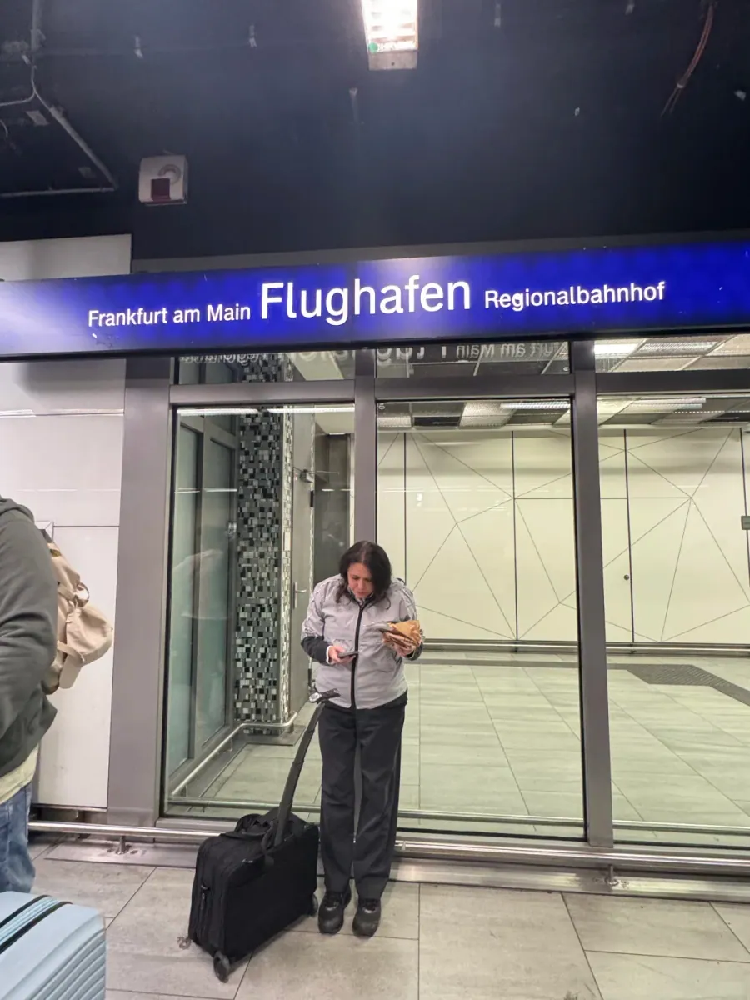

Frankfurt Havalimanı (FRA), Almanya'nın en yoğun havalimanı ve kıta Avrupası'nın ana aktarma merkezlerinden biri. İki terminali var. Terminal 1, Lufthansa ve Star Alliance taşıyıcılarının çoğuna hizmet veriyor; Terminal 2 geri kalanlara. Aralarında apron alanı ve taksi yolları uzanıyor; bunları SkyLine adlı yüksek bir sürücüsüz yolcu taşıma sistemi geçiyor.

Zor kısım, Terminal 2'ye inerseniz havalimanının demiryolu istasyonunun Terminal 2'nin altında olmaması. İstasyon Terminal 1'in altında. Harita uygulamaları şehre gitmek istediğinizi görüp memnuniyetle otobüs öneriyor — orijinal notun yazarı bu konuda açık sözlü: **otobüs için Google Maps'e güvenmeyin**.

Bu rehber gerçekten yürünen güzergâhı izliyor: Terminal 2 varışları, Terminal 1 tabelalarını izleyin, SkyLine ile Terminal 1'e gidin, **Bahnhöfe / Train stations** tabelalarını izleyerek bölgesel istasyona inin, ardından S8 veya S9 ile yaklaşık on beş dakikada şehrin ana istasyonu Frankfurt (Main) Hauptbahnhof'a gidin. Her adım terminal ve istasyon binalarının içinde geçiyor, böylece bavulunuzla hiçbir zaman kaldırımda durmuyorsunuz.

## 1. Havalimanı otobüsü neden yanlış seçim

Havalimanını ve şehri aynı haritaya koyduğunuzda otobüs neredeyse düz bir çizgi gibi görünür: terminalden çık, bir yolu geç, bin ve birkaç durak sonra merkezin kenarındasınız. Ama harita düz mesafeyi ölçer, havalimanı ise dikey çalışır. Asıl sorun otobüs değil; binadan çıkmak.

Frankfurt'ta otobüs durakları terminallerin dışındaki yollarda. Terminal 2 varışlarından önce trafik şeritlerinden geçer, doğru durağı bulur, yönü çözer ve açıkta beklersiniz. Frankfurt kışları soğuk ve yağışlı, ilkbahar ve sonbaharı yağmurlu; durakta on dakika pişman olmaya yeter. Bagajla ayrıca valizleri kendiniz yükleyip indirirsiniz. Otobüs sonra şehir sokaklarını kullanır; sabah zirvesinde tıkanır ve şehre vardığınızda genellikle son kısım için bir U-Bahn veya S-Bahn'a binmeniz gerekir — bagajla ikinci bir hamle.

Bu güzergâh dolambaçlı görünüyor çünkü havalimanının kendisi katmanlı. Terminal 1, 1970'lerde demiryolu istasyonu en baştan altında olacak şekilde inşa edildi. Terminal 2, 1990'larda ek kapasite için eklendi ve kendi raylı peronlarına hiç kavuşmadı. Bu yüzden havalimanı iki binayı yüksek bir servisle birbirine bağlıyor: önce yana doğru terminal değiştirirsiniz, sonra trene inmek için aşağı inersiniz. Bu netleşince “Terminal 2'nin altında neden istasyon yok?” sorusu kendi kendine yanıtlanıyor.

Kapalı güzergâh size yürümekten başka bir maliyet çıkarmaz. SkyLine ücretsiz ve birkaç dakikada bir çalışıyor, S-Bahn trafikten uzakta yer altında gidiyor ve tüm yol asansör ile yürüyen merdivenlerle hizmet veriyor. Tabelalar Almanca ve İngilizce, bu yüzden kimseye sormak zorunda kalmazsınız. Para ödediğiniz tek kısım S-Bahn ve o bileti zaten almanız gerekirdi.

En hızlı seçenek de değil. Terminal 2 varışlarından Hauptbahnhof peronuna, yürüme ve bekleme dahil, yarım saat normal. İniş ile bir sonraki aktarmanız arasında yalnızca bir saatiniz varsa taksi daha güvenli bahis. Zamanınız varsa otobüs durağında beklemenin hiçbir nedeni yok.

## 2. Terminal 2'den Terminal 1'e: SkyLine'ı bulmak

Terminal 2 varışlarından çıkarken mavi tavan tabelalarına bakın. Mantıkları bir an alıyor: **“Terminal 1 A,B,C,Z” diğer terminalin check-in salonlarını** gösterir, düz “D,E” ise Terminal 2'nin kendi iki salonunu. İlk kez gelenler ikisini karıştırır, D ve E'yi izler ve Terminal 2'de daireler çizerek kalır.

Terminal 1 yazan satıra odaklanın ve okları izleyin. Kısıtlı bitki ürünleri getirilmemesi konusunda uyaran bir dizi bitki sağlığı ve hastalık kontrolü ilanının yanından geçersiniz; görmezden gelin ve yukarı çıkan yürüyen merdivene ulaşana kadar devam edin.

Birkaç adım ileride aynı tabelanın yakın çekimi daha net: üst satırda **Ausgang / Exit**, ortada Terminal 1 A,B,C,Z, altta bagaj alımı ile D ve E salonları. Burada bir kuralı hatırlayın: **istasyona ulaşmak için Exit'i izlemeyin**. Exit sizi yola çıkarır, SkyLine ise üst kattadır.

Yine de dışarı çıkarsanız sakin olun. Terminale geri yürüyün ve tavandaki küçük tren simgesini izleyerek yeniden yukarı çıkın. Frankfurt bu konuda oldukça nazik: SkyLine simgesi varış katından görünüyor, bu yüzden kimseye sormanız gerekmeyecek.

Yürüyen merdiven sizi SkyLine peronuna çıkarıyor. SkyLine, Frankfurt'un iç yolcu taşıma sistemidir: iki terminal arasında yüksek bir hat üzerinde çalışan küçük otomatik vagonlar. **Ücretsizdir**, bilet gerektirmez, kapısı yoktur ve peron ekranı bir sonraki kalkışı gösterir. Trenler **iki-üç dakikada bir** gelir.

Vagonlar küçük ve zirve saatlerde doluyor, bu yüzden çantalarınızı bir yanda tutun. Peron kalabalıksa bir sonraki treni beklemek genellikle sıkışmaktan hızlıdır — aralık yalnızca birkaç dakika. Çok nadiren SkyLine bakım için kapanır ve yerine otobüsler çalışır; peron anonsları bunu açıklar. Bu durumda personeli yüzey güzergâhına kadar izleyin ve yirmi dakika ekleyin.

Yalnızca iki yön var ve peron tabelaları hangisinin hangisi olduğunu söylüyor. Terminal 1'e yolculuk yaklaşık iki dakika sürüyor; anonslar ve ışıklı güzergâh haritası eşlik ediyor. İnin ve akışı izleyerek Terminal 1 varışlarına girin. Buradan itibaren anahtar kelime değişiyor: artık Terminal değil, Bahnhof.

## 3. Terminal 1'den perona: “Bahnhof”u izleyin

Terminal 1'in içinde tabelalar **Bahnhöfe / Train stations** olarak değişiyor; genellikle bir S ve tren simgesiyle birlikte. Tek bir perona değil, havalimanı istasyonunun iki farklı yarısına işaret ediyorlar. Terminal 1'in altında S-Bahn ve bölgesel trenler için **Regionalbahnhof** (bölgesel istasyon, 1–3 numaralı raylar), The Squaire adlı uzun binanın altında ise ICE seferleri için **Fernbahnhof** (uzun mesafe istasyonu, 4–7 numaralı raylar) var.

Hauptbahnhof için Regionalbahnhof'u istiyorsunuz. Doğrudan Terminal 1'in altında: tabelaları izleyerek bir-iki kat inin, kısa bir mağaza geçidinden geçin ve oradasınız. Fernbahnhof ise başka bir yönde uzun bir koridorun sonunda. Tabelalarda ikisi tek kelimeyle ayrılır ve yanlış olanı almak size çeyrek saat kaybettirir.

Doğru yolda olduğunuzu kontrol etmenin iki hızlı yolu var. Birincisi peron numaraları: 1–3 bölgesel istasyon, 4–7 uzun mesafe istasyonu demek. İkincisi etrafınızdaki insanlar — büyük valizler sürükleyip ICE kalkışlarına göz atan yolcular genellikle Fernbahnhof'a gidiyordur. Regionalbahnhof girişi Terminal 1'in ortasında ve aşağı inen geçit kısa; The Squaire'in yanından hiç geçmezsiniz.

Dipte geçit ikiye ayrılıyor. Bir yön Bahnhöfe ve Lufthansa'nın hava-demiryolu check-in noktası **AiRail Terminal**'e, diğeri Otobüs ve Taksi çıkışlarına gidiyor. Terminal 1'de insanların en çok tereddüt ettiği yer burası. Bir gerçeğe tutunun — S-Bahn, Regionalbahnhof'tan kalkıyor — ve Otobüs/Taksi tabelaları sizi dışarı çekemez. Bebek arabası veya ağır valizleriniz varsa yürüyen merdivenle boğuşmak yerine geçidin sonundaki asansörü arayın.

Yanlışlıkla Fernbahnhof'ta bulursanız bu felaket değil: bir ICE sizi yaklaşık çeyrek saatte Hauptbahnhof'a götürür. Ama S-Bahn biletiniz geçerli olmaz, uzun mesafe bileti almanız gerekir ve bazı trenler rezervasyon ister. İlk ziyaret için en basit çözüm Regionalbahnhof'a geri yürümektir.

## 4. S8 veya S9 ile on beş dakika

Regionalbahnhof'un 1'den 3'e kadar rayları, salonun bir kat altında yan yana uzanıyor. Mavi bir tabelada **Gleis 1 / Track 1**, ardından Frankfurt City ve S-Bahn simgesi, aşağı ve yana bakan bir okla yazıyor. Şehre giden yolcuların çoğunun kullandığı taraf burası.

Peronda aşağıda şehre giden **S8 veya S9**'a binin. İki hat da havalimanına hizmet ediyor ve ikisi de Hauptbahnhof'ta duruyor; şehir merkezinden sonra biraz farklı güzergâhlar izliyorlar, Hauptbahnhof durağınızsa bunun bir önemi yok. Diğer yöne binmeyin — o taraf Mainz ve Wiesbaden'e gidiyor ve her durakta sizi daha da uzaklaştırıyor.

Çeyrek saat sonra, Gateway Gardens ve Frankfurt-Niederrad'dan geçerek **Frankfurt (Main) Hauptbahnhof**'a varıyorsunuz. Anons önce istasyon adını, sonra bağlantı hatlarını veriyor. Hauptbahnhof'taki S-Bahn peronları yerin bir kat altında; Hauptbahnhof veya Ausgang tabelalarını izleyerek yukarı çıkın ve yuvarlak saat ile sıra sıra ana hat peronlarının bulunduğu büyük salona ulaşın.

Hauptwache veya Konstablerwache civarındaki şehir merkezine gidiyorsanız Hauptbahnhof'ta hiç inmeniz gerekmez: S8 ve S9 tünel boyunca doğuya devam eder ve ikisinde de durur. Uzun mesafe trenine aktarma yapacaksanız veya istasyon yakınında kalacaksanız Hauptbahnhof daha iyi seçim. Ters yönde, şehirden havalimanına giderken aynı hattı geri kullanırsınız; binmeden önce peron ekranındaki varış yerini kontrol edin.

Hauptbahnhof'un kendisi zihinde canlandırmaya değer. Almanya'nın en büyük baş istasyonlarından biri: ana hat peronları bir sıra halinde uzanıyor ve yirmilere kadar numaralanıyor, S-Bahn ise bir kat altta. İlk kez gelenler salonda yönünü kaybetmeye meyillidir, bu yüzden önce tabeladaki Gleis numarasını okuyun, sonra hangi kata gideceğinize karar verin. Bir ICE'ye ulaşmak için peronun sonuna yürüyün; orada rayları birbirine bağlayan bir geçiş koridoru var.

## 5. Biletler, sefer sıklıkları ve olağan beş hata

Bu güzergâhta yalnızca S-Bahn bilet gerektiriyor. Frankfurt'un banliyö demiryolu **RMV** ücret ağına (Rhein-Main-Verkehrsverbund) dahil ve havalimanı ile şehir aynı ücret sisteminin içinde. Salondaki mavi bilet makineleri İngilizceye geçiyor: varış yeri olarak Frankfurt Hbf'yi seçin, makine ücreti hesaplıyor. RMV veya DB Navigator uygulamasıyla önceden e-bilet de alabilirsiniz. S-Bahn peronlarında **bilet turnikesi yok**, ama denetçiler trene biner ve geçerli biletsiz — ya da damgalanmamış kâğıt biletle — seyahat ceza getirir. Kâğıt aldıysanız binmeden önce perondaki küçük makinede damgalayın.

O gün birkaç kez binecekseniz gün bileti (Tageskarte) genellikle tek biletleri tekrar tekrar almaktan daha basit ve makineler grup bileti de satıyor. Başlangıç saatine dikkat edin: kâğıt gün bileti satın aldığınız andan değil, damgaladığınız andan itibaren geçerlidir. Uygulama biletleri damga gerektirmez, ama denetim için sipariş sayfasını açık tutun.

| Bacak | Nasıl | Süre | Sıklık | Maliyet |
| --- | --- | --- | --- | --- |
| T2 → T1 | Terminal 1 tabelalarını izleyerek yürüyen merdivenle çıkın, SkyLine'a binin | yaklaşık 2 dakika | 2–3 dakikada bir | ücretsiz |
| T1 varışları → istasyon katı | Bahnhöfe/Train stations tabelalarını izleyerek inin | 5–8 dakika | — | — |
| İstasyon katı → S-Bahn peronu | Gleis 1/Frankfurt City tabelasını arayın, bir kat daha inin | 2–3 dakika | — | — |
| T1 → Hauptbahnhof | Şehir yönünde S8 veya S9; Gateway Gardens ve Niederrad üzerinden | yaklaşık 15 dakika | yaklaşık 15 dakikada bir | RMV ücreti |

Parçaları birleştirdiğinizde gerçekte yalnızca beş yerde yanlış gidebilirsiniz:

1. **Terminal 2'de Exit'i izleyip** taksi durağına çıkmak ve sonra geri girip SkyLine'ı aramak.
2. **D ve E'yi Terminal 1 sanmak** ve Terminal 2 içinde dönüp durmak.
3. **Terminal 1'de Fernbahnhof'a yürümek**, yalnızca ICE trenleri ve geçersiz bir S-Bahn bileti bulmak.
4. **Regionalbahnhof'ta yanlış yöne binmek**, Mainz'e doğru gitmek ve şehrin gözden uzaklaşmasını izlemek.
5. **Hauptbahnhof'ta büyük salonu bulamamak**; oysa Ausgang tabelaları doğrudan oraya çıkar.

Ters yönde, şehirden havalimanına giderken bilet varış yeri olarak **Frankfurt Flughafen Regionalbahnhof**'u seçin, Frankfurt Flughafen Fernbahnhof'u değil. İkincisi uzun mesafe istasyonu; S-Bahn orada hiç durmaz ve bilet sizi trene bindirmez. Adlar tek kelimeyle farklı ve makinede yapılabilecek en kolay hata. Peron ekranı hangi rayı kullanacağınızı söyler; S8 ve S9'dan hangisi önce gelirse ona binin.

Bu güzergâh Eylül 2025'te bir yolcunun yürüyerek yaptığı denemeden geliyor; SkyLine ve S-Bahn sıklıkları ile ücretleri, günün koşullarına ve işletmecinin web sitesindeki bilgilere tabidir. İlk denemede inişten S-Bahn'da oturmaya kadar bir saat ayırın, acele etmeniz gerekmeyecek. Hauptbahnhof'ta uzun mesafe trenine aktarma yapacaksanız, aktarma için yürüme süresini ekleyin.

## İlgili bağlantılar

- **Bu sitede**: [Frankfurt Havalimanı (FRA)](/airport/FRA), [Almanya (DE)](/country/DE)
- **Wikipedia**: [Frankfurt Airport](https://en.wikipedia.org/wiki/Frankfurt_Airport)
- **Baidu Baike**: [Frankfurt Airport](https://baike.baidu.com/item/%E6%B3%95%E5%85%B0%E5%85%8B%E7%A6%8F%E6%9C%BA%E5%9C%BA)
