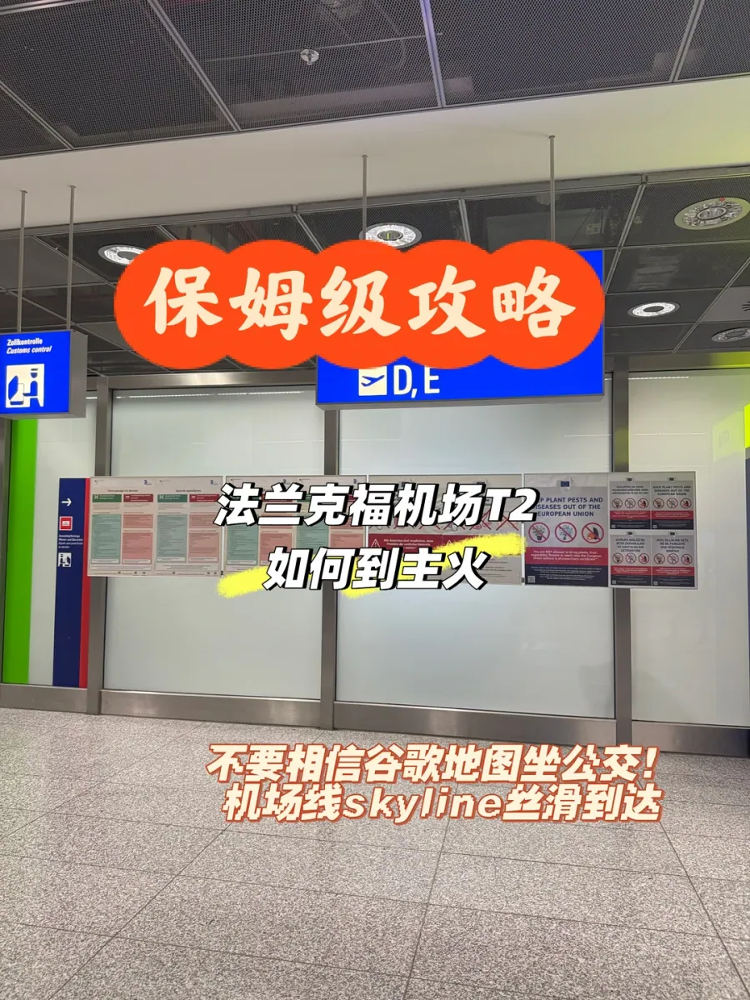
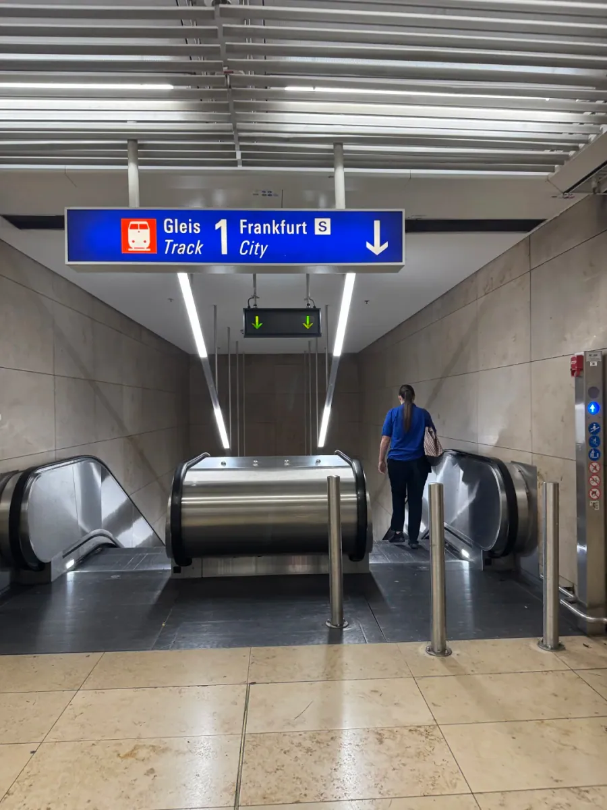

Sân bay Frankfurt (FRA) là sân bay bận rộn nhất nước Đức và là một trong những trung tâm trung chuyển chính của lục địa châu Âu. Sân bay có hai nhà ga. Nhà ga 1 phục vụ Lufthansa và phần lớn các hãng thuộc Star Alliance; Nhà ga 2 phục vụ phần còn lại. Giữa hai nhà ga là khu sân đỗ và đường lăn, được bắc qua bằng một tuyến tàu trung chuyển tự động trên cao có tên SkyLine.

Điều bất tiện, nếu bạn hạ cánh ở Nhà ga 2, là ga đường sắt của sân bay hoàn toàn không nằm bên dưới Nhà ga 2. Ga nằm dưới Nhà ga 1. Các ứng dụng bản đồ thấy bạn muốn vào thành phố và vui vẻ gợi ý xe buýt — tác giả của ghi chú gốc nói thẳng về điều này: **đừng tin Google Maps về xe buýt**.

Hướng dẫn này đi theo lộ trình thực tế đã đi bộ: đến Nhà ga 2, đi theo biển Nhà ga 1, đi SkyLine đến Nhà ga 1, đi theo biển **Bahnhöfe / Train stations** xuống ga khu vực, rồi bắt S8 hoặc S9 khoảng mười lăm phút đến Frankfurt (Main) Hauptbahnhof, ga trung tâm của thành phố. Mọi bước đều diễn ra bên trong các tòa nhà nhà ga và ga tàu, nên bạn không bao giờ phải đứng bên lề đường với chiếc vali.

## 1. Vì sao xe buýt sân bay là lựa chọn sai

Đặt sân bay và thành phố lên cùng một bản đồ, xe buýt trông gần như một đường thẳng: rời nhà ga, băng qua đường, lên xe, vài điểm dừng sau là bạn đã ở rìa trung tâm. Nhưng bản đồ đo khoảng cách trên mặt phẳng, còn sân bay vận hành theo chiều thẳng đứng. Xe buýt thực ra không phải vấn đề; rời khỏi tòa nhà mới là vấn đề.

Các điểm dừng xe buýt ở Frankfurt nằm trên đường bên ngoài nhà ga. Từ khu đến Nhà ga 2, trước tiên bạn phải băng qua các làn xe, tìm đúng điểm dừng, xác định hướng đi, rồi chờ ngoài trời. Mùa đông Frankfurt lạnh và ẩm, mùa xuân và mùa thu mưa nhiều; mười phút chờ ở điểm dừng là đủ để bạn hối hận. Với hành lý, bạn còn phải tự bốc và dỡ túi. Xe buýt sau đó chạy trên đường phố, thường tắc vào giờ cao điểm buổi sáng, và khi đến thành phố, bạn thường vẫn phải đi U-Bahn hoặc S-Bahn cho chặng cuối — thêm một lần di chuyển với hành lý.

Lộ trình này trông vòng vèo vì bản thân sân bay được xây theo nhiều tầng. Nhà ga 1 được xây từ những năm 1970 với ga đường sắt nằm bên dưới ngay từ đầu. Nhà ga 2 được bổ sung vào những năm 1990 để tăng công suất và chưa bao giờ có sân ga riêng. Vì vậy sân bay nối hai tòa nhà bằng một tuyến tàu trung chuyển trên cao: trước tiên bạn đổi nhà ga theo chiều ngang, rồi đi xuống để bắt tàu. Khi đã hiểu điều đó, câu hỏi “vì sao không có ga dưới Nhà ga 2?” tự trả lời.

Lộ trình trong nhà không tốn gì ngoài việc đi bộ. SkyLine miễn phí và chạy vài phút một chuyến, S-Bahn chạy ngầm tránh giao thông, và toàn bộ tuyến có thang máy và thang cuốn. Biển chỉ dẫn bằng tiếng Đức và tiếng Anh, nên bạn không bao giờ phải hỏi. Phần duy nhất bạn phải trả tiền là S-Bahn, và dù sao bạn cũng phải mua vé đó.

Đây cũng không phải lựa chọn nhanh nhất. Từ khu đến Nhà ga 2 đến sân ga ở Hauptbahnhof, tính cả đi bộ và chờ đợi, nửa giờ là bình thường. Nếu bạn chỉ có một giờ giữa lúc hạ cánh và chuyến nối tiếp theo, taxi là lựa chọn an toàn hơn. Nếu có thời gian, không có lý do gì phải chờ ở trạm xe buýt.

## 2. Từ Nhà ga 2 đến Nhà ga 1: tìm SkyLine

Khi ra khỏi khu đến Nhà ga 2, hãy nhìn lên các biển chỉ dẫn màu xanh trên cao. Logic của chúng mất một chút thời gian để hiểu: **“Terminal 1 A,B,C,Z” chỉ các sảnh làm thủ tục của nhà ga bên kia**, còn “D,E” đơn giản là hai sảnh của chính Nhà ga 2. Người lần đầu thường nhầm hai thứ này, đi theo D và E, rồi loanh quanh trong Nhà ga 2.

Hãy xác định dòng ghi Terminal 1 và đi theo mũi tên. Bạn sẽ đi qua một dãy biển kiểm dịch thực vật và phòng chống dịch bệnh, cảnh báo không mang các sản phẩm thực vật bị hạn chế; hãy bỏ qua và tiếp tục cho đến khi đến thang cuốn đi lên.

Đi thêm vài bước, cùng tấm biển ở cự ly gần rõ hơn: dòng trên cùng là **Ausgang / Exit**, ở giữa là Terminal 1 A,B,C,Z, bên dưới là nhận hành lý và các sảnh D, E. Hãy nhớ một quy tắc: **để đến ga tàu, đừng đi theo Exit**. Exit dẫn ra đường, còn SkyLine ở trên lầu.

Nếu bạn lỡ ra ngoài, hãy bình tĩnh. Đi ngược vào nhà ga và lên lại bằng biểu tượng tàu nhỏ trên trần. Frankfurt khá tử tế ở điểm này: biểu tượng SkyLine có thể thấy từ tầng đến, nên bạn không cần hỏi ai.

Thang cuốn đưa bạn đến sân ga SkyLine. SkyLine là tàu trung chuyển nội bộ của Frankfurt: các toa tự động nhỏ chạy trên đường ray trên cao giữa hai nhà ga. Tàu **miễn phí**, không cần vé và không có cổng soát, màn hình sân ga hiển thị chuyến tiếp theo. Tàu đến **cứ hai đến ba phút một chuyến**.

Các toa nhỏ và đông vào giờ cao điểm, nên hãy giữ hành lý sang một bên. Nếu sân ga đông, chờ chuyến sau thường nhanh hơn chen lên — khoảng cách chỉ vài phút. Rất hiếm khi SkyLine đóng cửa để bảo trì và có xe buýt thay thế; thông báo tại sân ga sẽ giải thích. Khi đó, hãy đi theo nhân viên đến tuyến trên mặt đất và cộng thêm hai mươi phút.

Chỉ có hai hướng, và biển ở sân ga ghi rõ hướng nào. Chuyến đi đến Nhà ga 1 mất khoảng hai phút, có thông báo và bản đồ tuyến được chiếu sáng. Xuống tàu và đi theo dòng người vào khu đến Nhà ga 1. Từ đây, từ khóa thay đổi: không còn là Terminal nữa, mà là Bahnhof.

## 3. Từ Nhà ga 1 đến sân ga: đi theo “Bahnhof”

Bên trong Nhà ga 1, biển chỉ dẫn chuyển sang **Bahnhöfe / Train stations**, thường kèm biểu tượng S và tàu. Chúng không chỉ đến một sân ga duy nhất mà đến hai nửa khác nhau của ga sân bay. Dưới Nhà ga 1 có **Regionalbahnhof** (ga khu vực, đường ray 1–3) cho S-Bahn và tàu khu vực, và **Fernbahnhof** (ga đường dài, đường ray 4–7) cho các chuyến ICE, nằm bên dưới tòa nhà dài có tên The Squaire.

Đến Hauptbahnhof, bạn cần Regionalbahnhof. Ga nằm ngay dưới Nhà ga 1: đi theo biển xuống một hoặc hai tầng, qua một dãy cửa hàng ngắn là đến. Ngược lại, Fernbahnhof nằm ở cuối một hành lang dài theo hướng khác. Trên biển, hai ga chỉ khác nhau một từ, và chọn nhầm sẽ tốn của bạn mười lăm phút.

Có hai cách nhanh để kiểm tra bạn đang đi đúng. Thứ nhất là số sân ga: 1–3 là ga khu vực, 4–7 là ga đường dài. Thứ hai là những người xung quanh — hành khách kéo vali lớn và nheo mắt nhìn giờ tàu ICE thường đang đi đến Fernbahnhof. Lối vào Regionalbahnhof nằm ở giữa Nhà ga 1, và lối đi xuống ngắn; bạn không bao giờ đi qua The Squaire.

Ở phía dưới, hành lang tách làm hai. Một hướng là Bahnhöfe và **AiRail Terminal**, quầy làm thủ tục đường sắt – hàng không của Lufthansa; hướng kia dẫn đến lối ra xe buýt và taxi. Đây là chỗ người ta do dự nhiều nhất trong Nhà ga 1. Hãy nhớ một điều — S-Bahn khởi hành từ Regionalbahnhof — và biển Bus/Taxi sẽ không dụ được bạn ra ngoài. Nếu bạn có xe đẩy em bé hoặc vali nặng, hãy tìm thang máy ở cuối hành lang thay vì vật lộn với thang cuốn.

Nếu lỡ đến Fernbahnhof, cũng không phải thảm họa: một chuyến ICE sẽ đưa bạn đến Hauptbahnhof trong khoảng mười lăm phút. Nhưng vé S-Bahn của bạn sẽ không có giá trị, bạn cần mua vé đường dài, và một số chuyến yêu cầu đặt chỗ. Với lần đầu đến, cách sửa đơn giản nhất là đi bộ trở lại Regionalbahnhof.

## 4. Mười lăm phút trên S8 hoặc S9

Các đường ray 1 đến 3 của Regionalbahnhof nằm cạnh nhau, một tầng dưới sảnh. Một biển xanh ghi **Gleis 1 / Track 1**, tiếp theo là Frankfurt City và biểu tượng S-Bahn, với mũi tên chỉ xuống và sang bên. Đó là phía mà phần lớn hành khách vào thành phố sử dụng.

Xuống sân ga, hãy bắt **S8 hoặc S9** đi vào thành phố. Cả hai tuyến đều phục vụ sân bay và đều dừng ở Hauptbahnhof; sau trung tâm thành phố chúng đi tuyến hơi khác nhau, nhưng điều đó không quan trọng nếu Hauptbahnhof là điểm dừng của bạn. Đừng đi hướng ngược lại — phía đó chạy đến Mainz và Wiesbaden và đưa bạn xa dần thêm sau mỗi điểm dừng.

Mười lăm phút sau, qua Gateway Gardens và Frankfurt-Niederrad, bạn đến **Frankfurt (Main) Hauptbahnhof**. Thông báo đọc tên ga trước, rồi các tuyến nối tiếp. Các sân ga S-Bahn tại Hauptbahnhof nằm một tầng dưới mặt đất; đi theo biển Hauptbahnhof hoặc Ausgang lên và bạn sẽ ra sảnh lớn với chiếc đồng hồ tròn và các dãy sân ga đường sắt chính ở phía trên.

Nếu bạn đi đến trung tâm quanh Hauptwache hoặc Konstablerwache, bạn không cần xuống ở Hauptbahnhof: S8 và S9 tiếp tục về phía đông qua đường hầm và dừng ở cả hai ga. Hauptbahnhof là lựa chọn tốt hơn nếu bạn đổi sang tàu đường dài hoặc lưu trú gần ga. Đi ngược lại, từ thành phố ra sân bay, cũng là tuyến đó theo chiều ngược lại; chỉ cần kiểm tra điểm đến trên màn hình sân ga trước khi lên tàu.

Bản thân Hauptbahnhof đáng để hình dung trước. Đây là một trong những ga đầu cuối lớn nhất nước Đức: các sân ga đường sắt chính chạy thành dãy và được đánh số đến hàng hai mươi, còn S-Bahn nằm một tầng bên dưới. Người lần đầu thường mất phương hướng trong sảnh, nên hãy đọc số Gleis trên biển trước rồi mới quyết định đi tầng nào. Để đến một chuyến ICE, hãy đi đến cuối sân ga, nơi có hành lang ngang nối các đường ray.

## 5. Vé, tần suất và năm lỗi thường gặp

Chỉ S-Bahn cần vé trên lộ trình này. Đường sắt ngoại ô Frankfurt thuộc mạng lưới giá vé **RMV** (Rhein-Main-Verkehrsverbund), và sân bay cùng thành phố nằm trong cùng hệ thống giá. Máy bán vé màu xanh trong sảnh chuyển được sang tiếng Anh: chọn Frankfurt Hbf làm điểm đến và máy sẽ tính giá vé. Bạn cũng có thể mua vé điện tử trước bằng ứng dụng RMV hoặc DB Navigator. **Không có cổng soát vé** tại các sân ga S-Bahn, nhưng nhân viên kiểm soát có lên tàu, và đi tàu không có vé hợp lệ — hoặc có vé giấy chưa đóng dấu — sẽ bị phạt. Nếu mua vé giấy, hãy đóng dấu vào máy nhỏ trên sân ga trước khi lên tàu.

Nếu trong ngày bạn đi lại nhiều lần, vé ngày (Tageskarte) thường đơn giản hơn mua nhiều vé lẻ, và máy cũng bán vé nhóm. Hãy chú ý giờ bắt đầu hiệu lực: vé ngày giấy có hiệu lực từ lúc bạn đóng dấu, không phải từ lúc mua. Vé trên ứng dụng không cần đóng dấu, nhưng hãy để sẵn trang đơn hàng khi bị kiểm tra.

| Chặng | Cách đi | Thời gian | Tần suất | Chi phí |
| --- | --- | --- | --- | --- |
| T2 → T1 | Đi theo biển Terminal 1 lên thang cuốn, đi SkyLine | khoảng 2 phút | cứ 2–3 phút | miễn phí |
| Khu đến T1 → tầng ga | Đi theo Bahnhöfe/Train stations xuống | 5–8 phút | — | — |
| Tầng ga → sân ga S-Bahn | Tìm Gleis 1/Frankfurt City, xuống thêm một tầng | 2–3 phút | — | — |
| T1 → Hauptbahnhof | S8 hoặc S9 về phía thành phố, qua Gateway Gardens và Niederrad | khoảng 15 phút | khoảng 15 phút một chuyến | giá vé RMV |

Ghép các bước lại, thực ra chỉ có năm chỗ dễ đi sai:

1. **Đi theo Exit ở Nhà ga 2** và ra bến taxi, rồi phải quay lại tìm SkyLine.
2. **Đọc D và E thành Nhà ga 1** và loanh quanh trong Nhà ga 2.
3. **Đi bộ đến Fernbahnhof ở Nhà ga 1**, chỉ thấy tàu ICE và vé S-Bahn không hợp lệ.
4. **Lên nhầm hướng ở Regionalbahnhof**, về phía Mainz, và nhìn thành phố lùi xa.
5. **Không tìm được sảnh chính ở Hauptbahnhof**, trong khi biển Ausgang dẫn thẳng lên đó.

Đi ngược lại, từ thành phố ra sân bay, hãy chọn **Frankfurt Flughafen Regionalbahnhof** làm điểm đến trên vé, không phải Frankfurt Flughafen Fernbahnhof. Ga thứ hai là ga đường dài, S-Bahn không bao giờ dừng ở đó, và vé sẽ không đưa bạn lên tàu. Hai tên chỉ khác nhau một từ và đây là lỗi dễ mắc nhất ở máy bán vé. Màn hình sân ga sẽ cho biết dùng đường ray nào; hãy bắt chuyến S8 hoặc S9 nào đến trước.

Lộ trình này dựa trên trải nghiệm đi bộ của một du khách vào tháng 9 năm 2025; tần suất SkyLine và S-Bahn cùng giá vé phụ thuộc thông tin trong ngày tại hiện trường và trên trang web của nhà vận hành. Trong lần đầu, hãy dành một giờ từ lúc hạ cánh đến lúc ngồi trên S-Bahn và bạn sẽ không phải vội. Nếu bạn nối sang tàu đường dài tại Hauptbahnhof, hãy cộng thêm thời gian đi bộ để đổi tàu.

## Liên kết liên quan

- **Trên trang này**: [Sân bay Frankfurt (FRA)](/airport/FRA), [Đức (DE)](/country/DE)
- **Wikipedia**: [Sân bay Frankfurt](https://en.wikipedia.org/wiki/Frankfurt_Airport)
- **Baidu Baike**: [Sân bay Frankfurt](https://baike.baidu.com/item/%E6%B3%95%E5%85%B0%E5%85%8B%E7%A6%8F%E6%9C%BA%E5%9C%BA)
