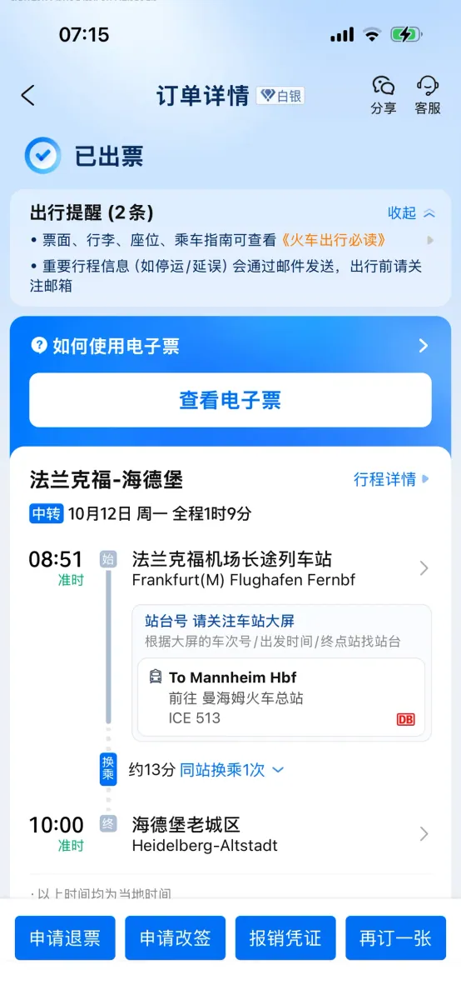

টার্মিনাল ৩ ফ্রাঙ্কফুর্ট বিমানবন্দরের সবচেয়ে নতুন ভবন, বিমানবন্দরের দক্ষিণ দিকে তৈরি, আর এর সঙ্গে টার্মিনাল ১ ও ২-এর মাঝখানে রয়েছে রানওয়ে। হলটি প্রশস্ত আর সাইনবোর্ডও যথেষ্ট, তবু বিমান থেকে নেমে ট্রেনে ওঠা পর্যন্ত বেশ কিছু ধাপ পেরোতে হয়, যা অধিকাংশ মানুষ ভাবেন না: পাসপোর্ট নিয়ন্ত্রণ, লাগেজ, পিপল মুভারে মোটামুটি দীর্ঘ যাত্রা, তারপর খুব লম্বা একটি করিডোর।

সমস্যার মূল হলো স্টেশনটি কোথায়। ফ্রাঙ্কফুর্টে সব দূরপাল্লার ট্রেন — ICE আর IC উভয়ই — ছাড়ে টার্মিনাল ১-এর দিকের **ফার্নবানহফ** থেকে। টার্মিনাল ৩-এর নিজের কোনো দূরপাল্লার প্ল্যাটফর্ম নেই, তাই সেখান থেকে যাত্রা শুরু করা যাত্রীদের প্রথমে টার্মিনাল ১-এ ফিরে যেতে হয়, তারপর স্টেশন হলটি যে লম্বা ভবন The Squaire-এ অবস্থিত, সেটি পেরিয়ে ট্রেনে পৌঁছাতে হয়।

২০২৬ সালের অক্টোবরে এক ভ্রমণকারী পুরো যাত্রার সময় মেপে দেখেন। ফ্লাইটটি **06:00**-এ টার্মিনাল ৩-এ অবতরণ করে। পাসপোর্ট নিয়ন্ত্রণ, লাগেজ ও পথ খোঁজার পর ফার্নবানহফ হলে পৌঁছানোর সময় ছিল প্রায় **07:50** — মোট **১ ঘণ্টা ৪০ মিনিট**, দৌড়াদৌড়ি নয়, শুধু স্যুটকেস টেনে স্বাভাবিক হাঁটার গতিতে। এই গাইডে সেই যাত্রাটি ধাপে ধাপে ভাগ করে দেখানো হয়েছে এবং কোথায় সময় বাঁচানো যায় আর কোথায় যায় না, তা তুলে ধরা হয়েছে।

## ১. টার্মিনাল ৩ এবং দূরত্বের সমস্যা

ফ্রাঙ্কফুর্টের সম্প্রসারণের জায়গা করতেই টার্মিনাল ৩ তৈরি হয়েছে। টার্মিনাল ১ ও ২ বছরের পর বছর ধরে প্রায় পূর্ণ ক্ষমতায় চলছিল, আর অবশিষ্ট জমি ছিল কেবল রানওয়ের অপর পাশে; সে কারণেই নতুন ভবনটি পুরোনো দুটির থেকে আলাদা অবস্থান করছে। সেটি সম্ভব করতে বিমানবন্দরটি স্কাইলাইন পিপল মুভারকে টার্মিনাল ৩ পর্যন্ত সম্প্রসারিত করেছে, তাই যাত্রীদের আর ভবনগুলোর মধ্যে শাটল বাসের দরকার হয় না। বিনিময়ে যাত্রাটি দীর্ঘ হয়েছে: টার্মিনাল ২ থেকে টার্মিনাল ১-এ দুই মিনিট, কিন্তু টার্মিনাল ৩ থেকে **আট থেকে দশ মিনিট**।

যাত্রাটি এতটাই দীর্ঘ যে নিজের স্টেশনটি মিস করেছেন কি না, এমন সন্দেহ জাগতে পারে। ট্রেনটি উঁচু ট্র্যাকে অ্যাপ্রনের চারপাশে ঘোরে, আর জানালার বাইরে টার্মিনালের মতো কিছু নয়, বরং ট্যাক্সিওয়ে, বিমান দাঁড় করানোর জায়গা আর সারি সারি টেইল ফিন দেখা যায়। সত্যিই এটি ঘুরপথেই যায়। মূল লেখকেরও একই কথা: টার্মিনাল ৩ নতুন, সাইনও আছে, কিন্তু **দূরত্বগুলো দীর্ঘ**, আর সময়ের বেশ খানিকটা শুধু পিপল মুভারেই কেটে যায়।

সহজে যেটি কম গুরুত্ব পায়, তা হলো যাত্রার আগে ঘটে যাওয়া সবকিছু। সকাল ছটার দিকে দূরপাল্লার ফ্লাইটগুলো একসঙ্গে এসে পড়ে, তাই পাসপোর্টের লাইন আর লাগেজ বেল্ট দুটোই ধীর হতে পারে; বিমান যদি দূরের স্ট্যান্ডে দাঁড়ায়, তাহলে আগে বাসে যেতে হয়। রুটের বর্ণনায় এসবের কিছুই থাকে না, অথচ ১ ঘণ্টা ৪০ মিনিটের বেশির ভাগ সময় এখানেই গেছে। তাই টার্মিনাল ৩ থেকে স্টেশনে যেতে এক ঘণ্টার বেশি লাগে—এ কথা পড়লে বুঝুন, সমস্যা রুটে নয়; সময় কাটে টার্মিনালে, ট্র্যাকে নয়।

এটাই ব্যাখ্যা করে, টার্মিনাল ৩-এ নামলে ট্রেন বুক করার সময় কেন বেশি বাফার রাখা উচিত। টার্মিনাল ২ থেকে অবতরণের পর চল্লিশ মিনিটে S-Bahn-এ বসে পড়া সাধারণ ব্যাপার। টার্মিনাল ৩-এ যোগ হয় পিপল মুভার আর লম্বা করিডোর, তাই সেই একই আরামদায়ক ব্যবধান হয়ে যায় এক ঘণ্টা বা তার বেশি। অবতরণের অন্তত দুই ঘণ্টা পরে ICE বুক করুন, তাহলে তাড়াহুড়ো করতে হবে না; হাতে মাত্র এক ঘণ্টা থাকলে দ্রুত লাগেজ বেল্টের ভরসায় না থেকে পরের ট্রেনে বদলে নিন।

## ২. টার্মিনাল ১ পর্যন্ত স্কাইলাইন

আগমন কক্ষ থেকে বেরিয়ে মাথার ওপরের নীল সাইনগুলো খুঁজুন। টার্মিনাল ৩ অন্য দুটির মতো একই নকশাভাষা ব্যবহার করে: বাঁ দিকে একটি বিমান আইকন আর তার পাশে **1**, তারপর **A,B,C,Z**, যার অর্থ টার্মিনাল ১-এর চারটি চেক-ইন হল। পরের লাইনে লেখা **Bahnhöfe / Train stations** এবং **AiRail Terminal**, আর আরও ডানে Busbahnhof (বাস স্টেশন) ও Toiletten। রেলপথ ধরতে হলে টার্মিনাল ১-এর লাইনটি অনুসরণ করুন।

করিডোরটি প্রশস্ত, মেঝেতে গাঢ় পাথর, ছাদে কোণাকুণি ইস্পাতের কাঠামো আর স্কাইলাইট। ভিড়ের স্রোত ধরে তিন থেকে পাঁচ মিনিট হাঁটলেই এসকেলেটর আর স্কাইলাইনের প্ল্যাটফর্ম। শাটলটি **বিনামূল্যে**, কোনো গেট নেই, টিকিট লাগে না, আর পরিষেবা এত ঘন যে অপেক্ষায় সাধারণত যাত্রার চেয়ে কম সময় লাগে।

ওঠার পর একটু জায়গা নিয়ে স্যুটকেসটি কাছে রাখুন। কামরাগুলো ছোট, আর ভোরে আসা যাত্রীরা প্রায়ই প্রত্যেকে দুই-তিনটি বড় স্যুটকেস আনেন, ফলে করিডোর ভরে যায়; উঠতে না পারলে পরের ট্রেনই সহজ সমাধান। আট থেকে দশ মিনিট পর টার্মিনাল ১-এ পৌঁছাবেন, আর মূল শব্দটি Terminal থেকে বদলে হয়ে যায় **Bahnhof**।

## ৩. ফার্নবানহফ নাকি রিজিওনালবানহফ

টার্মিনাল ১-এর ভেতরে রেলপথ দুই দিকে ভাগ হয়ে যায়, আর পুরো রুটে এটিই সবচেয়ে গুরুত্বপূর্ণ সিদ্ধান্ত। বিমানবন্দর স্টেশনের দুই অংশ: **রিজিওনালবানহফ**, সরাসরি টার্মিনাল ১-এর নিচে, ট্র্যাক 1–3 S-Bahn ও আঞ্চলিক ট্রেনের জন্য; আর **ফার্নবানহফ**, উত্তর-পশ্চিম দিকে The Squaire-এর নিচে, ট্র্যাক 4–7 ICE ও IC পরিষেবার জন্য। নামে মাত্র একটি শব্দের পার্থক্য, আর দিক দুটি সম্পূর্ণ বিপরীত।

নীল **Fernbahnhof / Long-distance trains** সাইনটি অনুসরণ করুন, যেটিতে **Gleis 4–7** ও **AiRail Terminal**-ও লেখা আছে। পাশের কালো সাইনে ভিন্ন কয়েকটি গন্তব্যের নাম — The Squaire, Hilton, Hilton Garden Inn, Marriott, Sheraton ও Frankfurt Airport Center — সবই একই কমপ্লেক্সে, তাই দিকও একই। হলুদ প্যানেলটি লুফথানসার লাগেজ ট্রেসিং ডেস্ক; এটি দেখলেই বুঝবেন আপনি সঠিক পথেই আছেন।

এরপর আসে রুটের সবচেয়ে দীর্ঘ হাঁটা: দুই পাশে কাচের সোজা করিডোর, যেখান থেকে রাস্তা আর The Squaire-এর বিশাল কাঠামো দেখা যায়। এতে **পাঁচ থেকে সাত মিনিট** লাগে, আর স্টেশন হল একেবারে শেষ প্রান্তে। ব্যাগ ভারী হলে পথে মুভিং ওয়াকওয়ে ও লিফট আছে। কোনো শাখাপথ নেই; একমাত্র আসল ঝুঁকি ভুল দিকে যাওয়া — রিজিওনালবানহফের সাইন দেখলে বুঝবেন আপনি S-Bahn-এর দিকে যাচ্ছেন, তাই ফিরে আসুন।

| স্টেশন | কোথায় | ট্রেন | যা ভালো |
| --- | --- | --- | --- |
| ফার্নবানহফ | টার্মিনাল ১-এর উত্তর-পশ্চিমে, The Squaire-এর নিচে, করিডোর ধরে 5–7 মিনিট | ICE ও IC দূরপাল্লার ট্রেন, ট্র্যাক 4–7 | হাইডেলবার্গ, মিউনিখ, বার্লিন, কোলন এবং তার বাইরেও |
| রিজিওনালবানহফ | সরাসরি টার্মিনাল ১-এর নিচে, ট্র্যাক 1–3 | S-Bahn S8/S9 ও আঞ্চলিক ট্রেন | ফ্রাঙ্কফুর্ট শহরকেন্দ্র, মাইনৎস, ভিসবাডেন |

ভুল করলে তেমন ক্ষতি নেই। রিজিওনালবানহফ থেকে শহরে যাওয়ার S-Bahn আছে, আর Hauptbahnhof-এ গিয়ে দূরপাল্লার ট্রেনে বদলানো যায়, বিনিময়ে একটি বাড়তি বদল আর হয়তো আধা ঘণ্টা লাগে। সত্যিই অস্বস্তিকর ভুলটি উল্টোটা: ফার্নবানহফের প্ল্যাটফর্মে S-Bahn-এর টিকিট নিয়ে দাঁড়িয়ে এমন ট্রেনের অপেক্ষা করা, যা কোনোদিন আসবে না।

The Squaire আলাদা করে আলোচনার দাবি রাখে। এটি বিমানবন্দরের সবচেয়ে পরিচিত ভবন: মোটরওয়ের ওপর 660 মিটার লম্বা একটি ‘শুয়ে থাকা টাওয়ার’, যেখানে হোটেল, অফিস ও রেস্তোরাঁ আছে, আর নিচে স্টেশন হল। করিডোর ধরে হাঁটলে প্রথমে ভবনটি পাশ থেকে দেখা যায়, তারপর তার নিচে পৌঁছান; তাই ক্রমশ বড় হতে থাকা সম্মুখভাগ ভালো লক্ষণ। ভেতরে লুফথানসার **AiRail Terminal**: লুফথানসা এক্সপ্রেস রেলে বুকিং থাকলে এখানেই চেক-ইন করে ব্যাগ জমা দিতে পারেন, গন্তব্য পর্যন্ত ট্যাগ লাগিয়ে খালি হাতে ট্রেনে শহরে যেতে পারেন।

## ৪. টিকিট, প্ল্যাটফর্ম ও বিলম্ব

ফার্নবানহফ হলের ছাদ কাচের, আর মাঝখানে ঝোলানো বড় **Abfahrt / Departure / Départ** বোর্ড। ট্রেনগুলো সময় অনুযায়ী তালিকাভুক্ত, সঙ্গে থাকে পথের স্টেশন (Über via), গন্তব্য (Ziel) ও প্ল্যাটফর্ম (Gleis)। প্রথমবার আসা যাত্রীরা প্রায়ই বোর্ডের দিকে তাকিয়ে নিজের প্ল্যাটফর্ম খোঁজেন, কিন্তু কলামটি ফাঁকা দেখেন। ডয়চে বাহনের ক্ষেত্রে এটি স্বাভাবিক: **প্ল্যাটফর্ম প্রায়ই ছাড়ার সামান্য আগে ঘোষণা করা হয়**, কখনো কখনো মাত্র দশ-পনেরো মিনিট আগে।

তাই পৌঁছেই প্ল্যাটফর্মের দিকে ছুটবেন না। হলে থেকেই দুটি বিষয় নিশ্চিত করুন: আপনার ট্রেন নম্বর, আর প্ল্যাটফর্ম কখন দেখাবে। DB Navigator অ্যাপেও একই তথ্য থাকে এবং প্রায়ই দ্রুত হালনাগাদ হয়; মোবাইল ডেটা না থাকলে বোর্ডের সামনে দাঁড়ান বা ডান দিকের DB Information ডেস্কে জিজ্ঞেস করুন।

জার্মানির স্টেশনগুলোতে **টিকিট গেট নেই**। প্ল্যাটফর্ম সবার জন্য খোলা, ভরসার ভিত্তিতে পেমেন্ট, আর যাচাই হয় ট্রেনে: কন্ডাক্টর করিডোর ধরে হেঁটে আপনার ই-টিকিটের QR কোড স্ক্যান করেন। ওঠার আগে টিকিট কেনা ও বৈধতা নিশ্চিত করুন; কাগজের টিকিটে স্ট্যাম্প লাগে, ই-টিকিট শুধু ফোনেই থাকে।

প্ল্যাটফর্মের সাইন মাথার ওপরে ঝোলে, নিচে ছোট লাইনে কামরার জোন লেখা থাকে। জার্মানির দূরপাল্লার ট্রেনগুলো A, B ও C চিহ্নিত অংশে থামে, তাই টিকিটে “Wagen 31, Sektor B” থাকলে B জোনে দাঁড়ান, বহন করতে হবে অনেক কম। দ্বিতীয় শ্রেণিতে নির্দিষ্ট আসন নেই — যে কোনো ফাঁকা আসনে বসুন; প্রথম শ্রেণি ট্রেনের সামনে বা পেছনে, দরজায় বড় “1” দিয়ে চিহ্নিত। বড় স্যুটকেস বসার জায়গায় টেনে না নিয়ে দরজার পাশের র্যাকে রাখুন — মূল লেখার সবচেয়ে কাজের পরামর্শ এটি।

জার্মানিতে বিলম্ব নিত্য ব্যাপার; দশ-বিশ মিনিট কিছুই না। ফ্লেক্সপ্রাইস (Flexpreis) নমনীয় টিকিট থাকলে পরের ট্রেনেই উঠুন। স্পারপ্রাইস (Sparpreis) সাশ্রয়ী টিকিট নির্দিষ্ট একটি ট্রেনের সঙ্গে বাঁধা, সাধারণত বদলানো যায় না; তবে DB-এর বিলম্বে সংযোগ মিস হলে কর্মীরা সাধারণত একই দিকের পরের ট্রেনে উঠতে দেন। এমন হলে দ্বিতীয় টিকিট না কিনে DB Information ডেস্কে পরিস্থিতি বুঝিয়ে বলুন। মূল লেখকের অভিজ্ঞতা — সংযোগ মিস করলেও নতুন টিকিট না কিনে পরের ট্রেনে যাওয়া যায় — সাধারণভাবে সত্য, যদিও তা ভাড়া ও দিনের নিয়মের ওপর নির্ভর করে।

টিকিট কেনা সহজ। হলের নীল মেশিনে ইংরেজি ভাষা বেছে নেওয়া যায় এবং কার্ড ও কয়েন দুটোই নেয়; DB Navigator সবচেয়ে সুবিধাজনক, এখানে আসনও সংরক্ষণ করা যায়; বাসা থেকে বেরোনোর আগেই কিনতে চাইলে Trainline বা Omio-র মতো প্ল্যাটফর্মও ই-টিকিট দেয়। দূরপাল্লার ট্রেন **আগে থেকেই বুক করুন**: সাশ্রয়ী ভাড়া নমনীয় ভাড়ার চেয়ে অনেক কম, কিন্তু সীমিত এবং শেষ হয়ে যায়। পরিকল্পনা বদলাতে পারে বলে মনে হলে নমনীয়তার জন্য বাড়তি টাকা দিন। সংরক্ষণ ছাড়াই দ্বিতীয় শ্রেণিতে ওঠা যায়, তবে জনপ্রিয় সাপ্তাহিক ট্রেন ভরে যায়, আর আসন সংরক্ষণে সাধারণত মাত্র কয়েক ইউরো লাগে — তিন-চার ঘণ্টার যাত্রায় এটি লাভজনক।

## ৫. অবতরণ থেকে ট্রেন ছাড়া পর্যন্ত সময়ের হিসাব

রেকর্ড করা যাত্রাটি ভাগ করলে ১ ঘণ্টা ৪০ মিনিট মোটামুটি এভাবে কেটেছিল: প্রায় অর্ধেক লেগেছিল অবতরণ থেকে আগমন এলাকা ছাড়া পর্যন্ত — পাসপোর্ট নিয়ন্ত্রণ, লাগেজ ও সাইন খোঁজা সহ; স্কাইলাইনের অপেক্ষা ও যাত্রায় লেগেছিল প্রায় পনেরো মিনিট; টার্মিনাল ১-এর করিডোরে পাঁচ থেকে সাত মিনিট; বাকিটা বোর্ড পড়া, প্ল্যাটফর্মে নেমে যাওয়া আর সঠিক কামরা খোঁজায়।

অর্ডার পৃষ্ঠায় স্পষ্টই লেখা: **08:51**-এ Frankfurt (M) Flughafen Fernbf থেকে ICE 513, মানহাইম Hauptbahnhof-এ বদল, **10:00**-এ Heidelberg-Altstadt পৌঁছানো। প্ল্যাটফর্মের ঘরে শুধু লেখা “স্টেশনের বোর্ড দেখুন” — ঠিক ওপরের কথাটাই, প্ল্যাটফর্ম ছাড়ার কাছাকাছি সময়ে ঘোষণা হয়। 07:50-এ স্টেশনে ঢুকতে থেকে 08:51-এ বেরোনো পর্যন্ত এক ঘণ্টা ছিল, যা উদার মনে হয়, অথচ বাস্তবে এক কাপ কফি, ওয়াশরুম আর আরামসে হেঁটে নামার জন্য ঠিক যথেষ্ট ছিল।

প্রত্যাশার চেয়ে আগে পৌঁছালে হলে ক্যাফে ও বেকারি আছে; কিছুক্ষণ বসে থাকা ঠান্ডা প্ল্যাটফর্মে অপেক্ষার চেয়ে ভালো। ঘোষণা শুনুন আর স্ক্রিনের দিকে নজর রাখুন: স্টেশনের নাম ঘোষণা হয় “Frankfurt Flughafen Fernbahnhof”, রিজিওনালবানহফের সঙ্গে মাত্র এক শব্দের পার্থক্য। কিছু প্ল্যাটফর্ম প্রবেশপথে পরের ট্রেনের কামরার ক্রম দেখায়, এক নজরে দেখেই বুঝতে পারবেন প্ল্যাটফর্মের কোন প্রান্তে হাঁটতে হবে, ফলে পুরো ট্রেনের দৈর্ঘ্য স্যুটকেস টেনে যেতে হবে না।

প্রথমবার যাত্রার জন্য কয়েকটি পরামর্শ:

1. **অবতরণ থেকে ট্রেন ছাড়া পর্যন্ত দেড় থেকে দুই ঘণ্টা** ধরুন। ১ ঘণ্টা ৪০ মিনিট স্বাভাবিক গতি, উদার হিসাব নয়; ফ্লাইট দেরি হলে বা লাগেজ ধীরে এলে দুই ঘণ্টা নিরাপদ।
2. **টার্মিনাল ১-এ ভবন থেকে বেরোবেন না।** স্কাইলাইন থেকে শুরু করে পুরো পথটাই ভেতরের; বাইরে পা রাখলে আবার ভেতরে ঢোকার পথ খুঁজতে হবে।
3. **ফার্নবানহফ অনুসরণ করুন, রিজিওনালবানহফ নয়।** সাইনগুলো প্রায়ই পাশাপাশি থাকে; Gleis 4–7 লেখা নীল সাইনটিই দূরপাল্লার স্টেশন।
4. **ই-টিকিট সংরক্ষণ করুন এবং স্ক্রিনশট রাখুন।** প্ল্যাটফর্ম ও কামরায় মোবাইল সিগন্যাল দুর্বল হয়, আর টিকিট যাচাইয়ের সময় অর্ডার পৃষ্ঠা খোঁজাখুঁজি করা অস্বস্তিকর।
5. **দরজার পাশের লাগেজ র্যাক ব্যবহার করুন।** এতে করিডোর খালি থাকে এবং নামতে অনেক সুবিধা হয়।

এই বিবরণ ২০২৬ সালের অক্টোবরে এক ভ্রমণকারীর অভিজ্ঞতা থেকে নেওয়া; স্কাইলাইনের সময়সূচি এবং DB-র ট্রেন ও প্ল্যাটফর্ম নির্ভর করে সেই দিনের সাইট ও পরিচালনাকারীর ওয়েবসাইটের তথ্যের ওপর। টার্মিনাল ৩ এখনো নতুন, এর সাইনবোর্ড বদলাতেই থাকবে, তাই রুট মুখস্থ করার চেয়ে চলার পথে সাইনের দিকে তাকানোই বেশি নির্ভরযোগ্য।

## সম্পর্কিত লিংক

- **এই সাইটে**: [ফ্রাঙ্কফুর্ট বিমানবন্দর (FRA)](/airport/FRA), [জার্মানি (DE)](/country/DE)
- **Wikipedia**: [ফ্রাঙ্কফুর্ট বিমানবন্দর](https://en.wikipedia.org/wiki/Frankfurt_Airport)
- **Baidu Baike**: [ফ্রাঙ্কফুর্ট বিমানবন্দর](https://baike.baidu.com/item/%E6%B3%95%E5%85%B0%E5%85%8B%E7%A6%8F%E6%9C%BA%E5%9C%BA)
