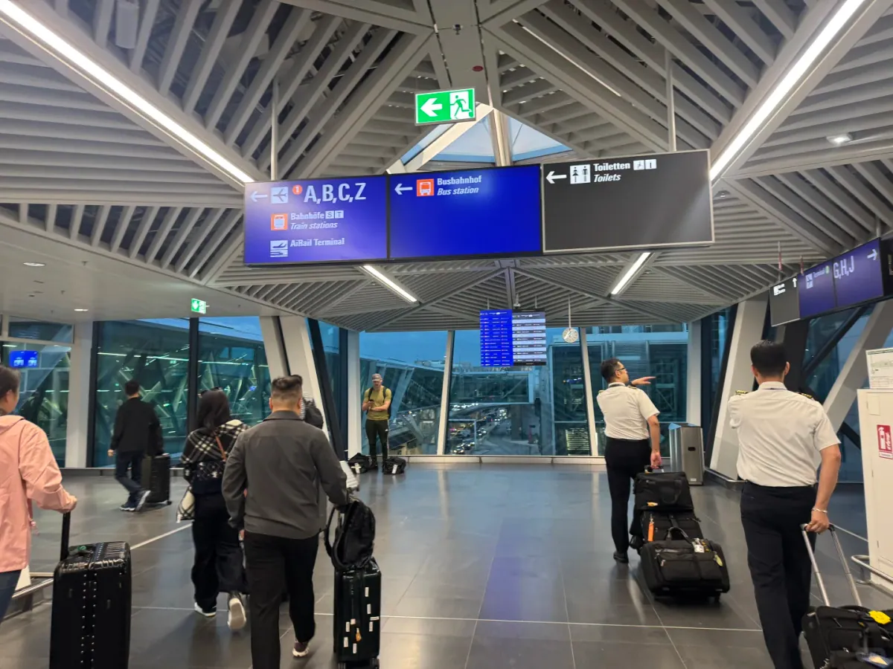
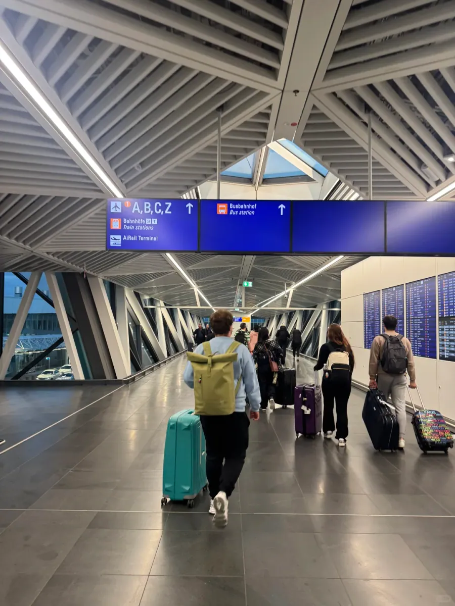
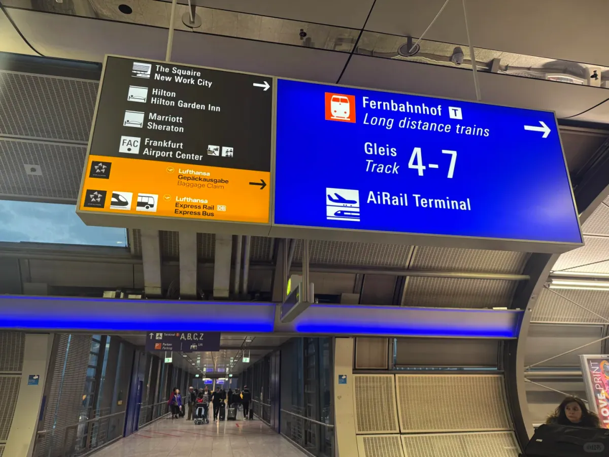
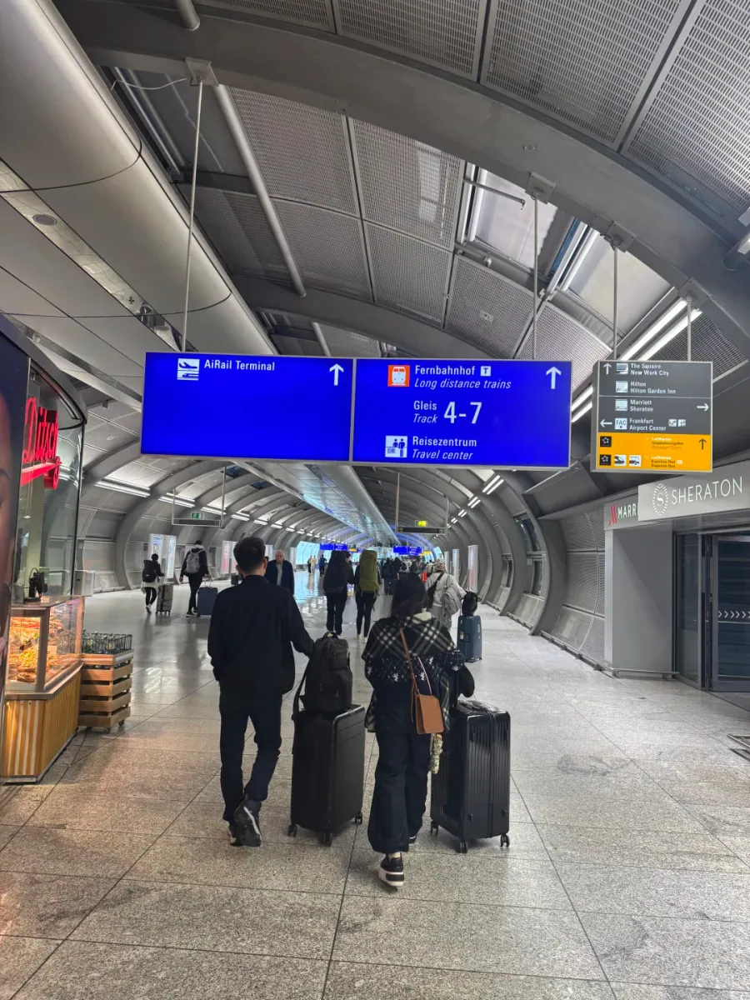
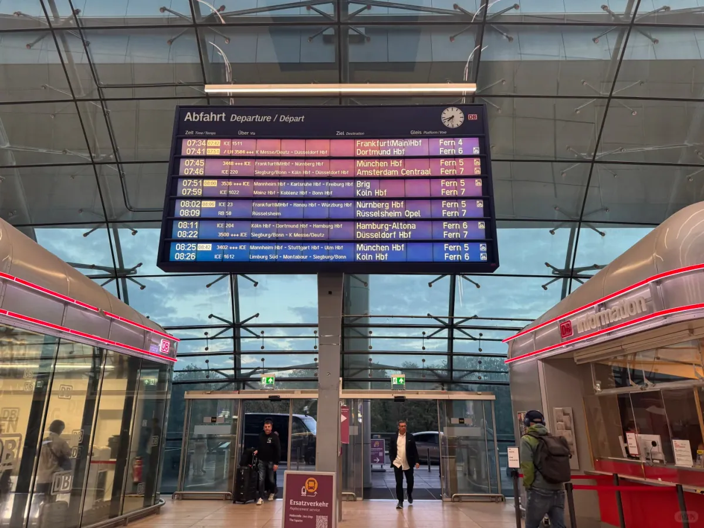
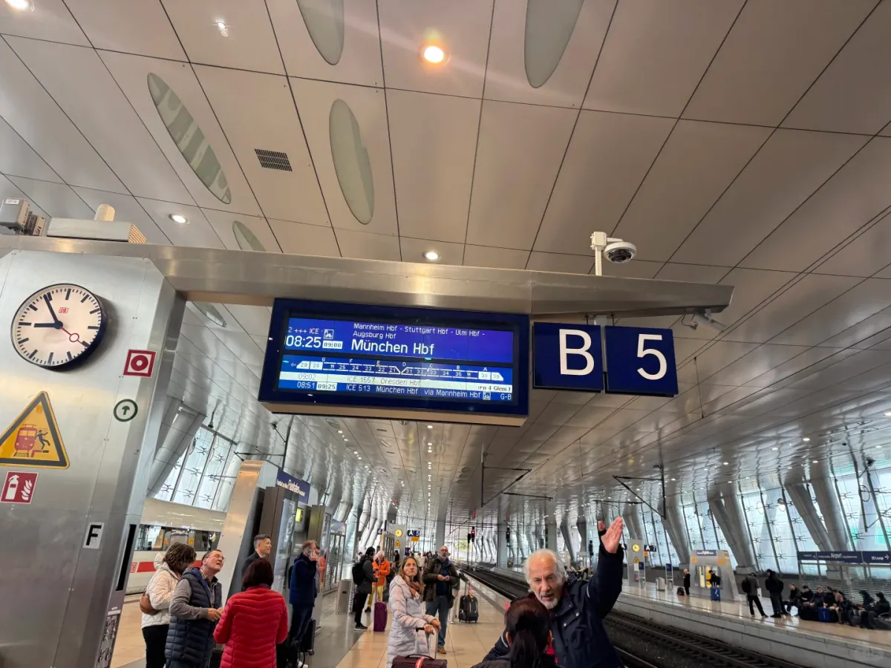
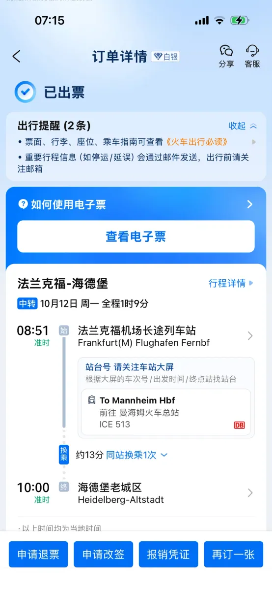

Terminal 3 ist das jüngste Gebäude des Flughafens Frankfurt. Es steht auf der Südseite des Flughafengeländes, die Start- und Landebahnen liegen zwischen ihm und den Terminals 1 und 2. Die Halle ist großzügig, die Beschilderung vollständig — und trotzdem liegen zwischen dem Aussteigen aus dem Flugzeug und dem Platz im Zug mehr Schritte, als viele erwarten: Passkontrolle, Gepäck, eine ziemlich lange Fahrt mit der Hochbahn und danach ein sehr langer Gang.

Die Ursache liegt beim Standort des Bahnhofs. Alle Fernzüge in Frankfurt — ICE wie IC — fahren vom **Fernbahnhof** auf der Seite von Terminal 1 ab. Terminal 3 hat keine eigenen Fernbahnsteige; wer dort startet, muss also zuerst nach T1 zurück und dann durch The Squaire, das lange Gebäude mit der Bahnhofshalle, bis zum Gleis.

Im Oktober 2026 hat eine Reisende den ganzen Weg mitgestoppt. Der Flug landete um **06:00** in T3. Nach Passkontrolle, Gepäck und Wegsuche stand sie etwa **07:50** in der Halle des Fernbahnhofs — **1 Stunde 40 Minuten** insgesamt, ohne Rennen, im normalen Tempo mit Koffer. Diese Anleitung zerlegt diesen Weg Schritt für Schritt und zeigt, wo sich Zeit sparen lässt und wo nicht.

## 1. T3 und die Entfernung zum Rest des Flughafens

Terminal 3 entstand, um Frankfurt Luft für Wachstum zu geben. Terminal 1 und 2 liefen jahrelang nahe an der Kapazitätsgrenze, und der einzige freie Platz lag auf der anderen Seite der Startbahn — daher steht der Neubau abseits der beiden alten Häuser. Damit das funktioniert, hat der Flughafen die SkyLine bis T3 verlängert; ein Shuttlebus zwischen den Terminals ist nicht mehr nötig. Der Preis dafür ist eine längere Fahrt: zwei Minuten von T2 nach T1, aber **acht bis zehn Minuten** von T3.

Diese Fahrt ist lang genug, um sich zu fragen, ob man die Haltestelle verpasst hat. Der Zug umrundet das Vorfeld auf seiner Hochbahn, und draußen ziehen Rollbahnen, Abstellpositionen und Reihen von Leitwerken vorbei statt etwas, das nach Terminal aussieht. Er fährt tatsächlich außen herum. Der Autor der Originalnotiz erwähnt das eigens: T3 ist neu, Schilder gibt es, aber **die Wege sind lang** — allein für die Hochbahn geht ein guter Teil der Zeit drauf.

Was leichter unterschätzt wird, ist alles vor der Fahrt. Sechs Uhr morgens ist die Zeit, in der Langstreckenankünfte zusammenkommen; an der Passkontrolle und am Gepäckband kann es also dauern, und steht das Flugzeug auf einer Außenposition, kommt noch eine Busfahrt dazu. Nichts davon steht in einer Wegbeschreibung, und doch ging der größte Teil der 1 Stunde 40 Minuten dafür drauf. Wenn Sie also lesen, dass T3 zum Bahnhof über eine Stunde braucht, liegt es nicht an der Route — die Zeit geht im Terminal drauf, nicht auf der Strecke.

Das erklärt auch, warum alle, die in T3 landen, beim Bahnticket mehr Puffer einplanen sollten. Ab T2 sind vierzig Minuten von der Landung bis zum Sitzplatz in der S-Bahn üblich. T3 bringt eine Hochbahnfahrt und einen langen Gang zusätzlich, aus demselben entspannten Zeitfenster wird also eine Stunde oder mehr. Buchen Sie den ICE frühestens zwei Stunden nach der Landung, dann geraten Sie nicht in Eile; bleibt nur eine knappe Stunde, nehmen Sie lieber einen späteren Zug, statt auf ein schnelles Gepäckband zu wetten.

## 2. Mit der SkyLine nach T1

Wenn Sie die Ankunftsebene verlassen, suchen Sie zuerst die blauen Schilder. T3 verwendet dieselbe Gestaltung wie die anderen Terminals: links ein Flugzeug-Symbol mit der **1**, dahinter **A,B,C,Z** für die vier Check-in-Bereiche von T1. Die nächste Zeile nennt **Bahnhöfe / Train stations** und **AiRail Terminal**, weiter rechts folgen Busbahnhof und Toiletten. Für die Bahn ist die Zeile mit Terminal 1 die richtige.

Der Gang ist breit, der Boden dunkler Stein, die Decke besteht aus schrägen Stahlträgern und Oberlichtern. Folgen Sie dem Strom drei bis fünf Minuten, dann erreichen Sie die Rolltreppen und den SkyLine-Bahnsteig. Die Bahn ist **kostenlos**, hat keine Sperren und braucht keine Fahrkarte, und sie fährt so dicht, dass das Warten meist kürzer ist als die Fahrt.

Im Wagen suchen Sie sich einen Platz und halten den Koffer bei sich. Die Wagen sind klein, und bei frühen Ankünften haben viele zwei oder drei große Koffer dabei, sodass der Gang voll wird; wenn Sie nicht mehr hineinpassen, ist die nächste Fahrt die einfachere Wahl. Acht bis zehn Minuten später sind Sie in Terminal 1, und das Schlüsselwort wechselt von Terminal zu **Bahnhof**.

## 3. Fernbahnhof oder Regionalbahnhof

In Terminal 1 teilt sich die Bahn in zwei Richtungen, und das ist die wichtigste Entscheidung der ganzen Route. Der Flughafenbahnhof hat zwei Hälften: den **Regionalbahnhof** direkt unter Terminal 1 mit den Gleisen 1–3 für S-Bahn und Regionalzüge und den **Fernbahnhof** auf der Nordwestseite unter The Squaire mit den Gleisen 4–7 für ICE und IC. Die Namen unterscheiden sich um ein Wort, die Richtungen sind entgegengesetzt.

Folgen Sie dem blauen Schild **Fernbahnhof / Long-distance trains**; es nennt zugleich **Gleis 4–7** und **AiRail Terminal**. Das schwarze Schild daneben listet andere Ziele auf: The Squaire, Hilton, Hilton Garden Inn, Marriott, Sheraton und Frankfurt Airport Center — alle im selben Gebäudekomplex und damit in derselben Richtung. Das gelbe Feld ist Lufthansas Gepäckermittlung; wer es sieht, ist auf dem richtigen Weg.

Danach kommt der längste Fußweg der Route: ein gerader Gang, beidseitig Glas, mit Blick auf die Fahrbahn und den Baukörper von The Squaire. Er dauert **fünf bis sieben Minuten**, am Ende liegt die Bahnhofshalle. Im Gang gibt es Fahrsteige und Aufzüge, was bei schwerem Gepäck hilft. Abzweige gibt es keine; das einzige Risiko ist die falsche Richtung — sehen Sie ein Schild „Regionalbahnhof“, laufen Sie zur S-Bahn, also kehren Sie um.

| Bahnhof | Lage | Züge | Geeignet für |
| --- | --- | --- | --- |
| Fernbahnhof | Nordwestlich von T1, unter The Squaire, 5–7 Minuten durch den Gang | ICE und IC, Gleise 4–7 | Heidelberg, München, Berlin, Köln und weiter |
| Regionalbahnhof | Direkt unter T1, Gleise 1–3 | S-Bahn S8 / S9 und Regionalzüge | Frankfurter Innenstadt, Mainz, Wiesbaden |

Falsch abgebogen ist es nicht dramatisch. Vom Regionalbahnhof fahren S-Bahnen in die Stadt, und am Hauptbahnhof steigen Sie auf einen Fernzug um — das kostet einen Umstieg und etwa eine halbe Stunde. Wirklich unangenehm ist der umgekehrte Fall: mit einem S-Bahn-Ticket am Bahnsteig des Fernbahnhofs zu stehen und auf einen Zug zu warten, der dort nie kommt.

The Squaire verdient einen eigenen Absatz. Es ist das auffälligste Gebäude des Flughafens: ein 660 Meter langer „liegender Turm“, der über der Autobahn liegt, mit Hotels, Büros und Restaurants; die Bahnhofshalle des Fernbahnhofs befindet sich im Erdgeschoss. Beim Gang durch den Korridor sehen Sie das Gebäude zuerst von der Seite und kommen dann darunter — eine größer werdende Fassade ist also ein gutes Zeichen. Im Gebäude liegt auch Lufthansas **AiRail Terminal**: Wer Lufthansa Express Rail gebucht hat, kann hier einchecken und das Gepäck aufgeben, es bis zum Ziel durchbuchen lassen und mit leeren Händen in die Stadt fahren.

## 4. DB-Tickets, Gleis und Verspätungen

Die Halle des Fernbahnhofs hat ein Glasdach, und in der Mitte hängt eine große Anzeigetafel **Abfahrt / Departure / Départ**. Die Züge stehen nach der Zeit untereinander, mit den Unterwegsbahnhöfen (Über via), dem Ziel (Ziel) und dem Gleis. Wer zum ersten Mal hier ist, sucht auf der Tafel nach seinem Zug und findet die Gleisspalte leer — bei der Deutschen Bahn ist das normal: **Das Gleis wird oft erst kurz vor der Abfahrt bekannt gegeben**, manchmal nur zehn oder fünfzehn Minuten vorher.

Gehen Sie also nach der Ankunft nicht sofort hinunter. Klären Sie in der Halle zwei Dinge: Ihre Zugnummer und wann das Gleis erscheint. Die App DB Navigator zeigt dieselben Angaben und aktualisiert oft schneller; ohne Mobilfunkdaten bleiben Sie vor der Tafel stehen oder fragen am Schalter DB Information rechts.

Deutsche Bahnhöfe haben **keine Sperren**. Die Bahnsteige sind offen, bezahlt wird auf Vertrauen, kontrolliert wird im Zug: Der Schaffner geht durch den Gang und scannt den QR-Code des E-Tickets. Achten Sie darauf, dass die Fahrkarte vor dem Einsteigen gekauft und gültig ist; Papiertickets müssen entwertet sein, das E-Ticket genügt auf dem Handy.

Über den Bahnsteigen hängen die Gleisnummern, darunter steht klein die Wagenreihung. Deutsche Fernzüge halten in Abschnitten, die mit A, B und C markiert sind; steht auf Ihrem Ticket „Wagen 31, Sektor B“, warten Sie in Abschnitt B und tragen deutlich weniger weit. In der zweiten Klasse gibt es keine festen Plätze — nehmen Sie einen freien; die erste Klasse liegt am Zuganfang oder -ende und ist an der Tür mit einer großen „1“ markiert. Große Koffer gehören in die Gepäckablagen an der Tür und nicht in den Gang zwischen die Sitze — der praktischste Hinweis aus der Originalnotiz.

Verspätungen sind in Deutschland Alltag; zehn oder zwanzig Minuten sind keine Besonderheit. Mit einer flexiblen Fahrkarte (Flexpreis) nehmen Sie einfach den nächsten Zug. Mit einer Sparpreis-Fahrkarte ist das Ticket an einen Zug gebunden und lässt sich normalerweise nicht tauschen; wenn Sie wegen einer DB-Verspätung den Anschluss verpassen, lassen die Mitarbeitenden Sie in der Regel aber in den nächsten Zug derselben Richtung. Erklären Sie in diesem Fall die Lage am Schalter DB Information, statt ein zweites Ticket zu kaufen. Die Erfahrung aus der Originalnotiz — einen verpassten Anschluss kann man ohne Neukauf im nächsten Zug nehmen — stimmt meistens, hängt aber vom Tarif und von den Regeln des Tages ab.

Der Ticketkauf ist unkompliziert. Die blauen Automaten in der Halle lassen sich auf Englisch umstellen und nehmen Karten und Münzen; DB Navigator ist der bequemste Weg und erlaubt eine Sitzplatzreservierung; wer zu Hause bucht, bekommt auch über Plattformen wie Trainline oder Omio ein E-Ticket. Fernzüge sollten Sie **im Voraus** buchen: Sparpreise sind deutlich günstiger als flexible Tickets, aber begrenzt und schnell weg. Wenn sich Ihre Pläne ändern könnten, zahlen Sie lieber den Aufpreis für Flexibilität. In der zweiten Klasse können Sie ohne Reservierung einsteigen, doch an beliebten Wochenenden füllen sich die Züge, und ein Sitzplatz kostet meist nur ein paar Euro — auf einer drei- oder vierstündigen Fahrt lohnt sich das.

## 5. Zeitplan von der Landung bis zum Zug

Aufgeschlüsselt verteilten sich die 1 Stunde 40 Minuten ungefähr so: Fast die Hälfte verging zwischen der Landung und dem Verlassen des Ankunftsbereichs, samt Passkontrolle, Gepäck und Schildersuche; Wartezeit und Fahrt mit der SkyLine machten etwa eine Viertelstunde aus; der Gang in T1 fünf bis sieben Minuten; der Rest ging für die Tafel, den Weg zum Bahnsteig und die Suche nach dem richtigen Wagen drauf.

Die Bestellseite sagt es klar: **08:51** ab Frankfurt (M) Flughafen Fernbf, ICE 513, Umstieg in Mannheim Hbf, Ankunft **10:00** in Heidelberg-Altstadt. In der Zeile für das Gleis steht nur „bitte Bahnhofstafel beachten“ — genau der Punkt von oben, dass das Gleis erst kurz vor der Abfahrt erscheint. Zwischen dem Betreten des Bahnhofs um 07:50 und der Abfahrt um 08:51 lag eine Stunde, was großzügig wirkt und in der Praxis genau für einen Kaffee, einen Toilettengang und einen ruhigen Weg nach unten reichte.

Wer früher da ist als geplant, findet in der Halle Cafés und eine Bäckerei; ein wenig sitzen ist angenehmer, als am kalten Bahnsteig zu warten. Hören Sie auf die Ansagen und schauen Sie auf die Bildschirme — der Bahnhof wird als „Frankfurt Flughafen Fernbahnhof“ angesagt, nur ein Wort vom Regionalbahnhof entfernt. An manchen Bahnsteigzugängen wird die Wagenreihung des nächsten Zuges angezeigt; ein Blick genügt, um zu wissen, zu welchem Ende Sie gehen müssen, und erspart Ihnen das Kofferziehen über die ganze Bahnsteiglänge.

Ein paar Empfehlungen für den ersten Versuch:

1. **Rechnen Sie mit 1,5–2 Stunden** von der Landung bis zur Abfahrt. Die 1 Stunde 40 Minuten ist ein normales Tempo, kein großzügiges; bei Verspätung oder langsamem Gepäck sind zwei Stunden sicherer.
2. **Verlassen Sie in T1 nicht das Gebäude.** Ab der SkyLine verläuft die ganze Route im Inneren; wer nach draußen gerät, muss den Eingang neu suchen.
3. **Halten Sie sich an den Fernbahnhof, nicht an den Regionalbahnhof.** Die Schilder stehen oft nebeneinander; das blaue mit Gleis 4–7 ist der Fernbahnhof.
4. **Speichern Sie das E-Ticket und machen Sie einen Screenshot.** Auf Bahnsteigen und im Zug ist das Netz lückenhaft, und bei der Kontrolle erst die Bestellseite zu suchen ist unangenehm.
5. **Große Koffer in die Gepäckablage an der Tür.** So bleibt der Gang frei, und das Aussteigen geht leichter.

Dieser Ablauf stammt aus der Aufzeichnung einer Reisenden vom Oktober 2026; Takt der SkyLine sowie Züge und Gleise der DB gelten nach den Angaben des Tages vor Ort und auf der Website des Betreibers. T3 ist noch neu, und die Beschilderung wird sich weiter ändern; wer unterwegs nach oben schaut, ist besser dran als jemand, der die Route auswendig gelernt hat.

## Weiterführende Links

- **Auf dieser Website**: [Flughafen Frankfurt (FRA)](/airport/FRA), [Deutschland (DE)](/country/DE)
- **Wikipedia**: [Flughafen Frankfurt](https://en.wikipedia.org/wiki/Frankfurt_Airport)
- **Baidu Baike**: [Flughafen Frankfurt](https://baike.baidu.com/item/%E6%B3%95%E5%85%B0%E5%85%8B%E7%A6%8F%E6%9C%BA%E5%9C%BA)
