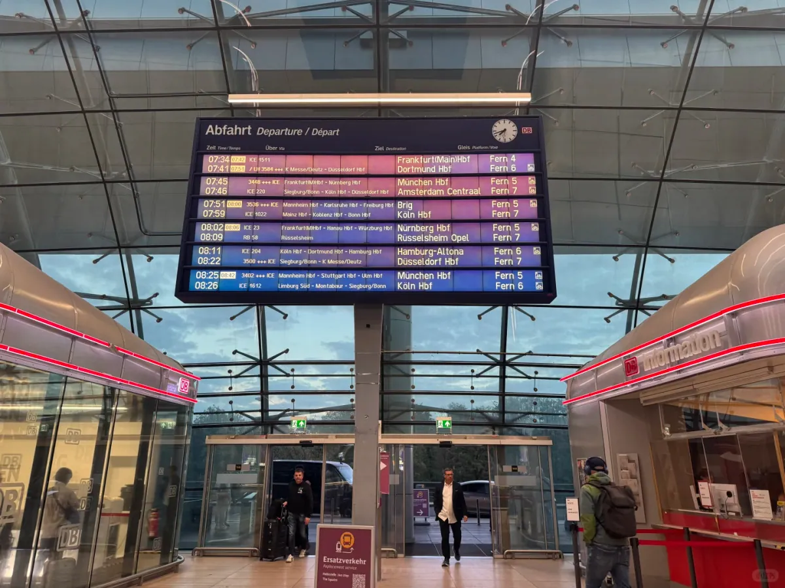

La Terminal 3 es el edificio más nuevo del aeropuerto de Fráncfort, construido en el lado sur del campo de aviación, con las pistas entre ella y las terminales 1 y 2. La sala es espaciosa y la señalización está completa, pero ir del avión a un tren implica más pasos de los que la mayoría espera: control de pasaportes, equipaje, un trayecto bastante largo en el tren automático y luego un pasillo muy largo.

La raíz del problema es dónde está la estación. Todos los trenes de largo recorrido de Fráncfort —tanto ICE como IC— salen del **Fernbahnhof**, en el lado de la Terminal 1. La Terminal 3 no tiene andenes de largo recorrido propios, así que los pasajeros que empiezan allí deben volver primero a la Terminal 1 y luego cruzar The Squaire, el largo edificio que alberga la sala de la estación, antes de llegar a un tren.

En octubre de 2026, un viajero cronometró todo el trayecto. El vuelo aterrizó en la Terminal 3 a las **06:00**. Tras el control de pasaportes, el equipaje y la orientación, la llegada a la sala del Fernbahnhof fue alrededor de las **07:50**: **1 hora y 40 minutos** en total, sin correr, solo a paso normal con una maleta. Esta guía desglosa ese viaje paso a paso y señala dónde se puede ahorrar tiempo y dónde no.

## 1. La Terminal 3 y el problema de la distancia

La Terminal 3 existe para dar a Fráncfort espacio para crecer. Las terminales 1 y 2 llevaban años funcionando cerca de su capacidad, y el único espacio que quedaba estaba al otro lado de las pistas, por eso el nuevo edificio está separado de la pareja original. Para que funcione, el aeropuerto amplió el tren automático SkyLine hasta la Terminal 3, de modo que los pasajeros ya no necesitan un autobús lanzadera entre edificios. La contrapartida es un trayecto más largo: dos minutos de la Terminal 2 a la Terminal 1, pero **de ocho a diez minutos** desde la Terminal 3.

Ese trayecto es lo bastante largo para hacerte pensar que te has pasado de parada. El tren da vueltas alrededor de la plataforma por su vía elevada, y por la ventana se ven calles de rodaje, puestos de aviones y filas de derivas en lugar de algo que parezca una terminal. Realmente está dando un rodeo. El autor de la nota original señala lo mismo: la Terminal 3 es nueva, los carteles existen, pero **las distancias son largas**, y buena parte del tiempo se va solo en el tren automático.

Lo que más fácilmente se subestima es todo lo que ocurre antes del trayecto. A las seis de la mañana es cuando se acumulan las llegadas de largo radio, así que las colas de pasaportes y las cintas de equipaje pueden ir lentas; si el avión aparca en una posición remota, primero hay un trayecto en autobús. Nada de eso aparece en la descripción de una ruta, y sin embargo supuso la mayor parte de la hora y cuarenta minutos. Así que cuando leas que de la Terminal 3 a la estación se tarda más de una hora, el problema no es la ruta: el tiempo se va en la terminal, no en la vía.

Esto también explica por qué quien aterrice en la Terminal 3 debería reservar más margen al comprar un billete de tren. Desde la Terminal 2, lo habitual es cuarenta minutos del aterrizaje a estar sentado en el S-Bahn. La Terminal 3 añade un tren automático y un pasillo largo, así que el mismo margen cómodo pasa a ser una hora o más. Compra un ICE para al menos dos horas después del aterrizaje y no irás con prisas; con solo una hora de margen, cambia a un tren posterior en lugar de apostar por una cinta de equipaje rápida.

## 2. El SkyLine hasta la Terminal 1

Al salir de llegadas, busca los carteles azules colgantes. La Terminal 3 usa el mismo lenguaje visual que las otras dos: a la izquierda, un icono de avión con un **1**, seguido de **A,B,C,Z**, que designan las cuatro salas de facturación de la Terminal 1. La línea siguiente dice **Bahnhöfe / Train stations** y **AiRail Terminal**, y más a la derecha están el Busbahnhof (estación de autobuses) y los Toiletten. Para el ferrocarril, hay que seguir la línea de Terminal 1.

El pasillo es ancho, con suelo de piedra oscura y techo de acero angulado con lucernarios. Sigue el flujo durante tres a cinco minutos y llegarás a las escaleras mecánicas y al andén del SkyLine. El transbordador es **gratuito**, no tiene tornos ni necesita billete, y el servicio es tan frecuente que la espera suele durar menos que el trayecto.

Una vez a bordo, busca un sitio y mantén la maleta cerca. Los vagones son pequeños, y las llegadas tempranas suelen traer dos o tres maletas grandes por persona, así que el pasillo se llena; si no puedes subir, el siguiente tren es la opción más fácil. Ocho o diez minutos después llegas a la Terminal 1, y la palabra clave cambia de Terminal a **Bahnhof**.

## 3. Fernbahnhof o Regionalbahnhof

Dentro de la Terminal 1, el ferrocarril se divide en dos direcciones, y esta es la decisión más importante de toda la ruta. La estación del aeropuerto tiene dos mitades: el **Regionalbahnhof**, directamente bajo la Terminal 1, con las vías 1–3 para el S-Bahn y los trenes regionales, y el **Fernbahnhof**, en el lado noroeste bajo The Squaire, con las vías 4–7 para los servicios ICE e IC. Los nombres se diferencian en una palabra y las direcciones son opuestas.

Sigue el cartel azul de **Fernbahnhof / Long-distance trains**, que también indica **Gleis 4–7** y **AiRail Terminal**. El cartel negro de al lado enumera otro conjunto de destinos —The Squaire, Hilton, Hilton Garden Inn, Marriott, Sheraton y Frankfurt Airport Center—, todos en el mismo complejo y, por tanto, en la misma dirección. El panel amarillo es el mostrador de localización de equipajes de Lufthansa; verlo significa que vas por buen camino.

Luego llega el paseo más largo de la ruta: un pasillo recto con cristal a ambos lados, que da a la calzada y al volumen de The Squaire. Dura **de cinco a siete minutos**, y la sala de la estación está al final. Hay cintas transportadoras y ascensores por el camino si las maletas pesan. No hay ramificaciones que tomar; el único riesgo real es ir en la dirección equivocada: si ves un cartel del Regionalbahnhof, te diriges al S-Bahn, así que da la vuelta.

| Estación | Dónde está | Trenes | Mejor para |
| --- | --- | --- | --- |
| Fernbahnhof | Al noroeste de la Terminal 1, bajo The Squaire, a 5–7 minutos por el pasillo | Trenes de largo recorrido ICE e IC, vías 4–7 | Heidelberg, Múnich, Berlín, Colonia y más allá |
| Regionalbahnhof | Directamente bajo la Terminal 1, vías 1–3 | S-Bahn S8/S9 y trenes regionales | Centro de Fráncfort, Maguncia, Wiesbaden |

Equivocarse no es catastrófico. El Regionalbahnhof tiene trenes de S-Bahn a la ciudad, y puedes cambiar a un tren de largo recorrido en la Hauptbahnhof, a costa de un cambio extra y quizá media hora. El error realmente incómodo es el contrario: estar en un andén del Fernbahnhof con un billete de S-Bahn, esperando un tren que nunca llegará.

The Squaire merece una mención propia. Es el edificio más reconocible del aeropuerto: una “torre tumbada” de 660 metros que salva la autopista, alberga hoteles, oficinas y restaurantes, y tiene la sala de la estación en su base. Al caminar por el pasillo primero ves el edificio de lado y luego llegas por debajo, así que una fachada que crece es buena señal. Dentro está la **AiRail Terminal** de Lufthansa: si has reservado Lufthansa Express Rail, puedes facturar y dejar las maletas aquí, etiquetarlas hasta tu destino y tomar el tren a la ciudad con las manos libres.

## 4. Billetes, andenes y retrasos

La sala del Fernbahnhof tiene techo de cristal y un gran panel **Abfahrt / Departure / Départ** colgado en el centro. Los trenes se listan por hora con las estaciones intermedias (Über vía), el destino (Ziel) y el andén (Gleis). Quien llega por primera vez suele mirar el panel buscando su andén y encontrar la columna en blanco. Eso es normal en Deutsche Bahn: **el andén a menudo solo se publica poco antes de la salida**, a veces no más de diez o quince minutos antes.

Así que no bajes corriendo al andén al llegar. En la sala, confirma dos cosas: el número de tu tren y cuándo aparece el andén. La aplicación DB Navigator muestra la misma información y a menudo se actualiza más rápido; sin datos móviles, ponte delante del panel o pregunta en el mostrador de información de DB a la derecha.

Las estaciones alemanas **no tienen tornos**. Los andenes están abiertos a cualquiera, el pago funciona por confianza y la inspección se hace en el tren: el revisor recorre el pasillo y escanea el código QR de tu billete electrónico. Asegúrate de que el billete esté comprado y sea válido antes de subir; los billetes de papel deben validarse, los electrónicos simplemente viven en tu teléfono.

Los carteles de andén cuelgan en lo alto, con una línea más pequeña debajo que indica las zonas de vagones. Los trenes de largo recorrido alemanes paran en secciones marcadas A, B y C, así que si tu billete dice “Wagen 31, Sektor B”, ponte en la zona B y tendrás mucho menos que cargar. La segunda clase no tiene asientos asignados: toma cualquiera libre; la primera clase está en la parte delantera o trasera de la unidad y se marca con un gran “1” en la puerta. Coloca las maletas grandes en los portaequipajes junto a la puerta en lugar de arrastrarlas hasta la zona de asientos, que es el consejo más útil de la nota original.

Los retrasos son rutina en Alemania; diez o veinte minutos no son nada raro. Con un billete flexible (Flexpreis) simplemente tomas el siguiente tren. Con un billete de ahorro (Sparpreis) el billete está vinculado a un servicio concreto y normalmente no se puede cambiar, pero cuando un retraso de DB te hace perder una conexión, el personal suele dejarte subir al siguiente tren en la misma dirección. Si ocurre, explica la situación en el mostrador de información de DB en lugar de comprar un segundo billete. La experiencia de la nota original —que una conexión perdida se puede tomar en el siguiente tren sin volver a pagar— suele cumplirse, aunque depende de la tarifa y de las normas del día.

Comprar un billete es sencillo. Las máquinas azules de la sala cambian al inglés y aceptan tarjetas y monedas; DB Navigator es la opción más cómoda y permite reservar asiento; si compras antes de salir de casa, plataformas como Trainline u Omio también emiten billetes electrónicos. Reserva los trenes de largo recorrido **con antelación**: las tarifas de ahorro son bastante más baratas que las flexibles, pero son limitadas y se agotan. Si tus planes pueden cambiar, paga el extra por la flexibilidad. Puedes subir a segunda clase sin reserva, pero los servicios populares de fin de semana se llenan, y una reserva de asiento suele costar solo unos euros: vale la pena en un trayecto de tres o cuatro horas.

## 5. El presupuesto de tiempo del aterrizaje a la salida

Desglosando el viaje registrado, la hora y cuarenta minutos transcurrió más o menos así: casi la mitad se fue entre el aterrizaje y la salida de la zona de llegadas, incluidos el control de pasaportes, el equipaje y la búsqueda de los carteles; la espera y el trayecto del SkyLine ocuparon unos quince minutos; el pasillo de la Terminal 1, de cinco a siete minutos; el resto se fue en leer el panel, bajar al andén y encontrar el vagón correcto.

La página del pedido lo dice claramente: **08:51** desde Frankfurt (M) Flughafen Fernbf, ICE 513, cambio en Mannheim Hauptbahnhof, llegada a Heidelberg-Altstadt a las **10:00**. El campo del andén solo dice “consulte el panel de la estación”: exactamente el punto anterior, que el andén se publica cerca de la salida. Desde la entrada en la estación a las 07:50 hasta la salida a las 08:51 había una hora, que parece generosa y en la práctica fue justo lo necesario para un café, una parada en el baño y un paseo sin prisa hacia abajo.

Si llegas antes de lo previsto, la sala tiene cafeterías y una panadería, y sentarse un rato es mejor que esperar en un andén frío. Escucha los anuncios y mira las pantallas: la estación se anuncia como “Frankfurt Flughafen Fernbahnhof”, a una palabra del Regionalbahnhof. Algunas entradas de andén muestran el orden de los vagones del siguiente tren, así que un vistazo te dice hacia qué extremo del andén caminar y te ahorra arrastrar la maleta a lo largo de todo el tren.

Algunas sugerencias para un primer intento:

1. **Calcula 1,5–2 horas** desde el aterrizaje hasta la salida. La hora y cuarenta minutos es un ritmo normal, no generoso; con un vuelo retrasado o equipaje lento, dos horas son más seguras.
2. **No salgas del edificio en la Terminal 1.** Desde el SkyLine en adelante, toda la ruta es interior; si sales, tendrás que encontrar la forma de volver a entrar.
3. **Sigue Fernbahnhof, no Regionalbahnhof.** Los carteles suelen aparecer uno al lado del otro; el azul que indica Gleis 4–7 es la estación de largo recorrido.
4. **Mantén el billete electrónico guardado y con captura de pantalla.** La señal móvil es irregular en los andenes y en los vagones, y rebuscar la página del pedido en una inspección es desagradable.
5. **Usa los portaequipajes junto a la puerta.** Mantienen el pasillo despejado y facilitan mucho la bajada.

Este recorrido procede del relato de un viajero en octubre de 2026; las frecuencias del SkyLine y los trenes y andenes de DB dependen de la información del día en el sitio y en la web del operador. La Terminal 3 aún es nueva y su señalización seguirá cambiando, así que mirar los carteles sobre la marcha es más fiable que memorizar la ruta.

## Enlaces relacionados

- **En este sitio**: [Aeropuerto de Fráncfort (FRA)](/airport/FRA), [Alemania (DE)](/country/DE)
- **Wikipedia**: [Frankfurt Airport](https://en.wikipedia.org/wiki/Frankfurt_Airport)
- **Baidu Baike**: [Frankfurt Airport](https://baike.baidu.com/item/%E6%B3%95%E5%85%B0%E5%85%8B%E7%A6%8F%E6%9C%BA%E5%9C%BA)
