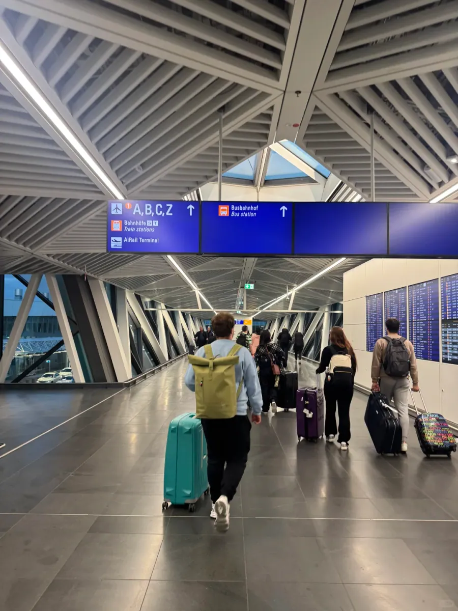

Terminalul 3 este cea mai nouă clădire a Aeroportului Frankfurt, construită pe partea sudică a terenului aeroportuar, cu pistele între ea și Terminalele 1 și 2. Sala este spațioasă, iar semnalizarea este completă, însă drumul de la avion până la tren presupune mai mulți pași decât se așteaptă majoritatea oamenilor: controlul pașapoartelor, bagajele, o plimbare destul de lungă cu trenulețul SkyLine și apoi un coridor foarte lung.

Rădăcina problemei este unde se află gara. Toate trenurile de lungă distanță din Frankfurt — atât ICE, cât și IC — pleacă din **Fernbahnhof**, de partea Terminalului 1. Terminalul 3 nu are peroane proprii pentru lungă distanță, așa că pasagerii care pornesc de acolo trebuie mai întâi să revină la Terminalul 1 și apoi să traverseze The Squaire, clădirea lungă care adăpostește hala gării, înainte de a ajunge la un tren.

În octombrie 2026, un călător a cronometrat întregul parcurs. Avionul a aterizat la Terminalul 3 la **06:00**. După controlul pașapoartelor, bagaje și orientare, sosirea în hala Fernbahnhof a fost în jurul orei **07:50** — **1 oră și 40 de minute** în total, fără alergat, doar cu un ritm normal de mers, cu un troler după sine. Acest ghid descompune acel drum pas cu pas și arată unde se poate câștiga timp și unde nu.

## 1. Terminalul 3 și problema distanței

Terminalul 3 există pentru a-i da Frankfurtului spațiu de creștere. Terminalele 1 și 2 funcționau de ani de zile aproape de capacitatea maximă, iar singurul spațiu rămas era de cealaltă parte a pistelor, motiv pentru care noua clădire stă separat de cele două originale. Pentru ca acest lucru să funcționeze, aeroportul a prelungit trenulețul SkyLine până la Terminalul 3, astfel încât pasagerii să nu mai aibă nevoie de un autobuz navetă între clădiri. Compromisul este o călătorie mai lungă: două minute de la Terminalul 2 la Terminalul 1, dar **opt până la zece minute** de la Terminalul 3.

Călătoria este suficient de lungă încât să te întrebi dacă nu cumva ai ratat stația. Trenul ocolește platforma aeroportuară pe șina sa suspendată, iar pe fereastră se văd căi de rulare, standuri de aeronave și șiruri de derive, nu ceva care să semene a terminal. Chiar merge pe ocolite. Autorul notiței originale spune același lucru: Terminalul 3 este nou, indicatoarele există, dar **distanțele sunt lungi**, iar o bună parte din timp se duce doar pe trenuleț.

Ceea ce se subestimează mai ușor este tot ce se întâmplă înainte de călătorie. La ora șase dimineața se adună sosirile de lung curier, așa că atât cozile la pașapoarte, cât și benzile de bagaje pot fi lente; dacă aeronava parchează pe un stand îndepărtat, urmează mai întâi o plimbare cu autobuzul. Nimic din toate acestea nu apare într-o descriere de traseu, și totuși au ocupat cea mai mare parte din cele 1 oră și 40 de minute. Așa că, atunci când citești că de la Terminalul 3 la gară durează peste o oră, traseul nu este problema — timpul se duce în terminal, nu pe șine.

Aceasta explică și de ce oricine aterizează la Terminalul 3 ar trebui să-și lase mai multă marjă atunci când rezervă un tren. De la Terminalul 2, patruzeci de minute de la aterizare până la a sta în S-Bahn sunt obișnuite. Terminalul 3 adaugă un trenuleț și un coridor lung, așa că aceeași marjă confortabilă devine o oră sau mai mult. Rezervă un ICE la cel puțin două ore după aterizare și nu vei fi presat de timp; cu doar o oră la dispoziție, schimbă biletul pentru un tren mai târziu în loc să pariezi pe o bandă de bagaje rapidă.

## 2. SkyLine până la Terminalul 1

La ieșirea din zona de sosiri, caută indicatoarele albastre suspendate. Terminalul 3 folosește același limbaj vizual ca celelalte două: în stânga, o pictogramă cu un avion și un **1**, urmată de **A,B,C,Z**, adică cele patru hale de check-in ale Terminalului 1. Rândul următor scrie **Bahnhöfe / gări** și **AiRail Terminal**, iar mai la dreapta apar Busbahnhof (autogara) și Toiletten (toalete). Pentru tren, rândul Terminalului 1 este cel de urmat.

Coridorul este larg, cu pardoseală din piatră închisă la culoare și acoperiș din oțel înclinat și luminatoare. Urmează fluxul timp de trei până la cinci minute și ajungi la scările rulante și la peronul SkyLine. Naveta este **gratuită**, nu are porți și nu necesită bilet, iar frecvența este suficient de mare încât așteptarea să dureze de obicei mai puțin decât călătoria.

Odată urcat, găsește-ți un loc și ține-ți valiza aproape. Vagoanele sunt mici, iar sosirile de dimineață aduc adesea câte două-trei valize mari de persoană, așa că culoarul se umple; dacă nu reușești să urci, trenul următor este opțiunea mai simplă. Opt până la zece minute mai târziu ajungi la Terminalul 1, iar cuvântul-cheie se schimbă din Terminal în **Bahnhof**.

## 3. Fernbahnhof sau Regionalbahnhof

În interiorul Terminalului 1, calea ferată se desparte în două direcții, iar aceasta este cea mai importantă decizie de pe întregul traseu. Gara aeroportului are două jumătăți: **Regionalbahnhof**, direct sub Terminalul 1, cu liniile 1–3 pentru S-Bahn și trenurile regionale, și **Fernbahnhof**, pe partea de nord-vest, sub The Squaire, cu liniile 4–7 pentru serviciile ICE și IC. Numele diferă printr-un singur cuvânt, iar direcțiile sunt opuse.

Urmează indicatorul albastru **Fernbahnhof / trenuri de lungă distanță**, care mai poartă și **Gleis 4–7** și **AiRail Terminal**. Indicatorul negru de lângă el listează alte destinații — The Squaire, Hilton, Hilton Garden Inn, Marriott, Sheraton și Frankfurt Airport Center — toate în același complex și, prin urmare, în aceeași direcție. Panoul galben este biroul de urmărire a bagajelor al Lufthansa; dacă îl vezi, ești pe drumul cel bun.

Urmează cea mai lungă plimbare de pe traseu: un coridor drept, cu sticlă pe ambele părți, care privește spre șoseaua de acces și spre masa impunătoare a clădirii The Squaire. Durează **cinci până la șapte minute**, iar hala gării se află la capătul din depărtare. Pe drum există benzi rulante și lifturi, dacă bagajele sunt grele. Nu sunt ramificații de luat; singurul risc real este să o iei în direcția greșită — dacă vezi un indicator pentru Regionalbahnhof, te îndrepți spre S-Bahn, așa că întoarce-te.

| Gară | Unde se află | Trenuri | Cel mai potrivit pentru |
| --- | --- | --- | --- |
| Fernbahnhof | Nord-vestul Terminalului 1, sub The Squaire, 5–7 minute de-a lungul coridorului | Trenuri de lungă distanță ICE și IC, liniile 4–7 | Heidelberg, München, Berlin, Köln și mai departe |
| Regionalbahnhof | Direct sub Terminalul 1, liniile 1–3 | S-Bahn S8/S9 și trenuri regionale | Centrul orașului Frankfurt, Mainz, Wiesbaden |

Să greșești nu este catastrofal. Regionalbahnhof are trenuri S-Bahn spre oraș, iar la Hauptbahnhof poți schimba pe un tren de lungă distanță, cu prețul unei schimbări în plus și poate al unei jumătăți de oră. Greșeala cu adevărat neplăcută este invers: să stai pe un peron Fernbahnhof cu bilet de S-Bahn, așteptând un tren care nu va veni niciodată.

The Squaire merită o mențiune aparte. Este clădirea cea mai ușor de recunoscut a aeroportului: un „turn culcat” de 660 de metri, care se întinde peste autostradă, adăpostind hoteluri, birouri și restaurante, cu hala gării la baza lui. Mergând pe coridor, vezi mai întâi clădirea din lateral și apoi ajungi dedesubtul ei, așa că o fațadă care crește este un semn bun. În interior se află **AiRail Terminal** al Lufthansa: dacă ai rezervare pe Lufthansa Express Rail, poți face check-in și preda bagajele aici, le poți eticheta direct până la destinație și poți lua trenul spre oraș cu mâinile goale.

## 4. Bilete, peroane și întârzieri

Hala Fernbahnhof are un acoperiș de sticlă și un panou mare **Abfahrt / Plecări / Départ** atârnat la mijloc. Trenurile sunt listate după oră, împreună cu stațiile intermediare (Über via), destinația (Ziel) și peronul (Gleis). Cei aflați la prima vizită se holbează adesea la panou căutându-și peronul și găsesc coloana goală. Este normal la Deutsche Bahn: **peronul este adesea afișat doar cu puțin timp înainte de plecare**, uneori cu cel mult zece sau cincisprezece minute înainte.

Așa că nu te grăbi spre peron imediat ce ai sosit. În hală, verifică două lucruri: numărul trenului și când apare peronul. Aplicația DB Navigator afișează aceleași informații și se actualizează adesea mai repede; fără date mobile, stai în fața panoului sau întreabă la biroul DB Information din dreapta.

Gările germane **nu au porți de control al biletelor**. Peroanele sunt deschise oricui, plata se bazează pe încredere, iar controlul se face în tren: conductorul parcurge culoarul și scanează codul QR de pe biletul electronic. Asigură-te că biletul este cumpărat și valabil înainte de urcare; biletele de hârtie trebuie compostate, iar cele electronice există pur și simplu pe telefon.

Indicatoarele de peron atârnă deasupra, cu un rând mai mic dedesubt care arată zonele vagoanelor. Trenurile germane de lungă distanță opresc în secțiuni marcate A, B și C, așa că, dacă biletul tău scrie „Wagen 31, Sektor B”, stai în zona B și vei avea mult mai puțin de cărat. La clasa a doua nu există locuri atribuite — ia orice loc liber; clasa întâi este în fața sau în spatele garniturii și este marcată cu un „1” mare pe ușă. Pune valizele mari în rafturile de lângă ușă, în loc să le târăști printre scaune, ceea ce este cel mai util sfat din notița originală.

Întârzierile sunt ceva obișnuit în Germania; zece sau douăzeci de minute nu reprezintă nimic deosebit. Cu un bilet flexibil (Flexpreis) iei pur și simplu trenul următor. Cu un bilet economic (Sparpreis), biletul este legat de un anumit tren și, în mod normal, nu poate fi schimbat, însă când o întârziere DB te face să pierzi o legătură, personalul te lasă de obicei să urci în trenul următor din aceeași direcție. Dacă se întâmplă asta, explică situația la biroul DB Information în loc să cumperi un al doilea bilet. Experiența din notița originală — că o legătură pierdută poate fi recuperată cu trenul următor, fără a cumpăra alt bilet — este în general valabilă, deși depinde de tarif și de regulile zilei.

Cumpărarea unui bilet este simplă. Aparatele albastre din hală trec pe limba engleză și acceptă carduri și monede; DB Navigator este cea mai comodă opțiune și îți permite să rezervi un loc; dacă cumperi înainte de a pleca de acasă, platforme precum Trainline sau Omio emit și ele bilete electronice. Rezervă trenurile de lungă distanță **din timp**: tarifele economice sunt considerabil mai ieftine decât cele flexibile, dar sunt limitate și se epuizează. Dacă planurile tale s-ar putea schimba, plătește în plus pentru flexibilitate. Poți urca la clasa a doua fără rezervare, dar cursele populare de la sfârșit de săptămână se umplu, iar rezervarea unui loc costă de obicei doar câțiva euro — merită pe un drum de trei sau patru ore.

## 5. Bugetul de timp de la aterizare până la plecare

Defalcând călătoria înregistrată, cele 1 oră și 40 de minute s-au împărțit cam așa: aproape jumătate s-a dus între aterizare și ieșirea din zona de sosiri, incluzând controlul pașapoartelor, bagajele și găsirea indicatoarelor; așteptarea și călătoria cu SkyLine au luat aproximativ un sfert de oră; coridorul din Terminalul 1, cinci până la șapte minute; restul s-a dus pe cititul panoului, mersul până la peron și găsirea vagonului potrivit.

Pagina comenzii o spune clar: **08:51** din Frankfurt (M) Flughafen Fernbf, ICE 513, schimbare la Mannheim Hauptbahnhof, sosire la Heidelberg-Altstadt la **10:00**. Câmpul pentru peron scrie doar „urmărește panoul gării” — exact ideea de mai sus, că peronul este afișat aproape de plecare. De la intrarea în gară la 07:50 până la plecarea la 08:51 a fost o oră, ceea ce pare generos și, în practică, a fost exact cât trebuie pentru o cafea, o oprire la toaletă și o coborâre fără grabă.

Dacă ajungi mai devreme decât ai planificat, hala are cafenele și o brutărie, iar o ședere pe scaun este mai plăcută decât așteptarea pe un peron rece. Ascultă anunțurile și urmărește ecranele: gara este anunțată drept „Frankfurt Flughafen Fernbahnhof”, la un singur cuvânt distanță de Regionalbahnhof. Unele intrări de peron arată ordinea vagoanelor pentru trenul următor, așa că o privire îți spune spre ce capăt al peronului să mergi și te scutește de a târî valiza pe toată lungimea trenului.

Câteva sugestii pentru o primă încercare:

1. **Rezervă 1,5–2 ore** de la aterizare până la plecare. Cele 1 oră și 40 de minute reprezintă un ritm normal, nu unul generos; cu un zbor întârziat sau bagaje lente, două ore sunt mai sigure.
2. **Nu ieși din clădire la Terminalul 1.** De la SkyLine încolo, tot traseul este la interior; dacă ieși afară, trebuie să găsești din nou drumul înăuntru.
3. **Urmează Fernbahnhof, nu Regionalbahnhof.** Indicatoarele apar adesea unul lângă altul; cel albastru cu Gleis 4–7 este gara de lungă distanță.
4. **Păstrează biletul electronic salvat și cu o captură de ecran.** Semnalul mobil este instabil pe peroane și în vagoane, iar căutarea haotică a paginii comenzii la control este neplăcută.
5. **Folosește rafturile de bagaje de lângă ușă.** Mențin culoarul liber și fac coborârea mult mai ușoară.

Această descriere provine din relatarea unui călător din octombrie 2026; frecvențele SkyLine, trenurile și peroanele DB depind de informațiile zilei, la fața locului și pe site-ul operatorului. Terminalul 3 este încă nou, iar semnalizarea lui va continua să se schimbe, așa că să ridici privirea spre indicatoare pe parcurs este mai sigur decât să memorezi traseul.

## Linkuri utile

- **Pe acest site**: [Aeroportul Frankfurt (FRA)](/airport/FRA), [Germania (DE)](/country/DE)
- **Wikipedia**: [Aeroportul Frankfurt](https://en.wikipedia.org/wiki/Frankfurt_Airport)
- **Baidu Baike**: [Aeroportul Frankfurt](https://baike.baidu.com/item/%E6%B3%95%E5%85%B0%E5%85%8B%E7%A6%8F%E6%9C%BA%E5%9C%BA)
